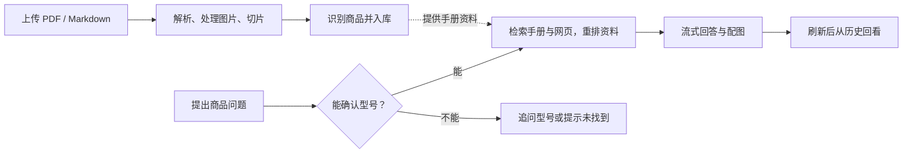
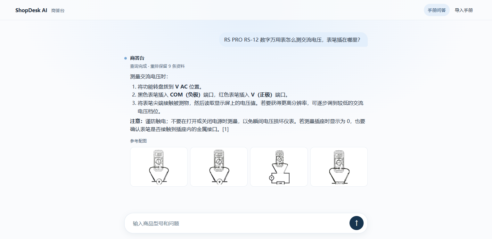
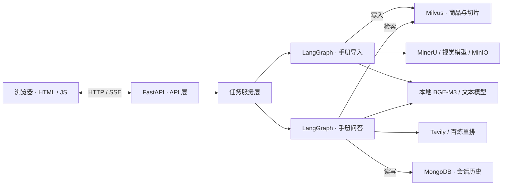

# ShopDesk AI（商答台）

面向电商客服的商品手册问答助手。上传 PDF 或 Markdown 手册后，可以按商品型号查询操作步骤、规格和配件，实时看到回答与参考配图。

## 业务流程



### 体验一次商品问答

> RS PRO RS-12 数字万用表怎么测交流电压，表笔插在哪里？

<details>
<summary>查看真实问答截图</summary>



</details>

## 系统架构



问答先用普通向量检索和 HyDE 召回手册片段，再用 RRF 融合。手册片段与 Tavily 网页摘要一起重排后交给文本模型。会话写入 MongoDB，导入任务与 SSE 队列保存在单进程内存中。

## 本地启动

1. **拉取和安装。** 需要 Git、uv 和该 GitHub 仓库的访问权限；下列 SSH 地址需要已配置 GitHub SSH 密钥。

   ```powershell
   git clone git@github.com:kdsirius/shopdesk-ai-.git shopdesk-ai
   cd shopdesk-ai
   uv sync --locked --python 3.12
   Copy-Item .env.example .env
   ```

2. **配置依赖。** 按 [.env.example](.env.example) 填写本地配置。问答需要 Milvus、MongoDB、文本模型，以及 `BGE_M3_PATH` 指向已下载的 [BGE-M3 模型](docs/study/day07-向量化与稀疏向量.md#2-下载模型再建立配置模块)。导入 PDF 额外需要 MinerU，处理图片需要视觉模型和 MinIO；Tavily 和百炼分别用于联网搜索和重排。
3. **启动并体验。** 执行 `uv run uvicorn app.main:app`，打开 <http://127.0.0.1:8000/>。首次试跑在实验集合和历史库中上传一份手册，等状态变为 `completed`，再到「手册问答」输入商品全名和问题。若已有手册数据，可直接查询。

[源码地图](docs/memory/project-overview.md#代码地图) · [导入与查询教程](docs/study/day15-API前端与流式交互.md) · [真实验收记录](docs/memory/2026-11-20-验收补测.md)
