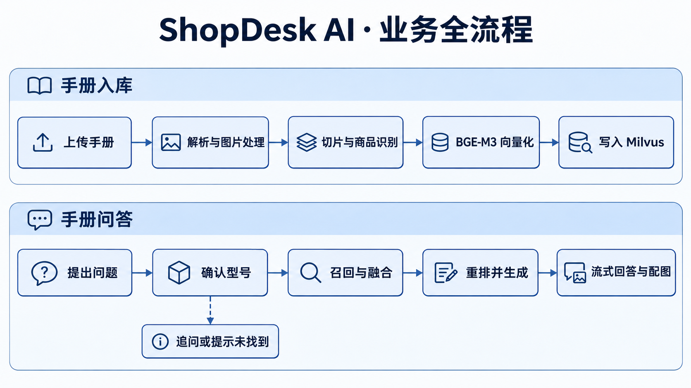
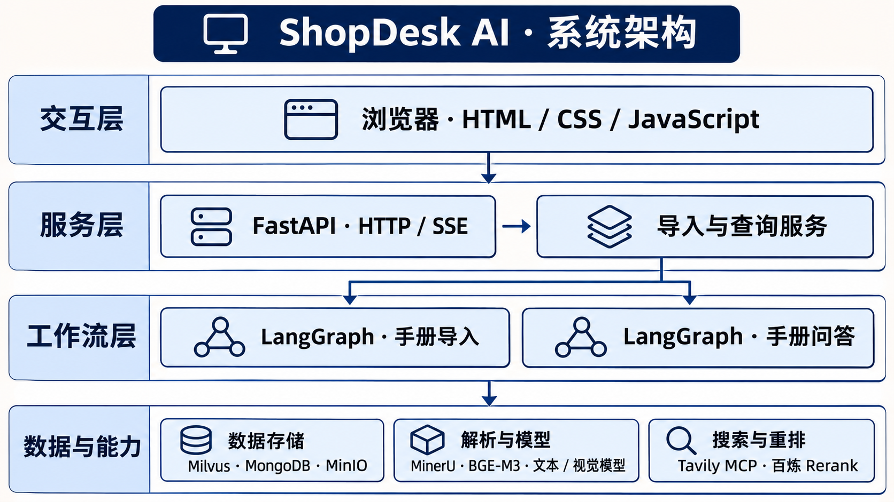
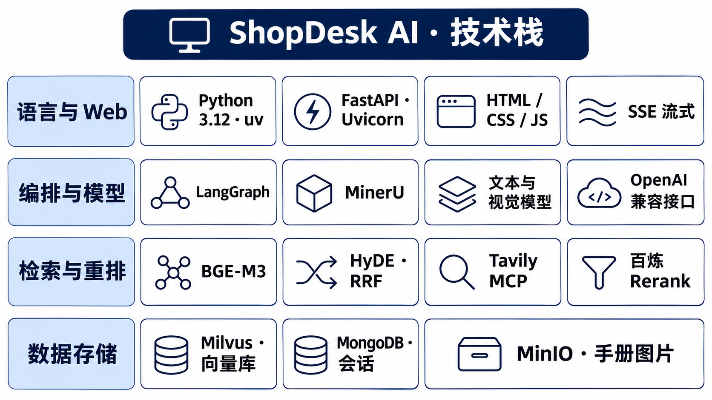
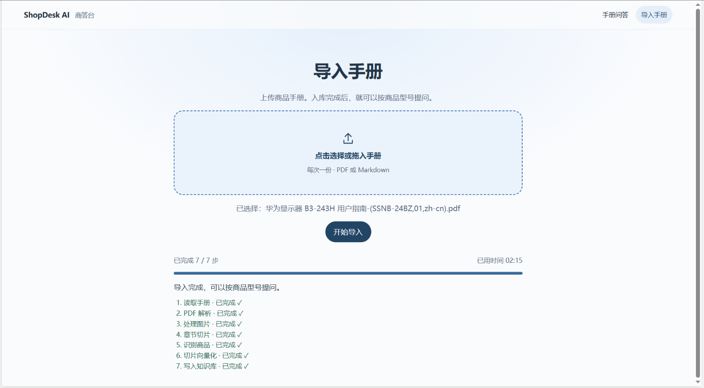

# ShopDesk AI（商答台）

## 项目介绍

ShopDesk AI 是面向电商客服的商品手册问答工具。把 PDF 或 Markdown 手册导入知识库后，可按商品型号询问操作步骤、规格和配件。系统从手册与网页资料中检索依据，流式返回回答及参考配图。

## 业务全流程



- **手册入库**：点击或拖入文件，确认后开始导入。PDF 先经 MinerU 转为 Markdown，再处理图片、按章节切片、识别商品并向量化。商品名称和正文切片分别写入 Milvus，页面按已完成节点更新进度。
- **手册问答**：先确认型号，无法确认时追问或提示未找到。确认后，普通向量检索与 HyDE 在商品范围内召回手册片段，用 RRF 融合，再与 Tavily 网页摘要一起重排。文本模型基于筛选后的资料生成回答，页面通过 SSE 接收正文，刷新后可回看历史和配图。

## 系统架构



浏览器通过 FastAPI 上传手册、轮询导入任务、订阅查询 SSE。业务调用按 `API → 服务 → 工作流` 分层。导入任务状态和 SSE 队列保存在单进程内存中，会话历史持久化到 MongoDB。[查看源码地图](docs/memory/project-overview.md#代码地图)

## 项目技术栈



## 项目演示

### 手册导入

上传华为 B3-243H 显示器用户指南。界面展示文件名、已用时间、节点状态和 `7 / 7` 完成进度。



### 体验一次商品问答

> RS PRO RS-12 数字万用表怎么测交流电压，表笔插在哪里？


## 本地启动指南

1. **拉取并安装。** 需要 Git、uv、仓库访问权限和已配置的 GitHub SSH 密钥。以下以 PowerShell 为例：

   ```powershell
   git clone git@github.com:kdsirius/shopdesk-ai.git shopdesk-ai
   cd shopdesk-ai
   uv sync --locked --python 3.12
   Copy-Item .env.example .env
   ```

2. **配置服务。** 按 [.env.example](.env.example) 填写本地 `.env`：问答需要 `MILVUS_*`、`MONGO_*`、`LLM_*`，并让 `BGE_M3_PATH` 指向已下载的 [BGE-M3](docs/study/day07-向量化与稀疏向量.md#2-下载模型再建立配置模块)。PDF 导入配置 `MINERU_*`，图文处理配置 `VL_*` 和 `MINIO_*`；如需联网搜索与重排，配置 `TAVILY_*`、`RERANK_*`。密钥只保存在本地。
3. **启动并验证。** 运行 `uv run uvicorn app.main:app`，打开 <http://127.0.0.1:8000/>。点「检查服务」应显示「Web 服务可访问」。若知识库为空，请用实验集合和对象桶导入 [RS-12 样例手册](docs/doc/万用表RS-12的使用.pdf)，等待完成后从「手册问答」试问；已有样例数据则可跳过导入。
