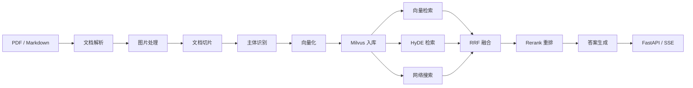

# 项目记忆：掌柜智库带练重建

## 已确认事实

- 新项目仓库名：`shopkeeper-brain`
- Python 包名：`shopkeeper_brain`
- 配置前缀：`SHOPKEEPER_BRAIN_`
- 参考项目：`reference/掌教智库/`
- 视频资料：`reference/掌教智库/4.视频/day01` 至 `day16`
- 包管理工具：`uv`
- 学习方式：教程先于手敲；用户手敲代码；上一节验收通过后才开始下一节
- 原项目优先：完成原项目已有能力前不主动扩展；发现缺陷时记录后再讨论修正
- 实验区：`workspace/`，已由根目录 `.gitignore` 忽略
- 参考资料优先级：先看 `4.视频/dayXX/` 的视频目录图片确定当天范围，再看当天课堂笔记和代码；`1.笔记/` 作为补充资料，不覆盖对应视频日的内容事实

## 接手入口

- 章节状态、提交基线和下一节门槛只读取 [学习进度](learning-progress.md)，不在本文件另维护进度副本。
- 教学方式以 [文档区规则](../AGENTS.md)、[教学偏好](teaching-preferences.md) 和用户最新确认的 [第 6 节教程](../study/day06-主体识别.md) 为准；第 3 节作为补充样例。本项目不使用子 agent。
- 工程使用说明见根 [README](../../README.md)；最近一节的详细证据见 [第 7 节验收记录](day07-acceptance.md)，资料错位与工具职责见 [第 7 节备课记录](day07-preparation.md)。更早验收文件记录当时事实，不把其中“下一节”或环境限制直接当作当前状态。
- 参考资料物理目录存在错位：`4.视频/day06/`仍是文档切片，主体识别和向量基础资料分布在 day07/day08。后续先读视频目录图片再定真实主题，不能仅按目录编号推断内容。
- 当前通过实现文件的学习期 `__main__` 验证各节点，`main_graph.py` 只有入口后的路由函数，正式主图尚未串齐；包的 CLI 仍是脚手架问候。不能把节点验收当成完整导入图或 Web 服务已就绪。
- 第 5 节原 `chunks.json` 没有主体字段；第 6 节只在内存回填。第 7 节用户新产物 `workspace/day07-real-run/state_vector.json` 已有 `item_name`、两个名称向量字段及 21 个带双向量的 Chunk，后续从这份新状态接续，不重新执行前七节。
- 备份中的 Sparse 特征键是字符串，恢复输入时要转回整数；两个名称向量字段与每个 Chunk 的向量都适用。Dense 为 1024 维、范数接近 1，Sparse 保留模型原权重；名称内部空格保留。
- 第 7 节实际环境是 CPython 3.11.15、CPU/FP32，本地模型在 `workspace/models/bge-m3/`。环境与依赖版本以锁文件及相应验收记录为准，不把第 4 节的历史 uv 故障当作当前持续故障。
- 真实远程模型证据与本地 SDK 检查分别记录；文本提取仍使用 `response.text.strip()`。CPU 线程数可造成极小的浮点差异，不能要求跨进程固定小数位完全一致，CSR 行映射仍须准确对应。

## 业务全景

“掌柜智库”是一个面向产品手册、维修指南和技术文档的 RAG 知识库问答系统。它把 PDF/Markdown 文档加工成可检索知识，再通过多路召回、融合、重排和大语言模型生成答案，并用 FastAPI/SSE 提供交互服务。

图中展示参考项目的目标业务链路；当前已经落地的节点、验证范围和后续顺序以唯一进度源为准，不能根据整张图推断所有服务已实现。

## 当前技术与参考目标

当前工程依赖和版本约束以 [pyproject.toml](../../pyproject.toml)、[uv.lock](../../uv.lock) 为准：Python、uv、LangGraph、LangChain OpenAI 客户端、文本切分、Requests、MinIO，以及 Torch、FlagEmbedding、Transformers、PyMilvus 模型工具和 ModelScope。MinerU、视觉摘要、MinIO、文本主体识别和本地 BGE-M3 的实际通过范围见对应验收记录。

文本与视觉模型通过 OpenAI 兼容客户端连接，具体服务地址和模型名由本地配置决定；参考笔记中的 DashScope/Qwen 不是本工程唯一固定服务商。BGE-M3 当前按本地模型目录运行。

FastAPI/Uvicorn、Milvus 持久化、MongoDB、检索、Rerank、前端、SSE 和 MCP 属于参考项目后续目标，需要对应章节落地与验证。参考资料中的其他嵌入模型也不代表当前工程已接入；不能把这份目标清单当成已安装依赖或已验证能力。

## 代码地图

当前学习代码根目录是 [src/shopkeeper_brain/](../../src/shopkeeper_brain/)，不是参考笔记中的 `app/`：

| 位置 | 当前职责 |
| --- | --- |
| [core/](../../src/shopkeeper_brain/core/) | MinerU、图片/MinIO、文本模型、本地 Embedding 配置 |
| [processor/import_process/](../../src/shopkeeper_brain/processor/import_process/) | BaseNode、异常、状态和入口路由函数 |
| [nodes/](../../src/shopkeeper_brain/processor/import_process/nodes/) | 入口、PDF 转换、Markdown 图片处理、切片、主体识别与 BGE 向量化节点 |
| [utils/](../../src/shopkeeper_brain/utils/) | BGE-M3 模型复用、Dense 转列表和 CSR 按行转字典 |

参考项目的 `api → services → processor` 分层及共享 `schema/core/utils` 是后续对照依据；当前并没有据此创建所有 API、服务、查询流程或前端目录。新增模块的路径和职责仍以实际源码及已确认教程为准。

## 重要边界

- `reference/` 只读，不修改、不格式化、不覆盖解压、不运行其中未知压缩包代码。
- 临时脚本、复制工程和测试输出统一放 `workspace/`。
- Git 只读；提交、推送由用户执行。
