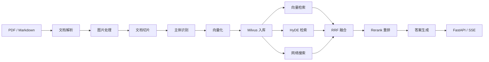

# 项目记忆：掌柜智库带练重建

## 已确认事实

- 新项目仓库名：`shopkeeper-brain`
- Python 包名：`shopkeeper_brain`
- 配置前缀：`SHOPKEEPER_BRAIN_`
- 参考项目：`reference/掌教智库/`
- 视频资料：`reference/掌教智库/4.视频/day01` 至 `day16`
- 包管理工具：`uv`
- 学习方式：教程先于手敲；用户手敲代码；上一节验收通过后才开始下一节
- 原项目优先：完成原项目已有能力前不主动扩展；发现缺陷时记录后再讨论修正
- 实验区：`workspace/`，已由根目录 `.gitignore` 忽略
- 参考资料优先级：先看 `4.视频/dayXX/` 的视频目录图片确定当天范围，再看当天课堂笔记和代码；`1.笔记/` 作为补充资料，不覆盖对应视频日的内容事实

## 业务全景

“掌柜智库”是一个面向产品手册、维修指南和技术文档的 RAG 知识库问答系统。它把 PDF/Markdown 文档加工成可检索知识，再通过多路召回、融合、重排和大语言模型生成答案，并用 FastAPI/SSE 提供交互服务。

## 技术事实

- Python 3.11、uv
- FastAPI、Uvicorn、Pydantic
- LangChain、LangGraph
- DashScope 兼容 OpenAI API 的 Qwen 模型
- OpenAI `text-embedding-v4`、BGE-M3、BGE-Reranker-Large
- Milvus、MongoDB、MinIO
- MinerU PDF 转 Markdown
- HTML5 + JavaScript
- SSE 流式输出、MCP Web 搜索

具体版本、环境变量和调用签名在对应章节读取真实资料后补充，不从记忆猜测。

## 初步代码地图

参考笔记给出的代码分层为：

- `api/`：HTTP 接口和路由
- `core/`：配置、路径和基础设施
- `processor/`：导入流程与查询流程的 LangGraph 状态、节点、主图
- `schema/`：请求、响应和任务状态模型
- `services/`：文件导入、任务管理等业务服务
- `utils/`：Milvus、MongoDB、MinIO、LLM、Embedding、Rerank、SSE 等工具
- `front/`：HTML 和 JavaScript 页面
- `test/`：测试代码

这是初步地图。实际重建时，参考代码与课堂笔记不一致的地方以实际代码为准，并在本文件更新。

## 重要边界

- `reference/` 只读，不修改、不格式化、不覆盖解压、不运行其中未知压缩包代码。
- 临时脚本、复制工程和测试输出统一放 `workspace/`。
- Git 只读；提交、推送由用户执行。
