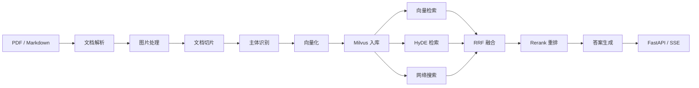

# 项目概览：ShopDesk AI（商答台）

## 已确认事实

- 对外名称：**ShopDesk AI（商答台）**。GitHub 仓库：[kdsirius/shopdesk-ai](https://github.com/kdsirius/shopdesk-ai)，已由用户创建并推送，首次推送时为私有。
- Python 发行名和 CLI：`shopdesk-ai`
- Python 导入包：`app`（带练阶段为 `shopkeeper_brain`）
- 开发解释器使用 Python 3.12，声明最低支持 3.12。
- 本地配置键按子系统分组，如 `LLM_`、`BGE_` 和 `MILVUS_`，不再带 `SHOPKEEPER_BRAIN_` 项目前缀。
- 参考项目：`reference/掌教智库/`
- 视频资料：`reference/掌教智库/4.视频/day01` 至 `day16`
- 包管理工具：`uv`
- 16 节带练已结束，已验收的商品手册问答作为功能迭代基线。
- 后续迭代按[项目协作规则](../../AGENTS.md)执行，首个电商客服场景待确认。
- 实验区：`workspace/`，已由根目录 `.gitignore` 忽略
- 参考资料优先级：先看 `4.视频/dayXX/` 的视频目录图片确定当天范围，再看当天课堂笔记和代码；`1.笔记/` 作为补充资料，不覆盖对应视频日的内容事实

## 接手入口

- 当前基线为 `00a7fae`。包结构整理将 Web 入口迁到 `app.main:app`，共享异常移到 `app.core.exceptions`，导入节点基类模块统一为 `base.py`。用户实测通过新入口、演示 SSE 和 RS-12 问答回显，见[包结构整理交付](../delivery/2026-11-20-包结构整理.md)。
- 前一轮 `bc69434` 已验收，包含 `shopdesk-ai` 命名、Python 3.12 和配置键调整，见[升级交付](../delivery/2026-11-20-项目改名与Python312升级.md)。此前根目录 `app/` 迁移见[迁移交付](../delivery/2026-11-20-根目录应用包迁移.md)。后续迭代的改动和验收从[功能交付](../delivery/)查阅。
- 带练章节状态、提交基线和留待验证事项见[学习进度](learning-progress.md)。维护历史教程时，以[文档区规则](../AGENTS.md)、[教学偏好](teaching-preferences.md)和[第 6 节教程](../study/day06-主体识别.md)为准；第 3 节作为补充样例。
- 工程使用说明见根 [README](../../README.md)。答案生成、流式正文和配图回显见[第 16 节验收记录](day16-acceptance.md)。业务上传、查询进度和会话历史见[第 15 节验收记录](day15-acceptance.md)。FastAPI 输入校验和 SSE 见[第 14 节验收记录](day14-acceptance.md)与[备课记录](day14-preparation.md)。Web 服务骨架见 [第 13 节验收记录](day13-acceptance.md) 和 [第 13 节备课记录](day13-preparation.md)，融合与重排见 [第 12 节验收记录](day12-acceptance.md) 和 [第 12 节备课记录](day12-preparation.md)，HyDE 与联网搜索见 [第 11 节验收记录](day11-acceptance.md) 和 [第 11 节备课记录](day11-preparation.md)，向量检索见 [第 10 节验收记录](day10-acceptance.md) 和 [第 10 节备课记录](day10-preparation.md)，查询骨架与产品确认见 [第 9 节验收记录](day09-acceptance.md) 和 [第 9 节备课记录](day09-preparation.md)，两类集合与入库资料依据见 [第 8 节备课记录](day08-preparation.md)，向量资料错位见 [第 7 节备课记录](day07-preparation.md)。更早验收文件记录当时事实，不把其中“下一节”或环境限制直接当作当前状态。
- 参考资料物理目录存在错位：`4.视频/day06/`仍是文档切片，主体识别和向量基础资料分布在 day07/day08。后续先读视频目录图片再定真实主题，不能仅按目录编号推断内容。
- Web 服务由 [app/main.py](../../app/main.py) 启动。状态首页连接同源导入页与查询页：上传触发导入图，按任务 ID 轮询；查询用 `run_id` 收 SSE 进度、正文增量和完成结果，用 `session_id` 从 MongoDB 读回会话正文与配图。已有追问、拒答直接回显；确认产品后由答案节点消费重排资料并生成答案。各节点仍可通过学习期 `__main__` 单独验证，CLI 仍是脚手架问候。
- 导入包原名 `import_process`，已由用户改为 `import_processor`；文档中的路径已同步，以真实源码为准。
- 第 5 节原 `chunks.json` 没有主体字段；第 6 节只在内存回填。第 7 节用户新产物 `workspace/day07-real-run/state_vector.json` 已有 `item_name`、两个名称向量字段及 21 个带双向量的 Chunk；第 8 节读取这份状态完成真实入库，后续产品确认和正文查询承接数据库记录，不为接手重复执行前八节导入。
- Milvus 两类记录分别为 `kb_item_names`（自增 `pk`）和 `kb_chunks`（自增 `chunk_id`）。两集合均按 `file_title` 删除后插入；名称字段不回填主键，Chunk 主键只回填本次返回状态，没有新建含主键的 JSON 备份。重复导入主键可变，旧备份不能当成带当前数据库主键的状态。
- 第 8 节验收时真实 Milvus 为 `192.168.150.120:19530`、服务端 2.5.5；当前配置以 `.env.example` 和本地环境为准。两个正式集合保存真实主体与正文；`verify_d08_b5001e7810_items`、`verify_d08_b5001e7810_chunks` 是保留的验收实验集合，不能作为后续查询的数据源。当前在线状态须另行只读核对，不重建或清空服务。
- 备份中的 Sparse 特征键是字符串，恢复输入时要转回整数；两个名称向量字段与每个 Chunk 的向量都适用。Dense 为 1024 维、范数接近 1，Sparse 保留模型原权重；名称内部空格保留。
- 第 7 节实际环境是 CPython 3.11.15、CPU/FP32，本地模型在 `workspace/models/bge-m3/`。环境与依赖版本以锁文件及相应验收记录为准，不把第 4 节的历史 uv 故障当作当前持续故障。
- 真实远程模型证据与本地 SDK 检查分别记录；文本提取仍使用 `response.text.strip()`。CPU 线程数可造成极小的浮点差异，不能要求跨进程固定小数位完全一致，CSR 行映射仍须准确对应。

## 业务全景

ShopDesk AI 基于「掌柜智库」带练重建的手册问答链路。它把 PDF/Markdown 商品文档加工成可检索知识，再通过多路召回、融合、重排和大语言模型生成答案，并用 FastAPI/SSE 提供交互服务。

图中展示 16 节重建的主链路，查询的追问与拒答短路未画出。已验证的行为与未做的联调以学习进度和各节验收记录为准。

## 当前技术与参考目标

当前工程依赖和版本约束以 [pyproject.toml](../../pyproject.toml)、[uv.lock](../../uv.lock) 为准：Python、uv、FastAPI、Uvicorn、Pydantic、LangGraph、LangChain OpenAI 客户端、文本切分、Requests、MinIO，以及 Torch、FlagEmbedding、Transformers、PyMilvus SDK 与模型工具、ModelScope。MinerU、视觉摘要、MinIO、文本主体识别、本地 BGE-M3 和 Milvus 入库的实际通过范围见对应验收记录。

文本与视觉模型通过 OpenAI 兼容客户端连接，具体服务地址和模型名由本地配置决定；参考笔记中的 DashScope/Qwen 不是本工程唯一固定服务商。BGE-M3 当前按本地模型目录运行。

第 9 节已落地查询流程骨架、产品确认和 MongoDB 会话历史（PyMongo，连接虚拟机 MongoDB，库 `kb001`、集合 `chat_message`，连接串只在本地 `.env`）。第 10 节落地了 `kb_chunks` 的 Dense + Sparse 混合检索（按已确认商品名过滤，`create_hybrid_search_requests` 带 `expr` 参数）。第 11 节落地了 HyDE 检索（文本模型写假设答案，与问题拼接后混合检索）和 Tavily 联网搜索（官方 `mcp` 包连 Tavily 远程 MCP 的 `tavily_search`，配置 `core/tavily_config.py`，密钥只在本地 `.env`，地址留空时用官方地址）；这两路运行期故障降级为空列表，向量检索主路仍异常外抛。第 12 节落地了 RRF 融合（向量检索与 HyDE 两路，k=60，联网搜索不参与）和重排（合并本地与联网结果，阿里云百炼 `qwen3-rerank`，通过 `dashscope` 包，配置 `core/rerank_config.py`，密钥只在本地 `.env`；断崖检测动态保留 3 到 10 条）；重排出错时降级为只保留本地结果、沿用 RRF 顺序。第 13 节用 FastAPI/Uvicorn 提供同源状态页和健康接口。第 14 节加入 Pydantic 输入校验与 SSE 练习，验证了浏览器逐条收流和完成后关闭。第 15 节接通业务上传、后台导入、进度轮询、查询 SSE 和历史读取。真实 Markdown 入库已自测，PDF Web 整链未运行。

第 16 节接通答案生成及回显。LangGraph 的 `updates` 和 `custom` 分别提供节点更新和正文增量，查询服务转为 `progress` 和 `delta`；成功写入助手历史后发送带完整答案和配图的 `complete`，异常时以 `task_error` 结束。任务与 SSE 队列在单进程内存中，MongoDB 持久化历史，查询页刷新时读回最近 5 条。

## 代码地图

当前业务源码位于本仓库根目录的 [app/](../../app/)：

| 位置 | 当前职责 |
| --- | --- |
| [core/](../../app/core/) | MinerU、图片/MinIO、文本模型、本地 Embedding、Milvus、MongoDB 和 Tavily 配置 |
| [processor/import_processor/](../../app/processor/import_processor/) | 导入主图、状态、BaseNode 和异常；按 PDF／Markdown 分流后汇合入库 |
| [import_processor/nodes/](../../app/processor/import_processor/nodes/) | 入口、PDF 转换、图片处理、切片、主体识别及名称保存、BGE 向量化、Chunk 入库节点 |
| [processor/query_processor/](../../app/processor/query_processor/) | 查询流程：NodeBase、状态、主图路由；`nodes/` 包含产品确认、三路检索、融合、重排和答案输出 |
| [utils/](../../app/utils/) | BGE-M3 模型复用与向量转换；Milvus 客户端复用、过滤转义、JSON Sparse 键恢复和混合检索；MongoDB 会话历史读写 |
| [api/](../../app/api/) | FastAPI 启动入口、状态与练习路由、上传、任务状态、查询、一次性 SSE 订阅和历史路由 |
| [services/](../../app/services/) | 执行导入和查询后台任务，将图更新转换为任务快照，将查询进度和正文增量转换为 SSE 事件 |
| [front/](../../app/front/) | 同源状态页、SSE 练习页、导入页和查询页 |

当前业务调用方向为 `api → services → processor`，前端通过同源 API 访问业务。共享配置和工具位于 `core`、`utils`。

## 电商客服扩展（待讨论）

当前从商品知识问答起步，订单查询、退换货和人工转接均未接入。MewHelp 已做只读摸底，用户暂缓借鉴。下一项候选是「让手册回答里的引用能回查原文」，范围与验收标准待确认。

## 重要边界

- `reference/` 只读，不修改、不格式化、不覆盖解压、不运行其中未知压缩包代码。
- 临时脚本、复制工程和测试输出统一放 `workspace/`。
- Git 只读；提交、推送由用户执行。
