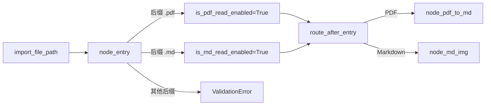

# 第 2 节：入口节点与文件类型路由

> 上一节已经准备好状态、异常和节点基类。这一节让第一个真实业务节点出现：它接收上传文件路径，确认文件类型，写入后续节点要读的状态字段；主图再根据这些标记决定走 PDF 分支、Markdown 分支，还是直接拒绝输入。

---

## 0. 本节你会学到

1. 说清楚入口节点在“文件上传 → 文档处理”链路中的职责。
2. 使用 `pathlib.Path` 检查真实文件、读取后缀和提取不带扩展名的标题。
3. 把一个输入状态转换成后续流程可消费的状态：PDF 路径、Markdown 路径、文件标题和两个路由标记。
4. 理解节点处理和主图路由为什么分成两步：节点负责产生事实，路由函数负责根据事实选下一站。
5. 用真实参考文件验证 PDF、Markdown、不支持格式和缺失文件四种行为。

**前置条件**：第 1 节已经验收通过。当前工程已有 `ImportGraphState`、`create_default_state()`、`ImportProcessError` 和 `BaseNode`；本节不重新初始化 uv 项目，不新增自动化测试文件，不调用 PDF 解析、模型或数据库。

**本节验证基线**：当前没有自动化测试；使用 `compileall` 和直接 Python 探针验证。下面命令在你手敲代码后才是对用户工程的验证，本图纸阶段的命令均标记为“未验证”。

---

## 1. day02 实际教了什么

day02 的视频目录包含三段内容：项目和环境准备、导入流程骨架、入口节点及主图设计。与本节直接相关的课堂内容来自这些视频：

| 视频范围 | 实际主题 | 对应资料 |
| --- | --- | --- |
| 01、08 | 项目定位和导入骨架回顾 | `reference/掌教智库/4.视频/day02/课堂笔记/01【掌柜智库】项目简介.md`、`03【掌柜智库】【导入】骨架代码.md` |
| 09—14 | 配置、`dataclass`、`lambda`、uv、异常和状态 | 同一目录的课堂笔记，以及当天代码压缩包中的 `processor/import_processor/` |
| 16—19 | `BaseNode` 的抽象方法、`__call__`、日志和异常包装 | `03【掌柜智库】【导入】骨架代码.md`、`BaseNode` 实际代码 |
| 20 | 创建导入流程各节点的空壳 | `processor/import_processor/nodes/` 下的多个节点文件 |
| 21—22 | 主图结构、条件边和流程优化 | `main_graph.py` 以及 `04【掌柜智库】【导入】入口节点.md` |

这次重建的第 1 节已经覆盖了骨架模块，所以本节只抽取 day02 中第一个真实业务问题：入口节点和入口后的文件类型路由。环境部署、配置大表、空的 PDF/图片/切片节点不在本节重复。

当天资料存在一个必须看清的差异：课堂笔记已经写出了入口节点的目标实现；隔离后的当天代码中，入口文件仍是硬编码返回 Markdown 标记的骨架，而且文件名是 `node_enrty.py`，主图也沿用了这个拼写。教程使用正确的 `node_entry.py`，并把硬编码改成真实文件判断。这是本节要理解和验证的改造，而不是把压缩包状态误报成完成状态。

---

## 2. 业务流程：入口节点解决什么问题

导入流程收到的第一个业务输入是一条文件路径。后续节点不应该各自猜测文件类型，也不应该每个节点都重新解析路径。入口节点统一完成这件事：



入口节点的输入和输出是一个明确的数据契约：

| 状态字段 | 入口节点做什么 | 后续用途 |
| --- | --- | --- |
| `import_file_path` | 读取并检查它是否指向真实文件 | 所有导入任务的原始输入 |
| `is_pdf_read_enabled` | PDF 时设为 `True` | 主图选择 PDF 转 Markdown 节点 |
| `is_md_read_enabled` | Markdown 时设为 `True` | 主图选择 Markdown 图片处理节点 |
| `pdf_path` | PDF 时保存原路径 | PDF 节点读取 |
| `md_path` | Markdown 时保存原路径 | Markdown 节点读取 |
| `file_title` | 去掉扩展名后的文件名 | 后续元数据和商品主体识别 |

节点只负责把输入变成事实。`route_after_entry()` 不再检查文件名，它只读取两个布尔标记并返回下一节点名。这样以后文件类型判断发生变化时，路由层不需要跟着改。

---

## 3. 术语小灶

### `Path`

`Path` 是 Python 标准库里的路径对象。它把“后缀、文件名、是否存在”等操作集中到对象上：

```python
from pathlib import Path

path = Path("manual.pdf")
path.suffix   # ".pdf"
path.stem     # "manual"
path.exists() # True 或 False
path.is_file()# True 或 False
```

这里用 `suffix.lower()`，所以 `MANUAL.PDF` 也会按 PDF 判断；保存到状态里的路径仍保留调用方传入的原字符串。

### 状态标记和条件路由

入口节点输出的是状态，路由函数输出的是“下一节点名称”：

```text
文件路径 → 入口节点 → 状态标记 → 条件路由 → 下一节点
```

不要把这两步混成一个“大函数”。入口节点是业务处理，路由函数是流程编排。后面加入更多节点时，主图只消费状态契约。

### 节点对象为什么可以写成 `node(state)`

第 1 节的 `BaseNode.__call__()` 已经规定了统一外壳：记录开始日志、调用 `process()`、包装普通异常。`NodeEntry` 只实现 `process()`，调用 `NodeEntry()(state)` 时仍然会经过这层外壳。

---

## 4. 阶段①：先跑现状探针

先确认上一节的真实代码仍然是当前版本：

```bash
uv run python -m compileall -q src/shopkeeper_brain
uv run python -c "from shopkeeper_brain.processor.import_processor.state import create_default_state; print(create_default_state())"
```

**验证状态：未验证。**

预期效果：

- 两条命令退出码都是 0。
- 状态中目前只有第 1 节已有的输入路径、两个标记、访问节点列表和状态字段。
- 当前还不能导入 `NodeEntry`，因为本节文件尚未创建。

这一步的目的不是凑一次绿色输出，而是确认后面新增字段和入口节点是在第 1 节的真实状态上继续施工。

---

## 5. 阶段②：盯着现状列账

| 当前缺口 | 具体后果 | 本节处理 |
| --- | --- | --- |
| 状态没有 `pdf_path`、`md_path`、`file_title` | 入口节点无法把判断结果交给后续节点 | 扩充 `ImportGraphState` 和默认状态 |
| 异常只有基础类 | 无法区分“状态缺失”和“不支持格式” | 增加 `StateFieldError`、`ValidationError` |
| 没有真实入口节点 | 文件类型只能由调用方自己判断 | 新增 `NodeEntry.process()` |
| 没有入口后的路由函数 | 状态标记不会自动变成下一节点名 | 新增 `route_after_entry()` |
| 当天压缩包的入口代码硬编码返回 Markdown | 输入 PDF 时仍会走 Markdown 分支 | 用真实 `Path` 判断替换硬编码 |

优先级只有一个：先把入口节点的状态契约做对，再讨论主图怎么挂接。PDF 解析和 Markdown 图片处理留到它们各自出现的章节。

---

## 6. 阶段③：逐个改造

### 6.1 给状态补上入口节点的输出字段

入口节点要写入三个新事实：PDF 路径、Markdown 路径和文件标题。两个路径都保留在状态里，是因为后续主图虽然只会选择一个分支，但每个分支节点需要从固定字段取值。

**文件**：`src/shopkeeper_brain/processor/import_processor/state.py`

```python
from copy import deepcopy
from typing import TypedDict, Unpack


class ImportGraphState(TypedDict):
    """导入流程中所有节点共享的状态。"""

    import_file_path: str
    is_pdf_read_enabled: bool
    is_md_read_enabled: bool
    pdf_path: str
    md_path: str
    file_title: str
    visited_nodes: list[str]
    status: str


GRAPH_DEFAULT_STATE: ImportGraphState = {
    "import_file_path": "",
    "is_pdf_read_enabled": False,
    "is_md_read_enabled": False,
    "pdf_path": "",
    "md_path": "",
    "file_title": "",
    "visited_nodes": [],
    "status": "created",
}


def create_default_state(**overrides: Unpack[ImportGraphState]) -> ImportGraphState:
    """创建彼此隔离的状态副本，并允许调用方覆盖字段。"""
    state = deepcopy(GRAPH_DEFAULT_STATE)
    state.update(overrides)
    return state
```

手敲时注意：

- 新增字段要同时出现在 `TypedDict` 和 `GRAPH_DEFAULT_STATE`，否则类型契约和运行时默认值会脱节。
- 每次仍然从 `deepcopy()` 得到新状态；本节只是增加字段，不改变上一节的状态隔离设计。
- 空字符串表示“这个分支没有路径”。入口节点会把未选中的路径清空，避免复用同一个状态时残留旧分支。

### 6.2 给入口输入增加可区分的异常

入口节点有两类输入错误：状态里没有有效路径，或者路径存在但扩展名不受支持。它们都属于导入流程异常，但调用方需要知道是哪一类。

**文件**：`src/shopkeeper_brain/processor/import_processor/exceptions.py`

```python
class ImportProcessError(Exception):
    """导入流程的基础异常。"""

    def __init__(
            self,
            message: str,
            node_name: str = "",
            cause: Exception | None = None,
    ) -> None:
        self.node_name = node_name
        self.cause = cause
        super().__init__(message)

    def __str__(self) -> str:
        prefix = f"[{self.node_name}] " if self.node_name else ""
        cause = f" (原因: {self.cause})" if self.cause else ""
        return f"{prefix}{super().__str__()}{cause}"


class StateFieldError(ImportProcessError):
    """状态字段缺失、为空或类型不符合预期。"""

    def __init__(
            self,
            node_name: str = "",
            field_name: str = "",
            expected_type: type | None = None,
            message: str = "",
            cause: Exception | None = None,
    ) -> None:
        self.field_name = field_name
        self.expected_type = expected_type
        if not message:
            message = f"状态字段 '{field_name}' 缺失或无效"
            if expected_type is not None:
                message += f"，期望类型: {expected_type.__name__}"
        super().__init__(message, node_name=node_name, cause=cause)


class ValidationError(ImportProcessError):
    """输入数据不符合节点要求。"""
```

这两个子类没有重复实现字符串格式，节点名和原始原因仍由 `ImportProcessError` 统一处理。`BaseNode.__call__()` 已经会让 `ImportProcessError` 原样抛出，所以具体异常类型不会被再次包成一层普通流程异常。

### 6.3 实现入口节点

入口节点的处理顺序固定为：取值 → 类型校验 → 路径校验 → 清理旧分支 → 判断后缀 → 写入标题 → 返回状态。

**文件**：`src/shopkeeper_brain/processor/import_processor/nodes/__init__.py`

```python
"""导入流程节点。"""
```

**文件**：`src/shopkeeper_brain/processor/import_processor/nodes/node_entry.py`

```python
from pathlib import Path

from ..BaseNode import BaseNode
from ..exceptions import StateFieldError, ValidationError
from ..state import ImportGraphState


class NodeEntry(BaseNode):
    """入口节点：确认文件类型并准备路由状态。"""

    name = "node_entry"

    def process(self, state: ImportGraphState) -> ImportGraphState:
        import_file_path = state.get("import_file_path", "")
        if not isinstance(import_file_path, str) or not import_file_path.strip():
            raise StateFieldError(
                node_name=self.name,
                field_name="import_file_path",
                expected_type=str,
            )

        path = Path(import_file_path)
        if not path.exists() or not path.is_file():
            raise StateFieldError(
                node_name=self.name,
                field_name="import_file_path",
                expected_type=Path,
                message=f"文件不存在或不是普通文件: {import_file_path}",
            )

        suffix = path.suffix.lower()
        if suffix not in {".pdf", ".md"}:
            raise ValidationError(
                message=f"该文件的后缀格式 {path.suffix} 不支持",
                node_name=self.name,
            )

        # 先清理派生字段，保证同一个状态对象被重复使用时不会残留旧分支。
        state["is_pdf_read_enabled"] = suffix == ".pdf"
        state["is_md_read_enabled"] = suffix == ".md"
        state["pdf_path"] = import_file_path if suffix == ".pdf" else ""
        state["md_path"] = import_file_path if suffix == ".md" else ""
        state["file_title"] = path.stem
        return state
```

手敲时重点看三处：

1. `state.get("import_file_path", "")` 只负责取值，不能替代后面的真实路径检查。
2. `path.suffix` 得到 `.pdf` 这种带点后缀，`path.stem` 得到不含扩展名的文件名。
3. 入口节点写的是状态事实；它不直接调用 PDF 解析，也不在这里决定下一个节点。

### 6.4 把状态标记转换成下一节点名

主图条件边需要一个只负责选择下一站的函数。当前后续节点还没有真实实现，所以本节先把路由契约落下来，不注册空的 PDF、图片、切片和入库节点。

**文件**：`src/shopkeeper_brain/processor/import_processor/main_graph.py`

```python
from langgraph.constants import END

from .state import ImportGraphState


def route_after_entry(state: ImportGraphState) -> str:
    """根据入口节点写入的标记选择下一节点。"""
    if state.get("is_pdf_read_enabled"):
        return "node_pdf_to_md"
    if state.get("is_md_read_enabled"):
        return "node_md_img"
    return END
```

参考项目后续会把这个函数传给 `StateGraph.add_conditional_edges()`：

```python
graph.add_conditional_edges(
    "node_entry",
    route_after_entry,
    {
        "node_pdf_to_md": "node_pdf_to_md",
        "node_md_img": "node_md_img",
        END: END,
    },
)
```

这段只是解释主图如何消费路由函数，不是本节要提前写入的完整主图。等 `node_pdf_to_md` 和 `node_md_img` 具备真实行为后，再把它们注册进图里并运行整条链路。

---

## 7. 真实验证步骤

下面的路径都来自仓库已有资料：一个真实 PDF、一个真实 Markdown 课堂笔记和当前项目的 `pyproject.toml`。不创建假 PDF，不读取文件内容，也不启动模型或外部服务。

### 7.1 语法和模块导入

运行：

```bash
uv run python -m compileall -q src/shopkeeper_brain
uv run python -c "from shopkeeper_brain.processor.import_processor.nodes.node_entry import NodeEntry; from shopkeeper_brain.processor.import_processor.main_graph import route_after_entry; print(NodeEntry.name, route_after_entry.__name__)"
```

**验证状态：未验证。**

预期效果：

```text
node_entry route_after_entry
```

两条命令退出码都应为 0。

### 7.2 验证 PDF、Markdown 和标题提取

运行：

```bash
uv run python -c "from shopkeeper_brain.processor.import_processor.nodes.node_entry import NodeEntry; from shopkeeper_brain.processor.import_processor.state import create_default_state; pdf='reference/掌教智库/2.资料/04-设备手册汇总/doc/hak180产品安全手册.pdf'; md='reference/掌教智库/4.视频/day02/课堂笔记/01【掌柜智库】项目简介.md'; node=NodeEntry(); pdf_state=node(create_default_state(import_file_path=pdf)); md_state=node(create_default_state(import_file_path=md)); assert pdf_state['is_pdf_read_enabled'] and not pdf_state['is_md_read_enabled']; assert pdf_state['pdf_path']==pdf and pdf_state['file_title']=='hak180产品安全手册'; assert md_state['is_md_read_enabled'] and not md_state['is_pdf_read_enabled']; assert md_state['md_path']==md and md_state['file_title']=='01【掌柜智库】项目简介'; print('PDF 和 Markdown 入口状态验证通过')"
```

**验证状态：未验证。**

预期效果：

```text
PDF 和 Markdown 入口状态验证通过
```

这条探针同时守住四个行为：分支标记互斥、对应路径写入、标题去掉扩展名、真实文件存在检查确实执行。

### 7.3 验证路由函数

运行：

```bash
uv run python -c "from shopkeeper_brain.processor.import_processor.main_graph import route_after_entry; from shopkeeper_brain.processor.import_processor.nodes.node_entry import NodeEntry; from shopkeeper_brain.processor.import_processor.state import create_default_state; from langgraph.constants import END; node=NodeEntry(); pdf=node(create_default_state(import_file_path='reference/掌教智库/2.资料/04-设备手册汇总/doc/hak180产品安全手册.pdf')); md=node(create_default_state(import_file_path='reference/掌教智库/4.视频/day02/课堂笔记/01【掌柜智库】项目简介.md')); assert route_after_entry(pdf)=='node_pdf_to_md'; assert route_after_entry(md)=='node_md_img'; assert route_after_entry(create_default_state())==END; print('入口条件路由验证通过')"
```

**验证状态：未验证。**

预期效果：

```text
入口条件路由验证通过
```

空状态返回 `END` 是路由函数的兜底行为。正常入口节点不会产生这种状态；这里保留它，是为了让主图在状态不完整时有确定的结束分支。

### 7.4 验证不支持格式和缺失文件

运行：

```bash
uv run python -c "from shopkeeper_brain.processor.import_processor.nodes.node_entry import NodeEntry; from shopkeeper_brain.processor.import_processor.state import create_default_state; from shopkeeper_brain.processor.import_processor.exceptions import StateFieldError, ValidationError; node=NodeEntry(); unsupported=create_default_state(import_file_path='pyproject.toml'); missing=create_default_state(import_file_path='workspace/verification/day02/not-found.md');
try:
    node(unsupported)
except ValidationError as exc:
    print(type(exc).__name__, exc)
else:
    raise AssertionError('不支持格式没有失败')
try:
    node(missing)
except StateFieldError as exc:
    print(type(exc).__name__, exc)
else:
    raise AssertionError('缺失文件没有失败')"
```

**验证状态：未验证。**

预期效果：输出两行，类型名分别包含 `ValidationError` 和 `StateFieldError`，并且命令退出码为 0。具体异常文本以你的终端实际输出为准，不要照抄猜测的路径格式。

---

## 8. 验证汇总

本节交付后的验证记录按下面格式填写真实结果：

| 验证项 | 命令/行为 | 结果 |
| --- | --- | --- |
| 编译 | `uv run python -m compileall -q src/shopkeeper_brain` | 未验证 |
| 模块导入 | 导入 `NodeEntry`、`route_after_entry` | 未验证 |
| PDF 分支 | 真实 PDF 路径 → PDF 标记、路径和标题 | 未验证 |
| Markdown 分支 | 真实 Markdown 路径 → Markdown 标记、路径和标题 | 未验证 |
| 路由 | PDF / Markdown / 空状态返回不同下一站 | 未验证 |
| 错误 | 不支持后缀、缺失文件抛出不同异常 | 未验证 |
| 正常行为验证 | PDF、Markdown、路由和异常分支 | 未验证 |
| 外部服务 | PDF 解析、模型、Milvus、MinIO、MongoDB | 跳过：本节没有接入这些服务 |

不要把“代码能编译”写成“入口行为已通过”。入口行为必须以真实文件探针的实际输出为准。

---

## 9. 小结

如果只记三件事：

1. 入口节点把外部文件路径转换成状态事实，后续节点不再各自猜文件类型。
2. `Path.suffix` 用来判断分支，`Path.stem` 用来提取标题；路径存在检查和后缀支持检查是两种不同错误。
3. 节点负责写状态，路由函数负责选下一节点。主图要消费的是状态契约，不是重新解析原始路径。

### 对照参考项目

| 维度 | day02 参考资料 | 当前学习工程 |
| --- | --- | --- |
| 入口文件 | 课堂目标文件名为 `node_entry.py`；压缩包实际有 `node_enrty.py` 拼写问题 | 使用 `nodes/node_entry.py`，保持调用名和文件名一致 |
| 文件判断 | `.pdf` / `.md` 后缀，写入对应开关和路径 | 保留这个业务契约，并用 `Path` 统一处理大小写后缀 |
| 标题 | 从文件名去掉扩展名 | 写入 `file_title` |
| 异常 | 课堂目标区分状态错误和格式错误 | 增加 `StateFieldError`、`ValidationError` 两个最小子类 |
| 主图 | 入口后连接 PDF 或 Markdown 节点 | 先落地可独立验证的 `route_after_entry()`；后续真实节点出现后再注册整张图 |
| 参考缺陷 | 入口骨架硬编码返回 Markdown，主图引用拼写错误文件 | 用真实探针暴露并修正，不运行参考目录代码 |

### 欠账

- 本节只验证入口状态和路由返回值，尚未验证 `StateGraph` 编译后的完整执行；因为后续 PDF 和 Markdown 节点还没有真实实现。
- PDF 转 Markdown、图片处理、文档切片、模型调用和存储服务留到对应章节，不能用空壳节点代替。
- 入口节点复用同一个状态对象时的旧分支清理已在本节代码中处理，需要通过正常行为探针确认。

下一节进入 `node_pdf_to_md`，从入口节点的 `pdf_path` 状态开始处理真实 PDF 转 Markdown 流程。
