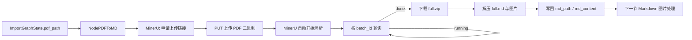

# 第 3 节：PDF 转 Markdown 流程

> 上一节的入口节点已经确认文件是 PDF，并把路径写入 `pdf_path`。这一节解决后续节点无法直接处理 PDF 的问题：使用 MinerU 把真实 PDF 转成带图片资源的 Markdown，再把 `md_path` 和 `md_content`交给下一节。
>
> 对应资料：`reference/掌教智库/4.视频/day03/`；主要依据当天课堂笔记和当天代码，`reference/掌教智库/1.笔记/` 只作补充。当天代码快照实际停在拿到 ZIP 下载地址，本节按课堂笔记补齐完整闭环。

## 一、业务流程与设计原因

### 1. 先看本节要解决的具体问题

上一节结束时，状态大致是这样：

```python
state["pdf_path"] = r".../hak180产品安全手册.pdf"
state["is_pdf_read_enabled"] = True
```

这个路径只能说明“要处理哪一个文件”，还没有得到后续切片节点需要的 Markdown。PDF 保存的是页面布局：标题、段落、表格和图片可能分别存在于页面坐标中；扫描 PDF 甚至只有图片。直接用 Python 的 `open()` 读取二进制内容，拿到的不是可供知识库切片的正文。

本节把这条链路补完整：



从左向右读这张图：节点从状态读取 PDF，MinerU 在云端做布局分析和 OCR/结构化解析；节点负责上传、等待、下载和保存结果。`md_path` 是本地文件路径，`md_content` 是读入状态的正文，它们才是下一节点的输入。ZIP 下载地址只是中间结果，不能直接当成 Markdown 路径。

### 2. MinerU 是什么，为什么项目使用它

MinerU 是一个文档解析服务，能够识别 PDF 中的标题、正文、表格、公式和图片，并把解析结果输出为 Markdown、JSON 以及图片等文件。它解决的是“页面布局如何恢复成结构化文档”的问题。

本项目选择调用 MinerU 的原因是：

- PDF 解析、OCR 和版面分析本身不是本项目的业务重点；
- 本地处理大 PDF 需要额外模型和计算资源；
- 知识库真正需要的是结构化 Markdown 及其图片资源；
- MinerU 已经提供了上传、异步解析和结果下载接口。

所以 `NodePDFToMD` 不是一个 PDF 解析算法，而是一个**外部解析服务适配节点**。它把 MinerU 官方接口的一次手工操作封装成导入图中的一个节点。

本节使用 MinerU 的标准 v4 精准解析 API。官方文档说明，这个接口需要 Token，支持本地文件签名上传；上传完成后服务端自动提交解析任务，再通过 `batch_id` 查询结果。`vlm` 是本节沿用课堂代码的模型版本，适合包含图片、表格等复杂版面的文档。

官方资料：

- API 文档：[https://mineru.net/apiManage/docs](https://mineru.net/apiManage/docs)
- Token 管理：[https://mineru.net/apiManage/token](https://mineru.net/apiManage/token)

### 3. 先申请 MinerU Token，再理解配置

申请和配置按下面步骤操作：

1. 打开 [MinerU 官网](https://mineru.net/)，注册或登录账号。
2. 进入 API 管理页面：<https://mineru.net/apiManage/token>。
3. 创建一个 API Token，并复制一次。Token 是调用解析接口的凭证，不要发到聊天、截图或 Git。
4. 回到本项目根目录，准备本地 `.env` 文件。
5. 把 Token 写入本地配置；项目统一使用 `SHOPKEEPER_BRAIN_` 前缀，避免和其他项目的环境变量重名。

项目只把空模板提交到仓库：

**文件**：`.env.example`

```dotenv
SHOPKEEPER_BRAIN_MINERU_BASE_URL=https://mineru.net/api/v4
SHOPKEEPER_BRAIN_MINERU_API_TOKEN=
```

在本地把 `.env.example` 复制成 `.env`，只在 `.env` 的空值位置填入真实 Token。`.env` 已被忽略规则排除，`MinerUConfig` 也会关闭 Token 的默认展示；这两层都是为了减少凭证误提交和误打印的机会，但它们都不是加密。

### 4. 把官方 API 映射成项目节点

先不要把接口代码当成魔法。官方 API 的每一步，都对应节点中的一个明确动作：

| 官方文档中的动作 | 节点代码中的动作 | 为什么需要它 |
| --- | --- | --- |
| `POST /file-urls/batch` | `requests.post(...)` | 用文件名申请临时上传 URL 和 `batch_id` |
| 返回 `batch_id`、`file_urls` | 保存两个返回值 | 后续查询任务和上传文件都要用 |
| 对签名 URL 执行 `PUT` | `requests.put(..., data=source)` | 把 PDF 的二进制内容上传到对象存储 |
| `GET /extract-results/batch/{batch_id}` | 循环 `requests.get(...)` | 解析是异步的，需要等待服务端完成 |
| 返回 `state=done`、`full_zip_url` | 返回 ZIP 下载地址 | 任务完成后才能取结果包 |
| 下载并解压 ZIP | `zipfile.ZipFile` | Markdown 的图片引用依赖同目录资源 |
| 读取 `full.md` | `md_path.read_text(...)` | 把真实正文交给下一节点 |

这里有三层成功判断，不能只看 HTTP 状态码：

1. HTTP 状态码成功：请求到达并被服务器处理；
2. JSON 的 `code == 0`：MinerU 业务接口接受了请求；
3. 任务的 `state == "done"`：解析任务真的完成，并且有 `full_zip_url`。

上传完成后不需要再调用一次“提交解析”接口。MinerU 的本地文件批量上传接口会在文件上传完成后自动提交解析；代码保存 `batch_id` 后直接进入轮询。

### 5. 这个节点为什么这样拆

如果把路径检查、申请 URL、上传、轮询、下载、解压和状态更新全部写进一个 `process()`，第一次能跑，但每次排查问题都要在一大段代码里找：究竟是本地路径错、Token 错、上传错、解析失败，还是 ZIP 没有 `full.md`？

本节只拆出三个有明确边界的步骤：

| 方法 | 负责的问题 | 返回值 |
| --- | --- | --- |
| `_step_1_validate_paths` | 本地输入和输出目录是否可用 | 两个 `Path` |
| `_step_2_upload_and_poll` | MinerU 配置、上传和异步任务 | ZIP 下载地址 |
| `_step_3_download_and_extract` | 结果包落盘、解压和 Markdown 命名 | 本地 Markdown `Path` |

`process()` 只负责按顺序串起来，最后才把结果写回状态。这样做的关键原因是：**只有 Markdown 已经真实落盘并读成功，状态才应该出现 `md_path` 和 `md_content`。**

## 二、手敲步骤

每一步都先看“当前缺什么”，再写解决这个缺口的代码。你负责在真实工程中手敲；我这里只提供施工图纸，不直接修改你的学习代码。

### 1. 先确认依赖和文件位置

本节直接使用 `requests` 调 HTTP，使用 `python-dotenv` 读取 `.env`，所以它们必须是项目的直接依赖。你当前工程的 `pyproject.toml` 应包含下面两项；如果你已经写过，只核对名称和版本，不要重复添加。

**文件**：`pyproject.toml`

```toml
[project]
name = "shopkeeper-brain"
version = "0.1.0"
description = "Add your description here"
readme = "README.md"
authors = [
    { name = "kdsirius", email = "2915049950@qq.com" }
]
requires-python = ">=3.11"
dependencies = [
    "langgraph>=1.2.20",
    "requests>=2.32.5",
    "python-dotenv>=1.2.2",
]

[project.scripts]
shopkeeper-brain = "shopkeeper_brain:main"

[[tool.uv.index]]
url = "https://pypi.tuna.tsinghua.edu.cn/simple"
default = true

[build-system]
requires = ["uv_build>=0.12.13,<0.13.0"]
build-backend = "uv_build"
```

在项目终端执行一次 `uv sync`，让当前虚拟环境安装依赖。它是环境准备，不是本节业务验证；真正的验证在第三部分用真实 PDF 运行 `__main__`。

### 2. 先让状态容纳转换结果

当前状态只有入口节点产生的 `pdf_path` 和 `md_path`。PDF 节点还需要一个输出目录，转换完成后还要把 Markdown 正文传给下一节点，因此补两个字段：

- `file_dir`：调用方指定的本次输出根目录；
- `md_content`：从真实 Markdown 文件读取出的正文。

**文件**：`src/shopkeeper_brain/processor/import_process/state.py`

```python
from copy import deepcopy
from typing import TypedDict, Unpack


class ImportGraphState(TypedDict):
    """导入流程中所有节点共享的状态。"""

    import_file_path: str
    is_pdf_read_enabled: bool
    is_md_read_enabled: bool
    pdf_path: str
    md_path: str
    file_title: str
    file_dir: str
    md_content: str
    visited_nodes: list[str]
    status: str


GRAPH_DEFAULT_STATE: ImportGraphState = {
    "import_file_path": "",
    "is_pdf_read_enabled": False,
    "is_md_read_enabled": False,
    "pdf_path": "",
    "md_path": "",
    "file_title": "",
    "file_dir": "",
    "md_content": "",
    "visited_nodes": [],
    "status": "created",
}


def create_default_state(**overrides: Unpack[ImportGraphState]) -> ImportGraphState:
    """创建彼此隔离的状态副本，并允许调用方覆盖字段。"""
    state = deepcopy(GRAPH_DEFAULT_STATE)
    state.update(overrides)
    return state
```

这里继续使用 `deepcopy()`，因为 `visited_nodes` 是可变列表；每次验证都要得到独立状态。`TypedDict` 只是告诉开发者状态契约，不会自动替你检查输入，所以节点仍然要做运行时校验。

### 3. 给失败原因分层

如果所有失败都变成普通 `Exception`，真实运行时只能看到“失败了”，不知道是缺 Token、PDF 不存在、MinerU 拒绝任务，还是 ZIP 缺少 `full.md`。沿用上一节的异常基类，只补本节需要的分类。

**文件**：`src/shopkeeper_brain/processor/import_process/exceptions.py`

```python
class ImportProcessError(Exception):
    """导入流程的基础异常。"""

    def __init__(
            self,
            message: str,
            node_name: str = "",
            cause: Exception | None = None,
    ) -> None:
        self.node_name = node_name
        self.cause = cause
        super().__init__(message)

    def __str__(self) -> str:
        prefix = f"[{self.node_name}] " if self.node_name else ""
        cause = f" (原因: {self.cause})" if self.cause else ""
        return f"{prefix}{super().__str__()}{cause}"


class StateFieldError(ImportProcessError):
    """状态字段缺失、为空或类型不符合预期。"""

    def __init__(
            self,
            node_name: str = "",
            field_name: str = "",
            expected_type: type | None = None,
            message: str = "",
            cause: Exception | None = None,
    ) -> None:
        self.node_name = node_name
        self.field_name = field_name
        self.expected_type = expected_type
        if not message:
            message = f"状态字段 '{field_name}' 缺失或无效"
            if expected_type is not None:
                message += f"，期望类型: {expected_type.__name__}"
        super().__init__(message, node_name=node_name, cause=cause)


class ValidationError(ImportProcessError):
    """输入数据不符合节点要求。"""


class ConfigurationError(ImportProcessError):
    """外部服务配置缺失。"""


class FileProcessingError(ImportProcessError):
    """本地文件不存在或无法处理。"""


class PdfConversionError(FileProcessingError):
    """PDF 上传、解析或结果处理失败。"""
```

`PdfConversionError` 继承 `FileProcessingError`，因为转换失败最终仍然发生在一个文件处理节点中；调用方可以捕获更具体的转换错误，也可以统一按文件处理错误处理。

### 4. 读取 MinerU 配置

节点不应该把 Token 写死在类成员变量里，也不应该让调用方把 Token 作为工作流状态传来。状态描述业务文件，环境变量描述外部服务配置，二者职责不同。

**文件**：`src/shopkeeper_brain/core/__init__.py`

```python
"""项目配置与基础设施。"""
```

**文件**：`src/shopkeeper_brain/core/mineru_config.py`

```python
import os
from dataclasses import dataclass, field
from pathlib import Path

from dotenv import load_dotenv


@dataclass
class MinerUConfig:
    """MinerU API 的连接配置，不在默认 repr 中显示 Token。"""

    base_url: str
    api_token: str = field(repr=False)


def load_mineru_config() -> MinerUConfig:
    """从当前项目根目录的 .env 读取 MinerU 配置。"""
    project_root = Path(__file__).resolve().parents[3]
    load_dotenv(project_root / ".env", override=False)
    return MinerUConfig(
        base_url=os.getenv("SHOPKEEPER_BRAIN_MINERU_BASE_URL", "").strip().rstrip("/"),
        api_token=os.getenv("SHOPKEEPER_BRAIN_MINERU_API_TOKEN", "").strip(),
    )
```

`project_root` 让配置文件位置不依赖你从哪个目录启动程序；`override=False` 让已经存在的系统环境变量优先于 `.env`。`field(repr=False)` 只防止 `print(config)` 时直接展示 Token，不是安全存储方案，所以仍然不能把 `.env` 提交到 Git。

### 5. 写 PDF 转 Markdown 节点

现在才写使用方。先读 `process()`：它只做四件事——校验路径、完成 MinerU 流程、读取 Markdown、回写状态。真正的细节放到三个步骤方法里。

**文件**：`src/shopkeeper_brain/processor/import_process/nodes/node_pdf_to_md.py`

```python
import logging
import tempfile
import time
import zipfile
from pathlib import Path

import requests

from shopkeeper_brain.core.mineru_config import load_mineru_config
from shopkeeper_brain.processor.import_processor.BaseNode import BaseNode
from shopkeeper_brain.processor.import_processor.exceptions import (
    ConfigurationError,
    FileProcessingError,
    PdfConversionError,
    StateFieldError,
)
from shopkeeper_brain.processor.import_processor.state import (
    ImportGraphState,
    create_default_state,
)


class NodePDFToMD(BaseNode):
    """调用 MinerU，把一个真实 PDF 转为本地 Markdown 和图片资源。"""

    name = "node_pdf_to_md"

    def process(self, state: ImportGraphState) -> ImportGraphState:
        """完成路径校验、远程解析、结果落盘，并回写 Markdown 状态。"""
        pdf_path, output_dir = self._step_1_validate_paths(state)
        try:
            zip_url = self._step_2_upload_and_poll(pdf_path)
            md_path = self._step_3_download_and_extract(
                zip_url,
                output_dir,
                pdf_path.stem,
            )
        except requests.RequestException as exc:
            # 网络异常可能包含临时签名 URL，对外只保留异常类型。
            raise PdfConversionError(
                message=f"MinerU 网络请求失败：{type(exc).__name__}",
                node_name=self.name,
            ) from exc

        md_content = md_path.read_text(encoding="utf-8")
        # 只有本地文件已经真实落盘并读成功，才更新状态。
        state["md_path"] = str(md_path)
        state["md_content"] = md_content
        return state

    def _step_1_validate_paths(
            self,
            state: ImportGraphState,
    ) -> tuple[Path, Path]:
        """校验 PDF 输入并准备输出目录。"""
        for field_name in ("pdf_path", "file_dir"):
            value = state.get(field_name)
            if not isinstance(value, str) or not value.strip():
                raise StateFieldError(
                    node_name=self.name,
                    field_name=field_name,
                    expected_type=str,
                )

        pdf_path = Path(state["pdf_path"]).resolve()
        output_dir = Path(state["file_dir"]).resolve()
        if not pdf_path.is_file():
            raise FileProcessingError(
                message=f"PDF 文件不存在或不是普通文件：{pdf_path}",
                node_name=self.name,
            )
        output_dir.mkdir(parents=True, exist_ok=True)
        return pdf_path, output_dir

    def _step_2_upload_and_poll(self, pdf_path: Path) -> str:
        """申请上传地址、上传 PDF，并轮询到 MinerU 返回 ZIP 地址。"""
        config = load_mineru_config()
        for field_name, value in (
                ("SHOPKEEPER_BRAIN_MINERU_BASE_URL", config.base_url),
                ("SHOPKEEPER_BRAIN_MINERU_API_TOKEN", config.api_token),
        ):
            if not value:
                raise ConfigurationError(
                    message=f"MinerU 配置缺失：{field_name}",
                    node_name=self.name,
                )

        headers = {"Authorization": f"Bearer {config.api_token}"}
        response = requests.post(
            url=f"{config.base_url}/file-urls/batch",
            headers=headers,
            json={
                "files": [{"name": pdf_path.name}],
                "model_version": "vlm",
            },
            timeout=(10, 30),
        )
        response.raise_for_status()
        result = response.json()
        if result.get("code") != 0:
            raise PdfConversionError(
                message=f"申请上传链接失败，业务码：{result.get('code')}",
                node_name=self.name,
            )

        batch_id = result["data"]["batch_id"]
        signed_url = result["data"]["file_urls"][0]

        # 签名 URL 自己带上传授权，不把 MinerU Bearer Token 转发过去。
        with pdf_path.open("rb") as source:
            upload = requests.put(
                signed_url,
                data=source,
                timeout=(10, 120),
            )
        upload.raise_for_status()
        self.logger.info("PDF 上传完成，batch_id=%s", batch_id)

        deadline = time.monotonic() + 600
        poll_url = f"{config.base_url}/extract-results/batch/{batch_id}"
        while time.monotonic() < deadline:
            try:
                response = requests.get(
                    poll_url,
                    headers=headers,
                    timeout=(10, 10),
                )
            except (requests.Timeout, requests.ConnectionError):
                self.logger.warning(
                    "轮询网络暂时不可用，3 秒后重试，batch_id=%s",
                    batch_id,
                )
                time.sleep(3)
                continue

            response.raise_for_status()
            result = response.json()
            if result.get("code") != 0:
                raise PdfConversionError(
                    message=f"查询解析结果失败，业务码：{result.get('code')}",
                    node_name=self.name,
                )

            item = result["data"]["extract_result"][0]
            task_state = item["state"]
            if task_state == "done":
                self.logger.info("MinerU 解析完成，batch_id=%s", batch_id)
                return item["full_zip_url"]
            if task_state == "failed":
                raise PdfConversionError(
                    message=f"MinerU 解析失败：{item.get('err_msg', '未提供原因')}",
                    node_name=self.name,
                )

            self.logger.info(
                "MinerU 解析中，state=%s，batch_id=%s",
                task_state,
                batch_id,
            )
            time.sleep(3)

        raise PdfConversionError(
            message=f"等待 MinerU 解析超时（轮询预算 600 秒），batch_id={batch_id}",
            node_name=self.name,
        )

    def _step_3_download_and_extract(
            self,
            zip_url: str,
            output_dir: Path,
            pdf_stem: str,
    ) -> Path:
        """下载结果 ZIP，保留图片结构并返回 PDF 同名 Markdown 路径。"""
        # 每次运行创建独立目录，不覆盖和删除上一次的结果。
        run_dir = Path(tempfile.mkdtemp(prefix=f"{pdf_stem}_", dir=output_dir))
        zip_path = run_dir / "result.zip"
        with requests.get(
                zip_url,
                stream=True,
                timeout=(10, 120),
        ) as response:
            response.raise_for_status()
            with zip_path.open("wb") as target:
                for chunk in response.iter_content(chunk_size=1024 * 1024):
                    if chunk:
                        target.write(chunk)

        extract_dir = run_dir / "extracted"
        extract_dir.mkdir()
        with zipfile.ZipFile(zip_path) as archive:
            # 先检查 ZIP 成员不能逃出本次目录，再执行解压。
            extract_root = extract_dir.resolve()
            for member in archive.infolist():
                target_path = (extract_dir / member.filename).resolve()
                if not target_path.is_relative_to(extract_root):
                    raise PdfConversionError(
                        message="解析结果 ZIP 包含越界路径，已停止解压",
                        node_name=self.name,
                    )
            archive.extractall(extract_dir)

        full_md = extract_dir / "full.md"
        if not full_md.is_file():
            raise PdfConversionError(
                message="解析结果缺少根目录 full.md，请检查本次结果 ZIP",
                node_name=self.name,
            )

        md_path = full_md.with_name(f"{pdf_stem}.md")
        full_md.rename(md_path)
        self.logger.info("Markdown 已保存：%s", md_path)
        return md_path.resolve()


if __name__ == "__main__":
    # 这是本节学习期间的临时真实验证入口，后续接入主图后再迁移或删除。
    logging.basicConfig(
        level=logging.INFO,
        format="%(levelname)s %(name)s %(message)s",
    )

    # 先改成你电脑上真实存在的 PDF；不要使用不存在的示例路径。
    pdf_path = Path(
        r"E:\dev\python\project-study\shopkeeper-brain\reference\掌教智库\2.资料\04-设备手册汇总\doc\hak180产品安全手册.pdf"
    )
    output_dir = Path(
        r"E:\dev\python\project-study\shopkeeper-brain\workspace\day03-real-run"
    )
    state = create_default_state(
        pdf_path=str(pdf_path),
        file_dir=str(output_dir),
    )

    print("开始验证 PDF 转 Markdown")
    print("PDF：", pdf_path)
    print("输出目录：", output_dir)
    result = NodePDFToMD()(state)

    md_path = Path(result["md_path"])
    assert result is state
    assert md_path.is_file()
    assert md_path.is_relative_to(output_dir.resolve())
    assert result["md_content"] == md_path.read_text(encoding="utf-8")
    assert result["md_content"].strip()

    image_suffixes = {".png", ".jpg", ".jpeg", ".webp", ".gif"}
    image_count = sum(
        path.is_file() and path.suffix.lower() in image_suffixes
        for path in md_path.parent.rglob("*")
    )
    print("Markdown：", md_path)
    print("正文字符数：", len(result["md_content"]))
    print("图片文件数：", image_count)
    print("Markdown 前 300 个字符：")
    print(result["md_content"][:300])
    print("PDF 转 Markdown：通过")
```

#### 这份代码要这样读

- `requests.post(..., json=...)` 对应官方“申请上传 URL”接口；请求体只放文件名，因为文件内容要通过后面的签名 URL 上传。
- `requests.put(..., data=source)` 传的是打开后的二进制文件对象。`with` 离开代码块会关闭文件，类似 Java 的 try-with-resources。
- `batch_id` 是服务端任务编号。解析是异步的，所以 `while` 不是多余循环，而是把“稍后完成”的远程任务转换成节点可以等待的同步步骤。
- `time.monotonic()` 用来计算等待时长；状态为 `running` 时必须休眠，否则会连续打满查询接口。
- `full_zip_url` 只能用于下载结果包。ZIP 中的 `full.md` 和图片目录必须一起保留，否则 Markdown 中的相对图片链接会失效。
- `process()` 在最后才设置 `md_path` 和 `md_content`。如果上传成功但下载失败，状态不能伪装成“已经有 Markdown”。
- `__main__` 中的固定路径是学习期的真实验证入口。它不是最终应用入口，后面接入主图或服务层时再迁移；现在保留它是为了让你手敲完就能运行并看到正反馈。

### 6. 你当前手敲代码要特别对照的地方

打开你自己的 `node_pdf_to_md.py`，按下面顺序检查，不要只看文件能不能保存：

1. `BaseNode` 的导入只导入 `BaseNode`；`StateT` 定义在基类文件内部时，不要从基类模块导入一个不存在的名字。
2. `process()` 必须在路径校验后继续调用 `_step_2_upload_and_poll()` 和 `_step_3_download_and_extract()`，最后读取 Markdown 并回写状态。
3. 轮询的非终态分支必须 `time.sleep(3)`，否则会快速重复请求 MinerU。
4. `__main__` 必须创建包含 `pdf_path` 和 `file_dir` 的真实状态，并调用 `NodePDFToMD()(state)`。
5. `create_default_state` 和 `ImportGraphState` 的字段名必须一致：`file_dir`、`md_content`、`pdf_path`。

## 三、必做真实验证

本节不新增模拟 PDF、模拟 MinerU、模拟 HTTP、模拟 ZIP 或纯教学测试文件。你要验证的是**真实 PDF → 真实 MinerU → 真实 Markdown 与图片**这一条业务链。

### 1. 准备真实环境

先准备下面四项：

- 一个你有权上传的真实 PDF。学习时可以使用参考目录中的设备手册；如果资料敏感，换成你自己的公开或脱敏文档。
- MinerU 账号和有效 API Token。
- 项目根目录 `.env`，其中 Token 已填写，且没有把 Token 提交到 Git。
- 输出目录使用项目 `workspace/` 下的目录，避免把结果写回 `reference/`。

在 IDE 中确认 Python 解释器使用当前项目的 uv 环境，并确认 `requests`、`python-dotenv` 已安装。依赖安装本身不是本节业务验证；不要因为依赖安装成功就记录“PDF 转换通过”。

### 2. 在 IDE 中运行真实入口

1. 打开 `src/shopkeeper_brain/processor/import_process/nodes/node_pdf_to_md.py`。
2. 找到文件末尾的 `if __name__ == "__main__":`。
3. 把 `pdf_path` 改成你电脑上真实存在的 PDF 绝对路径。
4. 把 `output_dir` 改成项目 `workspace/` 下你准备好的输出目录。
5. 保存文件。
6. 先确认 `.env` 中的 Token 已填写；不要把 Token 放进 `state`，也不要写进 `node_pdf_to_md.py`。
7. 在 IDE 的 Python 运行配置中选择当前工程解释器，直接运行这个文件。
8. 观察控制台，然后打开输出目录。

不需要先运行主图，也不需要重复测试第 2 节入口路由。本节入口已经从 `pdf_path` 状态开始，`__main__` 直接把这个状态交给 `NodePDFToMD`。

### 3. 成功时观察什么

控制台应按大致顺序出现：

1. `开始验证 PDF 转 Markdown`；
2. PDF 路径和输出目录；
3. `PDF 上传完成`；
4. 一条或多条 MinerU 解析状态日志，例如 `running`、`converting`；
5. `MinerU 解析完成`；
6. `Markdown 已保存`；
7. Markdown 路径、正文字符数、图片文件数和正文前 300 个字符；
8. `PDF 转 Markdown：通过`。

实际轮询次数、正文字符数和图片数量以本次真实 PDF 的结果为准，不要和示例数字比较。只要任务完成，输出目录中应能找到本次独立运行目录，里面有：

- `result.zip`：MinerU 返回的原始结果包；
- `extracted/`：解压后的内容；
- 与 PDF 同名的 Markdown 文件；
- Markdown 引用的图片及其他解析产物。

用编辑器打开生成的 Markdown，检查三件事：

1. 标题和正文确实来自刚才上传的 PDF；
2. `md_content` 与磁盘上的 Markdown 内容一致；
3. Markdown 中的 `images/...` 等相对引用，在解压目录中确实能找到对应文件。

这三项一起成立，才说明本节的输出可以交给下一节。只看到程序退出，不足以证明转换结果正确。

### 4. 失败时按这一条路径定位

| 看到的现象 | 先检查什么 | 这说明什么 |
| --- | --- | --- |
| `状态字段 'pdf_path'` 或 `file_dir` 缺失 | `__main__` 是否给状态传了两个字段 | 本地状态没有满足节点输入契约 |
| PDF 文件不存在 | `pdf_path` 的绝对路径、中文文件名和扩展名 | 还没进入 MinerU，先修本地路径 |
| `MinerU 配置缺失` | `.env` 文件位置、变量名和 Token 空值 | 节点没有发起远程请求 |
| HTTP 401/403 | Token 是否过期、是否多写了 `Bearer`、账号权限 | 服务拒绝鉴权，不能反复上传 |
| 申请上传链接业务码失败 | 打印的业务码和 MinerU 官方错误说明 | 请求到达了，但参数或服务状态不接受 |
| 上传成功后一直轮询 | `batch_id`、网络连接、MinerU 控制台任务状态 | 服务端还在排队或解析；不要手动写 Markdown |
| `state=failed` | MinerU 返回的 `err_msg`、PDF 是否损坏、页数/大小限制 | 远程解析失败，先保留 batch_id 排查 |
| 缺少 `full.md` | 输出目录中的 `result.zip` 是否完整 | 结果包结构与节点约定不一致，不能随便改名其他文件 |
| Markdown 有图片引用但图片打不开 | 引用相对路径和 `extracted/` 中的目录层级 | 解压或结果目录结构被破坏 |
| 运行后 `md_path` 仍为空 | 是否真的运行了完整 `process()`，是否中途抛异常 | 没有完成本地结果读取，不能记录成功 |

失败时只记录脱敏后的错误类型、业务码和你看到的状态。不要把 Token、完整签名 URL 或完整解析正文贴到聊天或提交记录中。

### 5. 哪些结果可以记录为通过

本节的业务验证只在下面全部满足时记录“通过”：

- 真实 PDF 确实上传到 MinerU；
- MinerU 返回了 `done`；
- 真实 ZIP 已下载并解压；
- `full.md` 已变成 PDF 同名 Markdown；
- `md_path` 指向真实存在的文件；
- `md_content` 非空且与磁盘文件一致；
- Markdown 中需要的图片资源仍然存在。

如果没有 Token、没有外网、没有上传权限或服务失败，记录“跳过”或“失败”，不要用编译、导入或本地路径检查代替真实转换。

完成这次真实运行后，`__main__` 暂时保留，方便后续修改时重复验证。等 PDF 节点接入主图并由服务层统一接收任务后，再把这段临时入口迁移到正式的应用入口或删除。
