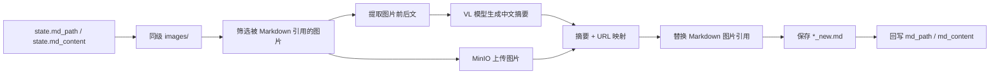

# 第 4 节：Markdown 图片处理

> 第 3 节已经把真实 PDF 转成了带 `images/` 资源的 Markdown，并写入 `md_path`、`md_content`。这一节只处理“Markdown 里有图片，但图片内容还没有进入知识库语义”的问题：扫描真实图片、结合上下文生成中文摘要、把图片放进 MinIO，并把 Markdown 中的本地引用替换成可访问的远程引用。
>
> 本节不重复 PDF 上传、MinerU 轮询、ZIP 下载、解压和 Markdown 生成。那些能力已经在第 3 节验收通过。
>
> 资料边界：day04 视频和压缩包中的当天代码实际讲到“调用 VL 模型生成摘要”；课堂笔记和补充笔记继续写了 MinIO 上传、Markdown 替换和 `_new.md` 保存。本节按你确认的完整闭环施工，并把这段资料差异明确标出来。

## 0. 本节你会学到

完成本节后，`NodeMdImg` 应该能完成下面的业务闭环：



本节的前置条件是：

- 第 3 节已经通过，项目能读到真实 Markdown 和图片资源；
- [状态定义](../../src/shopkeeper_brain/processor/import_process/state.py)中已有 `md_path`、`md_content`；
- [PDF 节点](../../src/shopkeeper_brain/processor/import_process/nodes/node_pdf_to_md.py)能把真实 Markdown 写到 `workspace/`；
- 你有权使用的 VL 模型配置和 MinIO 服务只在本地 `.env` 中准备，密钥不写入教程和 Git。

本节节点的契约如下：

| 项目 | 内容 |
| --- | --- |
| 输入状态 | `md_path`：Markdown 文件路径；`md_content`：Markdown 正文 |
| 本地输入 | `md_path` 同级的 `images/` 目录和其中的真实图片 |
| 外部服务 | OpenAI 兼容的 VL 模型接口、MinIO 对象存储 |
| 成功输出 | 新的 `md_path` 指向 `<stem>_new.md`，`md_content` 与该文件一致 |
| Markdown 变化 | 图片 Alt 文本变成模型摘要，图片路径变成 MinIO URL |
| 无图片目录 | 记录跳过并原样返回状态 |
| 没有被引用的图片 | 不上传、不调用模型、不修改 Markdown |
| 外部服务不可用 | 本地探针可以通过；完整外部验证必须记录为“跳过”或“失败” |

第 3 节真实产物已经确认包含 13 个图片引用和 16 个图片文件。因此本节可以直接使用真实 Markdown 验证，另外 3 个未被引用的文件正好能观察筛选逻辑。不要为了教学再造假图片、假 Markdown 或假模型。

## 1. 业务流程与设计原因

### 1.1 先看图片为什么必须进入处理流程

Markdown 中这样的引用：

```markdown

```

对文本切片器来说，通常只能看到 `原始描述` 和路径字符串，看不到 `example.jpg` 里面的内容。图片可能是一张：

- 产品面板图；
- 电路连接图；
- 安全警告图；
- 参数表截图；
- 操作步骤示意图。

如果用户问“哪个端口用于公共接地”，答案可能只存在于图片里。图片处理节点做两件互补的事：

1. 把图片上传到对象存储，让后续服务不依赖当前 Python 进程的本地磁盘；
2. 用视觉模型把图片内容变成短文本，让后续切片、向量化和检索能够使用这部分语义。

所以这个节点不是“把图片复制一下”。它是在做一次图文语义对齐：图片仍然保留为图片，同时产生一条可检索的文字描述。

### 1.2 为什么要先从 Markdown 引用反查图片

MinerU 的输出目录可能包含比正文引用更多的图片文件。直接遍历 `images/` 全部上传会带来三个问题：

| 做法 | 具体后果 |
| --- | --- |
| 上传目录中的全部图片 | 未使用的图片进入对象存储，增加垃圾数据和模型费用 |
| 只匹配文件后缀 | 只能知道“像一张图片”，不知道它是否属于当前文档正文 |
| 只按 Markdown 顺序解析 | 可能漏掉目录中存在、但引用路径格式不同的支持格式文件 |

本节保留参考项目的思路：先遍历同级 `images/`，再检查每个文件名是否出现在 Markdown 图片标签中。目标列表中的每一项携带三类信息：

```text
图片文件名 + 本地完整路径 + 图片标签前后文
```

图片前后文不是图片本身，它的作用是给 VL 模型补充文档语境。例如图片上方是“控制与端口”，下方是“1.LCD 液晶显示”，模型比只看图片更容易生成贴合文档的摘要。

### 1.3 为什么摘要和 URL 要分开生成，再合并

模型摘要和 MinIO 上传是两个可能独立失败的外部动作：

- 模型调用成功，上传失败；
- 上传成功，模型调用失败；
- 两者都成功。

因此先得到：

```python
summaries = {"image-a.jpg": "产品控制面板和端口示意图"}
urls = {"image-a.jpg": "http://localhost:9000/knowledge-base/upload-images/doc/image-a.jpg"}
```

再只保留同时存在的键，形成：

```python
image_info = {
    "image-a.jpg": (
        "产品控制面板和端口示意图",
        "http://localhost:9000/knowledge-base/upload-images/doc/image-a.jpg",
    )
}
```

这样替换 Markdown 时不会产生“摘要有了但 URL 为空”的半成品引用。

### 1.4 节点为什么分成五步

`process()` 只负责串联业务步骤，把排查边界留给小方法：

| 步骤 | 方法 | 解决的问题 | 产物 |
| --- | --- | --- | --- |
| 1 | `_step_1_get_content` | 状态和 Markdown 路径是否可用 | 正文、Markdown Path、图片目录 Path |
| 2 | `_step_2_scan_images` | 哪些图片真的被引用 | `target_images` |
| 3 | `_step_3_generate_summaries` | 图片怎样变成文字 | `summaries` |
| 4 | `_step_4_upload_and_replace` | 图片怎样远程持久化并替换引用 | 新 Markdown 正文 |
| 5 | `_step_5_backup_new_md_file` | 怎样保留原文件并落盘新结果 | 新 Markdown Path |

这种拆分不是为了增加方法数量，而是让每个外部边界都能单独定位。真实运行失败时，你能判断失败发生在本地文件、模型、对象存储还是 Markdown 写入。

## 2. 手敲步骤

下面的代码是施工图纸。你负责在自己的学习代码中手敲；本节不会直接修改 `src/`。

### 2.1 先补依赖和本地配置模板

图片摘要使用 `langchain-openai` 的 `ChatOpenAI`，因为 DashScope 提供 OpenAI 兼容接口；图片持久化使用 `minio` Python SDK。当前项目的直接依赖需要补上这两个包。

**文件**：`pyproject.toml`

```toml
[project]
name = "shopkeeper-brain"
version = "0.1.0"
description = "Add your description here"
readme = "README.md"
authors = [
    { name = "kdsirius", email = "2915049950@qq.com" }
]
requires-python = ">=3.11"
dependencies = [
    "langgraph>=1.2.20",
    "requests>=2.32.5",
    "python-dotenv>=1.2.2",
    "langchain-openai>=1.2.1",
    "minio>=7.2.20",
]

[project.scripts]
shopkeeper-brain = "shopkeeper_brain:main"

[[tool.uv.index]]
url = "https://pypi.tuna.tsinghua.edu.cn/simple"
default = true

[build-system]
requires = ["uv_build>=0.12.13,<0.13.0"]
build-backend = "uv_build"
```

在项目终端执行：

```bash
uv sync
```

这条命令只代表依赖同步完成，不能代表图片节点业务通过。依赖问题解决后，真正的验证仍然要使用第 3 节真实 Markdown。

然后补充本地环境模板。模板只保留变量名和安全默认值，真实 Token、MinIO 密钥写入本地 `.env`，不要写入这个文件。

**文件**：`.env.example`

```dotenv
# ====================
# MinerU API
# ====================
SHOPKEEPER_BRAIN_MINERU_BASE_URL=https://mineru.net/api/v4
SHOPKEEPER_BRAIN_MINERU_API_TOKEN=

# ====================
# Vision model: OpenAI-compatible endpoint
# ====================
SHOPKEEPER_BRAIN_VL_BASE_URL=https://dashscope.aliyuncs.com/compatible-mode/v1
SHOPKEEPER_BRAIN_VL_API_KEY=
SHOPKEEPER_BRAIN_VL_MODEL=qwen3-vl-flash
SHOPKEEPER_BRAIN_VL_TEMPERATURE=0.1

# Sliding-window rate limit for VL requests
SHOPKEEPER_BRAIN_IMAGE_MAX_REQUESTS=10
SHOPKEEPER_BRAIN_IMAGE_WINDOW_SECONDS=60

# ====================
# MinIO
# ====================
# 不要加 http://，也不要在末尾加路径
SHOPKEEPER_BRAIN_MINIO_ENDPOINT=localhost:9000
SHOPKEEPER_BRAIN_MINIO_ACCESS_KEY=your-access-key
SHOPKEEPER_BRAIN_MINIO_SECRET_KEY=your-secret-key
SHOPKEEPER_BRAIN_MINIO_BUCKET=knowledge-base
SHOPKEEPER_BRAIN_MINIO_IMAGE_PREFIX=upload-images
SHOPKEEPER_BRAIN_MINIO_SECURE=false
```

配置职责要分开：`state` 描述本次文档处理的数据，`.env` 描述外部服务连接信息。不要把 API Key 塞进状态，也不要在 `NodeMdImg` 类里硬编码。

### 2.2 读取 VL 模型配置

`image_config.py` 只负责把环境变量变成配置对象。`repr=False` 让直接打印配置对象时不展示 API Key，但它不是加密；`.env` 仍然必须保持本地私有。

**文件**：`src/shopkeeper_brain/core/image_config.py`

```python
import os
from dataclasses import dataclass, field
from pathlib import Path

from dotenv import load_dotenv


@dataclass
class ImageConfig:
    """图片摘要所需的视觉模型配置。"""

    base_url: str
    api_key: str = field(repr=False)
    model: str
    temperature: float
    max_requests: int
    window_seconds: int


def load_image_config() -> ImageConfig:
    """从项目根目录的 .env 读取视觉模型和限流配置。"""
    project_root = Path(__file__).resolve().parents[3]
    load_dotenv(project_root / ".env", override=False)

    return ImageConfig(
        base_url=os.getenv("SHOPKEEPER_BRAIN_VL_BASE_URL", "").strip().rstrip("/"),
        api_key=os.getenv("SHOPKEEPER_BRAIN_VL_API_KEY", "").strip(),
        model=os.getenv("SHOPKEEPER_BRAIN_VL_MODEL", "").strip(),
        temperature=float(
            os.getenv("SHOPKEEPER_BRAIN_VL_TEMPERATURE", "0.1")
        ),
        max_requests=int(
            os.getenv("SHOPKEEPER_BRAIN_IMAGE_MAX_REQUESTS", "10")
        ),
        window_seconds=int(
            os.getenv("SHOPKEEPER_BRAIN_IMAGE_WINDOW_SECONDS", "60")
        ),
    )
```

这里继续用 `Path(__file__).resolve().parents[3]` 定位项目根目录。这样从 IDE、项目根目录或模块入口启动时，`.env` 的查找位置一致。

### 2.3 读取 MinIO 配置

MinIO 的 endpoint 只保存 `host:port`，协议由 `secure` 决定。图片前缀不要以 `/` 开头，因为对象存储的对象名是桶内的键，不是本地绝对路径。

**文件**：`src/shopkeeper_brain/core/minio_config.py`

```python
import os
from dataclasses import dataclass
from pathlib import Path

from dotenv import load_dotenv


@dataclass
class MinioConfig:
    """MinIO 图片对象存储配置。"""

    endpoint: str
    access_key: str
    secret_key: str
    bucket: str
    image_prefix: str
    secure: bool


def load_minio_config() -> MinioConfig:
    """从项目根目录的 .env 读取 MinIO 配置。"""
    project_root = Path(__file__).resolve().parents[3]
    load_dotenv(project_root / ".env", override=False)

    return MinioConfig(
        endpoint=os.getenv("SHOPKEEPER_BRAIN_MINIO_ENDPOINT", "").strip(),
        access_key=os.getenv("SHOPKEEPER_BRAIN_MINIO_ACCESS_KEY", "").strip(),
        secret_key=os.getenv("SHOPKEEPER_BRAIN_MINIO_SECRET_KEY", "").strip(),
        bucket=os.getenv("SHOPKEEPER_BRAIN_MINIO_BUCKET", "").strip(),
        image_prefix=os.getenv(
            "SHOPKEEPER_BRAIN_MINIO_IMAGE_PREFIX", "upload-images"
        ).strip().strip("/"),
        secure=os.getenv(
            "SHOPKEEPER_BRAIN_MINIO_SECURE", "false"
        ).strip().lower() == "true",
    )
```

### 2.4 手敲图片节点主体

现在写节点。下面是一份完整文件，包含本地扫描、上下文提取、真实 VL 摘要、MinIO 上传、Markdown 替换、备份和学习期真实入口。

**文件**：`src/shopkeeper_brain/processor/import_process/nodes/node_md_img.py`

```python
import base64
import json
import logging
import mimetypes
import re
import time
from collections import deque
from pathlib import Path
from typing import Deque

from langchain_openai import ChatOpenAI
from minio import Minio
from minio.models import DeleteRequest

from shopkeeper_brain.core.image_config import load_image_config
from shopkeeper_brain.core.minio_config import load_minio_config
from shopkeeper_brain.processor.import_process.BaseNode import BaseNode
from shopkeeper_brain.processor.import_process.exceptions import (
    ConfigurationError,
    FileProcessingError,
    StateFieldError,
)
from shopkeeper_brain.processor.import_process.state import (
    ImportGraphState,
    create_default_state,
)


ImageTarget = tuple[str, Path, tuple[str, str]]
ImageInfo = dict[str, tuple[str, str]]


class NodeMdImg(BaseNode):
    """处理 Markdown 图片，完成摘要、上传和引用替换。"""

    name = "node_md_img"
    image_extensions = {".jpg", ".jpeg", ".png", ".gif", ".bmp", ".webp"}

    def process(self, state: ImportGraphState) -> ImportGraphState:
        """读取 Markdown，处理图片，并把新结果写回状态。"""
        md_content, md_path, images_dir = self._step_1_get_content(state)
        if not images_dir.is_dir():
            self.logger.info("图片目录不存在，跳过图片处理：%s", images_dir)
            return state

        target_images = self._step_2_scan_images(md_content, images_dir)
        if not target_images:
            self.logger.info("没有找到被 Markdown 引用的支持格式图片")
            return state

        summaries = self._step_3_generate_summaries(
            md_path.stem,
            target_images,
        )
        new_md_content = self._step_4_upload_and_replace(
            md_path.stem,
            target_images,
            summaries,
            md_content,
        )
        new_md_path = self._step_5_backup_new_md_file(
            md_path,
            new_md_content,
        )

        # 只有新文件写入成功后，才让下游看到新的状态。
        state["md_path"] = str(new_md_path)
        state["md_content"] = new_md_content
        return state

    def _step_1_get_content(
            self,
            state: ImportGraphState,
    ) -> tuple[str, Path, Path]:
        """取得 Markdown 正文、文件路径和同级图片目录。"""
        md_path_value = state.get("md_path")
        if not isinstance(md_path_value, str) or not md_path_value.strip():
            raise StateFieldError(
                node_name=self.name,
                field_name="md_path",
                expected_type=str,
            )

        md_path = Path(md_path_value).resolve()
        if not md_path.is_file():
            raise FileProcessingError(
                message=f"Markdown 文件不存在或不是普通文件：{md_path}",
                node_name=self.name,
            )

        md_content = state.get("md_content", "")
        if not isinstance(md_content, str):
            raise StateFieldError(
                node_name=self.name,
                field_name="md_content",
                expected_type=str,
            )
        if not md_content:
            md_content = md_path.read_text(encoding="utf-8")

        return md_content, md_path, md_path.parent / "images"

    def _step_2_scan_images(
            self,
            md_content: str,
            images_dir: Path,
    ) -> list[ImageTarget]:
        """筛选支持格式且确实被 Markdown 引用的图片。"""
        target_images: list[ImageTarget] = []

        for image_path in sorted(images_dir.iterdir()):
            if not image_path.is_file():
                continue
            if image_path.suffix.lower() not in self.image_extensions:
                continue

            context = self._find_image_in_md(md_content, image_path.name)
            if context is None:
                self.logger.info("图片未被 Markdown 引用，跳过：%s", image_path.name)
                continue

            target_images.append((image_path.name, image_path, context))

        self.logger.info("筛选出 %s 张待处理图片", len(target_images))
        return target_images

    def _find_image_in_md(
            self,
            md_content: str,
            image_file: str,
            context_len: int = 100,
    ) -> tuple[str, str] | None:
        """查找图片标签，并截取标签前后各一段文本。"""
        pattern = re.compile(
            r"!\[.*?\]\(.*?"
            + re.escape(image_file)
            + r".*?\)"
        )
        match = pattern.search(md_content)
        if match is None:
            return None

        start, end = match.span()
        before = md_content[max(0, start - context_len):start]
        after = md_content[end:min(len(md_content), end + context_len)]
        return before, after

    def _step_3_generate_summaries(
            self,
            doc_stem: str,
            target_images: list[ImageTarget],
    ) -> dict[str, str]:
        """按限流规则调用 VL 模型，返回图片摘要映射。"""
        config = load_image_config()
        if not config.base_url:
            raise ConfigurationError(
                message="视觉模型配置缺失：SHOPKEEPER_BRAIN_VL_BASE_URL",
                node_name=self.name,
            )
        if not config.api_key:
            raise ConfigurationError(
                message="视觉模型配置缺失：SHOPKEEPER_BRAIN_VL_API_KEY",
                node_name=self.name,
            )
        if not config.model:
            raise ConfigurationError(
                message="视觉模型配置缺失：SHOPKEEPER_BRAIN_VL_MODEL",
                node_name=self.name,
            )

        request_times: Deque[float] = deque()
        summaries: dict[str, str] = {}
        for image_file, image_path, context in target_images:
            self._apply_api_rate_limit(
                request_times,
                config.max_requests,
                config.window_seconds,
            )
            summaries[image_file] = self._summarize_image(
                image_path,
                doc_stem,
                context,
                config,
            )

        return summaries

    def _apply_api_rate_limit(
            self,
            request_times: Deque[float],
            max_requests: int,
            window_seconds: int,
    ) -> None:
        """用滑动时间窗口限制 VL 请求频率。"""
        if max_requests <= 0 or window_seconds <= 0:
            raise ValueError("图片摘要限流参数必须是正数")

        current_time = time.monotonic()
        while request_times and current_time - request_times[0] >= window_seconds:
            request_times.popleft()

        if len(request_times) >= max_requests:
            sleep_seconds = window_seconds - (
                current_time - request_times[0]
            )
            if sleep_seconds > 0:
                self.logger.info(
                    "触发 VL 限流，等待 %.2f 秒后继续",
                    sleep_seconds,
                )
                time.sleep(sleep_seconds)

            current_time = time.monotonic()
            while request_times and current_time - request_times[0] >= window_seconds:
                request_times.popleft()

        request_times.append(current_time)

    def _summarize_image(
            self,
            image_path: Path,
            doc_stem: str,
            context: tuple[str, str],
            config,
    ) -> str:
        """把一张本地图片和它在文档中的上下文交给 VL 模型。"""
        mime_type = mimetypes.guess_type(image_path.name)[0] or "image/jpeg"
        base64_image = base64.b64encode(image_path.read_bytes()).decode("ascii")
        prompt = (
            f'这是“{doc_stem}”文件中的一张图片。'
            f'图片上文为“{context[0]}”，下文为“{context[1]}”。'
            "请只返回一段普通中文文本，作为 Markdown 图片标题，"
            "控制在 50 字以内。不要输出 Markdown、代码围栏、图片标签、"
            "解释文字或前缀。"
        )
        messages = [
            {
                "role": "user",
                "content": [
                    {"type": "text", "text": prompt},
                    {
                        "type": "image_url",
                        "image_url": {
                            "url": f"data:{mime_type};base64,{base64_image}"
                        },
                    },
                ],
            }
        ]

        try:
            chat_model = ChatOpenAI(
                model=config.model,
                api_key=config.api_key,
                base_url=config.base_url,
                temperature=config.temperature,
            )
            response = chat_model.invoke(messages)
        except Exception as exc:
            raise FileProcessingError(
                message=f"图片摘要生成失败：{image_path.name}",
                node_name=self.name,
            ) from exc

        summary = self._clean_image_summary(str(response.content))
        if not summary or "```" in summary or "![" in summary:
            raise FileProcessingError(
                message=f"图片摘要格式无效：{image_path.name}",
                node_name=self.name,
            )
        return summary

    @staticmethod
    def _clean_image_summary(summary: str) -> str:
        """把模型输出清洗成可以放进 Markdown Alt 文本的普通短文本。"""
        summary = summary.strip()

        # 去掉 ```markdown、```md 或单纯的 ``` 包裹。
        summary = re.sub(
            r"^```(?:markdown|md)?\s*",
            "",
            summary,
            flags=re.IGNORECASE,
        )
        summary = re.sub(r"\s*```$", "", summary)

        # 把嵌套图片标签转换成它的 Alt 文本。
        summary = re.sub(
            r"!\[([^\]]*)\]\([^)]*\)",
            r"\1",
            summary,
        )

        summary = re.sub(r"\s+", " ", summary).strip()
        return summary[:50]

    def _step_4_upload_and_replace(
            self,
            doc_stem: str,
            target_images: list[ImageTarget],
            summaries: dict[str, str],
            md_content: str,
    ) -> str:
        """清理旧对象、上传图片，并替换 Markdown 中的图片标签。"""
        config = load_minio_config()
        for field_name, value in (
            ("SHOPKEEPER_BRAIN_MINIO_ENDPOINT", config.endpoint),
            ("SHOPKEEPER_BRAIN_MINIO_ACCESS_KEY", config.access_key),
            ("SHOPKEEPER_BRAIN_MINIO_SECRET_KEY", config.secret_key),
            ("SHOPKEEPER_BRAIN_MINIO_BUCKET", config.bucket),
        ):
            if not value:
                raise ConfigurationError(
                    message=f"MinIO 配置缺失：{field_name}",
                    node_name=self.name,
                )

        try:
            client = Minio(
                endpoint=config.endpoint,
                access_key=config.access_key,
                secret_key=config.secret_key,
                secure=config.secure,
            )
            if not client.bucket_exists(config.bucket):
                client.make_bucket(config.bucket)

            # Markdown 保存的是匿名直链，因此桶必须允许匿名读取对象。
            # 这段代码必须放在 if 外面，已有桶也要补上策略。
            policy = {
                "Version": "2012-10-17",
                "Statement": [
                    {
                        "Effect": "Allow",
                        "Principal": {"AWS": ["*"]},
                        "Action": ["s3:GetObject"],
                        "Resource": [
                            f"arn:aws:s3:::{config.bucket}/*"
                        ],
                    }
                ],
            }
            client.set_bucket_policy(
                config.bucket,
                json.dumps(policy),
            )

            upload_dir = f"{config.image_prefix}/{doc_stem}".replace(" ", "")
            self._clean_minio_directory(client, config.bucket, upload_dir)
            urls = self._upload_images_batch(
                client,
                config,
                upload_dir,
                target_images,
            )
        except ConfigurationError:
            raise
        except Exception as exc:
            raise FileProcessingError(
                message=f"MinIO 图片处理失败：{doc_stem}",
                node_name=self.name,
            ) from exc

        image_info = self._merge_summary_and_url(summaries, urls)
        return self._process_md_file(md_content, image_info)

    def _clean_minio_directory(
            self,
            client: Minio,
            bucket: str,
            prefix: str,
    ) -> None:
        """删除当前文档对应的旧对象，保证重复运行不会累积垃圾文件。"""
        objects = client.list_objects(
            bucket_name=bucket,
            prefix=prefix,
            recursive=True,
        )
        delete_list = [
            DeleteRequest.Object(name=obj.object_name)
            for obj in objects
        ]
        if not delete_list:
            return

        errors = client.remove_objects(
            bucket_name=bucket,
            objects=delete_list,
        )
        for error in errors:
            raise RuntimeError(
                f"删除 MinIO 对象失败：{error.name}"
            )

    def _upload_images_batch(
            self,
            client: Minio,
            config,
            upload_dir: str,
            target_images: list[ImageTarget],
    ) -> dict[str, str]:
        """上传目标图片并返回文件名到 URL 的映射。"""
        protocol = "https" if config.secure else "http"
        urls: dict[str, str] = {}

        for image_file, image_path, _ in target_images:
            object_name = f"{upload_dir}/{image_file}"
            content_type = mimetypes.guess_type(image_file)[0] or "application/octet-stream"
            client.fput_object(
                bucket_name=config.bucket,
                object_name=object_name,
                file_path=str(image_path),
                content_type=content_type,
            )
            urls[image_file] = (
                f"{protocol}://{config.endpoint}/{config.bucket}/{object_name}"
            )

        return urls

    def _merge_summary_and_url(
            self,
            summaries: dict[str, str],
            urls: dict[str, str],
    ) -> ImageInfo:
        """只保留同时有摘要和 URL 的图片。"""
        return {
            image_file: (summary, urls[image_file])
            for image_file, summary in summaries.items()
            if urls.get(image_file)
        }

    def _process_md_file(
            self,
            md_content: str,
            image_info: ImageInfo,
    ) -> str:
        """把本地图片标签替换成摘要和远程 URL。"""
        for image_file, (summary, new_url) in image_info.items():
            pattern = re.compile(
                r"!\[.*?\]\(.*?"
                + re.escape(image_file)
                + r".*?\)"
            )
            md_content = pattern.sub(
                lambda _: f"",
                md_content,
            )
        return md_content

    def _step_5_backup_new_md_file(
            self,
            origin_md_path: Path,
            md_content: str,
    ) -> Path:
        """保留原 Markdown，并把处理后的内容写成 `<stem>_new.md`。"""
        new_md_path = origin_md_path.with_name(
            f"{origin_md_path.stem}_new.md"
        )
        try:
            new_md_path.write_text(md_content, encoding="utf-8")
        except OSError as exc:
            raise FileProcessingError(
                message=f"处理后的 Markdown 保存失败：{new_md_path}",
                node_name=self.name,
            ) from exc
        return new_md_path.resolve()


if __name__ == "__main__":
    logging.basicConfig(
        level=logging.INFO,
        format="%(levelname)s %(name)s %(message)s",
    )

    md_path = Path(input("请输入第 3 节生成的 Markdown 路径：").strip()).expanduser()
    state = create_default_state(
        md_path=str(md_path),
        md_content=md_path.read_text(encoding="utf-8"),
    )

    node = NodeMdImg()
    content, resolved_path, images_dir = node._step_1_get_content(state)
    targets = node._step_2_scan_images(content, images_dir)
    print("Markdown：", resolved_path)
    print("图片目录：", images_dir)
    print("被 Markdown 引用的图片数：", len(targets))

    # 这一步只验证本地输入，外部服务配置不完整时明确跳过完整链路。
    image_config = load_image_config()
    minio_config = load_minio_config()
    if not image_config.api_key or not minio_config.endpoint:
        print("本地图片扫描：通过")
        print("VL/MinIO 完整链路：跳过（缺少本地外部服务配置）")
        raise SystemExit(0)

    result = node(state)
    result_path = Path(result["md_path"])
    assert result is state
    assert result_path.is_file()
    assert result["md_content"] == result_path.read_text(encoding="utf-8")
    assert result_path.name == f"{resolved_path.stem}_new.md"
    print("处理后 Markdown：", result_path)
    print("处理后正文字符数：", len(result["md_content"]))
    print("Markdown 图片处理：通过")
```

这里有几处需要你特别留意：

- `process()` 在最后才更新状态。如果模型调用或 MinIO 上传中途失败，旧的 `md_path` 和 `md_content` 不会伪装成新结果。
- `_step_1_get_content()` 优先使用状态中已经存在的 `md_content`；状态内容为空时才从文件读取。这与第 3 节“节点把正文写入状态”的契约一致。
- `_step_2_scan_images()` 同时检查后缀和 Markdown 引用。只存在于 `images/`、但没有被正文引用的文件会被跳过。
- 正则中的 `re.escape(image_file)` 是为了让文件名里的点号、括号等字符按普通文件名匹配；`.*?` 是非贪婪匹配，避免把多张图片标签连成一个匹配结果。
- VL 消息使用 OpenAI 兼容格式的 `image_url` 数据 URI。`mime_type` 根据文件后缀推断，不能把所有图片都无条件标成 JPEG。
- 模型输出不能直接当作 Markdown Alt 文本；先去掉代码围栏和嵌套图片标签，再拒绝仍含 Markdown 结构的摘要。
- `deque` 保存的是当前时间窗口内的请求时间。窗口达到上限后，代码等待最早时间戳过期，再记录新的请求。
- MinIO 上传目录不使用前导 `/`，因为它是桶内对象前缀。上传前清理同一文档前缀，是为了让重复运行不会遗留旧文件。
- Markdown 保存的是浏览器直接访问的对象 URL，所以桶需要匿名 `s3:GetObject` 策略。策略设置必须和“桶不存在时创建桶”的 `if` 同级，否则已有桶不会补策略。
- `pattern.sub(lambda _: ...)` 使用函数返回替换文本，摘要中即使出现反斜杠等字符，也不会被 `re.sub` 当成替换模板语法。

### 2.5 参考项目对照和资料差异

参考项目的命名是 `NodeMDImg`，当前重建项目沿用第 3 节的 Python 命名风格使用 `NodeMdImg`。两者职责相同，类名大小写按当前项目风格统一即可。

参考 day04 压缩包中的 `node_md_img.py` 实际 `process()` 在生成摘要后直接返回状态，上传和备份部分被注释；课堂笔记流程图却已经把五步完整画出。这里采用完整闭环，是因为下一节文档切片需要拿到一个稳定的 Markdown 结果，而不是只在内存中短暂生成摘要。资料中这段“设计先于代码”的差异要保留在学习记录里，不能把压缩包快照说成已经完成了 MinIO 持久化。

本节没有把 MinIO 客户端再拆成独立 `utils` 文件。原因是当前重建项目还没有 MinIO 工具层，先让你看清楚“配置、上传、替换、状态回写”这一条业务边界；等后续节点复用对象存储时，再根据真实重复代码决定是否抽取。

本节仍保留文件末尾的 `__main__` 作为学习期真实入口，不把节点提前接入正式主图。等导入主图和服务层真正接收任务后，再迁移或删除这个临时入口。

## 3. 必做真实验证

### 3.1 本地确定性探针

先不要上传，也不要启动 VL 模型。用第 3 节真实输出目录完成本地探针：

1. 在 IDE 中运行 `node_md_img.py`。
2. 输入第 3 节生成的真实 Markdown 路径，例如 `workspace/day03-real-run/` 下的 PDF 同名 `.md`。
3. 观察打印出的 Markdown 路径和 `images/` 路径。
4. 检查“被 Markdown 引用的图片数”。此前真实输入中 Markdown 有 13 个图片引用、目录有 16 个图片文件；本次实际数量以程序扫描结果为准。
5. 检查没有被正文引用的图片不会进入 `targets`。
6. 如果本地 `.env` 没有 VL API Key 或 MinIO endpoint，程序应明确打印“本地图片扫描：通过”和“VL/MinIO 完整链路：跳过”，不能打印“图片处理：通过”。

这一步验证的是本地输入契约和筛选逻辑，不等于完整节点通过。

### 3.2 真实 VL 和 MinIO 验证

只有在你已经准备好真实服务时执行完整链路：

- `.env` 中填写真实的 VL API 地址、模型名和 API Key；
- MinIO 服务已经启动，endpoint、账号、密码和桶名正确；
- 该真实 Markdown 和图片是允许上传、分析和保存的资料；
- 输出结果仍然写入 `workspace/`，不把处理后的文件写回 `reference/`。

运行后检查：

1. VL 模型对每个目标图片产生非空中文摘要；
2. MinIO 桶中出现按文档主名隔离的图片对象；
3. 原 Markdown 仍然保留；
4. 同目录生成 `<原文件名>_new.md`；
5. 新 Markdown 中图片 Alt 文本不再是原始空描述或旧描述；
6. Alt 文本是普通短文本，不包含代码围栏、嵌套 `![...]` 或本地 `images/` 引用；
7. 新 Markdown 中图片路径是 MinIO URL；
8. `state["md_path"]` 指向新文件；
9. `state["md_content"]` 与新文件读取结果完全一致；
10. 重复运行时，旧文档前缀会先清理，不会无限累积同名对象。

真实服务验证没有在本教程编写阶段运行，以上是操作步骤和预期效果，不是本节已经产生的运行输出。没有凭证或服务时，验证状态写“跳过”或“未运行”。不要用假响应、模拟 MinIO 或模拟模型替代它。

### 3.3 失败定位

| 现象 | 先检查 | 说明 |
| --- | --- | --- |
| `md_path` 状态错误 | `create_default_state()` 是否传入真实 Markdown 路径 | 节点还没进入图片处理 |
| Markdown 文件不存在 | 路径和文件名是否真实存在 | 本地输入失败 |
| 图片目录不存在 | Markdown 同级是否有 `images/` | 节点按设计跳过 |
| 被引用图片数为 0 | Markdown 图片标签和文件名是否对应 | 没有目标图片，不应调用外部服务 |
| VL 配置缺失 | `.env` 的变量名和 API Key | 节点不应发起模型请求 |
| VL 请求失败 | endpoint、模型名、凭证和服务返回 | 只记录脱敏后的错误，不贴 Key 或签名 URL |
| 触发限流后请求过快 | `max_requests`、`window_seconds` 和等待日志 | 不能删掉 `sleep` 让请求持续打满服务 |
| MinIO 连接失败 | endpoint、secure、账号、密码和服务状态 | 上传尚未完成，不能写回新状态 |
| 新 Markdown 没有远程 URL | 上传返回的 URL 映射和文件名匹配 | 只有同时有摘要和 URL 才会替换 |
| 状态路径和磁盘内容不一致 | `_step_5_backup_new_md_file()` 和最后两行状态更新 | 下游拿到的内容契约被破坏 |

## 4. 验证汇总

本节验收时按下面几类分别记录，不把一种验证的结果扩大到另一种：

| 验证项 | 本教程交付时状态 | 用户手敲后的记录方式 |
| --- | --- | --- |
| 文档结构和代码标记 | 待实际检查 | 通过/失败 |
| `uv sync` | 未验证 | 记录真实命令结果 |
| 本地真实 Markdown 扫描 | 未验证 | 记录图片目录、引用数和目标数 |
| VL 真实摘要 | 未运行 | 有真实凭证才运行，否则跳过 |
| MinIO 真实上传与替换 | 未运行 | 有真实服务才运行，否则跳过 |
| 状态与新文件一致 | 未运行 | 读取新文件并逐字比较 |
| 自动化测试条数 | 本节不新增 | 不编造测试数量 |

下一节开始文档切片时，输入应当是本节成功生成的 `md_path` 和 `md_content`。如果本节只有本地扫描通过、外部服务没有运行，图片远程持久化和语义摘要仍属于欠账，不能写成完整闭环已经通过。

## 5. 小结

如果只记三件事：

1. 图片处理节点先从 Markdown 引用反查真实图片，再调用外部服务，避免把整个图片目录都当成业务数据。
2. 图片摘要和对象 URL 分别生成，只有两者都存在时才替换 Markdown；限流是保护外部 VL 服务的业务逻辑，不是可有可无的装饰。
3. 只有新 Markdown 真正写入成功，才更新 `md_path` 和 `md_content`；状态更新时机决定了下游看到的是不是可信结果。

对照参考项目，本节保留了 `node_md_img` 的职责、图片前后文、`deque` 限流、VL 多模态消息、MinIO 前缀隔离和 `_new.md` 备份；同时把参考代码快照中注释掉的上传与状态更新补成了可验证的完整链路，并明确记录了这项资料差异。

下一节是第 5 节“文档切片”。它会使用这里产生的 Markdown 正文继续处理；在进入下一节前，必须先完成本节用户代码的真实验收。
