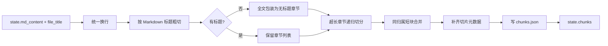

# 第 5 节：文档切片

> 第 4 节已经把 Markdown 中的图片变成了带中文摘要和远程 URL 的内容。这一节继续处理同一个 `state`：把完整 Markdown 整理成适合后续主体识别、向量化和检索的多个 Chunk。我们只做文档切片，不重新调用 VL 模型、MinIO，也不提前改正式主图。

## 0. 本节你会学到

完成本节后，学习项目会新增一个独立的 `NodeDocumentSplit` 节点，完成下面的流程：



本节的前置条件：

- 第 4 节已经通过，手里有真实的 Markdown `_new.md`；
- `state` 已经有 `md_path`、`md_content` 和 `file_title`；
- [NodeMdImg](../../src/shopkeeper_brain/processor/import_process/nodes/node_md_img.py) 的图片处理链路已经验收，不需要在本节重新运行；
- 用户使用 Python 3.11 或更高版本，并通过 uv 管理依赖。

本节节点的输入和输出如下：

| 项目 | 内容 |
| --- | --- |
| 核心输入 | `md_content`、`file_title` |
| 备份输入 | `md_path`，用于定位 `chunks.json` |
| 主要输出 | `state["chunks"]` |
| 本地产物 | Markdown 同目录的 `chunks.json` |
| 外部服务 | 无 |
| 本节跳过 | VL、MinIO、MinerU、Milvus、MongoDB |

本节的测试条数仍然以真实运行输出为准。教程交付前没有用户运行结果，所有命令都标为“未验证”；不要把预期输出当成实际测试条数。

## 1. 业务流程与设计原因

### 1.1 为什么不能把整篇 Markdown 直接向量化

第 4 节结束时，`md_content` 还是一整篇文档。以真实的 RS-12 说明书为例，正文同时包含安全手册、控制端口、规格、测量步骤和更换保险丝等多个主题。

如果把整篇文档只生成一个向量，会出现两个问题：

- 用户问“COM 端口是什么”时，召回结果还带着大量电池、保险丝和规格内容；
- 文档太长，向量模型或后续大模型的上下文窗口可能无法一次容纳全部正文。

因此切片节点要把“整篇文档”整理成多个相对完整的知识单元。每个单元既不能大到失去检索焦点，也不能小到只剩半句没有上下文。

### 1.2 为什么先按标题切，再按长度切

直接每 2000 个字符切一刀，可能正好把一个标题和它的正文分开。用户检索到正文时，切片里没有章节语境；如果切在表格、步骤或句子中间，答案生成还要重新猜这段文字属于什么主题。

参考项目采用两级策略：

1. **结构优先**：先把 Markdown 标题和标题下的正文放在同一章节里；
2. **长度兜底**：只有章节太长时，才进一步按段落、换行、标点和空格递归细分。

这是一种“先保留文档结构，再控制单块大小”的策略。标题切分不负责解决所有长度问题，递归切分也不负责重新理解文档层级，它们各自只解决一个问题。

### 1.3 为什么要保护代码围栏

Markdown 里的代码示例可能包含这样的 Python 注释：

```text
# 这是一段代码注释
```

如果扫描器只看行首的 `#`，就会把它误判成一级 Markdown 标题。课堂笔记本身大量使用 ` ```python` 围栏，因此本节的扫描器要记录“当前是否在代码围栏里”，并兼容带语言标记的开围栏。

这是对参考笔记的一个必要修正：参考正则只匹配单独的 ```，直接照抄会漏掉 ` ```python`。

### 1.4 每个 Chunk 为什么要带元数据

切片不是一串没有来源的字符串。后续主体识别、向量化、检索结果展示和答案溯源都需要知道这段文字来自哪份文档、哪一个章节。

本节保留这些字段：

| 字段 | 作用 |
| --- | --- |
| `title` | 当前 Chunk 的标题；长章节细分时追加序号 |
| `content` | 真正参与后续处理的文本 |
| `file_title` | 文档主标题，用于跨文档溯源 |
| `parent_title` | 当前 Chunk 所属的原始章节 |
| `part` | 长章节被细分后的序号 |

这里的 `parent_title` 是本节的“归属标题”。它不尝试构建完整的 Markdown 标题树，而是先保证相邻 Chunk 不会跨越不同标题错误合并。

### 1.5 节点输入、输出和处理边界

`process()` 只负责串联步骤，把每个可观察的边界拆成小方法：

| 步骤 | 方法 | 解决的问题 | 产物 |
| --- | --- | --- | --- |
| 1 | `_step_1_get_inputs` | 状态字段是否可用、换行是否统一 | 正文、文件标题 |
| 2 | `_step_2_split_by_titles` | 标题和代码围栏怎样形成初始章节 | 初切章节、标题数、行数 |
| 3 | `_step_3_handle_no_title` | 没有标题的 Markdown 怎样继续处理 | 至少一个章节 |
| 4 | `_step_4_refine_chunks` | 长章节怎样细分、短块怎样合并 | 最终 Chunk 列表 |
| 5 | `_step_5_print_stats` | 怎样观察切片效果 | 日志统计 |
| 6 | `_step_6_backup` | 怎样保留可人工检查的结果 | `chunks.json` |

这样拆分的目的，是让后面出现问题时能定位到“输入不对、标题识别不对、长度处理不对，还是备份失败”，而不是只看到一个巨大的 `process()` 报错。

## 2. 阶段①：最小探针

这一阶段只观察现状，不先写切片算法。

### 2.1 看当前项目有什么

当前学习项目已经有：

- [ImportGraphState](../../src/shopkeeper_brain/processor/import_process/state.py)中的 `md_path`、`md_content` 和 `file_title`；
- [BaseNode](../../src/shopkeeper_brain/processor/import_process/BaseNode.py)提供的节点调用外壳；
- 第 4 节的 [NodeMdImg](../../src/shopkeeper_brain/processor/import_process/nodes/node_md_img.py)；
- 第 4 节真实生成的 `_new.md`。

当前还没有：

- `state["chunks"]`；
- `node_document_split.py`；
- `langchain-text-splitters`直接依赖。

### 2.2 现状编译探针

在你开始手敲本节代码前，可以先确认上一节的代码仍然能编译。命令只检查当前项目，不会创建模拟 Markdown、模拟模型或模拟数据库。

```bash
uv run python -m compileall -q src/shopkeeper_brain
```

当前教程交付前的状态：**未验证**。你手敲第 5 节后再运行，以终端退出码和输出为准。

### 2.3 用真实输入确定切片目标

第 4 节留下的真实文件包含：

- 文档开头没有一级标题的正文和图片；
- 多个 `##` 章节；
- 表格和图片 Alt 文本；
- 安全说明、产品规格、操作步骤等不同主题。

这正好能观察三件事：

1. 第一个标题之前的正文不能丢；
2. 每个标题下的内容要形成可追溯章节；
3. 过长章节需要二次切分，过短章节不能被随意拼到别的标题下面。

## 3. 阶段②：盯着探针列账

| 当前缺口 | 具体后果 | 本节处理 |
| --- | --- | --- |
| 没有 `chunks` 状态字段 | 下游节点没有统一输入 | 在状态契约中增加 `chunks` |
| 整篇正文直接向量化 | 召回范围过大，超过上下文窗口 | 先按标题粗切，再按长度优化 |
| 只按 `#` 行首判断 | 代码注释可能变成伪标题 | 维护可带语言标记的围栏状态 |
| 文档可能没有标题 | 后续列表结构不统一 | 包装成“无标题”章节 |
| 超长章节不受控 | 单个 Chunk 仍过大 | 使用递归字符分割器 |
| 短章节太碎 | 检索结果上下文不足 | 只合并同归属且不超上限的相邻短块 |
| 没有 `file_title`/`parent_title` | 后续结果无法溯源 | 在每个 Chunk 中保留元数据 |
| 只把结果留在内存 | 运行后难以检查切片质量 | 输出 `chunks.json`并回写状态 |

注意最后一行的“同归属”很关键。参考笔记在初切章节未超长时没有写入 `parent_title`，不同标题的短章节会同时拿到 `None`，从而被错误视为同一组。本节在初切时就写入归属标题，这是已经确认的最小修正。

## 4. 阶段③：逐步改造

### 4.1 先补依赖

`RecursiveCharacterTextSplitter`属于独立的 `langchain-text-splitters`包。当前项目的 `pyproject.toml`已经配置清华 PyPI 镜像，依赖同步仍使用 uv。

**文件**：`pyproject.toml`

```toml
[project]
name = "shopkeeper-brain"
version = "0.1.0"
description = "Add your description here"
readme = "README.md"
authors = [
    { name = "kdsirius", email = "2915049950@qq.com" }
]
requires-python = ">=3.11"
dependencies = [
    "langgraph>=1.2.20",
    "requests>=2.32.5",
    "python-dotenv>=1.2.2",
    "langchain-openai>=1.2.1",
    "minio>=7.2.20",
    "langchain-text-splitters>=1.1.2",
]

[project.scripts]
shopkeeper-brain = "shopkeeper_brain:main"

[[tool.uv.index]]
url = "https://pypi.tuna.tsinghua.edu.cn/simple"
default = true

[build-system]
requires = ["uv_build>=0.12.13,<0.13.0"]
build-backend = "uv_build"
```

在项目根目录执行：

```bash
uv sync
```

这条命令只代表依赖同步。当前环境此前的 `uv sync`曾受 Windows uv 管理 Python 的环境问题影响；本节若再次遇到相同错误，要记录为环境限制，不能写成源码失败。当前教程交付前这条命令：**未验证**。

### 4.2 给状态增加切片结果

状态是节点之间的数据契约。切片节点不应该把结果藏在实例字段或全局变量里，而要写回共享状态。

这里继续保留 `deepcopy`。默认状态里的 `chunks`是一个列表，如果多个任务共用同一个列表，某次运行追加的 Chunk 会污染下一次运行。

**文件**：`src/shopkeeper_brain/processor/import_process/state.py`

```python
from copy import deepcopy
from typing import TypedDict, Unpack


class ImportGraphState(TypedDict):
    """导入流程中所有节点共享的状态。"""

    import_file_path: str
    is_pdf_read_enabled: bool
    is_md_read_enabled: bool
    pdf_path: str
    md_path: str
    file_title: str
    file_dir: str
    md_content: str
    chunks: list[dict[str, object]]
    visited_nodes: list[str]
    status: str


GRAPH_DEFAULT_STATE: ImportGraphState = {
    "import_file_path": "",
    "is_pdf_read_enabled": False,
    "is_md_read_enabled": False,
    "pdf_path": "",
    "md_path": "",
    "file_title": "",
    "file_dir": "",
    "md_content": "",
    "chunks": [],
    "visited_nodes": [],
    "status": "created",
}


def create_default_state(**overrides: Unpack[ImportGraphState]) -> ImportGraphState:
    """创建彼此隔离的状态副本，并允许调用方覆盖字段。"""
    state = deepcopy(GRAPH_DEFAULT_STATE)
    state.update(overrides)
    return state
```

改完先检查两份默认状态的列表是否独立：

```python
from shopkeeper_brain.processor.import_process.state import create_default_state

first = create_default_state()
second = create_default_state()
first["chunks"].append({"title": "只属于 first"})
assert second["chunks"] == []
print("chunks 状态隔离：通过")
```

这段是观察状态契约的最小探针。它没有调用任何外部服务。当前教程交付前：**未验证**。

### 4.3 先设计 `process()` 的串联顺序

节点入口只做编排，具体工作下沉到步骤方法：

```text
读取并标准化输入
    ↓
按标题粗切
    ↓
无标题兜底
    ↓
长块切分 + 短块合并
    ↓
打印统计
    ↓
备份 chunks.json
    ↓
回写 state["chunks"]
```

这里有一个顺序原因：先得到最终列表，再同时备份和回写。如果在切片还没有完成时就写入状态，下游节点可能看到半成品。

### 4.4 输入标准化：中间节点信任前置结果，但仍校验契约

第 3、4 节已经负责生成 Markdown 文件，因此本节点不再次检查 MinerU 或图片目录。它只检查自己真正需要的字段：

- `md_content`必须是非空字符串；
- `file_title`必须是非空字符串；
- `md_path`必须存在于状态中，因为最后要确定备份位置；
- `\r\n`和单独的 `\r`统一成 `\n`，消除 Windows/Linux 换行差异。

`Path`对象只在备份阶段使用。这样节点的核心切片逻辑仍然是字符串处理，不会把磁盘检查和文本规则混在一起。

### 4.5 标题粗切：一次扫描同时处理标题和围栏

扫描器维护四个局部状态：

- `current_title`：当前章节标题；
- `current_lines`：当前章节累积的行；
- `in_code_block`：是否已经进入代码围栏；
- `fence_char`：当前围栏使用反引号还是波浪号。

遇到开围栏就进入代码状态，遇到相同字符的闭围栏就退出。围栏正则允许后面带语言标记，所以 ` ```python`和 `~~~python`都能进入代码状态。

遇到标题时，先把旧章节 flush 到列表，再开始新章节。初切时就写入 `parent_title`，这正是本节修正跨标题合并缺口的位置。

### 4.6 无标题兜底：保持列表结构稳定

如果一份 Markdown 没有任何 ATX 标题，标题扫描结果可能只是空列表。后面的长切、短合逻辑就失去了统一输入形状。

兜底规则很直接：把全文包装成一个标题为“无标题”的章节，并让它也带上 `file_title` 和 `parent_title`。这样后续代码不需要再分“有标题列表”和“纯字符串”两套路径。

### 4.7 长章节递归切分：从大语义单元逐级降级

`RecursiveCharacterTextSplitter`的思路是：

1. 优先按空段落切；
2. 某一段仍然太长，再按换行切；
3. 继续太长，再按中文或英文标点切；
4. 最后按空格切；
5. `""`作为最后一级，必要时按字符硬切。

本节设置 `chunk_overlap=0`。标题粗切已经保留了章节上下文，先避免重复内容；以后如果真实检索效果显示跨块上下文不足，再单独讨论重叠策略。

`chunk_size`使用 Python 的 `len`作为长度函数，因此这里的 2000 是字符长度目标，不是模型 Token 数。参考笔记没有把空字符串放进自定义分隔符列表，无法稳定兑现“最后硬拆”的说明；本节把 `""`补到最后，确保当前库的递归行为与教学描述一致。

### 4.8 短块合并：只在同归属且不超上限时合并

短块合并解决的是碎片化，不是重新切章节。合并条件有三个：

1. 当前累积块长度小于 `MIN_CONTENT_LENGTH`；
2. 当前块和下一个块的 `parent_title`相同；
3. 合并后的长度不超过 `DEFAULT_MAX_CONTENT_LENGTH`。

第二个条件防止跨标题合并，第三个条件防止“为了消除碎片”又生成过长 Chunk。合并前去掉下一个块开头重复的父标题，避免同一个标题在正文里连续出现两次。

### 4.9 完整节点文件

下面是用户要手敲的完整文件。它保留了当前项目的 `BaseNode`、异常类型和 `create_default_state`命名，并在末尾提供一个学习期真实入口。入口直接读取第 4 节留下的真实 `_new.md`，不会重新调用图片模型或 MinIO。

**文件**：`src/shopkeeper_brain/processor/import_process/nodes/node_document_split.py`

```python
import json
import logging
import re
from pathlib import Path
from typing import Any

from langchain_text_splitters import RecursiveCharacterTextSplitter

from shopkeeper_brain.processor.import_process.BaseNode import BaseNode
from shopkeeper_brain.processor.import_process.exceptions import StateFieldError
from shopkeeper_brain.processor.import_process.state import (
    ImportGraphState,
    create_default_state,
)


Chunk = dict[str, Any]

DEFAULT_MAX_CONTENT_LENGTH = 2000
MIN_CONTENT_LENGTH = 500

TITLE_PATTERN = re.compile(r"^\s*#{1,6}\s+.+")
FENCE_PATTERN = re.compile(r"^\s*(`{3,}|~{3,})(?:.*)?$")


class NodeDocumentSplit(BaseNode):
    """文档切片节点：把 Markdown 整理成可检索的 Chunk 列表。"""

    name = "node_document_split"

    def process(self, state: ImportGraphState) -> ImportGraphState:
        """按固定步骤完成 Markdown 切片、统计、备份和状态回写。"""
        content, file_title = self._step_1_get_inputs(state)
        sections, title_count, lines_count = self._step_2_split_by_titles(
            content,
            file_title,
        )
        sections = self._step_3_handle_no_title(
            content,
            sections,
            title_count,
            file_title,
        )
        sections = self._step_4_refine_chunks(sections)
        self._step_5_print_stats(lines_count, sections)
        self._step_6_backup(state, sections)

        state["chunks"] = sections
        return state

    def _step_1_get_inputs(
            self,
            state: ImportGraphState,
    ) -> tuple[str, str]:
        """读取切片需要的字段，并统一正文换行符。"""
        file_title = state.get("file_title", "")
        if not isinstance(file_title, str) or not file_title.strip():
            raise StateFieldError(
                node_name=self.name,
                field_name="file_title",
                expected_type=str,
            )

        md_content = state.get("md_content", "")
        if not isinstance(md_content, str) or not md_content:
            raise StateFieldError(
                node_name=self.name,
                field_name="md_content",
                expected_type=str,
            )

        md_path = state.get("md_path", "")
        if not isinstance(md_path, str) or not md_path.strip():
            raise StateFieldError(
                node_name=self.name,
                field_name="md_path",
                expected_type=str,
            )

        normalized_content = md_content.replace("\r\n", "\n").replace("\r", "\n")
        self.logger.info("输入加载完成，文件标题：%s", file_title)
        return normalized_content, file_title

    def _step_2_split_by_titles(
            self,
            content: str,
            file_title: str,
    ) -> tuple[list[Chunk], int, int]:
        """按 Markdown 标题初切，并跳过代码围栏中的伪标题。"""
        lines = content.split("\n")
        sections: list[Chunk] = []
        title_count = 0
        current_title = ""
        current_lines: list[str] = []
        in_code_block = False
        fence_char: str | None = None

        def flush_section() -> None:
            """把当前缓存章节写入列表，空缓存不产生空 Chunk。"""
            if not current_lines:
                return
            sections.append(
                {
                    "title": current_title,
                    "content": "\n".join(current_lines),
                    "file_title": file_title,
                    # 初切时就写入归属，避免不同标题的短块都拥有 None。
                    "parent_title": current_title,
                }
            )

        for line in lines:
            fence_match = FENCE_PATTERN.match(line)
            if fence_match:
                marker = fence_match.group(1)
                if not in_code_block:
                    in_code_block = True
                    fence_char = marker[0]
                elif fence_char == marker[0]:
                    in_code_block = False
                    fence_char = None

                current_lines.append(line)
                continue

            if not in_code_block and TITLE_PATTERN.match(line):
                flush_section()
                current_title = line.strip()
                current_lines = [current_title]
                title_count += 1
                self.logger.info("识别标题：%s", current_title)
                continue

            current_lines.append(line)

        flush_section()
        self.logger.info(
            "文档粗切完成，章节数：%s，标题数：%s，文本行数：%s",
            len(sections),
            title_count,
            len(lines),
        )
        return sections, title_count, len(lines)

    def _step_3_handle_no_title(
            self,
            content: str,
            sections: list[Chunk],
            title_count: int,
            file_title: str,
    ) -> list[Chunk]:
        """没有 Markdown 标题时，把全文包装为一个统一章节。"""
        if title_count == 0:
            self.logger.warning(
                "未识别到 Markdown 标题，按无标题章节处理：%s",
                file_title,
            )
            return [
                {
                    "title": "无标题",
                    "content": content,
                    "file_title": file_title,
                    "parent_title": "无标题",
                }
            ]

        return sections

    def _step_4_refine_chunks(self, sections: list[Chunk]) -> list[Chunk]:
        """先切超长章节，再合并同归属短块，并补齐归属字段。"""
        refined_sections: list[Chunk] = []
        for section in sections:
            refined_sections.extend(self._split_long_section(section))

        final_sections = self._merge_short_sections(refined_sections)
        for section in final_sections:
            if not section.get("parent_title"):
                section["parent_title"] = section.get("title", "")
        return final_sections

    def _split_long_section(self, section: Chunk) -> list[Chunk]:
        """按段落、换行、标点和空格递归切分超长章节。"""
        content = str(section.get("content", ""))
        if len(content) <= DEFAULT_MAX_CONTENT_LENGTH:
            return [section]

        title = str(section.get("title", ""))
        prefix = f"{title}\n\n" if title else ""
        available_length = DEFAULT_MAX_CONTENT_LENGTH - len(prefix)
        if available_length <= 0:
            self.logger.warning("章节标题过长，无法继续切分：%s", title[:20])
            return [section]

        body = content.lstrip()
        if title and body.startswith(title):
            body = body[len(title):].lstrip()

        splitter = RecursiveCharacterTextSplitter(
            chunk_size=available_length,
            chunk_overlap=0,
            separators=[
                "\n\n",
                "\n",
                "。",
                "！",
                "？",
                "；",
                ".",
                "!",
                "?",
                ";",
                " ",
                "",
            ],
        )

        sub_sections: list[Chunk] = []
        for part, chunk in enumerate(splitter.split_text(body), start=1):
            text = chunk.strip()
            if not text:
                continue

            sub_sections.append(
                {
                    "title": f"{title}-{part}" if title else f"chunk-{part}",
                    "content": f"{prefix}{text}".strip(),
                    "file_title": section.get("file_title", ""),
                    "parent_title": title or section.get("parent_title", ""),
                    "part": part,
                }
            )

        return sub_sections

    def _merge_short_sections(self, sections: list[Chunk]) -> list[Chunk]:
        """只合并同归属且合并后不超过上限的相邻短块。"""
        if not sections:
            return []

        merged_sections: list[Chunk] = []
        current_chunk: Chunk | None = None

        for section in sections:
            if current_chunk is None:
                current_chunk = section
                continue

            current_content = str(current_chunk.get("content", ""))
            next_content = str(section.get("content", ""))
            current_parent = current_chunk.get("parent_title", "")
            next_parent = section.get("parent_title", "")
            same_parent = current_parent == next_parent
            combined_length = len(current_content) + 2 + len(next_content)

            if (
                    len(current_content) < MIN_CONTENT_LENGTH
                    and same_parent
                    and combined_length <= DEFAULT_MAX_CONTENT_LENGTH
            ):
                parent_title = str(section.get("parent_title", ""))
                if parent_title and next_content.startswith(parent_title):
                    next_content = next_content[len(parent_title):].lstrip()

                current_chunk["content"] = f"{current_content}\n\n{next_content}"
                if "part" in section:
                    current_chunk["part"] = section["part"]
                continue

            merged_sections.append(current_chunk)
            current_chunk = section

        if current_chunk is not None:
            merged_sections.append(current_chunk)

        return merged_sections

    def _step_5_print_stats(
            self,
            lines_count: int,
            sections: list[Chunk],
    ) -> None:
        """输出原始行数和最终 Chunk 数，方便观察切片效果。"""
        self.logger.info("文档切片统计：原始行数=%s，Chunk 数=%s", lines_count, len(sections))

    def _step_6_backup(
            self,
            state: ImportGraphState,
            sections: list[Chunk],
    ) -> None:
        """把最终 Chunk 列表备份到 Markdown 同目录的 JSON 文件。"""
        try:
            backup_path = Path(state["md_path"]).parent / "chunks.json"
            with backup_path.open("w", encoding="utf-8") as target:
                json.dump(
                    sections,
                    target,
                    ensure_ascii=False,
                    indent=2,
                )
            self.logger.info("Chunk 备份完成：%s", backup_path)
        except Exception as exc:
            # 备份失败不抹掉已经算出的切片，方便上层继续决定如何处理。
            self.logger.error("Chunk 备份失败：%s", exc)


if __name__ == "__main__":
    logging.basicConfig(
        level=logging.INFO,
        format="%(levelname)s %(name)s %(message)s",
    )

    md_path = Path(
        r"E:\dev\python\project-study\shopkeeper-brain\workspace\day03-real-run\万用表RS-12的使用_5gatm6ph\extracted\万用表RS-12的使用_new.md"
    )
    if not md_path.is_file():
        raise SystemExit(f"请先准备真实 Markdown：{md_path}")

    state = create_default_state(
        md_path=str(md_path),
        md_content=md_path.read_text(encoding="utf-8"),
        file_title=md_path.stem.removesuffix("_new"),
    )

    node = NodeDocumentSplit()
    result = node(state)
    backup_path = md_path.parent / "chunks.json"
    backup_chunks = json.loads(backup_path.read_text(encoding="utf-8"))

    assert result is state
    assert result["chunks"]
    assert result["chunks"] == backup_chunks
    required_fields = {"title", "content", "file_title", "parent_title"}
    assert all(required_fields <= chunk.keys() for chunk in result["chunks"])

    print("Markdown：", md_path)
    print("Chunk 数量：", len(result["chunks"]))
    print("chunks.json：", backup_path)
    print("状态与 JSON 备份一致：通过")
    print("文档切片：通过")

    # 课堂笔记是仓库中的真实 Markdown，包含 ```python 代码围栏。
    # 这里只调用标题粗切，不会向 reference/ 写入任何文件。
    reference_note = Path(
        r"E:\dev\python\project-study\shopkeeper-brain\reference\掌教智库\4.视频\day05\课堂笔记\07【掌柜智库】【导入】文档切片.md"
    )
    if reference_note.is_file():
        note_content = reference_note.read_text(encoding="utf-8")
        note_sections, _, _ = node._step_2_split_by_titles(
            note_content,
            "day05课堂笔记",
        )
        assert not any(
            str(section["title"]).startswith("# 作用：")
            for section in note_sections
        )
        print("带语言标记的代码围栏保护：通过")
```

这份实现和参考笔记有三处明确差异：

1. `FENCE_PATTERN`允许围栏后出现 `python`等语言标记；
2. 初切章节立即写入 `parent_title`，避免不同标题短块跨章节合并；
3. 自定义递归分隔符最后加入空字符串，并在短块合并前检查总长度，兑现长度控制的业务意图。

这些改动都直接服务于“切片边界正确”和“结果可检索”，没有新增数据库、模型客户端或主图抽象。

## 5. 必做真实验证

本节验证只使用真实 Markdown 和本地文件，不需要 VL、MinIO 或 MinerU。

### 5.1 依赖和编译

在用户手敲完成后按顺序执行：

```bash
uv sync
uv run python -m compileall -q src/shopkeeper_brain
```

验证标准：

- `uv sync`能够完成依赖同步；若再次遇到 Windows uv 的 Python 管理环境错误，记录为环境限制；
- `compileall`退出码为 0；
- 不在 `reference/`下生成任何文件。

当前教程交付时这两条命令：**未验证**。

### 5.2 模块导入和状态隔离

```bash
uv run python -c "from shopkeeper_brain.processor.import_process.nodes.node_document_split import NodeDocumentSplit; print(NodeDocumentSplit().name)"
```

预期观察：输出 `node_document_split`。再运行第 4.2 节的状态隔离探针，确认一个状态追加 `chunks`不会影响另一个状态。

当前教程交付时：**未验证**。

### 5.3 真实 Markdown 切片

先确认第 4 节的 `_new.md`路径在你的电脑上真实存在，再运行节点文件：

```bash
uv run python src/shopkeeper_brain/processor/import_process/nodes/node_document_split.py
```

预期效果：

- 读取真实 Markdown，不发起任何模型或对象存储请求；
- 在 Markdown 同目录生成 `chunks.json`；
- 终端打印实际 Chunk 数量；
- `state["chunks"]`和 `chunks.json`内容一致；
- 每个 Chunk 至少有 `title`、`content`、`file_title`、`parent_title`；
- 第一个标题之前的真实正文仍然存在于某个 Chunk 中。

Chunk 总数必须以你的实际终端输出为准，教程不预填数字。当前教程交付时：**未验证**。

### 5.4 真实课堂 Markdown 的围栏探针

`__main__`还会读取仓库中真实的 day05 课堂笔记，只运行标题粗切，不写入 `reference/`。它会检查代码围栏中的 `# 作用：...`没有变成章节标题。

预期观察：

```text
带语言标记的代码围栏保护：通过
```

这是对标题扫描边界的正常行为验证。当前教程交付时：**未验证**。

### 5.5 验证结果如何记录

本节没有新增自动化测试文件，因此测试条数记为“无自动化测试”。验收时按下面的状态填写，不把跳过写成通过：

| 验证项 | 当前教程状态 | 用户运行后填写 |
| --- | --- | --- |
| `uv sync` | 未验证 | 通过 / 失败 / 跳过 |
| `compileall` | 未验证 | 通过 / 失败 |
| 模块导入 | 未验证 | 通过 / 失败 |
| 状态隔离 | 未验证 | 通过 / 失败 |
| 真实 Markdown 切片 | 未验证 | 通过 / 失败 |
| `chunks.json`与状态一致 | 未验证 | 通过 / 失败 |
| 课堂代码围栏保护 | 未验证 | 通过 / 失败 |
| VL/MinIO/MinerU | 本节不运行 | 跳过 |

如果真实 Markdown 路径不存在，先回到第 3、4 节的产物准备，不要创建假的 Markdown 来凑验证结果。

## 6. 对照参考项目与本节小结

### 6.1 与参考资料的对照

| 项目 | 参考资料 | 当前重建项目 |
| --- | --- | --- |
| 节点路径 | `processor/import_processor/nodes/node_document_split.py` | `src/shopkeeper_brain/processor/import_process/nodes/node_document_split.py` |
| 节点基类 | `BaseNode`/课堂版本路径 | 当前项目的 `BaseNode` |
| 状态结果 | `chunks` | 增加到 `ImportGraphState` |
| 粗切规则 | Markdown 标题和代码围栏 | 保留标题规则，兼容语言标记围栏 |
| 长切工具 | `RecursiveCharacterTextSplitter` | 使用当前 `langchain_text_splitters`接口 |
| 短块合并 | 同 `parent_title`相邻合并 | 同归属且不超过长度上限才合并 |
| 备份 | 同目录 `chunks.json` | 保留 |
| 主图接入 | 参考主图已有顺序边 | 本节暂不接入，沿用学习期独立入口 |

当天 `knowledge_base.zip`中的切片节点仍是占位代码，所以本节完整实现以 day05 课堂笔记和 `1.笔记/07...文档切分.md`为事实源。课堂笔记中的缩进残留、`md_contenth`拼写错误、代码围栏正则缺口和 `parent_title`缺口已经在施工图纸中修正并点明原因。

### 6.2 如果只记三件事

1. 文档切片先保留 Markdown 结构，再用递归分割器控制长度；
2. 代码围栏和无标题文件都是输入边界，不能只写“正常标题”路径；
3. Chunk 必须同时回写状态并落盘备份，且保留文档和章节归属，后续检索才有来源。

本节完成后，下一条导入能力是主体识别：它会使用这些带 `file_title`、`parent_title`和 `content`的 Chunk 为文档提取主体名称和标签。本节教程交付不代表第 5 节已验收；等你手敲完成并明确告知后，再进入真实代码验收。
