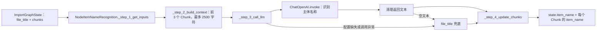

# 第 6 节：主体识别

> 上一节已经把 Markdown 整理成带来源信息的 `chunks`；这一节从文件标题和文档前部识别产品主体，把 `item_name` 写入状态和每个 Chunk，供后续向量化使用。
> 对应资料：`reference/掌教智库/4.视频/day07/`、`day08/` 中的主体识别课堂笔记与代码；补充阅读 `reference/掌教智库/1.笔记/08【掌柜智库】【导入】【节点5】主体识别.md`，本节做到名称识别与回填。

## 一、业务流程与设计原因

### 1. 先看切片之后还缺什么

打开上一节生成的真实 `chunks.json`，可以看到“安全手册”“安全标识”等章节。以“安全手册”为例，几个关键字段分别表示：

| 字段 | 这份真实文档中的含义 |
| --- | --- |
| `file_title` | `万用表RS-12的使用`，来自原文件名 |
| `title` | `## 安全手册`，当前切片标题 |
| `content` | 该章节的安全说明和量程信息 |
| `parent_title` | 切片所属的原章节标题 |

这些字段已经能回答“这段内容来自哪里”。现在换一个问题：知识库里同时有几种万用表，用户问“RS-12 的电阻挡怎么使用”，系统先要确认用户说的是哪一种产品，才能继续找它的使用步骤。

`file_title` 保存的是文档来源。它可能叫“万用表RS-12的使用”，也可能只叫“说明书”“维修指南”。因此我们另外提取一个 `item_name`，表达“这份文档主要介绍哪个产品”，并让每个 Chunk 带上这个标签。后续向量化可以把它放在正文之前，检索时也有了按产品关联和过滤的依据。

这里新增的是**元数据**：给内容附上的说明字段。本节保持原有 `content`、章节和来源，只补产品主体。一次识别对应整份文档，所有 Chunk 共用这个结果；当前流程按“一份文档有一个主要产品”处理。

### 2. 为什么用文件标题加前几个 Chunk 识别

只把文件名当产品名，遇到“说明书”就没有有效信息；把整份文档都发给模型，又会带上大量与识别产品无关的操作步骤。

参考代码在这两者之间取了一个范围：文件标题提供线索，前几个 Chunk 提供正文证据。产品名称、品牌和型号通常出现在封面或文档开头，因此先取前 3 个 Chunk，并把拼接后的上下文限制在 2500 字符以内。

这里的“上下文”就是交给模型参考的文字。它不是重新切片：原来的 Chunk 列表保持原样，我们只从中读取一小段，组装成这次识别请求的材料。2500 按 Python 的 `len()` 计算，是字符数，不是模型 Token 数；它控制本地请求材料的大小，也意味着文档后部才出现的产品信息可能不会被看到。

本节沿用课堂代码的 3 和 2500。补充笔记里另有前 5 个 Chunk 的版本，这里不扩大取样范围。

### 3. 从输入到回填，数据怎样经过节点



从左往右读：节点先检查状态，再构造给模型的材料；`ChatOpenAI.invoke()` 返回后，节点把结果整理成字符串，最后回填到状态与切片。图中两条失败分支都先得到一个确定的备用名称，再进入同一个回填步骤，因此下游始终按 `item_name` 读取结果。

模型只调用一次。取前 3 个 Chunk 是为了识别文档主体，回填时则遍历全部 Chunk；两处循环面对的范围不同，不能只给前 3 个切片加标签。

### 4. 为什么模型失败后还允许继续

主体名称是对已有内容的补充。模型暂时不可用时，前面已经完成的 Markdown 和切片仍然可用，因此参考流程采用 `file_title` 作为备用值，也就是“兜底”。

| 当前情况 | 节点怎么处理 | 这个结果说明什么 |
| --- | --- | --- |
| 缺少有效 `file_title` 或非空 Chunk 列表 | 抛出 `StateFieldError` | 上游输入契约不成立，不能继续 |
| 没有识别上下文或模型连接配置不完整 | 使用 `file_title`，记录原因 | 远程识别没有执行 |
| 模型调用异常或返回空文本 | 使用 `file_title`，记录原因 | 远程识别没有得到可用结果 |
| 模型返回非空文本 | 去掉首尾空白、保留名称内部空格，作为 `item_name` | 得到模型结果，仍需对照真实文档检查品牌与型号 |

这个取舍保住了导入流程，也降低了标签的精确程度。看到回填成功只能证明字段已经写好；只有实际模型返回了有文档依据的主体名称，才能说真实识别通过。

### 5. 节点为什么拆成四步

如果校验、拼接 Prompt、调用模型、清洗和修改切片都放在 `process()`，排查时就很难分清：材料没取对、接口没调用成功，还是最后没写回。

本节按数据边界拆成四步：

| 方法 | 负责的问题 | 交给下一步的数据 |
| --- | --- | --- |
| `_step_1_get_inputs` | 输入状态能否使用 | 文件标题、Chunk 列表 |
| `_step_2_build_context` | 模型看哪些文字，最多看多少 | 有字符上限的上下文字符串 |
| `_step_3_call_llm` | 如何识别、清洗和兜底 | 确定的主体名称 |
| `_step_4_update_chunks` | 如何把结果交给下游 | 带主体字段的状态和全部 Chunk |

`process()` 只把它们串起来，继续使用已有 `BaseNode` 的日志和异常外壳。本节不需要修改正式主图，先用节点文件末尾的真实入口观察这条链路。

## 二、手敲步骤

### 1. 先确认已有依赖和文件位置

打开项目的 [pyproject.toml](../../pyproject.toml)，确认已有 `langchain-openai` 和 `python-dotenv`。前者提供文本模型客户端，后者读取本地配置，本节无需重复添加依赖。IDE 解释器继续选择当前工程的 uv 环境；需要同步环境时，在项目终端执行 `uv sync`，这只是运行准备。

本节用到四处文件：

| 文件 | 你要做的事 |
| --- | --- |
| [state.py](../../src/shopkeeper_brain/processor/import_processor/state.py) | 核对 `item_name` 类型与默认值 |
| [.env.example](../../.env.example) | 追加文本模型配置模板 |
| `src/shopkeeper_brain/core/llm_config.py` | 新建文本模型配置读取模块 |
| `src/shopkeeper_brain/processor/import_processor/nodes/node_item_name_recognition.py` | 新建主体识别节点与学习期入口 |

按状态、配置、节点的顺序手敲，使用方出现时，被引用的模块就已经存在。

### 2. 让状态容纳主体名称

节点识别结果要交给后续流程，因此 `ImportGraphState` 和 `GRAPH_DEFAULT_STATE` 都要有 `item_name`。你已经手敲了这两处，只需要核对下面的字段位置，不必重抄其他已有内容。

**文件**：`src/shopkeeper_brain/processor/import_processor/state.py`

```python
from copy import deepcopy
from typing import TypedDict, Unpack


class ImportGraphState(TypedDict):
    """导入流程中所有节点共享的状态。"""

    import_file_path: str
    is_pdf_read_enabled: bool
    is_md_read_enabled: bool
    pdf_path: str
    md_path: str
    file_title: str
    file_dir: str
    md_content: str
    chunks: list[dict[str, object]]
    item_name: str
    visited_nodes: list[str]
    status: str


GRAPH_DEFAULT_STATE: ImportGraphState = {
    "import_file_path": "",
    "is_pdf_read_enabled": False,
    "is_md_read_enabled": False,
    "pdf_path": "",
    "md_path": "",
    "file_title": "",
    "file_dir": "",
    "md_content": "",
    "chunks": [],
    "item_name": "",
    "visited_nodes": [],
    "status": "created",
}


def create_default_state(**overrides: Unpack[ImportGraphState]) -> ImportGraphState:
    """创建彼此隔离的状态副本，并允许调用方覆盖字段。"""
    state = deepcopy(GRAPH_DEFAULT_STATE)
    state.update(overrides)
    return state
```

`item_name` 默认是空字符串，识别节点负责产生实际值。`TypedDict` 只声明契约，不自动校验运行时数据，所以节点仍然检查输入。原来的 `chunks` 和 `deepcopy()` 继续保留，这一节没有改变切片列表的创建方式。

### 3. 配置文本模型，再写读取模块

第 4 节的视觉模型负责理解图片，本节的文本模型负责从文字中识别产品。二者可以使用同一个服务商账号，但配置名分开，才能单独选择模型，避免把视觉模型名带进文本识别。

在现有 [.env.example](../../.env.example) 末尾追加下面四行模板；然后在本地 `.env` 追加同名变量，只在本地填写真实 API Key。保留原来的 MinerU、视觉模型和 MinIO 配置，不要把整个 `.env` 替换掉。

下面是**追加配置片段**：

```dotenv
SHOPKEEPER_BRAIN_LLM_BASE_URL=https://dashscope.aliyuncs.com/compatible-mode/v1
SHOPKEEPER_BRAIN_LLM_API_KEY=
SHOPKEEPER_BRAIN_LLM_MODEL=qwen-flash
SHOPKEEPER_BRAIN_LLM_TEMPERATURE=0.1
```

沿用第 4 节的百炼账号时，在[百炼控制台](https://bailian.console.aliyun.com/)确认 API Key 可以调用所选文本模型，再把密钥填入本地配置。`BASE_URL` 是兼容接口入口，`MODEL` 是具体模型名；`ChatOpenAI` 是客户端类名，本项目通过它连接 DashScope 的 Qwen 模型。

接着创建配置模块。节点只依赖这个模块返回的配置对象，不把密钥塞进 `state`，也不在节点代码里写死连接信息。

**文件**：`src/shopkeeper_brain/core/llm_config.py`

```python
import os
from dataclasses import dataclass, field
from pathlib import Path

from dotenv import load_dotenv


@dataclass
class LLMConfig:
    """主体识别文本模型的连接信息；默认展示时隐藏密钥。"""

    base_url: str
    api_key: str = field(repr=False)
    model: str
    temperature: float


def load_llm_config() -> LLMConfig:
    """读取本地文本模型配置，已有系统环境变量优先。"""
    project_root = Path(__file__).resolve().parents[3]
    load_dotenv(project_root / ".env", override=False)

    return LLMConfig(
        base_url=os.getenv("SHOPKEEPER_BRAIN_LLM_BASE_URL", "").strip().rstrip("/"),
        api_key=os.getenv("SHOPKEEPER_BRAIN_LLM_API_KEY", "").strip(),
        model=os.getenv("SHOPKEEPER_BRAIN_LLM_MODEL", "").strip(),
        temperature=float(
            os.getenv("SHOPKEEPER_BRAIN_LLM_TEMPERATURE", "0.1")
        ),
    )
```

这里沿用第 3 节已经用过的写法：`Path(__file__)` 从模块位置找到项目根目录，让 `.env` 的读取位置不依赖 IDE 工作目录；`override=False` 保留系统环境变量优先级；`field(repr=False)` 让打印配置对象时不直接显示密钥。`temperature` 需要转成浮点数，配置中保留 `0.1` 这样的数字。

### 4. 写主体识别节点和真实入口

现在再写使用方。先读 `process()` 的四行调用，确定它怎样把输入交给上下文构建、模型识别和最终回填，再手敲各个方法。节点输入直接沿用上一节的 Chunk，不需要重新读 Markdown 或重新生成切片。

文件末尾保留和第 3 节相同的学习期 `__main__`：改好真实文件路径，在 IDE 中直接运行。它只读取已有 JSON，输出观察信息，不覆盖上一节的产物。

**文件**：`src/shopkeeper_brain/processor/import_processor/nodes/node_item_name_recognition.py`

```python
import json
import logging
from pathlib import Path

from langchain_core.messages import HumanMessage, SystemMessage
from langchain_openai import ChatOpenAI

from shopkeeper_brain.core.llm_config import load_llm_config
from shopkeeper_brain.processor.import_processor.BaseNode import BaseNode
from shopkeeper_brain.processor.import_processor.exceptions import StateFieldError
from shopkeeper_brain.processor.import_processor.state import (
    ImportGraphState,
    create_default_state,
)

ITEM_NAME_CHUNK_K = 3
ITEM_NAME_CONTEXT_MAX_CHARS = 2500


class NodeItemNameRecognition(BaseNode):
    """识别整份文档的产品主体，让所有 Chunk 带上同一主体标签。"""

    name = "node_item_name_recognition"

    def process(self, state: ImportGraphState) -> ImportGraphState:
        """读取标题和切片，确定主体名称后统一回填；返回原状态对象。"""
        file_title, chunks = self._step_1_get_inputs(state)
        context = self._step_2_build_context(chunks)
        item_name = self._step_3_call_llm(file_title, context)
        self._step_4_update_chunks(state, chunks, item_name)
        self.logger.info("主体字段处理完成：%s", item_name)
        return state

    def _step_1_get_inputs(
            self,
            state: ImportGraphState,
    ) -> tuple[str, list[dict[str, object]]]:
        """检查文件标题和非空切片列表，缺少上游数据时终止节点。"""
        file_title = state.get("file_title")
        if not isinstance(file_title, str) or not file_title.strip():
            raise StateFieldError(
                node_name=self.name,
                field_name="file_title",
                expected_type=str,
            )

        chunks = state.get("chunks")
        if not isinstance(chunks, list) or not chunks:
            raise StateFieldError(
                node_name=self.name,
                field_name="chunks",
                expected_type=list,
            )

        return file_title, chunks

    def _step_2_build_context(
            self,
            chunks: list[dict[str, object]],
    ) -> str:
        """读取文档前部作为识别材料，不修改传入的切片。"""
        parts: list[str] = []
        total_chars = 0

        for index, chunk in enumerate(chunks[:ITEM_NAME_CHUNK_K], start=1):
            title_value = chunk.get("title", "")
            content_value = chunk.get("content", "")
            title = title_value.strip() if isinstance(title_value, str) else ""
            content = (
                content_value.strip()
                if isinstance(content_value, str)
                else ""
            )

            piece = f"【切片{index}】\n标题：{title}\n内容：{content}"
            parts.append(piece)
            total_chars += len(piece)

            if total_chars >= ITEM_NAME_CONTEXT_MAX_CHARS:
                break

        # join 还会增加分隔换行，最终截断才能守住字符上限。
        context = "\n\n".join(parts).strip()
        return context[:ITEM_NAME_CONTEXT_MAX_CHARS]

    def _step_3_call_llm(self, file_title: str, context: str) -> str:
        """返回模型识别名称；没有可用结果时以文件标题兜底。"""
        if not context:
            self.logger.warning("识别上下文为空，使用文件标题兜底")
            return file_title

        config = load_llm_config()
        if not all((config.base_url, config.api_key, config.model)):
            self.logger.warning("文本模型配置不完整，使用文件标题兜底")
            return file_title

        prompt = f"""请从以下信息中识别文档的商品名称或产品主体：
文件名：{file_title}

文档前部切片：
{context}

要求：
1. 优先返回包含品牌、型号和名称的完整主体名称；
2. 只返回主体名称，不要解释识别过程；
3. 如果无法识别，返回空字符串。
"""

        try:
            model = ChatOpenAI(
                model=config.model,
                api_key=config.api_key,
                base_url=config.base_url,
                temperature=config.temperature,
                extra_body={"enable_thinking": False},
            )
            response = model.invoke(
                [
                    SystemMessage(
                        content="你是商品主体识别专家，只输出主体名称。"
                    ),
                    HumanMessage(content=prompt),
                ]
            )
            # text 统一提取字符串或内容块中的正文，保留品牌与型号间的空格。
            item_name = response.text.strip()
            if not item_name:
                self.logger.warning("文本模型返回空内容，使用文件标题兜底")
                return file_title
            self.logger.info("文本模型返回主体名称：%s", item_name)
            return item_name
        except Exception as exc:
            self.logger.warning(
                "文本模型调用失败，使用文件标题兜底：%s",
                type(exc).__name__,
            )
            return file_title

    def _step_4_update_chunks(
            self,
            state: ImportGraphState,
            chunks: list[dict[str, object]],
            item_name: str,
    ) -> None:
        """给原状态及全部切片补充主体字段，不改变原切片正文。"""
        state["item_name"] = item_name
        for chunk in chunks:
            chunk["item_name"] = item_name
        state["chunks"] = chunks


if __name__ == "__main__":
    logging.basicConfig(
        level=logging.INFO,
        format="%(levelname)s %(name)s %(message)s",
    )

    # 改成第 5 节已经生成的真实 JSON，直接在 IDE 运行本文件。
    chunks_path = Path(
        r"E:\dev\python\project-study\shopkeeper-brain\workspace\day03-real-run\万用表RS-12的使用_5gatm6ph\extracted\chunks.json"
    )
    if not chunks_path.is_file():
        raise SystemExit(f"请先确认上一节的真实切片文件：{chunks_path}")

    chunks = json.loads(chunks_path.read_text(encoding="utf-8"))
    if not isinstance(chunks, list) or not chunks:
        raise SystemExit("chunks.json 必须是上一节生成的非空切片列表")

    state = create_default_state(
        file_title=chunks[0]["file_title"],
        chunks=chunks,
    )
    original_contents = [chunk["content"] for chunk in chunks]
    node = NodeItemNameRecognition()
    context = node._step_2_build_context(chunks)
    assert 0 < len(context) <= ITEM_NAME_CONTEXT_MAX_CHARS

    print("输入切片文件：", chunks_path)
    print("文件标题：", state["file_title"])
    print("切片总数：", len(chunks))
    print("识别上下文字符数：", len(context))
    print("识别上下文预览：", context[:300])
    result = node(state)

    assert result is state
    assert result["item_name"]
    assert all(
        chunk.get("item_name") == result["item_name"]
        for chunk in result["chunks"]
    )
    assert [chunk["content"] for chunk in result["chunks"]] == original_contents

    print("最终主体名称：", result["item_name"])
    print("已回填主体的切片数：", len(result["chunks"]))
    print("主体字段回填与原正文保留：通过")
```

#### 先看输入和上下文怎样传递

`file_title, chunks = ...` 是元组解包：方法返回两个值，调用方分别接住，不需要像 Java 那样专门建一个只用于返回值的对象。

`chunks[:3]` 是列表切片，读取前 3 个元素；`enumerate(..., start=1)` 同时给出序号和当前 Chunk。先把每一段放进 `parts`，再用 `"\n\n".join(parts)` 拼成字符串，模型就能看出哪些标题和正文属于同一段。最后的 `[:2500]` 才是最终长度边界，前面的累计计数只是让循环提前停止。

这里允许标题是空字符串：上一节保留了首个标题前的正文，那一块可能没有标题。不能因为标题为空就跳过这个 Chunk，正文仍然要作为识别材料保留下来。

#### 再看模型调用的三个层次

`ChatOpenAI(...)` 创建客户端，参数来自刚才的配置模块。`SystemMessage` 告诉模型这次担任什么角色，`HumanMessage` 提供本份文档的文件名、正文和输出要求；两条消息一起传给 `invoke()`，才会执行请求。

返回的 `response` 是消息对象。它的 `content` 可能是字符串，也可能是多个内容块组成的列表；列表中还可能有非文本块。直接 `str(response.content)` 会把列表括号、字段名等结构一起变成名称，只取 `content[0]` 又可能漏掉后续文本。当前版本提供的 `response.text` 会统一提取文本正文，具体契约见 [LangChain 消息文档](https://docs.langchain.com/oss/python/langchain/messages)。

拿到正文后只用 `.strip()` 去掉首尾空白，保留名称内部的空格。例如 `RS PRO RS-12 数字万用表` 中的品牌和型号需要分隔，不能把所有空白删掉。文本提取不等于品牌型号校验，真实验证时仍要对照文档内容。

`extra_body={"enable_thinking": False}` 是本节沿用的 Qwen 兼容接口参数，用于关闭思考输出，不是所有模型服务通用的字段。当前先沿用教程中的 Qwen 配置，不增加多服务商适配层。

#### 最后看回填和学习期入口

`for chunk in chunks` 取得的是列表里原来的字典，给字典增加 `item_name` 会反映到列表中，类似修改 Java `List<Map<...>>` 中某个 Map 的内容。随后显式写回 `state["chunks"]`，让节点输出契约一眼可见。

回填方法遍历所有切片，不能误用构建上下文时的前 3 个范围。`__main__` 中用同一主体逐块检查，并核对原正文没有改变。它没有保存新的 JSON，因此重跑后你打开原来的 `chunks.json`，里面仍然是第 5 节的切片结果；本节结果在返回的 `state` 中观察。

## 三、必做真实验证

### 1. 准备真实输入和文本模型

准备下面三项：

1. 第 5 节生成的真实 `chunks.json`。用编辑器打开，确认是非空列表，每个元素包含 `file_title`、`title` 和 `content`。直接复用已验收产物，无需重新运行切片节点。
2. 本地 `.env` 中的四个 `SHOPKEEPER_BRAIN_LLM_` 变量。密钥有权限调用所选文本模型，温度使用数字 `0.1`。
3. IDE 使用本工程的 uv Python 解释器，能够导入 `shopkeeper_brain` 和 `langchain_openai`。

这里要发生的是“真实切片 → 真实文本模型 → 状态与全部切片回填”。没有模型配置时仍能运行兜底路径，但这只覆盖本地回填，远程识别要单独记录为跳过。

### 2. 在 IDE 中运行节点文件

1. 打开 `src/shopkeeper_brain/processor/import_processor/nodes/node_item_name_recognition.py`。
2. 找到文件末尾的 `if __name__ == "__main__":`。
3. 把 `chunks_path` 改成你实际保留的第 5 节 JSON 绝对路径。教程路径在当前工程已有真实产物；如果你保存位置不同，就只改这里。
4. 在 `_step_3_call_llm()` 的 `response = model.invoke(...)` 和 `_step_4_update_chunks()` 处打断点，方便查看调用前后数据。
5. 选择当前工程解释器，直接 Run 或 Debug 这个文件，不需要填写运行参数，也不需要先运行主图。
6. 在调用前观察 `file_title`、`chunks` 和 `context`；继续运行到模型返回，再观察 `response.content` 与最终 `state`。

调用前，`context` 应只取文档前 3 个 Chunk，长度不超过 2500 字符；输入中的全部 Chunk 仍然在 `state["chunks"]` 里。继续执行后，回填方法应该处理整个列表。

### 3. 成功时观察什么

下面是观察顺序和预期判据，不是预填的运行结果：

1. 控制台出现真实输入文件路径、文件标题、切片总数、上下文字符数和预览。字符数不超过 2500，预览来自刚才打开的真实文档。
2. 模型调用成功并返回非空文字时，日志出现“文本模型返回主体名称”。如果出现“使用文件标题兜底”，本次要按兜底路径记录。
3. 对照文档开头检查名称：型号和品牌必须能在输入里找到依据，不能因为程序没报错就接受模型编出的产品名。名称的措辞不要求每次完全一致。
4. 运行结束打印最终主体和已回填切片数，后者应等于输入切片总数。
5. 在 Debug 变量中确认 `state["item_name"]` 与每个 Chunk 的 `item_name` 相同，原来的正文、标题和来源仍然保留。
6. 最后一行的“主体字段回填与原正文保留：通过”说明本地一致性断言成立；结合前面的模型返回和文档对照，才能判断远程识别是否也通过。

不要用“最终名称是否等于文件名”判断模型有没有执行：模型也可能正好返回同样的名称。应看执行分支、模型返回对象和相应日志。

### 4. 失败时按数据经过的位置定位

| 看到的现象 | 先看哪里 | 对应原因或下一步 |
| --- | --- | --- |
| 找不到 `chunks.json` | `__main__` 的 `chunks_path` | 先找到上一节真实产物，不重新造一份 JSON |
| JSON 不是非空列表，或缺少 `file_title` | 刚打开的输入文件 | 确认选择的是切片 JSON，而不是其他状态文件 |
| `StateFieldError` 指向 `file_title` 或 `chunks` | 创建状态的位置 | 必填数据没有按契约传给节点 |
| 文本模型配置不完整 | `.env` 位置和四个变量名 | 没有发起模型调用，只完成了兜底 |
| 修改 `.env` 后模型仍用旧值 | IDE 运行配置中的环境变量 | 系统环境变量优先，需要核对同名变量 |
| 温度转换报 `ValueError` | `SHOPKEEPER_BRAIN_LLM_TEMPERATURE` | 值应是数字；这是本地配置错误 |
| 模型调用失败并兜底 | `model.invoke()` 处的异常类型 | 核对接口地址、Key 权限、模型名和网络；本次不能算识别成功 |
| 模型返回解释文字或无依据的品牌 | `response.content`、Prompt 和 `context` | 先确认模型看到了什么，再调整识别要求，不能只看非空断言 |
| 状态有主体，但部分 Chunk 没有 | `_step_4_update_chunks()` | 检查是否漏遍历，或误只处理前 3 个 Chunk |
| 原 JSON 中没有新增 `item_name` | 返回的 `state` | 本节只在内存回填，原 JSON 保留上一节结果 |

排查接口问题时保留脱敏后的异常类型和现象，不打印配置对象中的密钥。正常验证不需要停止外部服务或故意改坏源码。

### 5. 哪些结果可以记录为通过

本节完整通过需要两部分证据：真实模型确实返回了有文档依据的主体名称；返回状态和全部 Chunk 都携带同一个名称，原切片内容得到保留。

如果模型配置缺失，记录“远程识别：跳过；文件标题兜底与回填：通过”；如果已经发起请求但调用失败，记录“远程识别：失败；文件标题兜底与回填：通过”。尚未执行的验证标为“未验证（未运行）”，不能用依赖安装、编译或模块导入替代真实业务运行。

完成后保留 `__main__`，方便手敲后的自测和后续验收。当前只补 `item_name`；BGE-M3 向量化与 Milvus 保存继续留在各自章节。
