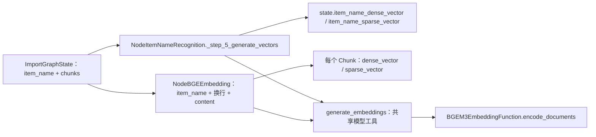

# 第 7 节：向量化与稀疏向量

> 上一节已识别主体名称，并把 `item_name` 回填到返回状态和全部 Chunk；这一节用本地 BGE-M3 为主体名称和每个 Chunk 生成稠密、稀疏两种向量。
> 对应资料：`reference/掌教智库/4.视频/day07/` 的模型工具与 CSR、`day08/` 的主体名称向量与 Chunk 向量化；补充阅读 `reference/掌教智库/1.笔记/09【掌柜智库】【导入】【节点6】向量化.md`。

## 一、业务流程与设计原因

### 1. 从 RS-12 的一段切片看还缺什么

上一节得到的主体名称是 `RS PRO RS-12 数字万用表`。配上第 5 节切出的“安全手册”等正文，我们已经知道“这段文字介绍什么产品、来自哪个章节”。但用户可能问“怎样测电阻”，正文写的却是“电阻测量”，仅靠字符串相等无法判断它们是否在说同一件事。

Embedding，也就是向量化，把文字转换成一组可以比较的数字。BGE-M3 对同一段文本同时产生两种表示：

| 输出 | 本项目用它表达什么 | 在代码中怎样保存 |
| --- | --- | --- |
| 稠密向量 Dense | 整段文字的语义，帮助关联不同措辞 | 一个长度为 1024 的浮点数列表 |
| 稀疏向量 Sparse | 模型词表中被激活的词元及其权重，补充品牌、型号、术语等词汇线索 | `{特征编号: 权重}`，只保存非零项 |

1024 个稠密维度是模型学习出来的坐标，不能把第 0 维直接解释成“品牌”、第 1 维解释成“型号”。稀疏特征编号则对应模型分词词表中的位置，一个中文词可能被拆成多个词元。这里的权重由模型计算，不是简单统计出现次数，也不是 Milvus 的 BM25 输出。

两条路线提供不同线索，并不保证“型号不同就一定能精确区分”。本节先把可供计算的数据准备好，检索时怎样结合它们由实际检索节点决定。

### 2. 为什么主体名称和 Chunk 都要向量化

原项目有两份用途不同的数据：

- 单独编码 `RS PRO RS-12 数字万用表`，得到**主体名称向量**，以后用于产品名称确认。
- 对每个 Chunk 编码 `主体名称 + 换行 + 原正文`，得到**切片向量**，以后用于查找该产品的知识内容。

如果只编码正文，“安全警告”“测量前检查”等内容可能在很多产品手册中重复。把主体放在正文前面，给模型补上产品语境；原来的 `content` 仍保持原样，拼接只发生在这次模型输入中。

主体名称向量不能代替全部 Chunk 向量，因为只有名称，没有每个章节的知识。反过来，也不能因为正文中已经拼了名称，就漏掉原项目单独保存产品名称的能力。



从左边的状态开始看：同一个名称有两条用途，主体节点只编码一次名称，Chunk 节点则按切片逐条构造输入。两者都调用 `generate_embeddings()`，共享同一个模型实例。名称向量放在状态的两个独立字段里；正文向量放在各自的 Chunk 里，不把同一份名称向量重复塞进 21 个切片。

上一节已经完成主体识别的前四步，本节只补原项目第 5 步。原项目接着进行的集合创建、旧数据清理和保存，需要 Milvus 环境，留在入库章节统一完成。本节节点不连接数据库。

### 3. 模型工具与业务节点为什么分开

模型工具只需要知道“请编码这些字符串”。它负责加载本地模型、调用模型以及整理返回的数据类型；不应该读 Chunk 的 `content`，也不决定主体名称放在哪里。

Chunk 节点负责业务：检查输入是否接好了、怎样拼名称与正文、每次处理几条、怎样把第 `j` 个结果写回第 `j` 个 Chunk。这样主体名称和将来的查询文本都能复用模型工具，不需要各自再写一份加载和 CSR 转换。

模型加载还会读取权重并占用内存。工具中保留一个模块级实例，第一次使用才创建，后续批次继续复用；本节是单进程、串行学习入口，不增加并发初始化机制。

### 4. CSR 怎样保存多条文本的稀疏向量

`encode_documents(texts)` 的稠密输出可以按行取数组。稀疏输出则是 SciPy 的 CSR，即压缩稀疏行结构：一行对应一条输入文本，列编号对应词表特征。绝大部分位置为零，没有必要把每行约 25 万个位置全部存下来。

先用一个仅用于解释结构的小矩阵看三个数组的关系。下面不是模型输出，也不需要新建文件运行：

```text
矩阵：                  data    = [1, 2, 3, 4, 5]
[1, 0, 2]              indices = [0, 2, 1, 0, 2]
[0, 3, 0]              indptr  = [0, 2, 3, 5]
[4, 0, 5]
```

- `data` 保存非零值，`indices` 保存每个值所在的列编号，两者一一对应。
- `indptr` 保存每一行在上述两个数组中的起止边界，长度是“行数 + 1”。
- 第 `i` 行使用半开区间 `[indptr[i], indptr[i + 1])`。例如第 1 行读取 `[2:3]`，得到列编号 `[1]`、值 `[3]`，转成字典就是 `{1: 3}`。

实际代码也按这个区间读取两次，分别拿到特征编号和权重，再用 `zip()` 配成键值对。CSR 是存储格式，转字典只是换一种表示，不会重新计算权重，也不会自动做归一化。

### 5. 归一化发生在哪里

稠密向量默认开启 L2 归一化。L2 长度是“各分量平方求和后开方”，例如 `[3, 4]` 的长度为 5，除以 5 后成为 `[0.6, 0.8]`，方向保留、长度变为 1。对两个单位长度向量，点积就等于余弦相似度。

本节在模型构造时明确传入 `normalize_embeddings=True`，由模型编码路径处理稠密输出，工具不再重复除一次长度。这是编码参数与实现的行为，不能理解成“权重文件里的任意输出天然都是单位向量”。

稀疏词汇权重走另外的计算路径。本节沿用当天工具代码，保留模型返回的权重，不额外做 L2 归一化，也不宣称其长度为 1。Dense 的 1024 维与 Sparse 中非零特征的个数是两回事，后者随输入而变化。

## 二、手敲步骤

### 1. 准备本地模型依赖

继续使用 [.python-version](../../.python-version) 指定的 Python 3.11 和项目 uv 环境。本节采用 Windows 的 CPU/FP32 路线：先完成真实向量生成，设备配置为 `cpu`，半精度为 `false`。PyTorch 的 Windows PyPI 包为 CPU 版本，使用现有清华镜像即可；这条路线不需要安装 CUDA、`torchvision` 或 `torchaudio`。

在项目终端执行下面这一条依赖准备命令。它会更新 [pyproject.toml](../../pyproject.toml) 与 uv 锁文件，保留已有依赖：

```bash
uv add "torch>=2.6.0" "pymilvus[model]>=3.0.0,<3.1" "FlagEmbedding==1.3.5" "transformers>=4.45.0,<5.0.0" modelscope --default-index https://pypi.tuna.tsinghua.edu.cn/simple
```

`pymilvus[model]` 提供参考项目使用的 `BGEM3EmbeddingFunction`；这里用它做本地推理，不要求 Milvus 服务已经启动。`FlagEmbedding` 是底层 BGE 实现，`transformers` 负责模型与分词器加载，`modelscope` 仅用于从国内模型源下载权重。

版本范围有实际原因：保留 FlagEmbedding 1.3.5 对应的 Transformers 4 路线；本节模型仓库提供 `pytorch_model.bin`，使用支持相应安全加载要求的 Torch 2.6 及以上版本。安装成功后，把 IDE 解释器选回本项目的 uv 环境，不能只在系统 Python 中安装。

依赖准备与模型准备不等于向量化通过，真正的业务判据在最后的 IDE 运行中检查。

### 2. 下载模型，再建立配置模块

先打开 IDE 的 Python 控制台，确认使用刚才同步的项目解释器。下面是**模型准备片段**，直接在控制台执行，不覆盖任何已有文件：

```python
from pathlib import Path
from modelscope import snapshot_download

model_dir = snapshot_download(
    "BAAI/bge-m3",
    local_dir=str(
        Path(r"E:\dev\python\project-study\shopkeeper-brain")
        / "workspace/models/bge-m3"
    ),
    ignore_patterns=["onnx/*", "imgs/*", "*.jpg", "*.webp"],
)
print("模型目录：", model_dir)
```

这里明确下载到实验区，不写参考目录。当前使用 PyTorch 推理，因此排除 ONNX 权重和展示图片，保留模型、分词器以及 `sparse_linear.pt`、`colbert_linear.pt` 两个投影头文件。主体模型文件约 2.3 GB，需要等待下载完成；只有缓存目录名、没有文件内容时不能算准备完成。

路径中应能看到 `config.json`、`pytorch_model.bin`、`tokenizer_config.json`、`sentencepiece.bpe.model` 和两个 `.pt` 文件。如果已经完整下载过同一模型，可以直接使用其实际目录，不必重复下载。`snapshot_download()` 的返回值是目录路径，不能把单个权重文件路径填给模型。

接着在现有 [.env.example](../../.env.example) 末尾追加下面的**配置片段**，本地 `.env` 追加同名变量；保留前面所有配置：

```dotenv
# BGE-M3：相对路径以项目根目录为起点
SHOPKEEPER_BRAIN_BGE_M3_PATH=workspace/models/bge-m3
SHOPKEEPER_BRAIN_BGE_DEVICE=cpu
SHOPKEEPER_BRAIN_BGE_FP16=false
```

只有一个实际模型来源：本地模型目录，不另设一个当前不会使用的远程模型名配置。下面新建读取模块，把相对路径解析到工程根目录，避免 IDE 工作目录变化后找错模型。

**文件**：`src/shopkeeper_brain/core/embedding_config.py`

```python
import os
from dataclasses import dataclass
from pathlib import Path

from dotenv import load_dotenv


@dataclass
class EmbeddingConfig:
    """本地 BGE-M3 的位置与推理设备。"""

    model_path: Path
    device: str
    use_fp16: bool


def load_embedding_config() -> EmbeddingConfig:
    """相对模型路径以项目根目录解析，系统环境变量优先。"""
    project_root = Path(__file__).resolve().parents[3]
    load_dotenv(project_root / ".env", override=False)
    model_path = Path(
        os.getenv("SHOPKEEPER_BRAIN_BGE_M3_PATH", "workspace/models/bge-m3")
    )
    if not model_path.is_absolute():
        model_path = project_root / model_path

    return EmbeddingConfig(
        model_path=model_path,
        device=os.getenv("SHOPKEEPER_BRAIN_BGE_DEVICE", "cpu").strip(),
        use_fp16=os.getenv("SHOPKEEPER_BRAIN_BGE_FP16", "false").strip().lower()
        in ("1", "true"),
    )
```

环境变量读出来都是字符串。不能用 `bool("false")` 转换开关，因为任何非空字符串的布尔值都是 `True`；这里明确只把 `1` 和 `true` 当作开启。CPU 使用 `false`，不会在代码中悄悄切换设备或精度。

### 3. 写模型复用和 CSR 转换工具

先创建 `src/shopkeeper_brain/utils/` 目录，再创建下面的工具文件。本项目使用普通包，给目录补一个空的 `__init__.py`，内容只放下面的包说明：

**文件**：`src/shopkeeper_brain/utils/__init__.py`

```python
"""供业务节点复用的工具。"""
```

工具文件只接收字符串列表。`get_bge_m3_ef()` 管模型，`generate_embeddings()` 管调用和返回形状；Chunk 怎样拼接由后面的业务节点决定。

**文件**：`src/shopkeeper_brain/utils/embedding_utils.py`

```python
from pymilvus.model.hybrid import BGEM3EmbeddingFunction

from shopkeeper_brain.core.embedding_config import load_embedding_config
from shopkeeper_brain.processor.import_processor.exceptions import ConfigurationError

_bge_m3_ef = None


def get_bge_m3_ef() -> BGEM3EmbeddingFunction:
    """首次调用加载本地模型，后续批次复用同一实例。"""
    global _bge_m3_ef
    if _bge_m3_ef is not None:
        return _bge_m3_ef

    config = load_embedding_config()
    required_files = (
        "config.json",
        "pytorch_model.bin",
        "tokenizer_config.json",
        "sentencepiece.bpe.model",
        "sparse_linear.pt",
        "colbert_linear.pt",
    )
    for name in required_files:
        if not (config.model_path / name).is_file():
            raise ConfigurationError(f"BGE-M3 模型文件缺失：{config.model_path / name}")
    if config.device == "cpu" and config.use_fp16:
        raise ConfigurationError("本节 CPU 推理请配置 SHOPKEEPER_BRAIN_BGE_FP16=false")

    _bge_m3_ef = BGEM3EmbeddingFunction(
        model_name=str(config.model_path),
        device=config.device,
        use_fp16=config.use_fp16,
        normalize_embeddings=True,
        passage_max_length=8192,
    )
    return _bge_m3_ef


def generate_embeddings(texts: list[str]) -> dict[str, list]:
    """按输入顺序返回 Dense 列表和整数特征编号的 Sparse 字典。"""
    if not isinstance(texts, list) or not texts:
        raise ValueError("向量化输入必须是非空文本列表")
    if any(not isinstance(text, str) or not text.strip() for text in texts):
        raise ValueError("向量化输入必须是非空文本列表")

    model = get_bge_m3_ef()
    embeddings = model.encode_documents(texts)
    sparse = embeddings["sparse"]
    processed_sparse: list[dict[int, float]] = []

    for index in range(len(texts)):
        start = sparse.indptr[index]
        end = sparse.indptr[index + 1]
        indices = sparse.indices[start:end].tolist()
        weights = sparse.data[start:end].tolist()
        processed_sparse.append(dict(zip(indices, weights)))

    return {
        "dense": [vector.tolist() for vector in embeddings["dense"]],
        "sparse": processed_sparse,
    }
```

`global` 表示函数要给模块里的 `_bge_m3_ef` 重新赋值，类似让整个模块共用一个静态引用。缓存只在模型成功创建后写入，加载失败会抛出异常，不能返回全零或随机向量让后续流程继续。

`required_files` 针对刚才下载的这份 PyTorch 模型，提前指出缺失路径；它不代替模型自身的文件完整性校验。底层实现缺少投影头时会走新初始化参数的分支，不能把这种结果当作训练好的稀疏输出。已有缓存缺权重时也应先停止，不能因为目录名存在就继续。

还有一个容易漏掉的输入边界：参考工具没有传最大长度，而本节 FlagEmbedding 版本的默认正文上限是 512 Token，超过后会截断。这里明确把 `passage_max_length` 设为 BGE-M3 支持的 8192 Token，让现有切片及前置主体名称使用这个上限；它是分词后的 Token 数，不是 `len(content)` 的字符数。这个参数不会把短文本补齐到 8192；若以后输入超过模型上限，需要回到切片策略处理，不能把未编码的尾部当作已覆盖。

`start:end` 的终点不包含在结果里，与前面的 CSR 示例相同。两个 `.tolist()` 把 NumPy 的数值变成普通 Python 数值，`dict(zip(...))` 把特征编号与权重配对；返回后第 `i` 条 Dense 和第 `i` 条 Sparse 都对应 `texts[i]`。

本节不调用 `toarray()` 把整个稀疏矩阵展开，也不把 CSR 对象直接塞进状态。这样状态可以观察、备份，后续也能适配数据库输入。

### 4. 状态增加主体向量，识别节点只补第 5 步

先打开已有 [state.py](../../src/shopkeeper_brain/processor/import_processor/state.py)，在 `ImportGraphState` 的 `item_name: str` 后增加下面两行。这是**类型声明增量**，不覆盖整个文件：

```python
    item_name_dense_vector: list[float]
    item_name_sparse_vector: dict[int, float]
```

再在 `GRAPH_DEFAULT_STATE` 的 `"item_name"` 条目后增加两个默认值。这是**默认状态增量**：

```python
    "item_name_dense_vector": [],
    "item_name_sparse_vector": {},
```

沿用原来的 `deepcopy()`，不同状态的空列表和字典仍然独立。没有生成主体向量时默认容器为空；生成成功后才写入实际数据。字段名带上 `item_name_`，避免与 Chunk 的正文向量混淆。

然后打开已有 [node_item_name_recognition.py](../../src/shopkeeper_brain/processor/import_processor/nodes/node_item_name_recognition.py)，在导入区增加下面这一行：

```python
from shopkeeper_brain.utils.embedding_utils import generate_embeddings
```

定位 `process()` 中已有的 `self._step_4_update_chunks(state, chunks, item_name)`。在它之后、现有“主体字段处理完成”日志之前增加下面的**主流程增量**：

```python
        dense_vector, sparse_vector = self._step_5_generate_vectors(item_name)
        state["item_name_dense_vector"] = dense_vector
        state["item_name_sparse_vector"] = sparse_vector
```

在类中、现有 `_step_4_update_chunks()` 方法之后增加下面的**完整方法**；仍放在 `if __name__ == '__main__':` 之前，缩进与其他方法一致：

```python
    def _step_5_generate_vectors(
            self,
            item_name: str,
    ) -> tuple[list[float], dict[int, float]]:
        """单独编码产品名称，供产品确认所需的名称数据使用。"""
        vectors = generate_embeddings([item_name])
        return vectors["dense"][0], vectors["sparse"][0]
```

工具接收列表，所以单个名称也用 `[item_name]` 包起来，再取返回列表的第 0 项。这个方法不重新识别名称，也不拼正文。名称来自上一节已经返回的非空结果；配置错误会直接指出缺失路径，模型加载或编码抛出的一般异常由已有 `BaseNode` 补充节点上下文。

到这里，识别节点的前四步没有变化；正式调用它时会在回填之后生成名称向量。本节真实入口会单独调用新增步骤，复用前节已确认的识别结果，避免再次请求文本模型。

### 5. 写 Chunk 向量化节点与学习期入口

业务节点不能只检查 `chunks` 非空。如果误把没有 `item_name` 的第 5 节原 JSON 直接交进来，到拼接阶段才抛 `KeyError`，看不出是前节状态没有接好。因此先检查状态主体、每块主体一致性和正文，再调用模型。

本节每批先处理 3 个 Chunk，最后一批按实际剩余数量处理。参考笔记中的 5、当天代码中的 3 都是批次选择，不改变“一个输入对应一对输出”的契约。CPU 下先保持 3，正常流程跑通后再根据实际内存和耗时调整。

**文件**：`src/shopkeeper_brain/processor/import_process/nodes/node_bge_embedding.py`

```python
import json
import logging
import math
from copy import deepcopy
from pathlib import Path

from shopkeeper_brain.processor.import_processor.BaseNode import BaseNode
from shopkeeper_brain.processor.import_processor.exceptions import StateFieldError
from shopkeeper_brain.processor.import_processor.state import (
    ImportGraphState,
    create_default_state,
)
from shopkeeper_brain.utils.embedding_utils import generate_embeddings

EMBEDDING_BATCH_SIZE = 3


class NodeBGEEmbedding(BaseNode):
    """把带主体标签的切片转换成供混合检索使用的双向量。"""

    name = "node_bge_embedding"

    def process(self, state: ImportGraphState) -> ImportGraphState:
        """全部批次成功后才把带向量的切片列表交回状态。"""
        chunks = self._step_1_validate_input(state)
        output_data = self._step_2_generate_embeddings(chunks)
        state["chunks"] = output_data
        self.logger.info("Chunk 双向量生成完成：%s 条", len(output_data))
        return state

    def _step_1_validate_input(
            self,
            state: ImportGraphState,
    ) -> list[dict[str, object]]:
        """检查主体与全部正文，在模型推理之前指出输入缺口。"""
        item_name = state.get("item_name")
        if not isinstance(item_name, str) or not item_name.strip():
            raise StateFieldError(
                node_name=self.name,
                field_name="item_name",
                expected_type=str,
            )
        chunks = state.get("chunks")
        if not isinstance(chunks, list) or not chunks:
            raise StateFieldError(
                node_name=self.name,
                field_name="chunks",
                expected_type=list,
            )

        for index, chunk in enumerate(chunks):
            if not isinstance(chunk, dict):
                raise StateFieldError(
                    node_name=self.name,
                    field_name=f"chunks[{index}]",
                    expected_type=dict,
                )
            if chunk.get("item_name") != item_name:
                raise StateFieldError(
                    node_name=self.name,
                    field_name=f"chunks[{index}].item_name",
                    message=f"第 {index + 1} 个 Chunk 的主体与状态不一致，请先完成主体回填",
                )
            content = chunk.get("content")
            if not isinstance(content, str) or not content.strip():
                raise StateFieldError(
                    node_name=self.name,
                    field_name=f"chunks[{index}].content",
                    expected_type=str,
                )
        return chunks

    def _step_2_generate_embeddings(
            self,
            chunks: list[dict[str, object]],
    ) -> list[dict[str, object]]:
        """按原顺序分批编码，保留每个切片原有的正文和来源。"""
        output_data: list[dict[str, object]] = []
        for start in range(0, len(chunks), EMBEDDING_BATCH_SIZE):
            batch = chunks[start:start + EMBEDDING_BATCH_SIZE]
            texts = [f"{chunk['item_name']}\n{chunk['content']}" for chunk in batch]
            vectors = generate_embeddings(texts)

            for index, chunk in enumerate(batch):
                item = chunk.copy()
                item["dense_vector"] = vectors["dense"][index]
                item["sparse_vector"] = vectors["sparse"][index]
                output_data.append(item)
            self.logger.info(
                "已完成第 %s—%s 个 Chunk", start + 1, start + len(batch)
            )
        return output_data


if __name__ == "__main__":
    from shopkeeper_brain.processor.import_processor.nodes.node_item_name_recognition import (
        NodeItemNameRecognition,
    )

    logging.basicConfig(
        level=logging.INFO,
        format="%(levelname)s %(name)s %(message)s",
    )
    # 直接复用第 5 节的真实产物，不重新解析 PDF、处理图片或切片。
    chunks_path = Path(
        r"E:\dev\python\project-study\shopkeeper-brain\workspace\day03-real-run\万用表RS-12的使用_5gatm6ph\extracted\chunks.json"
    )
    if not chunks_path.is_file():
        raise SystemExit(f"找不到真实切片文件：{chunks_path}")
    chunks = json.loads(chunks_path.read_text(encoding="utf-8"))
    if not isinstance(chunks, list) or not chunks:
        raise SystemExit("输入必须是第 5 节的非空 Chunk 列表")

    # 这是第 6 节已确认的真实名称，原 JSON 中没有这个字段。
    confirmed_item_name = "RS PRO RS-12 数字万用表"
    state = create_default_state(
        file_title=chunks[0]["file_title"],
        chunks=chunks,
    )
    recognition = NodeItemNameRecognition()
    recognition._step_4_update_chunks(state, chunks, confirmed_item_name)
    dense, sparse = recognition._step_5_generate_vectors(state["item_name"])
    state["item_name_dense_vector"] = dense
    state["item_name_sparse_vector"] = sparse
    original_chunks = deepcopy(state["chunks"])

    print("真实输入：", chunks_path)
    print("复用的主体名称：", state["item_name"])
    print("主体 Dense 维度：", len(dense))
    print("主体 Sparse 非零特征数：", len(sparse))
    result = NodeBGEEmbedding()(state)

    assert result is state
    assert len(dense) == 1024 and sparse
    assert len(result["chunks"]) == len(original_chunks)
    for before, after in zip(original_chunks, result["chunks"], strict=True):
        original_fields = {
            key: value
            for key, value in after.items()
            if key not in ("dense_vector", "sparse_vector")
        }
        assert original_fields == before
        vector = after["dense_vector"]
        weights = after["sparse_vector"]
        assert len(vector) == 1024 and all(math.isfinite(x) for x in vector)
        assert math.isclose(math.sqrt(sum(x * x for x in vector)), 1.0, abs_tol=1e-3)
        assert weights and all(
            isinstance(key, int) and key >= 0 and math.isfinite(value)
            for key, value in weights.items()
        )

    project_root = Path(__file__).resolve().parents[5]
    output_path = project_root / "workspace/day07-real-run/state_vector.json"
    output_path.parent.mkdir(parents=True, exist_ok=True)
    output_path.write_text(
        json.dumps(result, ensure_ascii=False, indent=2, allow_nan=False),
        encoding="utf-8",
    )
    first_chunk = result["chunks"][0]
    print("完成的 Chunk 数：", len(result["chunks"]))
    print("首块 Dense 前 5 项：", first_chunk["dense_vector"][:5])
    print("首块 Sparse 前 5 项：", list(first_chunk["sparse_vector"].items())[:5])
    print("主体与全部 Chunk 双向量、原字段保留：通过")
    print("新的状态备份：", output_path)
```

#### 先看分批与结果对应

`range(0, len(chunks), 3)` 产生 0、3、6 等起点，列表切片负责取得这一批。`enumerate(batch)` 的编号每批从 0 开始，恰好用于读取本次 `generate_embeddings(texts)` 的结果，不能拿整个文档的下标去索引一个只有 3 条结果的批次。

`chunk.copy()` 是浅复制：这里只增加两个顶层字段，不改嵌套数据，浅复制已经够用。所有批次完成后才替换 `state["chunks"]`；如果中途失败，异常终止节点，状态不会被替换为一半有向量、一半没有向量的列表。

#### 再看这次入口为什么不调用识别模型

原来的 JSON 是第 5 节产物。第 6 节退出后，进程内的状态不会自动保存到磁盘。这里先使用已确认名称调用已有 `_step_4_update_chunks()`，明确重建“带主体名称的输入状态”；然后只调用新增 `_step_5_generate_vectors()`，真正执行本地 BGE-M3 推理。

直接调用带下划线的方法，是当前学习期入口为了分别观察这两个步骤；正式导入流程仍然调用节点实例。本节没有重新请求文本模型，`confirmed_item_name` 也不能当成一次新的主体识别证据。如果换成其他真实文档，必须填写那份文档已经确认的名称，不能继续沿用 RS-12。

`deepcopy()` 用于留下本次运行前的切片快照，后面的比较核对全部原字段，包括名称内部空格。输出另存为新状态文件，原 `chunks.json` 继续保留。

#### 最后看备份里的稀疏键

运行中的 `sparse_vector` 是整数键字典；JSON 对象只能使用字符串键，所以备份文本中会出现 `"123"` 这样的特征编号。这是序列化规则，不是模型改变了编号。

本节观察模型输出时以整数键的内存对象为准。以后从备份读取并交给 Milvus 前，需要把这些键转回整数；不能把 `json.loads()` 后的字符串键误认为可直接沿用的原字典。名称向量与所有 Chunk 向量都适用这个规则。

## 三、必做真实验证

### 1. 准备真实输入与本地模型

尚未执行的操作统一记为“未验证（未运行）”；下面给的是操作步骤和预期判据，不是预填结果。

准备三项：

1. 第 5 节已验收的真实 `chunks.json`。用编辑器打开，确认仍是 21 个真实 Chunk 的列表，包含 `file_title`、`title` 和 `content`；不要求它已经有 `item_name`。
2. 完整的 BGE-M3 本地目录。核对权重、分词器和两个投影头文件存在，`.env` 路径指向目录，设备为 `cpu`，FP16 为 `false`。
3. IDE 选择当前项目 uv 解释器，已同步本节依赖。不要运行参考项目，也不需要启动 Milvus。

这里要发生的是“真实切片 + 已确认名称 → 真实本地模型 → 主体和全部 Chunk 的双向量”。安装依赖、下载文件和创建模型实例分别只是准备与加载，不能代替编码成功。

### 2. 在 IDE 里看清模型原始输出与 CSR

1. 打开刚创建的 `node_bge_embedding.py`，将末尾 `chunks_path` 改成实际保留的原 JSON 绝对路径，核对 `confirmed_item_name` 是前节已确认名称。
2. 在 `embedding_utils.py` 的 `embeddings = model.encode_documents(texts)` 之后打断点，并在节点 `_step_2_generate_embeddings()` 的 `vectors = generate_embeddings(texts)` 处打断点。
3. 从 `node_bge_embedding.py` 末尾的运行入口点击 Debug，不需要填写参数，也不先运行正式主图。
4. 第一次进入工具时，`texts` 只有主体名称这一条。继续执行编码后，检查 `embeddings["dense"]` 与 `embeddings["sparse"]`；前者应有 1 行、每行 1024 个值，后者应有 1 行，`indptr` 长度应为 2。
5. 走过行转换，检查 `indices`、`weights` 和返回字典。第 0 行应读取 `indptr[0]:indptr[1]`，每个特征编号与相同位置的权重配对。
6. 继续到 Chunk 批次。此时 `texts` 应是前 3 个真实正文，前面分别拼着完整主体名称和换行；确认原 `chunk["content"]` 没被拼接结果覆盖。
7. 再进入工具，看 3 行稀疏输出的 `indptr` 长度为 4，后续各行使用各自边界；不要误把第 0 行字典复制给所有输入。

若想在 Debug 的求值窗口观察 Dense 长度，可对当前某行计算 `sum(x * x for x in embeddings["dense"][0]) ** 0.5`，应接近 1。稀疏输出只检查特征与权重对应、数值有效，不要求其长度为 1；词表列数以实际 `shape` 为准。

第一次加载模型通常比后续批次慢。后续调用应复用 `_bge_m3_ef`，不能每处理一个 Chunk 都重新读一遍权重。观察完前两次断点后取消断点，继续完成全部批次。

### 3. 运行结束后检查主体与全部切片

按下面顺序观察：

1. 控制台打印真实输入路径、复用的主体名称、主体 Dense 维度与 Sparse 非零特征数。名称内部的空格仍然存在；Dense 为 1024 维，真实名称应产生非空 Sparse。
2. 批次日志从第 1 个 Chunk 一直覆盖到输入列表末尾。对本节的 21 个 Chunk，应完成 7 批，每批 3 条，最终数量仍为 21；这是本份输入的判据，不是写死的节点限制。
3. 在返回状态中检查 `item_name_dense_vector`、`item_name_sparse_vector`，然后打开任意 Chunk 检查它自己的 `dense_vector`、`sparse_vector`。两处分别编码名称与名称加正文，不能把前者当成后者直接复用。
4. 每个 Chunk 的 Dense 长度为 1024、L2 长度接近 1；Sparse 是非空字典，内存中的特征编号是整数，权重为有效数值。
5. 原标题、正文、父标题、文件来源和主体名称保持不变，顺序与数量也保持不变。末尾的断言就是为这些观察提供直接反馈。
6. 打开控制台打印的新备份文件，确认顶层有主体向量、`chunks` 中每块有自己的双向量；再看原 JSON，原文件没有被覆盖。备份里的稀疏键呈字符串，按前面解释理解。

最后一行“主体与全部 Chunk 双向量、原字段保留：通过”，说明这次入口的断言成立；同时还要结合 Debug 中实际调用的是本地 BGE-M3、输入来自真实文档，才能把本节真实向量化记为通过。具体向量小数和非零特征数不要求逐次完全相同，也不通过打印几千个数字来判定成功。

### 4. 失败时沿输入、加载、编码和回填定位

| 看到的现象 | 先看哪里 | 对应原因或操作 |
| --- | --- | --- |
| `ModuleNotFoundError` 指向模型包 | IDE 解释器、项目依赖 | 确认安装和运行使用同一个 uv 环境，再同步依赖 |
| 找不到真实 JSON | 入口的 `chunks_path` | 找到已验收产物，不重新解析或伪造文件 |
| 缺少 `item_name` 或主体不一致 | 状态恢复处与节点输入检查 | 原 JSON 本来没有名称；先用已确认结果调用回填方法 |
| 模型文件缺失 | 异常中列出的完整路径 | 检查下载是否完成、配置是否指向模型目录；只有缓存引用文件不够 |
| CPU 与 FP16 配置冲突 | `.env` 的设备和精度 | 本节使用 `cpu`、`false`；修改后重启本次运行，让缓存实例重新加载 |
| Torch 或 Transformers 加载错误 | 当前依赖版本、原始异常 | 确认保留 Transformers 4 约束和 Torch 下限，不照抄参考 CUDA 安装命令 |
| 内存不足 | 批次大小、其他程序占用 | 先把 `EMBEDDING_BATCH_SIZE` 调为 1，再重跑；不静默截短正文或换成假向量 |
| 第 1 批正常，后续结果错位 | 批内 `enumerate()` 与 CSR `indptr` | 批内结果从 0 编号，CSR 每行必须使用自己的起止边界 |
| 类型无法 JSON 序列化 | 工具两个 `.tolist()` 与 Sparse 转换 | 不把 NumPy 数组、标量或整个 CSR 对象直接放进状态 |
| 只看到名称向量，没有 Chunk 向量 | 入口调用与节点返回状态 | 确认名称步骤后实际运行了 `NodeBGEEmbedding()(state)` |
| 只看到 Chunk 向量，没有名称向量 | 新增状态字段与主体第 5 步 | 核对两个独立输出都已接好，不能遗漏前节延后的能力 |

如果尚未准备模型或没有执行编码，记录“真实向量化：未运行”；已经执行但加载、推理或断言报错，记录“真实向量化：失败”，保留原始异常和对应输入位置。没有真实模型时不使用随机数、全零向量或替身结果凑通过。

本节完整通过需要真实名称与全部真实 Chunk 都完成 BGE-M3 编码、字段与顺序保留、CSR 行转换对应正确；Milvus 创建集合和保存记录不在本节通过条件中。
