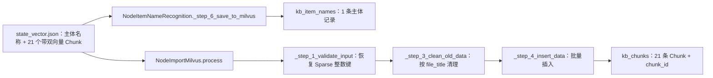

# 第 8 节：Milvus 向量入库

> 上一节已经把主体名称和 21 个 Chunk 都转换成 BGE-M3 双向量，并保存到 `workspace/day07-real-run/state_vector.json`；这一节把这份真实状态分别写入主体名称集合和 Chunk 集合。
> 对应资料：`reference/掌教智库/4.视频/day08/` 的主体保存、集合创建、数据保存和 Chunk 数据组织视频与课堂笔记；补充阅读 `reference/掌教智库/1.笔记/10【掌柜智库】【导入】【节点7】存入 Milvus.md`。

## 一、业务流程与设计原因

### 1. 第 7 节留下的是状态，不是数据库记录

第 7 节已经完成了两种不同用途的向量：

- 顶层 `item_name` 的 Dense 和 Sparse 向量，用于以后确认用户正在询问哪一个产品；
- 每个 Chunk 的 Dense 和 Sparse 向量，用于以后从产品正文中召回知识。

这些结果目前只是 Python 状态和 JSON 备份。打开真实输入文件，可以看到它的结构是：

```text
顶层：item_name
顶层：item_name_dense_vector
顶层：item_name_sparse_vector
顶层：chunks，共 21 个
每个 Chunk：item_name、dense_vector、sparse_vector
```

本节使用的输入必须是：

```text
workspace/day07-real-run/state_vector.json
```

不能改用第 5 节的 `chunks.json`。第 5 节文件只有切片正文和来源字段，没有第 7 节补上的主体向量和 Chunk 向量。

把状态写入 Milvus 后，向量才有了可以被后续检索节点查询的持久位置。Milvus 负责集合、字段、索引、删除和插入；本节代码负责把已有状态映射到这些数据库字段，不重新识别主体，也不重新生成向量。

### 2. 为什么要分成两个集合

主体名称和 Chunk 虽然都带 Dense/Sparse 向量，但它们的业务粒度不同：

| 数据 | 一条记录表达什么 | 本次真实数量 | 后续用途 |
| --- | --- | ---: | --- |
| 主体名称 | 一份文档介绍的产品主体 | 1 | 产品名称确认 |
| Chunk | 产品手册中的一个知识片段 | 21 | 正文知识召回 |

如果把两者塞进同一个集合，主体记录和正文记录就需要靠额外字段区分，查询产品名称时还要过滤正文；如果只保存 Chunk，又会丢掉原项目单独保存主体名称向量的能力。因此沿用参考项目的职责拆分：主体节点保存一条主体记录，独立入库节点保存全部 Chunk。



从左边读：输入是第 7 节已经生成的真实状态备份。上面的分支只读取顶层字段，写入主体名称集合；下面的分支逐个检查 Chunk，恢复 JSON 中的稀疏特征编号，再批量写入 Chunk 集合。两条分支都保存 Dense 和 Sparse，但主体集合保存一条，Chunk 集合保存二十一条。

本节采用已经部署好的真实 Milvus：

```text
Milvus URI：        http://192.168.150.120:19530
Milvus 服务端：     pkg/v2.5.5
PyMilvus 客户端：   3.0.3
pymilvus-model：    0.3.4
```

这些版本来自当前环境的只读核对。教程不要求你重新部署、删除或重建虚拟机上的 Milvus、MinIO、etcd 或 Attu。

### 3. 两个集合分别保存哪些字段

#### 主体名称集合：`kb_item_names`

主体集合默认名为 `kb_item_names`，具体名称从本地 `.env` 读取。它保存一条主体名称记录：

| 字段 | Milvus 类型 | 数据来源 |
| --- | --- | --- |
| `pk` | `INT64`，自增主键 | Milvus 自动生成 |
| `file_title` | `VARCHAR` | 状态顶层 `file_title` |
| `item_name` | `VARCHAR` | 状态顶层 `item_name` |
| `dense_vector` | `FLOAT_VECTOR(1024)` | `item_name_dense_vector` |
| `sparse_vector` | `SPARSE_FLOAT_VECTOR` | `item_name_sparse_vector` |

主体名称的幂等依据是 `file_title`：保存之前删除同一文件标题的旧主体记录，然后插入当前记录。这里不把 `item_name` 当作删除条件，因为同一个文件重新识别后名称可能被修正；按来源文件标题清理更符合本次导入的边界。

`pk` 是 Milvus 自增主键。当前后续流程只需要主体名称和主体向量，不需要拿这个主键回到状态里，所以主体主键不回填。

#### Chunk 集合：`kb_chunks`

Chunk 集合默认名为 `kb_chunks`：

| 字段 | Milvus 类型 | 数据来源 |
| --- | --- | --- |
| `chunk_id` | `INT64`，自增主键 | Milvus 返回后回填 |
| `content` | `VARCHAR` | Chunk 的 `content` |
| `title` | `VARCHAR` | Chunk 的 `title` |
| `parent_title` | `VARCHAR` | Chunk 的 `parent_title` |
| `part` | `INT8` | 本节入库前补充为 `0` |
| `file_title` | `VARCHAR` | Chunk 的 `file_title` |
| `item_name` | `VARCHAR` | Chunk 的 `item_name` |
| `dense_vector` | `FLOAT_VECTOR(1024)` | Chunk 的 `dense_vector` |
| `sparse_vector` | `SPARSE_FLOAT_VECTOR` | Chunk 的 `sparse_vector` |

Chunk 集合也按 `file_title` 幂等。一次导入先删除当前文档的旧 Chunk，再批量插入新 Chunk。Milvus 返回的 21 个 `chunk_id` 必须按插入顺序回填到 21 个状态副本中，这样状态里的第一个 Chunk 仍然对应数据库插入结果中的第一个 Chunk。

### 4. Dense、Sparse 和索引如何配合

两个集合都为两种向量建立索引：

| 向量字段 | 索引类型 | 相似度 |
| --- | --- | --- |
| `dense_vector` | `AUTOINDEX` | `COSINE` |
| `sparse_vector` | `SPARSE_INVERTED_INDEX` | `IP` |

Sparse 索引沿用 BGE-M3 的参考配置：

```python
{
    "inverted_index_algo": "DAAT_MAXSCORE",
    "normalize": True,
    "quantization": "none",
}
```

Dense 用余弦相似度，是因为第 7 节的 Dense 已经按 `normalize_embeddings=True` 生成了 1024 维 L2 归一化向量。Sparse 要单独理解：第 7 节保存的是模型原始 Sparse 权重，不能因为 Sparse 索引配置了 `normalize=True`，就反过来说模型输出本身已经 L2 归一化。这里一个是入库前的数据事实，一个是 Milvus 索引侧的处理参数。

参考资料中的主体集合曾使用 `IVF_FLAT`，Chunk 集合又使用了 `AUTOINDEX`。当前服务端已经确认是 Milvus 2.5.5，本节统一使用当前客户端和服务端能接受的 `AUTOINDEX`，不照搬旧版本的 `nlist=128`。`AUTOINDEX` 让当前小规模学习数据先完成持久化，具体索引调优留到真正有检索性能需求时再做。

### 5. 幂等删除为什么放在插入之前

导入同一份文档可能发生多次：用户修改了切片、重新生成向量，或者只是重复运行学习期入口。如果每次都直接插入，主体会从 1 条变成 2 条，Chunk 会从 21 条变成 42 条，后续检索就会得到重复内容。

因此保存步骤按下面的顺序工作：

```text
校验输入
  → 创建或复用集合
  → 按 file_title 删除旧记录
  → 插入当前记录
  → 成功后更新状态
```

删除过滤条件只匹配当前 `file_title`，不会删除其他文档的数据；本节也不会执行 `drop_collection` 或清空数据库。重复运行同一个 RS-12 状态后，当前文档应保持 1 条主体记录和 21 条 Chunk 记录。

这里有一个必须知道的失败边界：删除和插入不是一个数据库事务。如果删除成功而插入失败，旧记录可能已经被删除。本节沿用参考项目的实际边界，不假装增加了事务回滚；代码会保留节点上下文并报告失败，用户的正常验证不需要故意制造这种破坏性情况。

### 6. JSON 中的 Sparse 键需要恢复

第 7 节运行期间，Sparse 是这样的 Python 字典：

```python
{12345: 0.42, 67890: 0.18}
```

写入 JSON 后，对象键只能是字符串：

```json
{"12345": 0.42, "67890": 0.18}
```

所以第 8 节不能把 `json.loads()` 的结果直接当作第 7 节内存对象使用。入库适配工具会逐项检查：

- 特征编号能否转换成非负整数；
- 权重是不是数字；
- 权重是不是有限数值；
- Sparse 字典是否为空。

这个工具只恢复数据表示，不重新计算权重，也不做额外归一化。主体名称 Sparse 和全部 Chunk Sparse 都必须经过同样的恢复步骤。

### 7. 本节到哪里为止

本节的边界是：

```text
第 7 节真实状态
    → 主体名称集合
    → Chunk 集合
    → Schema 和 Dense/Sparse 索引
    → 按 file_title 幂等清理
    → 真实批量写入
    → Chunk 自增主键回填
```

本节不接正式 `main_graph.py`，不实现 Dense 检索、Sparse 检索、Hybrid Search、商品确认查询、RRF、Rerank、MongoDB、FastAPI、SSE 或前端。也不重新验收前七节的 PDF、图片、切片、主体识别和 BGE-M3 生成。

## 二、手敲步骤

### 1. 先确认配置和依赖位置

打开 [pyproject.toml](../../pyproject.toml)，确认项目已经有 `pymilvus[model]`。第 7 节已经安装并锁定了本节需要的 PyMilvus 客户端，本节不新增替身数据库，也不新增一套 Milvus SDK。

本节会接触以下文件：

| 文件 | 手敲内容 |
| --- | --- |
| [.env.example](../../.env.example) | 追加 Milvus 配置模板 |
| `src/shopkeeper_brain/core/milvus_config.py` | 新建 Milvus 配置读取模块 |
| `src/shopkeeper_brain/processor/import_processor/exceptions.py` | 追加 Milvus 异常类型 |
| `src/shopkeeper_brain/utils/milvus_utils.py` | 新建客户端、转义和 Sparse 恢复工具 |
| `src/shopkeeper_brain/processor/import_processor/nodes/node_item_name_recognition.py` | 追加主体名称保存步骤 |
| `src/shopkeeper_brain/processor/import_processor/nodes/node_import_milvus.py` | 新建 Chunk 入库节点和学习期入口 |

按“配置 → 异常 → 工具 → 被调用的主体步骤 → Chunk 节点”的顺序手敲。这样每个使用方出现时，被引用的文件已经存在。

### 2. 追加 Milvus 配置模板

不要替换 `.env.example` 的原有内容。在文件末尾追加下面的配置片段：

```dotenv
# ====================
# Milvus
# ====================
SHOPKEEPER_BRAIN_MILVUS_URI=http://192.168.150.120:19530
SHOPKEEPER_BRAIN_MILVUS_ITEM_NAME_COLLECTION=kb_item_names
SHOPKEEPER_BRAIN_MILVUS_CHUNK_COLLECTION=kb_chunks
```

然后在本地 `.env` 追加同名变量。`.env` 中可能还有模型、MinIO 等本地配置，不要用上面的片段覆盖整个文件，也不要把真实密钥写入 `.env.example`、教程或控制台输出。

这里把集合名也放进配置，而不是写死在节点里：连接地址可能随环境变化，集合名也可能需要使用本地隔离名称；节点只使用配置模块返回的值。

### 3. 创建 Milvus 配置模块

现在状态和节点还没有地方读取 Milvus 地址。先创建配置文件，让后面的客户端和两个节点都依赖同一个配置对象。

**文件**：`src/shopkeeper_brain/core/milvus_config.py`

```python
import os
from dataclasses import dataclass
from pathlib import Path

from dotenv import load_dotenv


@dataclass(frozen=True)
class MilvusConfig:
    """Milvus 连接地址和本节使用的两个集合。"""

    uri: str
    item_name_collection: str
    chunk_collection: str


def load_milvus_config() -> MilvusConfig:
    """从项目根目录读取 Milvus 配置，系统环境变量优先。"""
    project_root = Path(__file__).resolve().parents[3]
    load_dotenv(project_root / ".env", override=False)

    return MilvusConfig(
        uri=os.getenv("SHOPKEEPER_BRAIN_MILVUS_URI", "").strip(),
        item_name_collection=os.getenv(
            "SHOPKEEPER_BRAIN_MILVUS_ITEM_NAME_COLLECTION", ""
        ).strip(),
        chunk_collection=os.getenv(
            "SHOPKEEPER_BRAIN_MILVUS_CHUNK_COLLECTION", ""
        ).strip(),
    )
```

`Path(__file__).resolve().parents[3]` 从当前模块位置找到项目根目录，因此 IDE 从哪个工作目录启动都不会改变 `.env` 的读取位置。`override=False` 表示已有系统环境变量优先于 `.env`，这和前面配置模块的约定一致。

`@dataclass(frozen=True)` 让配置对象创建后不能被节点随意改写。三个字段都用空字符串作为缺省值，真正连接或创建集合前再由使用方检查；这样不会因为漏配变量而静默使用错误地址。

### 4. 增加 Milvus 异常类型

打开 `src/shopkeeper_brain/processor/import_processor/exceptions.py`，在现有 `ConfigurationError` 类后追加下面的类。不要重抄其他已有异常，也不要修改它们的继承关系。

```python


class MilvusError(ImportProcessError):
    """Milvus 连接、集合或写入操作失败。"""
```

它继承项目已有的 `ImportProcessError`。这样 `BaseNode.__call__()` 遇到 Milvus 错误时会保留节点边界，不会把数据库异常伪装成普通的成功返回。配置缺失仍然使用已有的 `ConfigurationError`，输入格式错误使用已有的 `StateFieldError` 或 `ValidationError`。

### 5. 创建 Milvus 工具模块

直接把 Milvus 客户端初始化、过滤表达式转义和 JSON Sparse 恢复放进节点，会让主体节点和 Chunk 节点各写一份相同逻辑。这里的工具只负责数据库连接和数据表示转换，不负责决定哪类业务数据保存到哪个集合。

**文件**：`src/shopkeeper_brain/utils/milvus_utils.py`

```python
import math
from numbers import Real

from pymilvus import MilvusClient

from shopkeeper_brain.core.milvus_config import load_milvus_config
from shopkeeper_brain.processor.import_processor.exceptions import (
    ConfigurationError,
    ValidationError,
)

_milvus_client: MilvusClient | None = None


def get_milvus_client() -> MilvusClient:
    """首次调用连接 Milvus，后续在当前进程复用同一客户端。"""
    global _milvus_client
    if _milvus_client is not None:
        return _milvus_client

    config = load_milvus_config()
    if not config.uri:
        raise ConfigurationError(
            "Milvus URI 未配置，请检查 SHOPKEEPER_BRAIN_MILVUS_URI"
        )

    _milvus_client = MilvusClient(uri=config.uri)
    return _milvus_client


def escape_milvus_string(value: str) -> str:
    """转义 Milvus 过滤表达式中的反斜杠和引号。"""
    return value.replace("\\", "\\\\").replace('"', '\\"').replace("'", "\\'")


def restore_sparse_vector(value: object, field_name: str) -> dict[int, float]:
    """把 JSON 读取后的 Sparse 字典恢复为 Milvus 可接受的整数键字典。"""
    if not isinstance(value, dict) or not value:
        raise ValidationError(
            message=f"{field_name} 必须是非空 Sparse 字典"
        )

    restored: dict[int, float] = {}
    for raw_index, raw_weight in value.items():
        if isinstance(raw_index, bool) or not isinstance(raw_index, (int, str)):
            raise ValidationError(
                message=f"{field_name} 的特征编号必须是整数或整数文本"
            )

        try:
            index = int(raw_index)
        except (TypeError, ValueError) as exc:
            raise ValidationError(
                message=f"{field_name} 的特征编号无法转换为整数：{raw_index!r}"
            ) from exc

        if index < 0:
            raise ValidationError(
                message=f"{field_name} 的特征编号不能为负数：{index}"
            )

        if isinstance(raw_weight, bool) or not isinstance(raw_weight, Real):
            raise ValidationError(
                message=f"{field_name} 的权重必须是数字：{raw_weight!r}"
            )

        weight = float(raw_weight)
        if not math.isfinite(weight):
            raise ValidationError(
                message=f"{field_name} 的权重必须是有限数值：{raw_weight!r}"
            )

        restored[index] = weight

    return restored
```

这里有三个 Python 写法需要留意：

- 模块变量 `_milvus_client` 初始为 `None`，`global` 让函数可以在第一次调用时写回它；同一学习进程的后续操作复用这个客户端。
- `replace()` 只处理过滤表达式中的特殊字符，不修改原始 `file_title`；真正插入数据库的字段仍使用原字符串。
- `dict[int, float]` 是 Python 类型标注，不会自动把 JSON 键转换成整数，所以函数内部仍然显式执行 `int(raw_index)`，并检查负数、布尔值、非数字和非有限权重。

本工具不做 L2 归一化，也不把整个 CSR 对象交给 Milvus。第 7 节已经把内存中的 CSR 转成字典，本节只处理 JSON 序列化造成的键类型变化。

### 6. 给主体识别节点增加主体名称保存

这一节只在现有主体节点中增加第 8 节的保存步骤。第 6 节的主体识别前四步、第 7 节的名称向量生成和现有学习期入口都不重写。

#### 6.1 增加导入

打开 `src/shopkeeper_brain/processor/import_processor/nodes/node_item_name_recognition.py`，将文件开头现有的导入区（从 `from langchain_core.messages` 到 `from shopkeeper_brain.utils.embedding_utils`）整体替换为下面代码；其他类、方法和学习期入口保持不变：

```python
from langchain_core.messages import SystemMessage, HumanMessage
from langchain_openai import ChatOpenAI
from pymilvus import DataType
from pymilvus.client.field_data_extractors import dense_vector_width

from shopkeeper_brain.core.llm_config import load_llm_config
from shopkeeper_brain.core.milvus_config import load_milvus_config
from shopkeeper_brain.processor.import_processor.BaseNode import BaseNode
from shopkeeper_brain.processor.import_processor.exceptions import (
    ConfigurationError,
    ImportProcessError,
    MilvusError,
    StateFieldError,
    ValidationError,
)
from shopkeeper_brain.processor.import_processor.state import (
    ImportGraphState,
    create_default_state,
)
from shopkeeper_brain.utils.embedding_utils import generate_embeddings
from shopkeeper_brain.utils.milvus_utils import (
    escape_milvus_string,
    get_milvus_client,
    restore_sparse_vector,
)
```

第 7 节留下的两项非阻塞建议仍然不在本节修改范围内：主体节点中未使用的 `dense_vector_width` 导入，以及工具中的 `get_beg_m3_ef` 拼写。先按真实保存文件手敲，不能把建议误记成已修复。

#### 6.2 在 `process()` 中接入第 6 步

找到已有的名称向量生成代码：

```python
        dense_vector, sparse_vector = self._step_5_generate_vectors(item_name)
        state["item_name_dense_vector"] = dense_vector
        state["item_name_sparse_vector"] = sparse_vector
```

紧接着追加：

```python
        self._step_6_save_to_milvus(
            file_title,
            item_name,
            dense_vector,
            sparse_vector,
        )
```

正式主流程以后调用这个 `process()` 时，顺序就是“识别主体 → 回填 Chunk → 生成名称向量 → 保存主体名称”。但是本节学习期入口会直接读取第 7 节状态备份并调用第 6 步，不重新请求 LLM，也不重新执行 BGE-M3。

#### 6.3 在 `_step_5_generate_vectors()` 后追加两个方法

把下面两个方法放在现有 `_step_5_generate_vectors()` 后、文件末尾学习期入口前。它们只保存主体名称，不处理 Chunk。

```python
    def _step_6_save_to_milvus(
        self,
        file_title: str,
        item_name: str,
        dense_vector: list[float],
        sparse_vector: dict[int, float],
    ) -> None:
        """按文件标题幂等保存一条主体名称记录。"""
        config = load_milvus_config()
        if not config.item_name_collection:
            raise ConfigurationError(
                "主体名称集合未配置，请检查 "
                "SHOPKEEPER_BRAIN_MILVUS_ITEM_NAME_COLLECTION",
                node_name=self.name,
            )
        if not isinstance(file_title, str) or not file_title.strip():
            raise StateFieldError(
                node_name=self.name,
                field_name="file_title",
                expected_type=str,
            )
        if not isinstance(item_name, str) or not item_name.strip():
            raise StateFieldError(
                node_name=self.name,
                field_name="item_name",
                expected_type=str,
            )
        if not isinstance(dense_vector, list) or len(dense_vector) != 1024:
            raise ValidationError(
                message="主体名称 Dense 向量必须是 1024 维列表",
                node_name=self.name,
            )

        restored_sparse = restore_sparse_vector(
            sparse_vector,
            "item_name_sparse_vector",
        )

        try:
            client = get_milvus_client()
            if not client.has_collection(config.item_name_collection):
                self._create_item_name_collection(
                    client,
                    config.item_name_collection,
                )

            safe_file_title = escape_milvus_string(file_title)
            client.delete(
                collection_name=config.item_name_collection,
                filter=f'file_title == "{safe_file_title}"',
            )
            result = client.insert(
                collection_name=config.item_name_collection,
                data=[
                    {
                        "file_title": file_title,
                        "item_name": item_name,
                        "dense_vector": dense_vector,
                        "sparse_vector": restored_sparse,
                    }
                ],
            )
        except ImportProcessError:
            raise
        except Exception as exc:
            raise MilvusError(
                message="主体名称写入 Milvus 失败",
                node_name=self.name,
                cause=exc,
            ) from exc

        inserted_ids = result.get("ids", [])
        if result.get("insert_count") != 1 or len(inserted_ids) != 1:
            raise MilvusError(
                message="主体名称写入 Milvus 后返回的主键数量不正确",
                node_name=self.name,
            )

    def _create_item_name_collection(
        self,
        client,
        collection_name: str,
    ) -> None:
        """创建主体名称集合及 Dense/Sparse 两类索引。"""
        schema = client.create_schema(
            auto_id=True,
            enable_dynamic_field=False,
        )
        schema.add_field(
            field_name="pk",
            datatype=DataType.INT64,
            is_primary=True,
            auto_id=True,
        )
        schema.add_field(
            field_name="file_title",
            datatype=DataType.VARCHAR,
            max_length=65535,
        )
        schema.add_field(
            field_name="item_name",
            datatype=DataType.VARCHAR,
            max_length=65535,
        )
        schema.add_field(
            field_name="dense_vector",
            datatype=DataType.FLOAT_VECTOR,
            dim=1024,
        )
        schema.add_field(
            field_name="sparse_vector",
            datatype=DataType.SPARSE_FLOAT_VECTOR,
        )

        index_params = client.prepare_index_params()
        index_params.add_index(
            field_name="dense_vector",
            index_name="dense_vector_index",
            index_type="AUTOINDEX",
            metric_type="COSINE",
        )
        index_params.add_index(
            field_name="sparse_vector",
            index_name="sparse_vector_index",
            index_type="SPARSE_INVERTED_INDEX",
            metric_type="IP",
            params={
                "inverted_index_algo": "DAAT_MAXSCORE",
                "normalize": True,
                "quantization": "none",
            },
        )
        client.create_collection(
            collection_name=collection_name,
            schema=schema,
            index_params=index_params,
        )
```

`try` 从客户端创建开始包住了连接、集合、删除和插入，所以真实服务不可达时，节点也能把异常包装成带 `node_item_name_recognition` 上下文的 `MilvusError`。主体集合使用 `enable_dynamic_field=False`，插入字典只能包含 Schema 中的显式字段，避免把整个状态对象误写进去。

主体保存按当前 `file_title` 删除旧记录；插入成功后只检查返回了 1 个自增主键，不把它写回状态。只有 Chunk 的 `chunk_id` 会在本节回填，因为后续正文结果需要继续携带它。

### 7. 创建 Chunk 入库节点

现在创建 Chunk 的独立节点。它不会重新生成任何向量，只把第 7 节状态中的已有字段映射到 Chunk 集合。

**文件**：`src/shopkeeper_brain/processor/import_processor/nodes/node_import_milvus.py`

```python
import json
import logging
import math
from pathlib import Path

from pymilvus import DataType

from shopkeeper_brain.core.milvus_config import MilvusConfig, load_milvus_config
from shopkeeper_brain.processor.import_processor.BaseNode import BaseNode
from shopkeeper_brain.processor.import_processor.exceptions import (
    ConfigurationError,
    ImportProcessError,
    MilvusError,
    StateFieldError,
    ValidationError,
)
from shopkeeper_brain.processor.import_processor.nodes.node_item_name_recognition import (
    NodeItemNameRecognition,
)
from shopkeeper_brain.processor.import_processor.state import ImportGraphState
from shopkeeper_brain.utils.milvus_utils import (
    escape_milvus_string,
    get_milvus_client,
    restore_sparse_vector,
)

DENSE_VECTOR_DIM = 1024
VARCHAR_MAX_LENGTH = 65535


class NodeImportMilvus(BaseNode):
    """把带双向量的 Chunk 幂等写入 Milvus。"""

    name = "node_import_milvus"

    def process(self, state: ImportGraphState) -> ImportGraphState:
        """校验、清理、批量插入，并在成功后回填 Chunk 主键。"""
        file_title, chunks = self._step_1_validate_input(state)
        config = load_milvus_config()
        client = self._step_2_prepare_collection(config)
        self._step_3_clean_old_data(client, config, file_title)
        updated_chunks = self._step_4_insert_data(client, config, chunks)
        state["chunks"] = updated_chunks
        self.logger.info("Chunk 入库完成：%s 条", len(updated_chunks))
        return state

    def _step_1_validate_input(
            self,
            state: ImportGraphState,
    ) -> tuple[str, list[dict[str, object]]]:
        """校验全部 Chunk，并创建不会污染原状态的待插入副本。"""
        file_title = state.get("file_title")
        if not isinstance(file_title, str) or not file_title.strip():
            raise StateFieldError(
                node_name=self.name,
                field_name="file_title",
                expected_type=str,
            )

        item_name = state.get("item_name")
        if not isinstance(item_name, str) or not item_name.strip():
            raise StateFieldError(
                node_name=self.name,
                field_name="item_name",
                expected_type=str,
            )

        chunks = state.get("chunks")
        if not isinstance(chunks, list) or not chunks:
            raise StateFieldError(
                node_name=self.name,
                field_name="chunks",
                expected_type=list,
            )

        normalized_chunks: list[dict[str, object]] = []
        for index, chunk in enumerate(chunks):
            field_prefix = f"chunks[{index}]"
            if not isinstance(chunk, dict):
                raise ValidationError(
                    message=f"{field_prefix} 必须是字典",
                    node_name=self.name,
                )
            if chunk.get("file_title") != file_title:
                raise ValidationError(
                    message=f"{field_prefix}.file_title 与状态不一致",
                    node_name=self.name,
                )
            if chunk.get("item_name") != item_name:
                raise ValidationError(
                    message=f"{field_prefix}.item_name 与状态不一致",
                    node_name=self.name,
                )

            content = chunk.get("content")
            if not isinstance(content, str) or not content.strip():
                raise ValidationError(
                    message=f"{field_prefix}.content 必须是非空文本",
                    node_name=self.name,
                )

            for field_name in ("title", "parent_title"):
                if not isinstance(chunk.get(field_name, ""), str):
                    raise ValidationError(
                        message=f"{field_prefix}.{field_name} 必须是文本",
                        node_name=self.name,
                    )

            dense_vector = chunk.get("dense_vector")
            if (
                    not isinstance(dense_vector, list)
                    or len(dense_vector) != DENSE_VECTOR_DIM
                    or any(
                isinstance(value, bool)
                or not isinstance(value, (int, float))
                or not math.isfinite(float(value))
                for value in dense_vector
            )
            ):
                raise ValidationError(
                    message=(
                        f"{field_prefix}.dense_vector 必须是有限数值组成的 "
                        f"{DENSE_VECTOR_DIM} 维列表"
                    ),
                    node_name=self.name,
                )

            sparse_vector = restore_sparse_vector(
                chunk.get("sparse_vector"),
                f"{field_prefix}.sparse_vector",
            )
            normalized_chunk = chunk.copy()
            normalized_chunk["dense_vector"] = [
                float(value) for value in dense_vector
            ]
            normalized_chunk["sparse_vector"] = sparse_vector
            normalized_chunk["part"] = 0
            normalized_chunks.append(normalized_chunk)

        return file_title, normalized_chunks

    def _step_2_prepare_collection(
            self,
            config: MilvusConfig,
    ):
        """连接 Milvus，并在缺少 Chunk 集合时创建它。"""
        if not config.chunk_collection:
            raise ConfigurationError(
                "Chunk 集合未配置，请检查 "
                "SHOPKEEPER_BRAIN_MILVUS_CHUNK_COLLECTION",
                node_name=self.name,
            )

        try:
            client = get_milvus_client()
            if not client.has_collection(config.chunk_collection):
                self._create_chunk_collection(client, config.chunk_collection)
        except ImportProcessError:
            raise
        except Exception as exc:
            raise MilvusError(
                message="Chunk 集合准备失败",
                node_name=self.name,
                cause=exc,
            ) from exc
        return client

    def _create_chunk_collection(self, client, collection_name: str) -> None:
        """创建 Chunk 字段和 Dense/Sparse 索引。"""
        schema = client.create_schema(
            auto_id=True,
            enable_dynamic_field=False,
        )
        schema.add_field(
            field_name="chunk_id",
            datatype=DataType.INT64,
            is_primary=True,
            auto_id=True,
        )
        schema.add_field(
            field_name="content",
            datatype=DataType.VARCHAR,
            max_length=VARCHAR_MAX_LENGTH,
        )
        schema.add_field(
            field_name="title",
            datatype=DataType.VARCHAR,
            max_length=VARCHAR_MAX_LENGTH,
        )
        schema.add_field(
            field_name="parent_title",
            datatype=DataType.VARCHAR,
            max_length=VARCHAR_MAX_LENGTH,
        )
        schema.add_field(
            field_name="part",
            datatype=DataType.INT8,
        )
        schema.add_field(
            field_name="file_title",
            datatype=DataType.VARCHAR,
            max_length=VARCHAR_MAX_LENGTH,
        )
        schema.add_field(
            field_name="item_name",
            datatype=DataType.VARCHAR,
            max_length=VARCHAR_MAX_LENGTH,
        )
        schema.add_field(
            field_name="dense_vector",
            datatype=DataType.FLOAT_VECTOR,
            dim=DENSE_VECTOR_DIM,
        )
        schema.add_field(
            field_name="sparse_vector",
            datatype=DataType.SPARSE_FLOAT_VECTOR,
        )

        index_params = client.prepare_index_params()
        index_params.add_index(
            field_name="dense_vector",
            index_name="dense_vector_index",
            index_type="AUTOINDEX",
            metric_type="COSINE",
        )
        index_params.add_index(
            field_name="sparse_vector",
            index_name="sparse_inverted_index",
            index_type="SPARSE_INVERTED_INDEX",
            metric_type="IP",
            params={
                "inverted_index_algo": "DAAT_MAXSCORE",
                "normalize": True,
                "quantization": "none",
            },
        )
        client.create_collection(
            collection_name=collection_name,
            schema=schema,
            index_params=index_params,
        )

    def _step_3_clean_old_data(
            self,
            client,
            config: MilvusConfig,
            file_title: str,
    ) -> None:
        """只删除当前文档的旧 Chunk，保留其他文档。"""
        safe_file_title = escape_milvus_string(file_title)
        try:
            client.delete(
                collection_name=config.chunk_collection,
                filter=f'file_title == "{safe_file_title}"',
            )
        except Exception as exc:
            raise MilvusError(
                message="Chunk 旧数据清理失败",
                node_name=self.name,
                cause=exc,
            ) from exc

    def _step_4_insert_data(
            self,
            client,
            config: MilvusConfig,
            chunks: list[dict[str, object]],
    ) -> list[dict[str, object]]:
        """映射 Schema、批量插入，并按返回顺序回填自增主键。"""
        data_to_insert = [
            {
                "content": chunk["content"],
                "title": chunk.get("title", ""),
                "parent_title": chunk.get("parent_title", ""),
                "part": chunk["part"],
                "file_title": chunk["file_title"],
                "item_name": chunk["item_name"],
                "dense_vector": chunk["dense_vector"],
                "sparse_vector": chunk["sparse_vector"],
            }
            for chunk in chunks
        ]

        try:
            result = client.insert(
                collection_name=config.chunk_collection,
                data=data_to_insert,
            )
        except Exception as exc:
            raise MilvusError(
                message="Chunk 批量写入 Milvus 失败",
                node_name=self.name,
                cause=exc,
            ) from exc

        inserted_ids = result.get("ids", [])
        if (
                result.get("insert_count") != len(chunks)
                or len(inserted_ids) != len(chunks)
        ):
            raise MilvusError(
                message=(
                    "Chunk 写入成功响应中的数量不正确："
                    f"期望 {len(chunks)}，实际 {len(inserted_ids)}"
                ),
                node_name=self.name,
            )

        updated_chunks: list[dict[str, object]] = []
        for chunk, inserted_id in zip(chunks, inserted_ids, strict=True):
            updated_chunk = chunk.copy()
            updated_chunk["chunk_id"] = int(inserted_id)
            updated_chunks.append(updated_chunk)
        return updated_chunks


if __name__ == "__main__":
    logging.basicConfig(
        level=logging.INFO,
        format="%(levelname)s %(name)s %(message)s",
    )

    project_root = Path(__file__).resolve().parents[5]
    state_path = project_root / "workspace/day07-real-run/state_vector.json"
    if not state_path.is_file():
        raise SystemExit(f"找不到第 7 节真实状态备份：{state_path}")

    state = json.loads(state_path.read_text(encoding="utf-8"))
    if not isinstance(state, dict) or not state.get("chunks"):
        raise SystemExit("state_vector.json 必须是带非空 chunks 的状态对象")

    item_node = NodeItemNameRecognition()
    item_node._step_6_save_to_milvus(
        state["file_title"],
        state["item_name"],
        state["item_name_dense_vector"],
        state["item_name_sparse_vector"],
    )
    result = NodeImportMilvus()(state)

    config = load_milvus_config()
    client = get_milvus_client()
    client.flush(collection_name=config.item_name_collection)
    client.flush(collection_name=config.chunk_collection)
    safe_file_title = escape_milvus_string(result["file_title"])
    item_rows = client.query(
        collection_name=config.item_name_collection,
        filter=f'file_title == "{safe_file_title}"',
        output_fields=["pk", "file_title", "item_name"],
    )
    chunk_rows = client.query(
        collection_name=config.chunk_collection,
        filter=f'file_title == "{safe_file_title}"',
        output_fields=["chunk_id", "file_title", "item_name", "part"],
    )

    assert len(item_rows) == 1
    assert len(chunk_rows) == len(result["chunks"]) == 21
    assert all(
        chunk.get("chunk_id") is not None
        for chunk in result["chunks"]
    )
    assert all(
        isinstance(key, int)
        for key in result["chunks"][0]["sparse_vector"]
    )

    print("主体集合当前文档记录数：", len(item_rows))
    print("Chunk 集合当前文档记录数：", len(chunk_rows))
    print("Chunk 主键回填数：", len(result["chunks"]))
    print("主体与 Chunk 真实入库：通过")
```

#### 先看输入校验为什么逐块进行

`state_vector.json` 是外部持久化结果，不能只检查第一个 Chunk 就假设后面 20 个结构相同。`_step_1_validate_input()` 逐个检查主体、文件标题、正文、标题、父标题和两类向量；其中 Dense 必须是 1024 个有限数字，Sparse 必须能恢复成非空的 `dict[int, float]`。

校验通过后使用 `chunk.copy()` 创建待插入副本，并在副本中补充 `part=0`。原始 `state["chunks"]` 在 Milvus 插入成功前不会被增加 `chunk_id`，因此失败时不会出现一部分切片有主键、一部分切片没有主键的混合状态。

#### 再看集合创建和字段映射

`create_schema(auto_id=True, enable_dynamic_field=False)` 表示主键由 Milvus 自动生成，同时只接受显式声明的字段。Chunk 入库不能把整个切片字典直接交给数据库，因为切片字典里还可能有以后不属于当前 Schema 的字段；`_step_4_insert_data()` 明确列出八个非主键字段，主键 `chunk_id` 留给 Milvus。

`AUTOINDEX` 和 `SPARSE_INVERTED_INDEX` 都通过 `prepare_index_params()` 添加到同一个集合创建请求中。Dense 的维度写死为第 7 节已经验证的 1024；Sparse 不写维度，因为它使用模型词表中的稀疏特征编号。

#### 最后看幂等删除和主键回填

`_step_3_clean_old_data()` 只构造当前文件标题的过滤条件。`escape_milvus_string()` 转义的是过滤表达式副本，原始 `file_title` 仍然按真实值插入。

Milvus 返回的 `ids` 与输入列表顺序对应。`zip(chunks, inserted_ids, strict=True)` 会在数量不一致时直接报错，而不是静默给错误的 Chunk 回填主键。只有数量检查通过，`_step_4_insert_data()` 才创建带 `chunk_id` 的返回列表；`process()` 最后才替换状态中的 `chunks`。

#### 学习期入口为什么不调用完整主体节点

文件末尾的入口直接读取第 7 节备份，然后调用：

```text
NodeItemNameRecognition._step_6_save_to_milvus()
        ↓
NodeImportMilvus()(state)
```

这样做是为了直接承接已经完成的真实状态：

- 不重新调用第 6 节的远程主体识别；
- 不重新执行第 7 节的 BGE-M3 名称和 Chunk 编码；
- 不把手动确认的主体名称伪装成新的识别证据；
- 仍然真实连接 Milvus、创建集合、删除旧记录和插入数据。

这只是本节学习入口，不代表 `main_graph.py` 已经接通。正式主图留到后续章节按进度接入。

## 三、必做真实验证

### 1. 准备真实输入和 Milvus

下面的操作必须使用真实服务和真实第 7 节状态。未运行的操作在你的记录中标为“未验证（未运行）”，不要用模块导入或编译结果替代真实入库。

准备：

1. 虚拟机保持运行，Milvus 容器状态为 healthy；Windows 能访问 `192.168.150.120:19530`。
2. 本地 `.env` 中有下面三个变量，值与实际部署一致：
   
   ```dotenv
   SHOPKEEPER_BRAIN_MILVUS_URI=http://192.168.150.120:19530
   SHOPKEEPER_BRAIN_MILVUS_ITEM_NAME_COLLECTION=kb_item_names
   SHOPKEEPER_BRAIN_MILVUS_CHUNK_COLLECTION=kb_chunks
   ```
3. [state_vector.json](../../workspace/day07-real-run/state_vector.json) 仍然存在，并且是第 7 节生成的真实备份；不要用第 5 节的旧 `chunks.json`。
4. IDE 使用本项目 uv 解释器，能够导入 `pymilvus` 和 `shopkeeper_brain`。
5. 不需要启动 MinIO。第 8 节只验证 Milvus，MinIO 的图片服务不属于本节写入链路。

### 2. 先做本地源码检查

在 IDE 中打开刚手敲的 `node_import_milvus.py`，确认：

- `state_path` 指向 `workspace/day07-real-run/state_vector.json`；
- `NodeItemNameRecognition` 的主体保存方法已经追加；
- `.env` 三个配置变量没有拼写错误；
- 没有把有效密钥打印到日志。

可以先运行项目的编译检查，确认 Python 语法和导入路径没有错误：

```bash
python -I -m compileall -q src
```

预期是退出码 0、没有编译错误。这一步只说明源码可以编译，不说明 Milvus 已经写入；如果没有实际执行，记录为“未验证（未运行）”。

### 3. 在 IDE 中运行第一次真实入库

1. 打开 `src/shopkeeper_brain/processor/import_processor/nodes/node_import_milvus.py`。
2. 在 `_step_6_save_to_milvus()`、`_step_1_validate_input()`、`_step_4_insert_data()` 和末尾两个 `query()` 处设置断点。
3. 选择当前项目 uv 解释器，直接 Run 或 Debug 这个文件；不要先运行正式主图，也不要执行参考项目代码。
4. 第一个断点处检查：
   - `file_title` 是真实文档标题；
   - `item_name` 是 `RS PRO RS-12 数字万用表`，品牌与型号之间的内部空格仍在；
   - 名称 Dense 长度为 1024；
   - 名称 Sparse 经过恢复后是整数键字典。
5. 进入 Chunk 节点后检查：
   - `chunks` 数量为 21；
   - 每个 Chunk 的 `content`、`title`、`parent_title` 和 `item_name` 保留；
   - 每个 Dense 长度为 1024；
   - 每个 Sparse 的特征键已从 JSON 字符串恢复为整数；
   - `part` 只出现在待插入副本中，值为 0。
6. 在主体插入和 Chunk 插入返回处检查：
   - 主体插入返回 1 个 ID；
   - Chunk 插入返回 21 个 ID；
   - `chunk_id` 按原 Chunk 顺序写回状态副本。
7. 继续运行到末尾断言，观察当前文件标题查询结果：
   - 主体集合当前记录数为 1；
   - Chunk 集合当前记录数为 21；
   - 控制台出现“主体与 Chunk 真实入库：通过”。

第一次运行时，当前两个集合如果不存在，会由代码创建；如果它们已经存在，则应该复用并继续核对 Schema 和索引。不要为了“重新演示创建”而删除集合。

### 4. 第二次运行验证幂等

在同一份代码、同一个 `.env` 和同一个 `state_vector.json` 上再次 Run，不删除集合、不清空数据库、不停止服务。

观察：

1. 两个集合被复用，不重复创建；
2. 当前 `file_title` 的主体旧记录被清理后重新插入；
3. 当前 `file_title` 的 Chunk 旧记录被清理后重新插入；
4. 查询结果仍然是主体 1 条、Chunk 21 条；
5. 没有变成主体 2 条或 Chunk 42 条；
6. 如果集合中后来有其他文档，其他文档的记录不应被当前过滤条件删除。

这一步验证的是幂等行为，不是比较两次自增主键是否相同。重复插入后主键可以变化，但当前文档的记录数量和字段内容必须正确。

### 5. 失败时沿数据经过的位置定位

| 现象 | 先看哪里 | 判定与处理 |
| --- | --- | --- |
| URI 无法连接 | 虚拟机状态、`19530` 端口和 `.env` | Milvus 未连接，不能记入库通过；保留异常类型和连接地址，不打印密钥 |
| `SHOPKEEPER_BRAIN_MILVUS_*` 配置为空 | 本地 `.env` 和配置变量名 | 连接还没有开始，先修正配置 |
| 集合创建失败 | 服务端版本、字段名、向量维度和索引参数 | 保留服务端原始异常；不要未经核对就改回参考资料的 `IVF_FLAT` |
| `SPARSE_FLOAT_VECTOR` 插入失败 | `restore_sparse_vector()` 的返回值 | 确认键是 `int`、权重是有限数字，不能把 JSON 字符串键原样交给 Milvus |
| 主体保存成功但 Chunk 失败 | 两个节点的日志和 `NodeImportMilvus.process()` | 主体集合通过不等于整节通过；继续定位 Chunk 的校验、删除或插入位置 |
| Chunk 数量不是 21 | `state_path`、输入 JSON 和查询过滤条件 | 确认没有误用第 5 节旧 JSON，也没有查到其他文档 |
| 第二次运行后变成 42 条 | `_step_3_clean_old_data()` 的 `file_title` filter | 幂等清理没有作用，本节验收失败；不要通过删除集合掩盖问题 |
| 主键数量不等于 Chunk 数量 | `result["ids"]`、输入 Chunk 数量和 `zip(..., strict=True)` | 先确认 Milvus 返回完整 ID，再检查回填顺序；不要静默补主键 |
| 原始状态备份发生变化 | `state_path` 和文件写入代码 | 本节只读取第 7 节备份，不应该覆盖它 |
| MinIO 报时间偏差 | MinIO API 或图片服务 | 不属于本节 Milvus 判据，不用 MinIO 结果替代 Milvus 入库结果 |

如果异常发生在删除之后、插入之前，旧数据可能已经被清理；保留服务端异常和当前集合状态，不通过删除集合或重建服务来掩盖问题。正常验证不需要停止服务、修改数据库数据或故意改坏源码。

### 6. 哪些结果可以记录为通过

本节完整通过需要第一次真实入库和第二次幂等运行两部分证据：

1. `kb_item_names` 和 `kb_chunks` 两个真实集合存在，服务端接受 Dense 与 Sparse 索引；
2. 当前 `file_title` 在主体集合中有 1 条记录，在 Chunk 集合中有 21 条记录；
3. 主体和所有 Chunk 的 Dense 字段均按 1024 维写入，Sparse 字段真实写入成功；
4. JSON 中的 Sparse 特征键在写入前已经恢复为整数，名称内部空格仍保留；
5. 21 个 `chunk_id` 全部从 Milvus 返回，并按原列表顺序回填到状态副本；
6. 同一输入第二次运行后仍然是 1 条主体和 21 条 Chunk，不累积成 2 条和 42 条；
7. 原始 `workspace/day07-real-run/state_vector.json` 没有被覆盖。

如果只看到 Python 编译成功、PyMilvus 可以导入、集合 API 调用返回，或者只成功保存了主体名称而没有完成 Chunk 批量插入，都不能记录为本节完整通过。外部服务未运行时，分别记录“真实 Milvus 入库：未验证（未运行）”或“跳过”，不使用假数据库补齐结果。

完成用户手敲后，保留文件末尾的学习期 `__main__`，方便后续真实验收继续使用同一输入和同一观察入口。