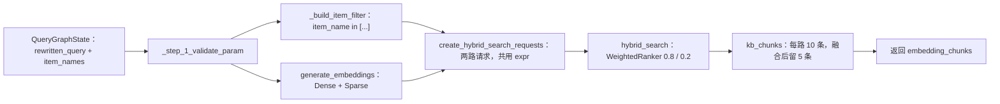

# 第 10 节：向量库检索

> 上一节已经能从用户的问题里确认产品，并把 `rewritten_query` 和 `item_names` 写进查询状态；这一节实现三路检索里的第一路：在 `kb_chunks` 里，限定在已确认的产品范围内，用改写后的问题做 Dense + Sparse 混合检索，把最相关的 5 个 Chunk 交给后面的节点。
> 对应资料：`reference/掌教智库/4.视频/day11/` 的向量搜索节点视频 02 至 06 与课堂笔记 `13`；补充阅读 `reference/掌教智库/1.笔记/15【掌柜智库】【检索】【节点2】搜索向量库.md`。day10 目录的视频讲的是上一节的产品确认，day11 笔记 `12` 相对 day10 的修订（视频 05、06）也在本节处理。

## 一、业务流程与设计原因

### 1. 产品确认之后，还差一次带范围的正文检索

上一节结束时，状态里已经有两个字段：

| 字段 | 例子 | 来自哪里 |
| --- | --- | --- |
| `rewritten_query` | `RS PRO RS-12 数字万用表怎么测量交流电压？` | 产品确认节点把“这个”“它”补成了完整名称 |
| `item_names` | `["RS PRO RS-12 数字万用表"]` | 在 `kb_item_names` 里评分高于 0.85 的标准名称 |

现在要在 `kb_chunks` 的 21 个 Chunk 里找答案。直接拿问题去搜会有两个问题：

| 直接写会怎样 | 为什么这样拆 |
| --- | --- |
| 不限产品范围：库里有多个产品时，别的产品里同样讲“交流电压”的段落会混进来，答案张冠李戴 | 上一节费力确认产品，就是为了在这里加一个 `item_name in [...]` 的过滤条件 |
| 只用 Dense：语义接近，但型号、数值、专有名词这类字面线索容易被冲淡 | 同一段文本再生成 Sparse 向量，两路按 0.8 比 0.2 加权融合：Dense 负责语义，Sparse 负责关键词 |
| 只用 Sparse：问法和手册用词不同时，找不到意思相同的段落 | 同上 |

两种向量在第 7 节已经为 `kb_chunks` 里的每个 Chunk 生成并入库，第 9 节的名称检索用过一次同样的混合检索。本节的新东西只有两点：检索对象换成正文集合，以及检索要带过滤条件。

### 2. 节点读什么、写什么



从左往右读：`NodeSearchEmbedding.process()` 先检查状态里的问题和商品名，然后一边把商品名拼成过滤表达式，一边把问题变成 Dense、Sparse 两个向量；两者一起交给 `create_hybrid_search_requests()`，得到两个检索请求，两个请求用同一个过滤条件。`hybrid_search()` 让 Milvus 每一路各取 10 条，再按 0.8、0.2 加权融合，只保留前 5 条，节点把它们放进 `embedding_chunks` 返回。

和第 9 节一样，这是三路并行检索之一，所以节点只返回自己负责的字段 `embedding_chunks`，不返回整份状态。

返回的每个元素保持 PyMilvus 原来的形状，不做转换：

```python
{"chunk_id": 470436837940929826, "distance": 0.8723,
 "entity": {"chunk_id": 470436837940929826, "content": "...", "item_name": "..."}}
```

`distance` 是融合后的评分（含义见第 9 节），`entity` 是 `output_fields` 里指定的字段。后面的 RRF 融合会直接读取 `entity`，所以现在不改写它。

### 3. 过滤表达式为什么要转义，商品名为什么不能为空

过滤条件的写法是 `item_name in ["名称1", "名称2"]`。参考代码用 `f'item_name in {item_names}'`，借 Python 列表的打印形式拼出这个字符串，依赖的是列表碰巧用单引号或双引号包字符串，名称里一旦带引号就可能拼出不合法的表达式。本节沿用第 8 节就有的 `escape_milvus_string()`：每个名称先转义反斜杠和引号，再用双引号包起来，拼出来的表达式始终合法。

参考代码在 `item_names` 为空时退化成“全库检索”。本节不这样做：查询主图只在产品已确认（`answer` 为空）时才会走到这里，此时 `item_names` 一定非空。如果它是空的，说明上游契约被破坏了，悄悄去搜全库，就把第 9 节好不容易确认的产品范围丢了，所以节点直接抛出 `StateFieldError`。

另一处和参考不同：参考代码捕获所有异常后返回空字典，Milvus 或向量模型出故障时，后面看到的是“没有召回结果”，和“库里确实没有相关段落”分不开。本节让异常直接抛出，由 `NodeBase` 记录日志后继续向外抛；三路检索里哪一路失败要不要降级，等到 HyDE 和网络搜索这类外部依赖更多的节点再讨论。

### 4. 第 9 节的一处回改：高于 0.85 的名称全部确认

day11 的课堂笔记对产品确认的第 6 步做了修订（视频 05、06 讲的“意图确认目前的问题及解决”）：评分高于 0.85 的名称**全部**作为确认商品，不再只选一个。

原因在本节的过滤条件里：同一个产品在名称集合里可能有几种写法，例如 `BrotherHAK180烫金机` 和 `BrotherHAK-180烫金机`。第 9 节的旧规则只留一个，正文检索的过滤条件就只认这一个写法，另一种写法下的 Chunk 全部检索不到。把高于 0.85 的都确认，过滤条件里就是 `item_name in [两种写法]`。

笔记同时把追问候选的上限改成每个提取名称各取 3 个。本节不跟：第 9 节的 `_step_7_check_confirmation()` 在把所有名称的候选合并去重之后才取前 3 个，总数不会随提取名称的个数增加，追问更简短，保持现状。所以本节只改第 6 步的确认规则。

### 5. 本节到哪里为止

本节只做 `node_search_embedding`。HyDE 检索、网络搜索、RRF 融合、重排和答案输出仍是占位；`hybrid_search()` 现有的权重、归一化和 `limit` 参数够用，只需要给 `create_hybrid_search_requests()` 增加一个过滤表达式参数。

## 二、手敲步骤

### 1. 先确认文件位置

本节没有新依赖。涉及三个已有文件和一个只有占位的文件：

| 文件 | 本节做什么 |
| --- | --- |
| `src/shopkeeper_brain/utils/milvus_utils.py` | 给 `create_hybrid_search_requests()` 增加 `expr` 参数 |
| `src/shopkeeper_brain/processor/query_processor/nodes/node_search_embedding.py` | 把占位替换成真实实现 |
| `src/shopkeeper_brain/processor/query_processor/nodes/node_item_name_confirm.py` | 第 6 步确认规则的小改动 |

### 2. 给请求构造函数增加过滤表达式

当前缺口：`create_hybrid_search_requests()` 构造的两个请求没有过滤条件，只能搜整个集合。`AnnSearchRequest` 本身有 `expr` 参数，把它透传即可。

打开 `milvus_utils.py`，把 `create_hybrid_search_requests()` 整个函数替换成下面的内容，其他函数不动，`hybrid_search()` 也不需要改：

```python
def create_hybrid_search_requests(
        dense_vector: list[float],
        sparse_vector: dict[int, float],
        limit: int = 5,
        expr: str | None = None,
) -> list[AnnSearchRequest]:
    """为同一段文本构造 Dense 与 Sparse 两路检索请求，度量方式与入库时的索引一致；expr 是两路共用的过滤表达式。"""
    dense_req = AnnSearchRequest(
        data=[dense_vector],
        anns_field="dense_vector",
        param={"metric_type": "COSINE"},
        limit=limit,
        expr=expr
    )

    sparse_req = AnnSearchRequest(
        data=[sparse_vector],
        anns_field="sparse_vector",
        param={"metric_type": "IP"},
        limit=limit,
        expr=expr
    )

    return [dense_req, sparse_req]
```

`expr` 放在 `limit` 后面并默认为 `None`，第 9 节名称检索的调用 `create_hybrid_search_requests(dense, sparse)` 不用改，仍然是不带过滤的检索。过滤要写进**每一路**请求：Dense 和 Sparse 是两次独立的向量检索，只给其中一路加条件，另一路仍会把别的产品的 Chunk 召回进融合。

### 3. 写检索节点

当前缺口：节点只返回空列表。新文件覆盖第 9 节留下的占位，不需要保留旧内容。

**文件**：`src/shopkeeper_brain/processor/query_processor/nodes/node_search_embedding.py`

```python
import logging

from shopkeeper_brain.core.milvus_config import load_milvus_config
from shopkeeper_brain.processor.import_processor.exceptions import ConfigurationError, StateFieldError
from shopkeeper_brain.processor.query_processor.base import NodeBase
from shopkeeper_brain.processor.query_processor.state import QueryGraphState
from shopkeeper_brain.utils.embedding_utils import generate_embeddings
from shopkeeper_brain.utils.milvus_utils import (
    create_hybrid_search_requests,
    escape_milvus_string,
    get_milvus_client,
    hybrid_search,
)

# 每一路先各取 10 条候选做加权融合，融合后只留前 5 条交给后面的 RRF 与重排。
PER_ROUTE_LIMIT = 10
RESULT_LIMIT = 5


class NodeSearchEmbedding(NodeBase):
    """用改写后的问题，在已确认商品的范围内检索 kb_chunks 的 Dense + Sparse 混合结果。"""

    name = "node_search_embedding"

    def process(self, state: QueryGraphState) -> QueryGraphState:
        """读取 rewritten_query、item_names；只返回 embedding_chunks，三路并行检索各写各的字段。"""
        query, item_names = self._step_1_validate_param(state)

        # 过滤表达式和问题向量对应的是同一次检索：Dense、Sparse 两路共用同一个 expr。
        expr = self._build_item_filter(item_names)
        self.logger.info("步骤 2：过滤条件 %s", expr)

        embeddings = generate_embeddings([query])
        reqs = create_hybrid_search_requests(
            embeddings["dense"][0],
            embeddings["sparse"][0],
            limit=PER_ROUTE_LIMIT,
            expr=expr
        )

        collection_name = load_milvus_config().chunk_collection
        if not collection_name:
            raise ConfigurationError(
                "Chunk 集合未配置，请检查 SHOPKEEPER_BRAIN_MILVUS_CHUNK_COLLECTION",
                node_name=self.name,
            )

        hits = hybrid_search(
            get_milvus_client(),
            collection_name,
            reqs,
            ranker_weights=(0.8, 0.2),
            norm_score=True,
            limit=RESULT_LIMIT,
            output_fields=["chunk_id", "content", "item_name"]
        )

        # 外层列表对应查询向量，本节只查一个问题，所以取第 0 个。
        chunks = hits[0]
        self.logger.info("步骤 3：召回 %d 个 Chunk", len(chunks))
        return {"embedding_chunks": chunks}

    def _step_1_validate_param(self, state: QueryGraphState) -> tuple[str, list[str]]:
        """问题和商品名是节点的输入契约；商品名为空时不能退化成全库检索。"""
        query = state.get("rewritten_query")
        if not isinstance(query, str) or not query.strip():
            raise StateFieldError(node_name=self.name, field_name="rewritten_query", expected_type=str)

        item_names = state.get("item_names")
        if (
                not isinstance(item_names, list)
                or not item_names
                or any(not isinstance(name, str) or not name.strip() for name in item_names)
        ):
            raise StateFieldError(node_name=self.name, field_name="item_names", expected_type=list)

        return query.strip(), item_names

    @staticmethod
    def _build_item_filter(item_names: list[str]) -> str:
        """生成 item_name in ["名称1", "名称2"]；名称先转义，带引号的名称也不会破坏表达式。"""
        quoted = ", ".join(f'"{escape_milvus_string(name)}"' for name in item_names)
        return f"item_name in [{quoted}]"


if __name__ == "__main__":
    logging.basicConfig(
        level=logging.INFO,
        format="%(levelname)s %(name)s %(message)s",
    )

    query = "RS PRO RS-12 数字万用表怎么测量交流电压？"
    # 第一组是库里真实存在的商品；第二组是不存在的商品，用来观察过滤条件确实在起作用。
    cases = [["RS PRO RS-12 数字万用表"], ["不存在的产品"]]

    node = NodeSearchEmbedding()
    for item_names in cases:
        result = node({"rewritten_query": query, "item_names": item_names})
        chunks = result["embedding_chunks"]
        print("商品范围：", item_names, "→ 召回", len(chunks), "条")
        for rank, hit in enumerate(chunks, start=1):
            entity = hit["entity"]
            content = entity["content"].replace("\n", " ")[:40]
            print(f"  {rank}. 评分 {hit['distance']:.4f}  chunk_id={entity['chunk_id']}  {content}")
        print("-" * 30)
```

先看 `process()` 的顺序：校验输入，拼过滤条件，向量化，构造请求，检索，返回。过滤条件只由 `item_names` 决定，所以放在向量化之前；输入不合法时，还没有加载 BGE-M3 就已经失败，省掉一次模型加载。

`generate_embeddings([query])` 沿用第 7 节的函数：一次传入一个文本，所以 Dense、Sparse 都取下标 0。Sparse 是整数键字典，可以直接传给请求，不需要像读 JSON 备份那样转换。

`_build_item_filter()` 写成静态方法，因为它只用参数，不读节点的任何状态。`f'"{...}"'` 的外层是 f 字符串，内层的双引号是表达式里字符串的边界，转义由 `escape_milvus_string()` 完成。

`PER_ROUTE_LIMIT` 是每一路各自召回的条数，`RESULT_LIMIT` 是融合后保留的条数。每路多取一些，融合才有挑选余地；最终 5 条是后面 RRF 与重排的输入规模。`norm_score=True` 与第 9 节一致：先把两路得分换算到同一区间，0.8 和 0.2 的权重才有意义。

`hits[0]` 之后保持原样返回，不做字段整理，原因见上面的数据形状。

学习期入口里的第二组用不存在的商品名，用来看过滤是否起作用：条件没有命中任何 Chunk，应当召回 0 条，而不是降级成别的产品的结果。

### 4. 调整产品确认第 6 步的确认规则

当前缺口：第 9 节的 `_step_6_align_item_names()` 在多个高分名称里只选一个，过滤条件会漏掉名称的另一种写法。只改这一个方法里的两处，其他代码不动。

打开 `node_item_name_confirm.py`，找到 `_step_6_align_item_names()`。

先删掉循环里的这一行，它之后不再被使用：

```python
            extracted_name = result["extracted_name"].strip()
```

再把 `if high:` 整个代码块替换成：

```python
            if high:
                # 评分高于 0.85 的都确认：同一产品可能在名称集合里有几种写法，只留一个会让正文检索漏掉另一半 Chunk。
                confirmed.extend(m["item_name"] for m in high)
                continue
```

方法末尾的 `dict.fromkeys()` 去重不变：多个提取名称命中同一个标准名称时仍然只保留一个，顺序还是从高到低。替换之后，本方法里不应再出现 `picked`。

库里目前只有一个产品，这次改动在日常运行里看不到差别，分支 A、B、C 的行为都和第 9 节相同；它的作用要等库里有同一产品的多种名称写法时才显现。

## 三、必做真实验证

下面的操作必须使用真实服务。未运行的操作在你的记录中标为“未验证（未运行）”，不要用依赖安装、编译或模块导入替代真实运行。

### 1. 准备真实服务

1. 虚拟机保持运行，Windows 能访问 Milvus `192.168.150.120:19530`；`kb_chunks` 里仍有第 8 节入库的 21 条 Chunk，其 `item_name` 都是 `RS PRO RS-12 数字万用表`。可以在 Attu 里确认，本节不重新入库。
2. 本地 BGE-M3 位于 `workspace/models/bge-m3`，CPU 推理，第一次加载会比较慢。
3. 回归验证第 4 项需要 MongoDB 和第 6 节的文本模型配置，保持第 9 节验证时的配置不变。
4. IDE 使用本工程的 uv 解释器。

数据流是“真实 BGE-M3 生成问题向量 → 带过滤条件的真实 Milvus 混合检索 → 返回 Chunk 的评分、主键和正文”。

### 2. 验证检索节点

1. 打开 `src/shopkeeper_brain/processor/query_processor/nodes/node_search_embedding.py`，找到文件末尾的 `if __name__ == "__main__":`。
2. 选择本工程解释器，直接 Run，不需要填写参数。想看数据怎样变化，可以在 `process()` 的 `expr = ...` 之后和 `chunks = hits[0]` 处设断点。
3. 观察日志：第一组先有“步骤 2：过滤条件”，内容是 `item_name in ["RS PRO RS-12 数字万用表"]`，然后是“步骤 3：召回 5 个 Chunk”。
4. 观察打印结果：第一组召回 5 条，评分从高到低排列，每条都有 `chunk_id` 和正文开头。问题问的是交流电压，所以第一条应当是 `## 交流电压测量` 一节，其余多为电压、电流测量相关的小节。参考评分大约在 0.82 到 0.88 之间，具体数值受 CPU 线程等因素影响，不要求完全一致。
5. 第二组 `["不存在的产品"]` 召回 0 条，打印“召回 0 条”，不抛异常。同一个问题、同样的向量，只是过滤条件换了，说明结果确实被限制在商品范围内，而不是只靠向量相似度。

`entity` 里的 `item_name` 不会在打印里出现，想确认的话，在 `print` 之前断点查看 `hit["entity"]`：三个字段是 `chunk_id`、`content`、`item_name`，`item_name` 全部是 `RS PRO RS-12 数字万用表`。

### 3. 验证输入契约

在入口里临时把 `cases` 改成 `[[]]`（空商品列表）再 Run：应当在“步骤 2”之前抛出 `StateFieldError`，信息里是 `item_names` 缺失或无效，而不是去搜全库。验证完把 `cases` 改回原样。

### 4. 回归：产品确认节点和查询主图

1. 打开 `node_item_name_confirm.py` 的 `__main__`，保持默认的两句问题直接 Run。结果应与第 9 节完全一致：第一句追问（分支 B），第二句确认（分支 A），历史里三条消息都带着商品名。
2. 打开 `main_graph.py` 的 `__main__` 直接 Run。第一个问题 `iPhone 15 怎么充电？` 仍然直接拒答，日志里不出现 `node_search_embedding`。第二个问题 `RS PRO RS-12 数字万用表怎么测电压？` 确认之后，`node_search_embedding` 打印过滤条件和“召回 5 个 Chunk”，`node_search_embedding_hyde`、`node_web_search_mcp` 两个占位节点与它交错执行，之后依次是 `node_rrf`、`node_rerank`、`node_answer_output`。

主图的输出文字仍是占位的“（空：已经过三路占位检索）”，`embedding_chunks` 没有被打印，这里只看日志里的召回条数。

### 5. 失败时按数据经过的位置定位

| 看到的现象 | 先看哪里 | 对应原因或下一步 |
| --- | --- | --- |
| `StateFieldError`，字段是 `rewritten_query` 或 `item_names` | 传给节点的状态；主图里看上一个节点是否分支 A | 入口里的 `cases` 写错，或主图走到了不该走的分支 |
| `ConfigurationError`，提示 Chunk 集合未配置 | 本地 `.env` 里的 `SHOPKEEPER_BRAIN_MILVUS_CHUNK_COLLECTION` | 变量名要与 `.env.example` 一致，值是 `kb_chunks` |
| `BGE-M3 模型文件缺失` | `SHOPKEEPER_BRAIN_BGE_M3_PATH` 和 `workspace/models/bge-m3` | 与第 7 节同一份模型，路径不要改成相对于其他目录 |
| 连接 Milvus 失败或超时 | 虚拟机、`19530` 端口、`.env` 里的地址 | 不要重建集合或清空服务 |
| 报错提到 `expr` 或过滤表达式 | 日志里“步骤 2”打印的条件 | 应是 `item_name in ["…"]`；检查 `_build_item_filter()` 的引号和括号 |
| 第一组也召回 0 条 | 日志里的过滤条件与 Attu 里 `item_name` 的字符是否一致 | 名称中间的空格要保留，不能被删掉 |
| 第二组（不存在的商品）仍召回 5 条 | `create_hybrid_search_requests()` | 两个请求都要带 `expr=expr`，只给一路加会让另一路漏过过滤 |
| 评分全部为 0 附近或顺序不是从高到低 | `hybrid_search()` 的调用参数 | `ranker_weights=(0.8, 0.2)`、`norm_score=True`，且没有被改成别的值 |
| 第 9 节的分支 A 回归失败 | `_step_6_align_item_names()` | 删除 `extracted_name` 一行后，下面不应再引用它；`confirmed` 里应是名称，不是整个匹配字典 |
| 主图里检索节点报 `InvalidUpdateError` | `process()` 的返回值 | 并行节点只能返回 `{"embedding_chunks": ...}`，不能返回整份状态 |

排查时只保留脱敏后的异常类型和现象，不打印连接地址里的密码。正常验证不需要停止外部服务或故意改坏源码。

### 6. 哪些结果可以记录为通过

本节完整通过需要三部分证据：

1. **检索节点**：真实 BGE-M3 和 Milvus 上，限定真实商品时召回 5 条且评分降序，限定不存在的商品时召回 0 条，返回元素包含 `distance` 和 `entity`；空商品列表被拒绝；
2. **过滤接入两路请求**：第二组的 0 条结果证明过滤对检索生效；
3. **回归**：产品确认节点三个分支与第 9 节一致，主图里被拒答的问题不进入检索，被确认的问题进入 `node_search_embedding` 并正常汇合到后续节点。

如果 Milvus 不可达，记录“向量库检索：失败（或未验证）”，其余两项也无法继续。如果只看到编译成功、模块可以导入或主图可以编译，都不能记录为本节完整通过。尚未执行的验证标为“未验证（未运行）”。

完成后保留各文件的 `__main__`，方便手敲后的自测和后续验收。当前只实现向量库检索；HyDE、网络搜索、融合重排和答案生成继续留在各自章节。
