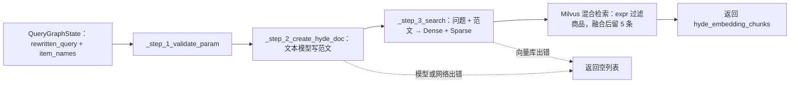
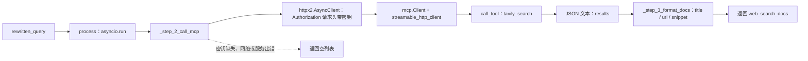

# 第 11 节：HyDE 与网络搜索

> 上一节实现了三路并行检索里的第一路：用改写后的问题直接检索 `kb_chunks`。这一节补上另外两路：先让模型写一段“假设答案”再检索的 HyDE 路，和通过 MCP 联网搜索的网络路；三路各写各的状态字段，下一节才做融合。
> 对应资料：`reference/掌教智库/4.视频/day11/` 的视频 08 至 17（HyDE 假设性文档、MCP 联网搜索）与课堂笔记 `14`、`15`；补充阅读 `reference/掌教智库/1.笔记/16`、`17`。资料用百炼 MCP 做联网搜索，本工程改用 Tavily 的远程 MCP，原因和差异在下面说明。

## 一、业务流程与设计原因

### 1. 直接检索的缺口：问题太短，手册里的词没出现

状态里现在有这样一个问题：`RS PRO RS-12 数字万用表怎么测量交流电压？`。手册里对应的段落是：

> 将功能转盘置于 V AC 的位置。将黑色表笔插入负极 COM 端口，红色表笔插入正极 V 端口。将表笔尖端接触被测物。

问题里只有“测量”“交流电压”几个词，手册段落里真正出现的却是“转盘”“表笔”“COM”“V AC”“接触被测物”。问题越短、越口语化，向量里携带的信息越少，和这种“操作步骤式”的正文越难靠近。

HyDE（Hypothetical Document Embeddings，假设文档嵌入）的做法是：先让文本模型按问题写一段“范文式”的答案，再把这段答案连同问题一起向量化去检索。模型不需要知道这台万用表的真实参数，写出来的步骤里自然会有“旋钮”“表笔”“COM”“并联”这类词，更像手册正文，检索就更容易命中。

| 直接写会怎样 | 为什么这样做 |
| --- | --- |
| 只用短问题检索：缺少手册里的专业词，排名靠前的段落可能只是“碰巧提到交流电压” | 让模型先写范文，用范文补足词汇和语境 |
| 只用范文检索：模型写偏时，范文会把检索带到别处 | 范文前面拼上原问题，用户真正的意图仍在向量里 |
| 范文当成答案用：模型可能编造参数 | 范文只用来检索，不进入最终答案；真正的答案以后只来自检索到的真实 Chunk |

HyDE 也有代价：多一次模型调用，范文可能跑偏。所以它不是替代第一路，而是三路里的一路，后面还有融合和重排来纠偏。

### 2. HyDE 节点读什么、写什么



从左往右读：`process()` 先检查状态里的问题和商品名，通过后进入 `try`。`_step_2_create_hyde_doc()` 调文本模型得到范文，`_step_3_search()` 把“问题 + 空格 + 范文”当成一段文本生成 Dense、Sparse 向量，再按和上一节完全相同的方式检索：每路取 10 条，0.8 比 0.2 加权融合，保留前 5 条。结果放进 `hyde_embedding_chunks` 返回。两条虚线表示：模型不可达、向量库出错时，本路返回空列表，而不是让整张图失败。

范文只记在日志里，不写入状态：状态里没有 `hyde_doc` 字段，后面的融合、重排也不用它。

返回元素的形状与上一节一致（`chunk_id`、`distance`、`entity`），后面的 RRF 会同时读取两路的结果。

### 3. 为什么这一路出错要降级，而上一节不降级

上一节的向量检索出错时，异常直接抛出，因为那是主路：向量库坏了，后面没有意义，要让问题暴露。HyDE 和网络搜索不同，它们依赖文本模型和外网，任何一天都可能不可用，而知识库检索那一路仍然是完整的。所以这两个节点把运行期故障（模型不可达、密钥错误、超时）记成一条 `ERROR` 日志，返回空列表，让另外两路继续。

但输入契约错误不降级：`rewritten_query` 缺失、`item_names` 为空，说明上游产品确认已经出问题，节点仍然抛出 `StateFieldError`。降级只用于外部服务的故障，不用于掩盖自己代码或上游的错误。

参考代码对 HyDE 的做法是捕获所有异常并返回 `{}`；它的商品名过滤用 `f'item_name in {item_names}'`，名称带引号时会拼出非法表达式，`item_names` 为空时退化成全库检索。本节复用上一节的 `NodeSearchEmbedding._build_item_filter()`：名称先转义，空列表直接拒绝。两路用同一个过滤写法，商品范围不会各写各的。

### 4. 联网搜索：知识库之外的补充

知识库只有已入库的手册。用户问到手册没写的内容（例如其他资料对同型号的说明），需要联网补充。联网搜索不接入向量库，而是调用外部搜索服务，把结果整理成 `{title, url, snippet}` 交给后面的重排。

**MCP（Model Context Protocol）** 是一套让程序调用“工具”的统一协议：服务端公开若干工具，每个工具有名称和参数；客户端连接服务端，按名字调用，拿到结果。你可以把它想成一个标准化的远程调用约定。本节的服务端是 Tavily 的远程 MCP（Streamable HTTP），工具名是 `tavily_search`，参数是 `query` 和 `max_results`。

资料用阿里云百炼的 MCP 联网搜索，需要在百炼控制台实名认证、开通服务、部署函数。本工程已经有 Tavily 密钥，Tavily 的 MCP 不需要这些步骤，协议和调用方式相同，所以改用它；节点仍叫 `node_web_search_mcp`，图和状态字段不用改。差异有三处：

| 差异 | 百炼（资料） | Tavily（本工程） |
| --- | --- | --- |
| 结果字段 | `pages[].snippet` | `results[].content`，节点里映射成 `snippet` |
| 摘要长度 | 较短 | 可能是整页商品参数表或视频字幕，节点截取前 500 字 |
| 密钥错误 | 抛出异常 | **不是异常**：`is_error` 仍为 `False`，返回 `{"error": ..., "status": 401}`，节点必须自己识别 |

最后一条要特别注意：如果只写 `payload.get("results") or []`，密钥写错时会得到空列表，没有任何日志，看起来就像“没搜到东西”。所以节点在没有 `results` 字段时抛出异常，再由外层统一降级并记录原因。



读图：`process()` 用 `asyncio.run()` 启动异步方法 `_step_2_call_mcp()`。后者读取配置，建一个带 `Authorization` 请求头的 HTTP 客户端，交给 MCP 的 `Client` 连接 Tavily，调用 `tavily_search`，从返回的第一个内容块里取出 JSON 文本，得到 `results`。`_step_3_format_docs()` 把每条结果整理成 `{title, url, snippet}`，没有正文的丢弃，其余截取前 500 字。密钥放在请求头里而不是地址里，日志里打印的地址就不会带密钥。

两点 Python 写法：`async def` 定义的是协程，不能直接调用，必须被 `await`，或者在普通函数里用 `asyncio.run()` 启动并等待结果。查询图里的同步节点由 LangGraph 放在线程池线程里执行，线程里没有正在运行的事件循环，所以可以直接 `asyncio.run()`。MCP 客户端在任务组里运行，真正的错误会被包在 `ExceptionGroup` 里，日志只写“任务组出错”没有用，所以代码先剥到最里面一层再记录。

### 5. 本节到哪里为止

本节做 `node_search_embedding_hyde` 和 `node_web_search_mcp`，新增一个配置文件和一个依赖。三路的结果现在各自躺在状态里，融合、重排和答案输出仍是占位，由后面的章节实现。视频 07（导入全流程测试）需要先有导入主图，不在本节。

## 二、手敲步骤

### 1. 安装依赖并补配置

当前缺口：工程里没有 MCP 客户端，也没有 Tavily 的配置。

文件与职责：

| 文件 | 本节做什么 |
| --- | --- |
| `pyproject.toml`、`uv.lock` | 新增 `mcp` 依赖（由 `uv add` 自动修改） |
| `.env.example`、本地 `.env` | 增加 Tavily 的地址和密钥 |
| `src/shopkeeper_brain/core/tavily_config.py` | 新文件：读取 Tavily 配置 |
| `src/shopkeeper_brain/processor/query_processor/nodes/node_search_embedding_hyde.py` | 把占位替换成真实实现 |
| `src/shopkeeper_brain/processor/query_processor/nodes/node_web_search_mcp.py` | 把占位替换成真实实现 |

在项目根目录执行（使用清华源）：

```bash
uv add mcp --default-index https://pypi.tuna.tsinghua.edu.cn/simple
```

它会把 `mcp` 写进 `pyproject.toml` 并更新锁文件。`mcp` 自带 HTTP 库 `httpx2`，代码里会直接导入它，不需要另外安装。

配置片段（不是整文件，只追加到 `.env.example` 末尾；本地 `.env` 里填同样两个变量）：

```ini
# ====================
# Tavily 联网搜索（远程 MCP）
# ====================
# 地址留空时使用官方地址；密钥只填在本地 .env，不要提交
SHOPKEEPER_BRAIN_TAVILY_MCP_URL=
SHOPKEEPER_BRAIN_TAVILY_API_KEY=
```

地址留空即可，代码会使用官方地址 `https://mcp.tavily.com/mcp/`。

### 2. 先写配置

当前缺口：节点需要地址和密钥，工程里其他服务的配置都放在 `core/` 下，各用一个 `load_xxx_config()` 读取。直接在节点里 `os.getenv` 会让密钥读取散落各处，也容易在打印配置时泄露密钥。

**文件**：`src/shopkeeper_brain/core/tavily_config.py`

```python
import os
from dataclasses import dataclass, field
from pathlib import Path

from dotenv import load_dotenv
from pydantic import SecretStr

DEFAULT_TAVILY_MCP_URL = "https://mcp.tavily.com/mcp/"


@dataclass(frozen=True)
class TavilyConfig:
    """Tavily 远程 MCP 的地址和密钥；默认展示时隐藏密钥。"""

    mcp_url: str
    api_key: SecretStr = field(repr=False)


def load_tavily_config() -> TavilyConfig:
    """从项目根目录读取 Tavily 配置，系统环境变量优先。"""
    project_root = Path(__file__).resolve().parents[3]
    load_dotenv(project_root / ".env", override=False)

    return TavilyConfig(
        # .env.example 里地址留空，留空时也使用官方地址。
        mcp_url=os.getenv("SHOPKEEPER_BRAIN_TAVILY_MCP_URL", "").strip() or DEFAULT_TAVILY_MCP_URL,
        api_key=SecretStr(os.getenv("SHOPKEEPER_BRAIN_TAVILY_API_KEY", "").strip()),
    )


if __name__ == "__main__":
    print(load_tavily_config())
```

写法同 `llm_config.py`：`SecretStr` 在打印时显示成星号，要用明文时必须调用 `get_secret_value()`，这样不会不小心把密钥写进日志。`os.getenv(...).strip() or DEFAULT` 的意思是：变量没设置、设成空串或只有空白，都使用默认地址。`.env` 里 `TAVILY_MCP_URL=` 这种留空写法，`getenv` 返回的是空串而不是 `None`，所以不能依赖 `getenv` 自己的默认值参数。

### 3. 写 HyDE 节点

当前缺口：`hyde_embedding_chunks` 现在永远是空列表。新文件覆盖占位，不需要保留旧内容。

**文件**：`src/shopkeeper_brain/processor/query_processor/nodes/node_search_embedding_hyde.py`

```python
import logging

from langchain_openai import ChatOpenAI

from shopkeeper_brain.core.llm_config import load_llm_config
from shopkeeper_brain.core.milvus_config import load_milvus_config
from shopkeeper_brain.processor.import_processor.exceptions import ConfigurationError, StateFieldError
from shopkeeper_brain.processor.query_processor.base import NodeBase
from shopkeeper_brain.processor.query_processor.nodes.node_search_embedding import (
    PER_ROUTE_LIMIT,
    RESULT_LIMIT,
    NodeSearchEmbedding,
)
from shopkeeper_brain.processor.query_processor.state import QueryGraphState
from shopkeeper_brain.utils.embedding_utils import generate_embeddings
from shopkeeper_brain.utils.milvus_utils import (
    create_hybrid_search_requests,
    get_milvus_client,
    hybrid_search,
)

HYDE_PROMPT = """请基于以下用户查询生成一个简洁的回答范文。
用户查询：{rewritten_query}
要求：
1. 回答要简洁明了，包含核心信息即可
2. 假设你是该领域的专家，提供专业的解释
3. 不要使用“假设”“可能”等不确定的词汇
4. 保持回答与查询主题高度相关
5. 使用中文回答且不超过 300 字
"""


class NodeSearchEmbeddingHyde(NodeBase):
    """先让文本模型写一段假设性答案，再用“问题 + 假设答案”检索 kb_chunks（HyDE）。"""

    name = "node_search_embedding_hyde"

    def process(self, state: QueryGraphState) -> QueryGraphState:
        """读取 rewritten_query、item_names；只返回 hyde_embedding_chunks。
        模型或向量库出故障时本路返回空列表，不拖垮另外两路检索。"""
        query, item_names = self._step_1_validate_param(state)

        try:
            hyde_doc = self._step_2_create_hyde_doc(query)
            chunks = self._step_3_search(query, hyde_doc, item_names)
        except Exception as exc:
            self.logger.error("HyDE 检索失败，本路返回空结果：%s: %s", type(exc).__name__, exc)
            return {"hyde_embedding_chunks": []}

        self.logger.info("步骤 3：召回 %d 个 Chunk", len(chunks))
        return {"hyde_embedding_chunks": chunks}

    def _step_1_validate_param(self, state: QueryGraphState) -> tuple[str, list[str]]:
        """输入契约与向量检索节点相同：问题和商品名缺一不可，商品名不能为空。"""
        query = state.get("rewritten_query")
        if not isinstance(query, str) or not query.strip():
            raise StateFieldError(node_name=self.name, field_name="rewritten_query", expected_type=str)

        item_names = state.get("item_names")
        if (
                not isinstance(item_names, list)
                or not item_names
                or any(not isinstance(name, str) or not name.strip() for name in item_names)
        ):
            raise StateFieldError(node_name=self.name, field_name="item_names", expected_type=list)

        return query.strip(), item_names

    def _step_2_create_hyde_doc(self, query: str) -> str:
        """让文本模型按问题写一段“范文”；范文不要求事实正确，只负责带出手册里会出现的词。"""
        config = load_llm_config()
        if not all((config.base_url, config.api_key, config.model)):
            raise ConfigurationError("文本模型配置不完整，无法生成假设文档", node_name=self.name)

        model = ChatOpenAI(
            model=config.model,
            api_key=config.api_key,
            base_url=config.base_url,
            temperature=config.temperature,
            extra_body={"enable_thinking": False},
        )
        hyde_doc = model.invoke(HYDE_PROMPT.format(rewritten_query=query)).text.strip()
        self.logger.info("步骤 2：假设文档 %d 字：%s", len(hyde_doc), hyde_doc)
        return hyde_doc

    def _step_3_search(self, query: str, hyde_doc: str, item_names: list[str]) -> list[dict]:
        """把“问题 + 假设文档”当作一段文本向量化，其余与向量检索节点一致。"""
        # 拼上原问题：假设文档可能跑偏，原问题把用户真正的意图留在向量里。
        embeddings = generate_embeddings([f"{query} {hyde_doc}"])

        # 与向量检索节点共用同一个过滤表达式写法，两路的商品范围不会各写各的。
        expr = NodeSearchEmbedding._build_item_filter(item_names)
        self.logger.info("步骤 3：过滤条件 %s", expr)
        reqs = create_hybrid_search_requests(
            embeddings["dense"][0],
            embeddings["sparse"][0],
            limit=PER_ROUTE_LIMIT,
            expr=expr,
        )

        collection_name = load_milvus_config().chunk_collection
        if not collection_name:
            raise ConfigurationError(
                "Chunk 集合未配置，请检查 SHOPKEEPER_BRAIN_MILVUS_CHUNK_COLLECTION",
                node_name=self.name,
            )

        hits = hybrid_search(
            get_milvus_client(),
            collection_name,
            reqs,
            ranker_weights=(0.8, 0.2),
            norm_score=True,
            limit=RESULT_LIMIT,
            output_fields=["chunk_id", "content", "item_name"],
        )
        return hits[0]


if __name__ == "__main__":
    logging.basicConfig(
        level=logging.INFO,
        format="%(levelname)s %(name)s %(message)s",
    )

    state = {
        "rewritten_query": "RS PRO RS-12 数字万用表怎么测量交流电压？",
        "item_names": ["RS PRO RS-12 数字万用表"],
    }
    # 同一个问题分别走直接检索和 HyDE 检索，对照两路召回的 Chunk。
    direct = NodeSearchEmbedding()(state)["embedding_chunks"]
    hyde = NodeSearchEmbeddingHyde()(state)["hyde_embedding_chunks"]
    direct_ids = {hit["entity"]["chunk_id"] for hit in direct}

    print("HyDE 召回", len(hyde), "条：")
    for rank, hit in enumerate(hyde, start=1):
        entity = hit["entity"]
        mark = "两路都有" if entity["chunk_id"] in direct_ids else "仅 HyDE"
        content = entity["content"].replace("\n", " ")[:40]
        print(f"  {rank}. 评分 {hit['distance']:.4f}  {mark}  chunk_id={entity['chunk_id']}  {content}")
```

先看结构：`process()` 的顺序是校验输入、写范文、检索、返回；只有后两步放在 `try` 里。校验放在 `try` 外面，所以契约错误仍然抛出，运行期故障才降级。`return` 写在 `except` 里，正常路径落到 `try` 之后，这样“召回 N 个 Chunk”的日志只在成功时出现。

`_step_2_create_hyde_doc()` 沿用产品确认节点里创建 `ChatOpenAI` 的写法，模型地址和密钥读自第 6 节的配置，配置不完整时抛 `ConfigurationError`（会被 `process()` 的 `try` 接住降级）。`.text.strip()` 是第 6 节确认过的统一取文本方式。`HYDE_PROMPT.format(...)` 只会替换模板里的 `{rewritten_query}`，问题文本里即使有大括号也不会出错。

`_step_3_search()` 和上一节只有两处不同：向量化的文本是 `f"{query} {hyde_doc}"`；过滤表达式直接调用 `NodeSearchEmbedding._build_item_filter()`。Python 里下划线开头只是约定，不是访问限制（和 Java 的 `private` 不同），这里为了让两路共用同一个转义写法，直接复用。`PER_ROUTE_LIMIT`、`RESULT_LIMIT` 也从上一节的文件导入，两路召回规模保持一致，后面融合才有可比性。

学习期入口会把同一个问题依次交给直接检索和 HyDE，再用 `chunk_id` 对照两路结果，标出“两路都有”或“仅 HyDE”，方便你直接看到 HyDE 改变了什么。

### 4. 写联网搜索节点

当前缺口：`web_search_docs` 现在永远是空列表。新文件覆盖占位。

**文件**：`src/shopkeeper_brain/processor/query_processor/nodes/node_web_search_mcp.py`

```python
import asyncio
import json
import logging

import httpx2
from mcp import Client
from mcp.client.streamable_http import streamable_http_client

from shopkeeper_brain.core.tavily_config import load_tavily_config
from shopkeeper_brain.processor.import_processor.exceptions import ConfigurationError, StateFieldError
from shopkeeper_brain.processor.query_processor.base import NodeBase
from shopkeeper_brain.processor.query_processor.state import QueryGraphState

SEARCH_TOOL = "tavily_search"
MAX_RESULTS = 5
REQUEST_TIMEOUT_SECONDS = 30
# Tavily 的 content 可能是整页商品参数表或视频字幕，每条只留开头一段交给后面的重排。
SNIPPET_MAX_CHARS = 500


class NodeWebSearchMcp(NodeBase):
    """通过 Tavily 的远程 MCP 服务联网搜索，补充知识库里没有的信息。"""

    name = "node_web_search_mcp"

    def process(self, state: QueryGraphState) -> QueryGraphState:
        """读取 rewritten_query；只返回 web_search_docs。
        联网失败时本路返回空列表，不拖垮另外两路检索。"""
        query = state.get("rewritten_query")
        if not isinstance(query, str) or not query.strip():
            raise StateFieldError(node_name=self.name, field_name="rewritten_query", expected_type=str)

        try:
            # 图里的同步节点在线程池线程中执行，线程里没有事件循环，可以直接 asyncio.run。
            pages = asyncio.run(self._step_2_call_mcp(query.strip()))
        except Exception as exc:
            # MCP 客户端在任务组里运行，真正的错误包在 ExceptionGroup 里，先剥到最里面一层再记日志。
            while isinstance(exc, BaseExceptionGroup):
                exc = exc.exceptions[0]
            self.logger.error("联网搜索失败，本路返回空结果：%s: %s", type(exc).__name__, exc)
            return {"web_search_docs": []}

        docs = self._step_3_format_docs(pages)
        self.logger.info("步骤 3：搜索返回 %d 条，保留 %d 条", len(pages), len(docs))
        return {"web_search_docs": docs}

    async def _step_2_call_mcp(self, query: str) -> list:
        """连接 Tavily MCP，调用 tavily_search，返回结果列表。"""
        config = load_tavily_config()
        api_key = config.api_key.get_secret_value()
        if not api_key:
            raise ConfigurationError(
                "Tavily 密钥未配置，请检查 SHOPKEEPER_BRAIN_TAVILY_API_KEY",
                node_name=self.name,
            )

        # 密钥放在请求头里，不拼进地址，日志里的地址就不会带密钥。
        async with httpx2.AsyncClient(
                headers={"Authorization": f"Bearer {api_key}"},
                timeout=REQUEST_TIMEOUT_SECONDS,
        ) as http_client:
            async with Client(streamable_http_client(config.mcp_url, http_client=http_client)) as client:
                result = await client.call_tool(
                    SEARCH_TOOL,
                    {"query": query, "max_results": MAX_RESULTS},
                )

        if result.is_error:
            raise RuntimeError(f"MCP 工具返回错误：{result.content}")
        # 工具把结果序列化成 JSON 文本放在第一个内容块里。
        payload = json.loads(result.content[0].text)
        # 密钥无效等错误不会让 is_error 变 True，而是返回 {"error": ..., "status": 401}，
        # 没有 results 字段就必须当成失败，否则会被误当成“没有搜到结果”。
        if "results" not in payload:
            raise RuntimeError(f"Tavily 返回错误：{payload.get('status')} {payload.get('detail') or payload.get('error')}")
        return payload["results"]

    @staticmethod
    def _step_3_format_docs(pages: list) -> list[dict]:
        """统一成 {title, url, snippet}；去首尾空白，没有正文的结果丢弃。"""
        docs = []
        for page in pages:
            if not isinstance(page, dict):
                continue
            snippet = (page.get("content") or "").strip()
            if not snippet:
                continue
            docs.append({
                "title": (page.get("title") or "").strip(),
                "url": (page.get("url") or "").strip(),
                "snippet": snippet[:SNIPPET_MAX_CHARS],
            })
        return docs


if __name__ == "__main__":
    logging.basicConfig(
        level=logging.INFO,
        format="%(levelname)s %(name)s %(message)s",
    )

    result = NodeWebSearchMcp()({"rewritten_query": "RS PRO RS-12 数字万用表怎么测量交流电压？"})
    docs = result["web_search_docs"]
    print("联网搜索返回", len(docs), "条：")
    for rank, doc in enumerate(docs, start=1):
        print(f"  {rank}. {doc['title'][:40]}")
        print(f"     {doc['url']}")
        print(f"     {doc['snippet'].replace(chr(10), ' ')[:60]}")
```

`process()` 的骨架和 HyDE 一致：先校验输入，再把外部调用包进 `try`。`except` 里的 `while isinstance(exc, BaseExceptionGroup)` 是 Python 3.11 的写法：异常组里有多个子异常时，取第一个继续往里剥，直到拿到真正的错误（连接失败、协议错误等）。

`_step_2_call_mcp()` 里有两层 `async with`：外层是 HTTP 客户端，负责带上 `Authorization` 请求头和超时；内层是 MCP `Client`，`streamable_http_client(url, http_client=...)` 告诉它走 Streamable HTTP 并使用外层客户端。`async with` 退出时自动关闭连接，相当于参考代码里 `finally: cleanup()` 的资源清理，不需要手写。`call_tool(名称, 参数字典)` 返回的 `result.content` 是内容块列表，Tavily 把整份结果序列化成 JSON 文本放在第一个块里，所以要 `json.loads(result.content[0].text)`。

`if "results" not in payload` 是本节最容易漏掉的一处：密钥无效时服务端并不会让 MCP 报错，只是在 JSON 里写 `status: 401`。没有 `results` 就抛异常，外层降级时日志里会出现 `Tavily 返回错误：401 ...`。

`_step_3_format_docs()` 写成静态方法，只做数据整理：非字典项和没有正文的项丢弃，`content` 映射成 `snippet` 并截取前 500 字。`or ""` 让值为 `None` 的字段也能安全地 `strip()`。

## 三、必做真实验证

下面的操作必须使用真实服务。未运行的操作标为“未验证（未运行）”，不要用依赖安装、编译或导入成功替代。

### 1. 准备真实服务

1. 虚拟机保持运行，Windows 能访问 Milvus `192.168.150.120:19530`，`kb_chunks` 里仍有 21 条 Chunk；产品确认的回归还需要 MongoDB 和第 6 节的文本模型配置。
2. 文本模型的本地网关保持运行，`.env` 里的 `SHOPKEEPER_BRAIN_LLM_*` 与第 9 节验证时一致；HyDE 会真实调用它写范文。
3. 本地 `.env` 里已填 `SHOPKEEPER_BRAIN_TAVILY_API_KEY`，地址留空。联网搜索会消耗 Tavily 的免费额度，每次运行入口调用一次。
4. 已执行 `uv add mcp ...`，IDE 使用本工程的 uv 解释器。

### 2. 验证配置

1. 打开 `src/shopkeeper_brain/core/tavily_config.py`，直接 Run。
2. 观察输出：`TavilyConfig(mcp_url='https://mcp.tavily.com/mcp/')`，里面没有出现密钥。

如果地址不是官方地址，检查 `.env` 里的 `SHOPKEEPER_BRAIN_TAVILY_MCP_URL` 是否填了别的值；如果输出里出现了密钥明文，检查 `api_key` 是否是 `SecretStr` 并设置了 `field(repr=False)`。

### 3. 验证联网搜索节点

1. 打开 `node_web_search_mcp.py`，直接 Run。想看数据怎样变化，可以在 `_step_3_format_docs()` 的 `docs.append` 处设断点，观察 `page` 和 `snippet` 的长度。
2. 日志里应出现对 Tavily 地址的 `POST ... 200 OK`，然后是“步骤 3：搜索返回 5 条，保留 5 条”。
3. 打印结果：5 条，每条有标题、网址和开头 60 个字符的摘要。内容来自互联网，具体条目会变，但应与 RS-12 万用表或交流电压测量有关。
4. 断点处观察 `snippet`：最长不超过 500 个字符，即使原文是整页参数表。

### 4. 验证 HyDE 节点

1. 打开 `node_search_embedding_hyde.py`，直接 Run。第一次加载 BGE-M3 会比较慢。
2. 先出现直接检索（`node_search_embedding`）的日志和“召回 5 个 Chunk”，然后是 HyDE 的日志。
3. 找到日志“步骤 2：假设文档 N 字：…”：模型写出的范文应是几条操作步骤，里面会出现“表笔”“COM”“旋钮”这类手册里的词，长度不超过 300 字。每次生成的文字会不同。
4. 最后的打印：HyDE 召回 5 条，评分从高到低。问题问的是交流电压，第一条应是 `## 交流电压测量` 一节，评分通常高于上一节直接检索的第一条（约 0.87，HyDE 的第一条在 0.90 左右）。每条标记“两路都有”或“仅 HyDE”：多数两路都有，通常有一条仅 HyDE（例如 `## 电阻测量`），这就是 HyDE 带来的变化。具体数值受模型输出和 CPU 线程影响，不要求完全一致。

### 5. 回归：查询主图

1. 打开 `main_graph.py`，直接 Run。
2. 第一个问题 `iPhone 15 怎么充电？`：直接拒答，日志里不出现 `node_search_embedding_hyde` 和 `node_web_search_mcp`。
3. 第二个问题 `RS PRO RS-12 数字万用表怎么测电压？`：确认商品后，三路检索节点同时开始，日志交错出现：向量检索“召回 5 个 Chunk”，HyDE 的假设文档和“召回 5 个 Chunk”，联网搜索“搜索返回 5 条，保留 5 条”；之后依次是 `node_rrf`、`node_rerank`、`node_answer_output`。

主图末尾打印的仍是占位文字，三路结果不会被打印，这里只看日志里的数量。

### 6. 失败时按数据经过的位置定位

| 看到的现象 | 先看哪里 | 对应原因或下一步 |
| --- | --- | --- |
| `ModuleNotFoundError: No module named 'mcp'` 或 `httpx2` | 解释器 | IDE 没有使用 uv 的环境，或还没执行 `uv add mcp` |
| 日志 `联网搜索失败 ... ConfigurationError ... Tavily 密钥未配置` | 本地 `.env` | 变量名要与 `.env.example` 一致，值不要加引号和空格 |
| 日志 `Tavily 返回错误：401` | 密钥 | 密钥写错、过期或额度用完；注意这不是 MCP 层的异常 |
| 日志 `ConnectError` 或超时 | 本机网络 | 先用浏览器打开 `https://mcp.tavily.com`，必要时配置系统代理 |
| 联网搜索返回 0 条但没有 `ERROR` | `_step_3_format_docs()` | 正文字段是 `content` 不是 `snippet`；断点看 `pages` 的键 |
| HyDE 日志 `HyDE 检索失败 ... OpenAIConnectionError` | 文本模型网关 | 地址、端口和 `SHOPKEEPER_BRAIN_LLM_BASE_URL`；模型不可用时本路返回空列表是预期行为 |
| HyDE 日志 `ConfigurationError ... 文本模型配置不完整` | `.env` 里 `SHOPKEEPER_BRAIN_LLM_*` | 地址、密钥、模型名都要有值 |
| HyDE 召回 0 条且没有 `ERROR` | 日志里的过滤条件 | 商品名与库里字符是否一致；名称中间的空格要保留 |
| `StateFieldError` | 传给节点的状态 | `rewritten_query` 或 `item_names` 缺失、为空 |
| 主图报 `InvalidUpdateError` | 节点返回值 | 并行节点只能返回自己负责的字段，不能返回整份状态 |

排查时不要把密钥贴进日志、截图或聊天。联网搜索失败不会让图失败：只要看到 `ERROR` 日志和空列表，就说明降级路径生效，要继续看日志里的原因。

### 7. 哪些结果可以记录为通过

1. **配置**：地址为官方地址，输出不含密钥；
2. **联网搜索**：真实 Tavily 返回 5 条，摘要不超过 500 字；
3. **HyDE**：真实文本模型写出范文，召回 5 条且评分降序，第一条是交流电压一节；
4. **主图**：拒答问题不进入这两路，确认问题三路并行，日志里各有召回数量，之后正常汇合。

没有 Tavily 密钥或网络时，第 2 项记录“未验证（未运行）”，此时只能证明失败路径会降级，不能证明联网搜索可用。只看到依赖安装成功、模块可导入或主图可编译，都不能记录为本节通过。

完成后保留各文件的 `__main__`，方便手敲后的自测和后续验收。当前只实现这两路检索；融合、重排和答案生成继续留在后面的章节。
