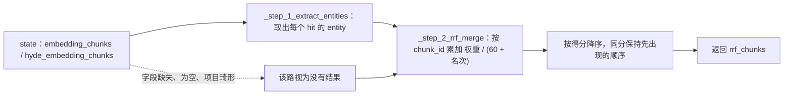
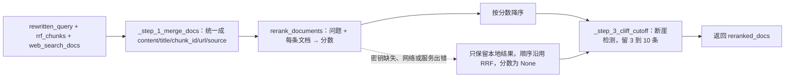

# 第 12 节：RRF 融合与 Rerank 重排

> 上一节补齐了三路检索：向量检索、HyDE、联网搜索各自把结果写进 `embedding_chunks`、`hyde_embedding_chunks`、`web_search_docs`。这一节把三路结果收拢：先用 RRF 把两路知识库结果按名次融合，再让阿里云的重排模型给本地结果和联网结果统一打分，并按分数断崖动态截取，得到交给答案生成的 `reranked_docs`。
> 对应资料：`reference/掌教智库/4.视频/day12/` 的视频 02 至 17（02 至 08 是 RRF，09 至 17 是 Rerank）与课堂笔记 `16`、`17`；补充阅读 `reference/掌教智库/1.笔记/18`、`19`。视频 01 是 day11 回顾，不在本节。资料里的重排调用百炼的 `qwen3-rerank`，本工程保持一致。

## 一、业务流程与设计原因

### 1. 三路结果躺在状态里，缺一个统一的排序

状态里现在有这样三份结果，问题是 `RS PRO RS-12 数字万用表怎么测量交流电压？`：

| 字段 | 内容 | 排序依据 |
| --- | --- | --- |
| `embedding_chunks` | 向量检索的 5 个 Chunk | Milvus 的融合评分 |
| `hyde_embedding_chunks` | HyDE 检索的 5 个 Chunk | 另一次检索的评分 |
| `web_search_docs` | Tavily 返回的 5 个网页 | 没有评分，也没有 `chunk_id` |

答案生成只想要一份“最值得看的文档”。直接拼起来有三个问题：同一个 Chunk 被两路同时召回，会重复出现；两次检索的评分来自不同的查询向量，数值不能直接相加比较；联网结果和 Chunk 的字段都不一样。这一节分两步解决：RRF 解决前两个问题，重排解决第三个，并把噪声页面挡在门外。

### 2. RRF：只看名次，不看分数

RRF（Reciprocal Rank Fusion，倒数排名融合）给每个 Chunk 的得分是：它在每一路里的 `权重 / (k + 名次)` 之和，名次从 1 开始，k 取通用值 60。没有出现在某一路里，那一路就不加分。

用真实的一次运行说明。同一个问题，两路的前几名是：

| Chunk（所在章节） | 向量检索名次 | HyDE 名次 | RRF 得分 |
| --- | --- | --- | --- |
| 交流电压测量 | 1 | 1 | 1/61 + 1/61 = 0.032787 |
| 测量非接触交流电压 | 2 | 3 | 1/62 + 1/63 = 0.032002 |
| 直流电压测量 | 3 | 2 | 1/63 + 1/62 = 0.032002 |
| 规格 | 4 | 没有 | 1/64 = 0.015625 |
| 电阻测量 | 没有 | 4 | 1/64 = 0.015625 |

两路都靠前的排在最前面；只被一路召回的，得分只有一半左右。这就是“多路投票”：被不同检索方式同时看好的 Chunk 更可信。

两个细节要先想清楚：

- **k 为什么是 60**：如果 k 是 0，第 1 名得 1，第 2 名只剩 0.5，第 1 名的优势太大，融合就变成“谁在某一路里排第 1 谁赢”。k=60 让第 1 名和第 2 名只差约 1.6%，名次差别被压平，“被几路同时召回”才是主要因素。
- **同分怎么排**：上表第 2、3 名得分完全相同，第 4、5 名也相同。Python 的 `sorted` 是稳定排序，同分保持先出现的顺序，先出现的是向量检索那一路里的，所以结果是确定的。

联网搜索不参与 RRF：网页没有 `chunk_id`，名次也不可和 Chunk 的名次混在一起算，而且它不是知识库内容。它直接进入重排，由模型判断相不相关。



读图：检索结果每项是 `{chunk_id, distance, entity}`，融合只看名次，所以 `_step_1_extract_entities()` 只留下 `entity`（含 `chunk_id`、`content`、`item_name`）。`_step_2_rrf_merge()` 以 `chunk_id` 为键累加得分，同一个 Chunk 两路都命中时只保留先遇到的一份。虚线表示：第 11 节里 HyDE 出故障会返回空列表，字段甚至可能不存在，这时节点把那一路当成没有结果，另一路的顺序原样保留，不报错。

### 3. 重排：RRF 看不到“相不相关”

RRF 只用名次，不读文本。它能说“两路都靠前”，却不能判断某个网页是不是在回答这个问题：第 11 节的联网搜索里就混过股票页，因为 Tavily 把“RS”理解成了股票代码。

重排模型（Cross-Encoder，交叉编码器）的做法不同：向量检索是把问题和文档分别变成向量再比距离，重排是把“问题 + 文档”一起交给模型，让它们互相对照，直接输出一个 0 到 1 的相关性分数。它精度高，但每条文档都要过一次模型，慢，所以只用在少量候选上：先用向量检索和 RRF 从全库缩到十条左右，再让重排精挑。

本节的重排模型是阿里云百炼的 `qwen3-rerank`，通过 `dashscope` 包调用，需要百炼的 API 密钥。它每次请求最多 500 条文档，单条不超过 4000 个 Token，我们的候选最多十几条，用不到这些上限。

### 4. 断崖检测：不固定留几条

重排之后要决定留几条给答案生成。固定留 5 条有两个问题：前 3 条相关、后 2 条是噪声时，要把噪声也带上；前 7 条都相关时，又会丢掉有用的。断崖检测的做法是：沿着已按分数排好的文档，找相邻两条分数突然大降的位置，就在那里截断。

规则（常量写在代码顶部）：

- 最少留 `RERANK_MIN_TOPK = 3` 条，最多留 `RERANK_MAX_TOPK = 10` 条；
- 从第 3 条开始，看这一条和下一条的分差。绝对分差 `abs_gap` 达到 0.5，或相对下降比例 `rel_gap = abs_gap / 当前分数` 达到 0.25，就在这一条之后截断；
- 前 3 条之间的落差不检查，因为最少留 3 条。

两个阈值各管一段：

| 分数序列 | 第 3、4 条的变化 | 结果 |
| --- | --- | --- |
| 0.95, 0.92, 0.88, **0.12**, 0.08 | 绝对差 0.76，超过 0.5 | 留 3 条 |
| 0.30, 0.29, 0.28, **0.10**, 0.09 | 绝对差只有 0.18，但相对下降 64%，超过 25% | 留 3 条 |
| 0.95, 0.91, 0.87, 0.83, 0.79, 0.75, 0.71 | 相邻分差都很小 | 全部 7 条保留 |

分数很高时用绝对差，分数整体偏低时用相对差，一个阈值管不住两种情况。

### 5. 节点读什么、写什么，失败怎么办



读图：`_step_1_merge_docs()` 把本地 Chunk 和联网网页整理成同一种形状，没有正文的丢弃，每条带 `source`（`local` 或 `web`）。`rerank_documents()` 返回和输入顺序一一对应的分数，节点据此给每条文档加上 `score`，按分数降序排列，再做断崖检测。虚线是失败路径：重排服务出错时，节点记一条 `ERROR` 日志并降级。

降级时只保留本地结果，联网结果丢弃：重排是联网结果唯一的相关性把关，没有它，股票页之类的噪声会直接进入答案生成。本地结果的顺序沿用 RRF 的融合顺序，分数记为 `None`，断崖检测遇到 `None` 就跳过，取到上限为止。输入契约错误（缺 `rewritten_query`）不降级，仍然抛出 `StateFieldError`。

### 6. 与参考代码的几处差异

| 参考写法 | 问题 | 本节做法 |
| --- | --- | --- |
| `for doc in state.get('rrf_chunks')` 直接遍历 | 字段缺失或为 `None` 时抛 `TypeError`；第 11 节两路出错正好返回空列表 | `state.get(...) or []` |
| 失败降级写成 `[{**merged_multi_docs, "score": None}]` | `merged_multi_docs` 是列表，不能用 `**` 展开，降级分支本身会抛 `TypeError` | 对每条文档单独 `{**doc, "score": None}`，并且只保留本地结果 |
| 重排分数列表长度取 `len(results)` | 服务端少返回时下标越界 | 长度取输入文档数，缺失的分数为 0.0 |
| 密钥写在全局 `dashscope.api_key`，变量名借用 `OPENAI_API_KEY` | 全局变量会被其他调用共用；一个密钥两种用途 | 密钥走 `api_key=` 参数，配置变量单独命名 |
| 重排用的标题取自 `rrf_doc.get('title')` | 本工程的 Chunk 实体里没有 `title` | 用所属商品名 `item_name` 代替 |
| 文件名 `reranker_http_utils.py` | 实际用的是 SDK，不是直接发 HTTP | 命名为 `rerank_utils.py` |

### 7. 本节到哪里为止

本节做 `node_rrf`、`node_rerank`，新增一个配置文件、一个工具文件和一个依赖。`node_answer_output` 仍是占位，所以查询图跑完后，主图末尾打印的还是占位文字。

## 二、手敲步骤

### 1. 安装依赖并补配置

当前缺口：工程里没有 DashScope SDK，也没有重排的配置。

文件与职责：

| 文件 | 本节做什么 |
| --- | --- |
| `pyproject.toml`、`uv.lock` | 新增 `dashscope` 依赖（由 `uv add` 自动修改） |
| `.env.example`、本地 `.env` | 增加重排模型和密钥 |
| `src/shopkeeper_brain/core/rerank_config.py` | 新文件：读取重排配置 |
| `src/shopkeeper_brain/utils/rerank_utils.py` | 新文件：调用重排模型，返回分数 |
| `src/shopkeeper_brain/processor/query_processor/nodes/node_rrf.py` | 把占位替换成真实实现 |
| `src/shopkeeper_brain/processor/query_processor/nodes/node_rerank.py` | 把占位替换成真实实现 |

在项目根目录执行（使用清华源）：

```bash
uv add dashscope --default-index https://pypi.tuna.tsinghua.edu.cn/simple
```

密钥需要在阿里云百炼控制台获取：登录百炼，进入 API-KEY 管理，创建一个密钥。调用按量计费，具体额度以控制台显示为准。

配置片段（不是整文件，只追加到 `.env.example` 末尾；本地 `.env` 里填同样三个变量，并填上密钥）：

```ini
# ====================
# 重排模型：阿里云百炼（DashScope）
# ====================
# 模型名留空时使用 qwen3-rerank；instruct 留空表示不传；密钥只填在本地 .env，不要提交
SHOPKEEPER_BRAIN_RERANK_MODEL=qwen3-rerank
SHOPKEEPER_BRAIN_RERANK_INSTRUCT=
SHOPKEEPER_BRAIN_RERANK_API_KEY=
```

`instruct` 是给重排模型的任务说明，留空时服务端按“问答检索”打分，对本工程已经合适。

### 2. 先写配置

当前缺口：重排工具要读取模型名和密钥，需要和其他服务一样放在 `core/` 下，用 `SecretStr` 保护密钥。

**文件**：`src/shopkeeper_brain/core/rerank_config.py`

```python
import os
from dataclasses import dataclass, field
from pathlib import Path

from dotenv import load_dotenv
from pydantic import SecretStr

DEFAULT_RERANK_MODEL = "qwen3-rerank"


@dataclass(frozen=True)
class RerankConfig:
    """阿里云百炼（DashScope）重排模型的配置；默认展示时隐藏密钥。"""

    model: str
    # 留空表示不传 instruct，由服务端按“问答检索”任务打分。
    instruct: str
    api_key: SecretStr = field(repr=False)


def load_rerank_config() -> RerankConfig:
    """从项目根目录读取重排配置，系统环境变量优先。"""
    project_root = Path(__file__).resolve().parents[3]
    load_dotenv(project_root / ".env", override=False)

    return RerankConfig(
        # .env.example 里模型名可以留空，留空时使用 qwen3-rerank。
        model=os.getenv("SHOPKEEPER_BRAIN_RERANK_MODEL", "").strip() or DEFAULT_RERANK_MODEL,
        instruct=os.getenv("SHOPKEEPER_BRAIN_RERANK_INSTRUCT", "").strip(),
        api_key=SecretStr(os.getenv("SHOPKEEPER_BRAIN_RERANK_API_KEY", "").strip()),
    )


if __name__ == "__main__":
    print(load_rerank_config())
```

写法同上一节的 `tavily_config.py`：`os.getenv(..., "").strip() or DEFAULT` 让“没设置”“空串”“只有空白”三种情况都用默认模型。`@dataclass(frozen=True)` 相当于一个只读的数据类，`field(repr=False)` 让打印配置时不显示密钥。

### 3. 写重排工具

当前缺口：节点需要“问题 + 文档列表 → 分数列表”，不应该每个节点都去处理 SDK 的响应结构。

**文件**：`src/shopkeeper_brain/utils/rerank_utils.py`

```python
from http import HTTPStatus

import dashscope

from shopkeeper_brain.core.rerank_config import load_rerank_config
from shopkeeper_brain.processor.import_processor.exceptions import ConfigurationError


def rerank_documents(query: str, documents: list[str]) -> list[float]:
    """调用 DashScope 重排模型，返回与 documents 一一对应的相关性分数（0 到 1）。"""
    config = load_rerank_config()
    api_key = config.api_key.get_secret_value()
    if not api_key:
        raise ConfigurationError("重排密钥未配置，请检查 SHOPKEEPER_BRAIN_RERANK_API_KEY")

    response = dashscope.TextReRank.call(
        model=config.model,
        query=query,
        documents=documents,
        # 要全部文档的分数，后面的断崖检测需要完整的分数序列。
        top_n=len(documents),
        return_documents=False,
        # 密钥通过参数传入，不写进 dashscope 的全局变量。
        api_key=api_key,
        # 空串换成 None，表示不传 instruct。
        instruct=config.instruct or None,
    )
    if response.status_code != HTTPStatus.OK:
        raise RuntimeError(f"DashScope 重排调用失败：{response.status_code} {response.message}")

    # 服务端按分数从高到低返回，index 才是文档在请求里的原位置，分数要按它放回去。
    scores = [0.0] * len(documents)
    for item in response.output["results"]:
        scores[item["index"]] = float(item["relevance_score"])
    return scores


if __name__ == "__main__":
    query = "万用表怎么测量交流电压？"
    documents = [
        "将功能转盘置于 V AC 的位置，黑表笔插 COM，红表笔插 V，笔尖接触被测物。",
        "今天中午去吃猪脚饭吧。",
        "测量电阻前必须先断开被测电路的电源。",
    ]
    for document, score in zip(documents, rerank_documents(query, documents)):
        print(f"{score:.4f}  {document}")
```

先看这几处：

- `top_n=len(documents)` 要求返回全部文档的分数。后面的断崖检测要看整条分数曲线，只拿前几名没法找落差。
- 服务端返回的 `results` 是**按分数从高到低**排好的，每项带 `index`，指向文档在请求里的原位置。所以不能按返回顺序直接当分数列表，要用 `scores[item["index"]] = ...` 放回原位，这样返回值和 `documents` 一一对应。
- `HTTPStatus.OK` 就是 200；非 200 时抛 `RuntimeError`，错误信息里带状态码和服务端的话，例如密钥错误会是 `401 Invalid API-key provided.`。
- 密钥缺失时抛 `ConfigurationError`，在发请求之前就失败，避免无意义地打到服务端。
- 底部的学习期入口用三条固定的句子单独验证这个函数，不依赖 Milvus 和检索。

### 4. 写 RRF 节点

当前缺口：`rrf_chunks` 现在永远没有值。新文件覆盖占位，不需要保留旧内容。

**文件**：`src/shopkeeper_brain/processor/query_processor/nodes/node_rrf.py`

```python
import logging

from shopkeeper_brain.processor.query_processor.base import NodeBase
from shopkeeper_brain.processor.query_processor.state import QueryGraphState

# 平滑常数：k 越大，名次靠前的优势越小；60 是 RRF 的通用取值。
RRF_K = 60
# 参与融合的检索路和权重。联网搜索不参与：它没有 chunk_id，交给后面的重排处理。
ROUTE_WEIGHTS = (
    ("embedding_chunks", 1.0),
    ("hyde_embedding_chunks", 1.0),
)


class NodeRrf(NodeBase):
    """把向量检索和 HyDE 两路的结果按名次融合成一份排序（Reciprocal Rank Fusion）。"""

    name = "node_rrf"

    def process(self, state: QueryGraphState) -> QueryGraphState:
        """读取 embedding_chunks、hyde_embedding_chunks；只返回 rrf_chunks。
        某一路字段缺失或为空，视为这一路没有结果，不报错。"""
        routes = [
            (self._step_1_extract_entities(state.get(field)), weight)
            for field, weight in ROUTE_WEIGHTS
        ]
        merged = self._step_2_rrf_merge(routes)
        for entity, score in merged:
            self.logger.info("步骤 2：chunk_id=%s RRF 得分 %.6f", entity["chunk_id"], score)
        self.logger.info("步骤 2：融合得到 %d 个 Chunk", len(merged))
        return {"rrf_chunks": [entity for entity, _ in merged]}

    @staticmethod
    def _step_1_extract_entities(hits: list[dict] | None) -> list[dict]:
        """检索结果每项是 {chunk_id, distance, entity}；融合只看名次，所以只取出 entity。"""
        entities = []
        for hit in hits or []:
            entity = hit.get("entity") if isinstance(hit, dict) else None
            if isinstance(entity, dict) and entity.get("chunk_id") is not None:
                entities.append(entity)
        return entities

    @staticmethod
    def _step_2_rrf_merge(routes: list[tuple[list[dict], float]]) -> list[tuple[dict, float]]:
        """每个 Chunk 的得分 = 各路的 权重 / (k + 名次) 之和，返回按得分降序的 (entity, 得分)。"""
        scores: dict = {}
        entities: dict = {}
        for route_entities, weight in routes:
            for rank, entity in enumerate(route_entities, start=1):
                chunk_id = entity["chunk_id"]
                scores[chunk_id] = scores.get(chunk_id, 0.0) + weight / (RRF_K + rank)
                # 同一个 Chunk 两路都命中时，保留先遇到的那份。
                entities.setdefault(chunk_id, entity)

        # sorted 是稳定排序：得分相同的 Chunk 保持先出现的顺序。
        ranked = sorted(scores.items(), key=lambda item: item[1], reverse=True)
        return [(entities[chunk_id], score) for chunk_id, score in ranked]


if __name__ == "__main__":
    # 两路检索只有学习期入口用得到，放在这里导入，节点本身不依赖检索节点。
    from shopkeeper_brain.processor.query_processor.nodes.node_search_embedding import NodeSearchEmbedding
    from shopkeeper_brain.processor.query_processor.nodes.node_search_embedding_hyde import NodeSearchEmbeddingHyde

    logging.basicConfig(
        level=logging.INFO,
        format="%(levelname)s %(name)s %(message)s",
    )

    state = {
        "rewritten_query": "RS PRO RS-12 数字万用表怎么测量交流电压？",
        "item_names": ["RS PRO RS-12 数字万用表"],
    }
    # 先真实跑两路检索，再把它们的结果交给融合节点。
    state.update(NodeSearchEmbedding()(state))
    state.update(NodeSearchEmbeddingHyde()(state))

    def ranks(field: str) -> dict:
        """chunk_id → 在这一路里的名次（从 1 开始）。"""
        return {hit["entity"]["chunk_id"]: rank for rank, hit in enumerate(state[field], start=1)}

    vector_ranks, hyde_ranks = ranks("embedding_chunks"), ranks("hyde_embedding_chunks")
    result = NodeRrf()(state)

    print("RRF 融合结果：")
    for position, chunk in enumerate(result["rrf_chunks"], start=1):
        chunk_id = chunk["chunk_id"]
        print(
            f"  {position}. chunk_id={chunk_id}  向量检索第 {vector_ranks.get(chunk_id, '-')} 名"
            f"  HyDE 第 {hyde_ranks.get(chunk_id, '-')} 名  {chunk['content'].replace(chr(10), ' ')[:30]}"
        )
```

结构上：`process()` 把 `ROUTE_WEIGHTS` 里每一路的字段取出来，经 `_step_1_extract_entities()` 整理成实体列表，再交给 `_step_2_rrf_merge()` 融合。以后要给某一路更高权重，只改 `ROUTE_WEIGHTS` 里的数字。

几处 Python 写法：

- `list[dict] | None` 是类型注解，表示“字典列表，或者 `None`”；`for hit in hits or []` 让 `None` 和字段缺失都按空处理。
- `hit.get("entity") if isinstance(hit, dict) else None` 是条件表达式，等价于 Java 的三目运算符 `isDict ? get : null`。
- `enumerate(route_entities, start=1)` 同时给出名次和元素，名次从 1 开始，正好对应公式。
- `scores.get(chunk_id, 0.0) + ...` 是“没有就从 0 开始累加”；`entities.setdefault(chunk_id, entity)` 是“没有才放入”，保证两路命中同一个 Chunk 时只留先遇到的。
- `sorted(..., key=lambda item: item[1], reverse=True)` 按元组的第二个值（得分）降序，稳定排序保证同分时顺序可预期。
- `if __name__ == "__main__"` 里才导入检索节点：融合节点本身不依赖它们，只有学习期入口需要真实跑两路检索，所以不放在文件顶部。

学习期入口会先真实跑向量检索和 HyDE，再融合，并列出每个 Chunk 在两路里各排第几。

### 5. 写重排节点

当前缺口：`reranked_docs` 现在永远没有值。新文件覆盖占位。

**文件**：`src/shopkeeper_brain/processor/query_processor/nodes/node_rerank.py`

```python
import logging

from shopkeeper_brain.processor.import_processor.exceptions import StateFieldError
from shopkeeper_brain.processor.query_processor.base import NodeBase
from shopkeeper_brain.processor.query_processor.state import QueryGraphState
from shopkeeper_brain.utils.rerank_utils import rerank_documents

# 动态 TopK 的上下限：至少留 3 条，最多留 10 条。
RERANK_MIN_TOPK = 3
RERANK_MAX_TOPK = 10
# 断崖阈值：相邻两条的分差达到 0.5（高分区间），或下降比例达到 25%（低分区间），就在这里截断。
RERANK_GAP_ABS = 0.5
RERANK_GAP_RATIO = 0.25


class NodeRerank(NodeBase):
    """把本地融合结果和联网结果放在一起，用重排模型逐条打分，再按分数断崖动态截取。"""

    name = "node_rerank"

    def process(self, state: QueryGraphState) -> QueryGraphState:
        """读取 rewritten_query、rrf_chunks、web_search_docs；只返回 reranked_docs。
        后两个字段缺失或为空视为没有这一类文档；重排服务出故障时降级为本地融合顺序。"""
        query = state.get("rewritten_query")
        if not isinstance(query, str) or not query.strip():
            raise StateFieldError(node_name=self.name, field_name="rewritten_query", expected_type=str)

        docs = self._step_1_merge_docs(state)
        self.logger.info("步骤 1：待重排文档 %d 条", len(docs))
        if not docs:
            return {"reranked_docs": []}

        scored_docs = self._step_2_rerank(query.strip(), docs)
        reranked_docs = self._step_3_cliff_cutoff(scored_docs)
        self.logger.info("步骤 3：截取后保留 %d 条", len(reranked_docs))
        return {"reranked_docs": reranked_docs}

    @staticmethod
    def _step_1_merge_docs(state: QueryGraphState) -> list[dict]:
        """本地 Chunk 和联网结果字段不同，统一成 {content, title, chunk_id, url, source}；没有正文的丢弃。"""
        docs = []
        for chunk in state.get("rrf_chunks") or []:
            content = (chunk.get("content") or "").strip()
            if content:
                docs.append({
                    "content": content,
                    # Chunk 里没有标题字段，用所属商品名代替。
                    "title": chunk.get("item_name") or "",
                    "chunk_id": chunk.get("chunk_id"),
                    "url": None,
                    "source": "local",
                })
        for page in state.get("web_search_docs") or []:
            content = (page.get("snippet") or "").strip()
            if content:
                docs.append({
                    "content": content,
                    "title": page.get("title") or "",
                    "chunk_id": None,
                    "url": page.get("url"),
                    "source": "web",
                })
        return docs

    def _step_2_rerank(self, query: str, docs: list[dict]) -> list[dict]:
        """调用重排模型给每条文档打分，按分数降序返回。"""
        try:
            scores = rerank_documents(query, [doc["content"] for doc in docs])
        except Exception as exc:
            # 重排失败时联网结果没有任何把关，不能直接交给答案生成；
            # 只保留本地结果，顺序沿用 RRF 的融合顺序，分数记为 None。
            self.logger.error("重排失败，降级为本地融合顺序：%s: %s", type(exc).__name__, exc)
            return [{**doc, "score": None} for doc in docs if doc["source"] == "local"]

        scored_docs = [{**doc, "score": score} for doc, score in zip(docs, scores)]
        return sorted(scored_docs, key=lambda doc: doc["score"], reverse=True)

    def _step_3_cliff_cutoff(self, ranked_docs: list[dict]) -> list[dict]:
        """断崖检测：从第 MIN_TOPK 条起，相邻两条分数骤降就在此截断，最多保留 MAX_TOPK 条。"""
        upper_bound = min(RERANK_MAX_TOPK, len(ranked_docs))
        lower_bound = min(RERANK_MIN_TOPK, upper_bound)

        cutoff = upper_bound
        for index in range(lower_bound - 1, upper_bound - 1):
            current = ranked_docs[index]["score"]
            following = ranked_docs[index + 1]["score"]
            if current is None or following is None:
                continue

            abs_gap = current - following
            # 1e-6 防止当前分数为 0 时除零。
            rel_gap = abs_gap / (abs(current) + 1e-6)
            if abs_gap >= RERANK_GAP_ABS or rel_gap >= RERANK_GAP_RATIO:
                cutoff = index + 1
                self.logger.info(
                    "步骤 3：断崖在第 %d 条之后，绝对差 %.4f，相对差 %.4f", cutoff, abs_gap, rel_gap
                )
                break
        return ranked_docs[:cutoff]


if __name__ == "__main__":
    # 检索和融合节点只有学习期入口用得到，放在这里导入。
    from shopkeeper_brain.processor.query_processor.nodes.node_rrf import NodeRrf
    from shopkeeper_brain.processor.query_processor.nodes.node_search_embedding import NodeSearchEmbedding
    from shopkeeper_brain.processor.query_processor.nodes.node_search_embedding_hyde import NodeSearchEmbeddingHyde
    from shopkeeper_brain.processor.query_processor.nodes.node_web_search_mcp import NodeWebSearchMcp

    logging.basicConfig(
        level=logging.INFO,
        format="%(levelname)s %(name)s %(message)s",
    )

    state = {
        "rewritten_query": "RS PRO RS-12 数字万用表怎么测量交流电压？",
        "item_names": ["RS PRO RS-12 数字万用表"],
    }
    # 依次真实跑完三路检索和融合，再交给重排。
    for node in (NodeSearchEmbedding(), NodeSearchEmbeddingHyde(), NodeWebSearchMcp(), NodeRrf()):
        state.update(node(state))

    result = NodeRerank()(state)
    print("重排后保留", len(result["reranked_docs"]), "条：")
    for rank, doc in enumerate(result["reranked_docs"], start=1):
        score = "无" if doc["score"] is None else f"{doc['score']:.4f}"
        print(f"  {rank}. 分数 {score}  [{doc['source']}]  {doc['title'][:20]}  {doc['content'].replace(chr(10), ' ')[:30]}")
```

`process()` 的顺序是：校验问题，合并文档，没有文档就直接返回空列表（不调用服务），再重排、断崖截断。只有 `_step_2_rerank()` 里捕获异常，所以契约错误仍然抛出。

重点看这几处：

- `_step_1_merge_docs()` 是静态方法，只做字段整理。联网结果的 `snippet` 变成 `content`，本地 Chunk 的 `item_name` 变成 `title`，两类文档用 `source` 区分。
- `{**doc, "score": score}` 是字典展开：把 `doc` 的所有键复制到新字典，再加上 `score`，原字典不被修改。
- `zip(docs, scores)` 把两个列表按位置配对，因为 `rerank_documents()` 保证了分数与文档一一对应。
- 降级分支返回的也是同样形状的文档，只是 `score` 为 `None`、没有联网结果，后面的断崖检测和答案生成不需要为失败写另一套逻辑。
- 断崖检测的循环 `range(lower_bound - 1, upper_bound - 1)` 用的是下标：下标 2 对应第 3 条与第 4 条的比较，所以前 3 条之间不检查；循环到下标 `upper_bound - 2` 结束，因为最后一条没有“下一条”。
- 学习期入口按顺序真实运行三路检索、融合和重排，所以需要 Milvus、文本模型、Tavily 和 DashScope 密钥都可用。

## 三、必做真实验证

下面的操作必须使用真实服务。未运行的操作标为“未验证（未运行）”，不要用依赖安装、编译或导入成功替代。

### 1. 准备真实服务

1. 虚拟机保持运行，Windows 能访问 Milvus `192.168.150.120:19530`，`kb_chunks` 里仍有 21 条 Chunk；文本模型的本地网关保持运行；Tavily 密钥仍在 `.env` 里。这些和第 11 节的准备相同。
2. 本地 `.env` 里已填 `SHOPKEEPER_BRAIN_RERANK_API_KEY`（百炼密钥），模型名保持 `qwen3-rerank`。
3. 已执行 `uv add dashscope ...`，IDE 使用本工程的 uv 解释器。

### 2. 验证配置

1. 打开 `src/shopkeeper_brain/core/rerank_config.py`，直接 Run。
2. 观察输出：`RerankConfig(model='qwen3-rerank', instruct='')`，没有出现密钥。

如果模型名不对，检查 `.env` 里 `SHOPKEEPER_BRAIN_RERANK_MODEL`；如果输出里出现了密钥明文，检查 `api_key` 是否设置了 `field(repr=False)`。

### 3. 验证重排工具

1. 打开 `src/shopkeeper_brain/utils/rerank_utils.py`，直接 Run。
2. 输出三行，每行是分数和一句话。“将功能转盘置于 V AC……”这句应当分数最高（实测约 0.79），“测量电阻前必须先断开……”居中（约 0.39），“今天中午去吃猪脚饭吧。”最低（约 0.18）。不要求数值完全一致，但三者的高低顺序必须是这样。
3. 想看数据怎样变化，可以在 `scores[item["index"]] = ...` 处设断点：观察 `response.output["results"]` 是按分数排序的，而 `index` 不是 0、1、2 的顺序。

如果输出 `RuntimeError ... 401 Invalid API-key provided.`，检查 `.env` 里的密钥是否写错、有没有多余的引号或空格。如果输出 `ConfigurationError ... 重排密钥未配置`，检查变量名是否是 `SHOPKEEPER_BRAIN_RERANK_API_KEY`。

### 4. 验证 RRF 节点

1. 打开 `node_rrf.py`，直接 Run。第一次加载 BGE-M3 会比较慢，HyDE 还会真实调用文本模型。
2. 日志里先是向量检索和 HyDE 各“召回 5 个 Chunk”，然后是 `node_rrf` 对每个 Chunk 打印一行“RRF 得分”，最后一行是“融合得到 N 个 Chunk”。
3. 末尾的打印列出融合结果，每条标出它在两路里各自的名次。判据：
   - 融合得到 5 至 10 个 Chunk；数量等于两路 Chunk 的并集，不是 10 条的简单拼接，被两路同时召回的只出现一次；
   - 两路都排第 1 的 Chunk（问题问的是交流电压，通常是 `## 交流电压测量`）排在最前，得分约 0.0328；
   - 只被一路召回的 Chunk 排在两路都命中的之后，得分约 0.0156 至 0.0161；
   - 得分相同的 Chunk，向量检索名次靠前的排在前面。

模型输出和 CPU 线程会让具体名次略有不同，只看上面的规律，不要求和这里的数字完全一致。

### 5. 验证重排节点

1. 打开 `node_rerank.py`，直接 Run。它会依次真实运行三路检索、RRF 和重排，耗时比单个节点长。
2. 日志里先是“步骤 1：待重排文档 N 条”（本地融合结果加上联网网页，大约 10 条上下），然后是百炼的请求，最后是“步骤 3：截取后保留 M 条”，如果触发断崖，会多一行“断崖在第 K 条之后……”。
3. 末尾的打印：保留 3 到 10 条，分数从高到低。判据：
   - 与交流电压测量直接相关的 `local` 文档（`## 交流电压测量`）分数最高；
   - 联网结果每次都会变：同一款万用表的手册页，分数可以高过本地 Chunk（实测排在第 2、4 位）；如果这次搜到了无关页面（例如股票页），它的分数应当明显偏低；
   - 保留条数在 3 到 10 之间。分数曲线平缓、没有触发断崖时会一直保留到上限 10 条（实测最低分 0.44，相邻分差都小于 0.15，所以保留 10 条），这是正常结果，不是断崖检测失效。

没有重排密钥时，这一项记录“未验证（未运行）”。这时运行会看到 `ERROR ... 重排失败，降级为本地融合顺序` 和只有 `local` 的结果，分数显示为“无”。那只能证明降级路径生效，不能证明重排可用。

### 6. 回归：查询主图

1. 打开 `main_graph.py`，直接 Run。
2. 第一个问题 `iPhone 15 怎么充电？`：直接拒答，日志里不出现任何检索节点，也不出现 `node_rrf`、`node_rerank` 的处理步骤。
3. 第二个问题 `RS PRO RS-12 数字万用表怎么测电压？`：确认商品后三路并行检索，日志里依次出现 `node_rrf` 的得分行、`node_rerank` 的“待重排文档 N 条”和“截取后保留 M 条”，再进入 `node_answer_output`。

主图末尾打印的仍是占位文字，`reranked_docs` 里的内容不会被打印，这里只看日志。

### 7. 失败时按数据经过的位置定位

| 看到的现象 | 先看哪里 | 对应原因或下一步 |
| --- | --- | --- |
| `ModuleNotFoundError: No module named 'dashscope'` | 解释器 | IDE 没有使用 uv 的环境，或还没执行 `uv add dashscope` |
| 日志 `重排失败 ... ConfigurationError ... 重排密钥未配置` | 本地 `.env` | 变量名要与 `.env.example` 一致，值不要加引号和空格 |
| 日志 `重排失败 ... RuntimeError ... 401` | 密钥 | 密钥写错、过期，或不是百炼的密钥 |
| 日志 `重排失败 ... 400` | 请求内容 | 文档或问题超过 4000 个 Token，或存在空文本；断点看 `documents` |
| 日志 `重排失败` 且是连接错误 | 本机网络 | 先用浏览器打开百炼控制台确认网络可达，必要时配置系统代理 |
| RRF 得分行全是同一个值 | 两路是否同一条结果 | 检查 `ROUTE_WEIGHTS` 的字段名是否与状态字段一致，写错会让那一路被当成空 |
| RRF 结果只有一路的 Chunk | 另一路的日志 | 那一路返回了空列表（如 HyDE 降级），属于预期行为，看 `ERROR` 日志找原因 |
| 重排后一直保留 10 条 | 分数是否是 `None` | 降级时没有分数，断崖检测不会触发 |
| `StateFieldError` | 传给节点的状态 | `rewritten_query` 缺失或为空 |

排查时不要把密钥贴进日志、截图或聊天。重排失败不会让图失败：只要看到 `ERROR` 日志和只有本地结果的输出，就说明降级路径生效，要继续看日志里的原因。

### 8. 哪些结果可以记录为通过

1. **配置**：模型名正确，输出不含密钥；
2. **重排工具**：真实百炼返回三个分数，相关句最高、无关句最低；
3. **RRF**：真实两路融合，两路都命中的排在前，只命中一路的在后，同一 Chunk 不重复；
4. **重排节点**：真实打分后相关文档在前，分数降序，保留条数落在 3 到 10；
5. **主图**：拒答问题不进入这两个节点，确认问题经过 RRF 和重排后进入答案输出。

没有百炼密钥时，第 2、4 项记录“未验证（未运行）”；只看到依赖安装成功、模块可导入或降级日志，都不能记录为重排通过。

完成后保留各文件的 `__main__`，方便手敲后的自测和后续验收。答案生成留给后面的章节。
