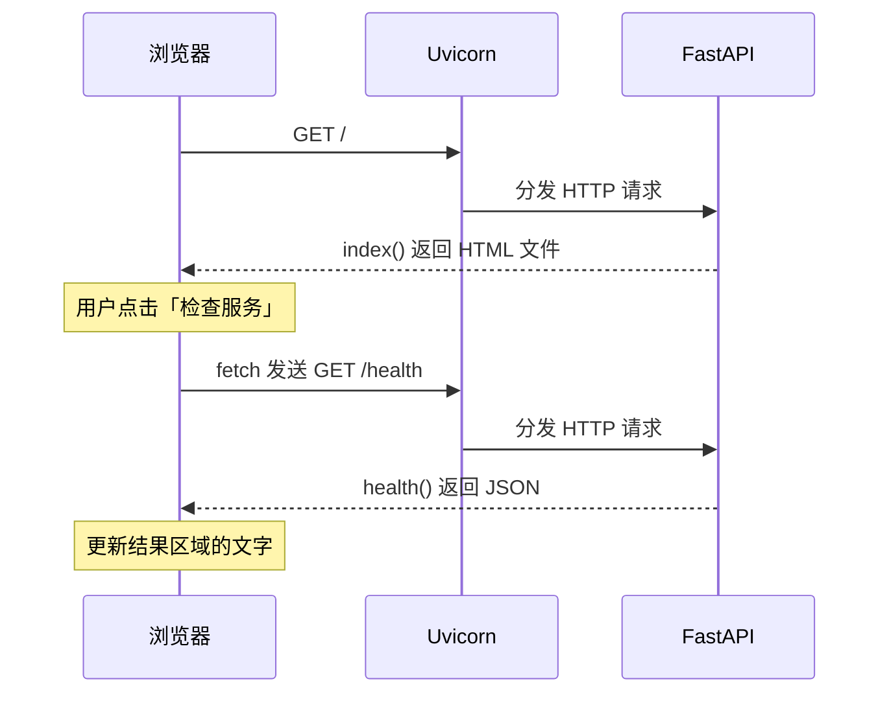

# 第 13 节：Web 服务骨架

> 上一节在 Python 查询图里拿到了重排结果。这一节让浏览器访问本地服务，点击按钮查看服务是否能响应 HTTP 请求。
> 对应资料为 [day13 的 HTML/CSS/JavaScript 示例](../../reference/掌教智库/4.视频/day13/knowledge_base.zip)、[当天 Web 服务课堂笔记](../../reference/掌教智库/4.视频/day13/课堂笔记/18【掌柜智库】【Web服务】.md)的启动示例，以及 [day14 视频 02](../../reference/掌教智库/4.视频/day14/视频目录1.png) 的启动与调试部分。

## 一、业务流程与设计原因

### 1. 浏览器怎样确认掌柜智库服务已启动

前几节在 PyCharm 点 Run 就能执行节点，结果留在控制台。现在要让浏览器看到结果，需要给它一个 URL，由服务端接收请求并返回响应。先从最小的真实请求开始：打开状态页，点击「检查服务」，看到服务返回的 `{"ok": true}`。

如果把 `{"ok": true}` 写死在页面按钮里，Python 进程没有启动也能显示成功。我们让按钮真正发出 `GET /health`，等服务返回 JSON 后再更新页面。这里的 `health` 只报告 HTTP 服务能接收并响应请求，导入图、查询图和数据库的可用性由各自的验证负责。

### 2. 一个服务返回两种内容



浏览器首次访问 `/`，Uvicorn 监听端口并把请求交给 FastAPI，FastAPI 按请求方法和路径找到 `index()`，由 Uvicorn 把 HTML 响应发回浏览器。点击按钮后才会发出第二个请求，`health()` 返回的字典会被序列化为 JSON，页面用 JavaScript 把响应显示出来。如果这个请求失败，结果区域会显示错误。

页面和接口都由 `http://127.0.0.1:8000` 提供，协议、主机、端口完全相同，这就是**同源**。页面里的 `fetch("/health")` 会沿用这个来源，本节用同一个服务就能完成联调。

## 二、手敲步骤

### 1. 声明 Web 依赖

打开 [pyproject.toml](../../pyproject.toml)，本工程的直接依赖写在 `[project]` 的 `dependencies` 下。在 PyCharm 的项目终端执行下面的命令，让 uv 把 FastAPI 和 Uvicorn 声明为项目直接依赖并同步环境。

```bash
uv add fastapi uvicorn --default-index https://pypi.tuna.tsinghua.edu.cn/simple
```

FastAPI 负责路由和响应，Uvicorn 是实际监听端口、运行 FastAPI 应用的服务器。即便当前解释器已能导入这两个包，也要显式声明，方便其他环境按项目依赖安装。

### 2. 先写浏览器页面

在 `src/shopkeeper_brain/` 下新建 `front` 目录。用 HTML 放按钮和结果区，用一条 CSS 规则调整页面间距，再用 JavaScript 把按钮点击和真实请求连起来。

**文件**：`src/shopkeeper_brain/front/index.html`

```html
<!doctype html>
<html lang="zh-CN">
<head>
    <meta charset="utf-8">
    <title>掌柜智库 · 服务状态</title>
    <style>
        body { margin: 2rem; font-family: system-ui, sans-serif; }
    </style>
</head>
<body>
    <h1>掌柜智库 · 服务状态</h1>
    <button id="check-health" type="button">检查服务</button>
    <pre id="health-result" aria-live="polite">等待检查</pre>

    <script>
        const button = document.getElementById("check-health");
        const result = document.getElementById("health-result");

        button.addEventListener("click", async () => {
            result.textContent = "正在检查…";
            try {
                const response = await fetch("/health");
                if (!response.ok) {
                    throw new Error(`HTTP ${response.status}`);
                }
                const health = await response.json();
                result.textContent = JSON.stringify(health);
            } catch (error) {
                result.textContent = `检查失败：${error.message}`;
            }
        });
    </script>
</body>
</html>
```

`getElementById()` 通过 `id` 拿到页面元素，`addEventListener()` 把函数绑到点击事件。第一个 `await` 等到响应，第二个 `await` 读取并解析 JSON。`fetch()` 收到 `404` 等 HTTP 响应时也会返回 `Response`，所以这里用 `response.ok` 判断状态。最后用 `textContent` 把结果作为纯文本显示在 `<pre>` 区域。

### 3. 用 FastAPI 提供页面和健康接口

在 `src/shopkeeper_brain/` 下新建 `api` 目录。页面需要从服务端打开才能使用同源地址，所以 `index()` 返回刚写好的 HTML 文件，`health()` 单独返回 JSON。

**文件**：`src/shopkeeper_brain/api/main.py`

```python
from pathlib import Path

import uvicorn
from fastapi import FastAPI
from fastapi.responses import FileResponse


app = FastAPI(title="掌柜智库")
# 从入口文件定位页面，IDE 的工作目录变化时路径仍然有效。
INDEX_PATH = Path(__file__).resolve().parents[1] / "front" / "index.html"


@app.get("/", response_class=FileResponse)
def index() -> FileResponse:
    return FileResponse(INDEX_PATH, media_type="text/html")


@app.get("/health")
def health() -> dict[str, bool]:
    return {"ok": True}


if __name__ == "__main__":
    uvicorn.run(app, host="127.0.0.1", port=8000)
```

如果用 `Path("front/index.html")`，路径会随 IDE 工作目录变化。`__file__` 指向当前 Python 文件，`parents[0]` 是 `api` 目录，`parents[1]` 是它上一层的 `shopkeeper_brain` 目录。

`@app.get` 的作用类似 Spring MVC 的 `@GetMapping`。`index()` 用 `FileResponse` 返回文件，浏览器按 `text/html` 渲染。`health()` 返回普通字典，FastAPI 会把 Python 的 `True` 转成 JSON 的 `true`。直接运行文件时，`__main__` 中的 `uvicorn.run()` 把服务开在本机 `127.0.0.1:8000`。

## 三、必做真实验证

### 1. 在 PyCharm 启动服务

选择本工程的 uv 解释器，打开 `src/shopkeeper_brain/api/main.py`，点击 `__main__` 旁边的运行按钮。控制台应显示 Uvicorn 正在监听 `http://127.0.0.1:8000`。保持进程运行，浏览器访问这个地址，确认页面显示「检查服务」按钮和「等待检查」。

如果启动时报找不到 `fastapi` 或 `uvicorn`，先检查解释器是否选成了本工程环境。端口被占用时，先确认是否有一份本节服务在运行，在 IDE 停掉那一份再启动。页面返回 `500` 时检查控制台，并核对 `front/index.html` 的实际位置和文件名。

### 2. 点击按钮，检查一次真实 HTTP 响应

按 F12 打开浏览器的 Network（网络）面板，再点击「检查服务」。找到新出现的 `health` 请求，确认方法是 `GET`、状态是 `200`，响应体是 `{"ok": true}`。回到页面，结果区应由「等待检查」变成 `{"ok":true}`。控制台里也会出现 `GET /health` 的访问记录。以上三处对上，即完成本节验证。

如果点击后没有请求，先看浏览器 Console（控制台）里的 JavaScript 错误和按钮 `id` 是否对应。如果请求失败，先确认页面是从 `http://127.0.0.1:8000/` 打开的，再看请求地址、状态码和 PyCharm 控制台。
