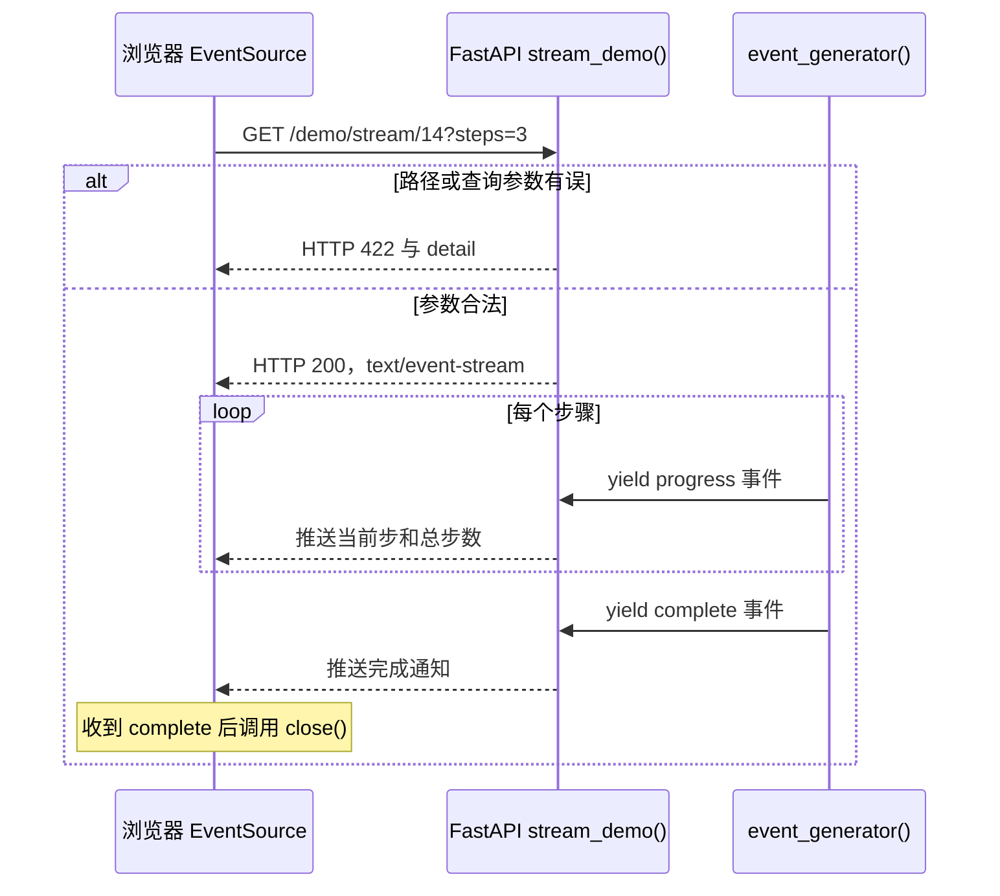

# 第 14 节：FastAPI 与 SSE

> 上一节用 `GET /health` 确认服务能响应。这一节把浏览器传来的输入校验清楚，再让浏览器在同一个 HTTP 响应里逐条收到处理进度。
> 资料见 [day14 的参数校验目录](../../reference/掌教智库/4.视频/day14/视频目录1.png)、[SSE 目录](../../reference/掌教智库/4.视频/day14/视频目录5.png)与[课堂笔记](../../reference/掌教智库/4.视频/day14/课堂笔记/18【掌柜智库】【Web服务】.md)。

## 一、业务流程与设计原因

### 1. 请求进入处理函数前，先把输入校验清楚

假设你要问“RS-12 怎么测量电压？”。浏览器发来的是 JSON，后端需要一段有效的提问文字。要是每个接口都自己从字典里取值、去空格、查类型，漏掉一次检查就可能让空问题进入后续处理。本节先做一个 `POST /demo/preview`，收到问题后只回显清理后的文字，用它观察校验是在什么时候发生的。

| 输入位置 | 本节请求 | 后端收到什么 |
| --- | --- | --- |
| URL 路径 | `/demo/stream/14` 中的 `14` | `run_id` 是整数，本次演示的编号 |
| URL 查询串 | `?steps=3` | `steps` 是 1 到 5 的整数，省略时取 3 |
| JSON 请求体 | `{"question": "  RS-12 怎么测量电压？  "}` | `PreviewRequest.question` 是去掉首尾空白后的非空字符串 |

FastAPI 从 URL 取出路径和查询参数，把 POST 的 JSON 请求体交给 Pydantic 模型处理。输入符合声明时，处理函数直接拿到对应的 Python 值。缺字段、类型不对或超出约束时，这次请求在进入处理函数前就会收到 `422`，响应的 `detail` 会指出出错位置。熟悉 Spring MVC 的话，可以把参数来源分别类比为 `@PathVariable`、`@RequestParam` 和 `@RequestBody`。

### 2. 同一个响应，边处理边交付进度

浏览器点击「开始接收」后，请求 `GET /demo/stream/14?steps=3`。如果后端先把三条进度装进列表再 `return`，页面要等三步全部结束才看到结果。用异步生成器每秒 `yield` 一条，浏览器就可以在服务仍在处理时更新页面。



从浏览器发出的一个 GET 开始。参数合法时，`stream_demo()` 把生成器交给 `StreamingResponse`。生成器在每次 `await asyncio.sleep(1)` 时让出执行机会，醒来后交付一条进度，浏览器收到就显示。最后一条是 `complete`，页面收到后主动关闭 `EventSource`，避免响应正常结束后浏览器又发出订阅请求。

SSE 在 HTTP 响应里发送 UTF-8 文本。`event:` 指定事件名，`data:` 携带内容，空行表示这一条事件结束。HTTP 可以把一个事件拆成多段传输，浏览器按空行识别完整事件。POST 校验和 SSE 订阅在本节是两个独立练习，进度来自服务端的定时生成器。

## 二、手敲步骤

### 1. 声明直接使用的 Pydantic 依赖

FastAPI 和 Uvicorn 已在项目的 [依赖声明](../../pyproject.toml)中。已有锁文件也包含 FastAPI 带入的 Pydantic `2.14.3`。本节会在学习代码里直接导入 Pydantic，因此在 PyCharm 项目终端执行下面的命令，把它加入直接依赖。继续选择本工程的 uv 解释器。

```bash
uv add "pydantic>=2.14.3" --default-index https://pypi.tuna.tsinghua.edu.cn/simple
```

### 2. 写 SSE 练习页

在已有 `front` 目录新建下面的页面。按钮打开同源的事件流，结果区记录每次收到的进度。等前一次连接关闭后，按钮才可以再次点击。

**文件**：`src/shopkeeper_brain/front/sse_demo.html`

```html
<!doctype html>
<html lang="zh-CN">
<head>
    <meta charset="utf-8">
    <title>SSE 进度练习</title>
</head>
<body>
    <h1>SSE 进度练习</h1>
    <button id="start-stream" type="button">开始接收</button>
    <pre id="stream-result" aria-live="polite">等待连接</pre>

    <script>
        const button = document.getElementById("start-stream");
        const result = document.getElementById("stream-result");

        button.addEventListener("click", () => {
            button.disabled = true;
            result.textContent = "正在连接…\n";
            const source = new EventSource("/demo/stream/14?steps=3");

            source.addEventListener("progress", (event) => {
                const { run_id, step, total } = JSON.parse(event.data);
                result.textContent += `演示 ${run_id}：第 ${step}/${total} 步\n`;
            });

            source.addEventListener("complete", (event) => {
                result.textContent += event.data;
                source.close();
                button.disabled = false;
            });

            source.onerror = () => {
                result.textContent += "连接失败，请检查网络面板。";
                source.close();
                button.disabled = false;
            };
        });
    </script>
</body>
</html>
```

`EventSource` 连接后会按事件名调用对应的监听器。`progress` 携带 JSON 文本，用 `JSON.parse()` 取出字段。`complete` 携带普通文字，页面用 `textContent` 显示，然后调用 `close()`。练习页在连接失败时也会关闭连接，并允许手动重试。开头为 `/` 的地址沿用页面的协议、主机和端口，所以要从 FastAPI 提供的 URL 打开页面。

### 3. 在 Web 入口接上输入校验和 SSE

打开 [api/main.py](../../src/shopkeeper_brain/api/main.py)。先把文件顶部从 `from pathlib import Path` 到 `from fastapi.responses import FileResponse` 的导入区替换为下面的增量，保留原有 `app` 定义和页面路径。

```python
import asyncio
import json
from collections.abc import AsyncIterator
from pathlib import Path
from typing import Annotated

import uvicorn
from fastapi import FastAPI, Query
from fastapi.responses import FileResponse, StreamingResponse
from pydantic import BaseModel, StringConstraints
```

把下面的请求模型与路由插在 `health()` 之后、`if __name__ == '__main__':` 之前。沿用原来的两个路由和启动入口。

```python
class PreviewRequest(BaseModel):
    question: Annotated[str, StringConstraints(strip_whitespace=True, min_length=1)]


@app.post("/demo/preview")
def preview(request: PreviewRequest) -> PreviewRequest:
    return request


@app.get("/demo/sse", response_class=FileResponse)
def sse_page() -> FileResponse:
    return FileResponse(INDEX_PATH.with_name("sse_demo.html"), media_type="text/html")


@app.get("/demo/stream/{run_id}", response_class=StreamingResponse)
async def stream_demo(
    run_id: int,
    steps: Annotated[int, Query(ge=1, le=5)] = 3,
) -> StreamingResponse:
    async def event_generator() -> AsyncIterator[str]:
        for step in range(1, steps + 1):
            await asyncio.sleep(1)
            data = json.dumps({"run_id": run_id, "step": step, "total": steps})
            yield f"event: progress\ndata: {data}\n\n"
        yield "event: complete\ndata: 演示完成\n\n"

    return StreamingResponse(event_generator(), media_type="text/event-stream")
```

`Annotated` 在类型后附加校验规则。`question` 要求字符串，`StringConstraints` 先去首尾空白，再检查至少有一个字符。`preview()` 收到校验完成的模型，直接返回它，FastAPI 会把它序列化成 JSON。`run_id` 与路由里的 `{run_id}` 同名，因此取自路径。`Query(ge=1, le=5)` 限制查询参数的范围，`= 3` 则提供默认值。

`INDEX_PATH.with_name()` 沿用第 13 节定位到的目录，只换同目录的文件名。`event_generator()` 返回一个异步迭代器，`StreamingResponse` 逐次取出它产出的字符串。这里沿用课堂的手写事件格式，用 `\n\n` 留出空行。`json.dumps()` 把进度字典写成一行 JSON，与浏览器端的 `JSON.parse()` 对应。

## 三、必做真实验证

下面是操作步骤和预期判据。手敲后尚未亲自执行的项目标为“未验证（未运行）”。

### 1. 在 PyCharm 启动并回归状态页

选择当前工程的 uv 解释器，打开 `api/main.py`，在 `__main__` 旁点击 Run。等控制台显示 Uvicorn 已监听 `http://127.0.0.1:8000`，浏览器打开 `/`，点击「检查服务」，预期仍显示 `{"ok":true}`。如果端口被占用，先在 IDE 停掉之前启动的这份服务，再运行当前文件。

### 2. 在浏览器核对参数与 JSON 校验

1. 打开 `http://127.0.0.1:8000/docs`，展开 **POST /demo/preview**，点击 **Try it out**。输入 `{"question":"  RS-12 怎么测量电压？  "}`，点 **Execute**。在 **Server response** 里看 `200`，响应中的 `question` 已去掉首尾空格。
2. 在同一个输入框依次试 `{}` 和 `{"question":12}`，预期都是 `422`。在 `detail` 里找 `loc` 为 `['body', 'question']` 的错误，分别对应缺少字段和类型不符。再试 `{"question":"   "}`，去掉空白后长度为零，也预期返回 `422`。
3. 直接在浏览器地址栏打开 `http://127.0.0.1:8000/demo/stream/abc?steps=3` 和 `http://127.0.0.1:8000/demo/stream/14?steps=0`。两个地址应直接显示 JSON 错误。在 Network（网络）面板看到 `422`，并在 `detail` 里分别找到 `['path', 'run_id']` 和 `['query', 'steps']`。

想在 IDE 里对照数据时，可在 `preview()` 的 `return request` 处打断点后用 Debug 启动。合法请求会命中断点，可查看 `request.question`，继续运行后浏览器才收到响应。校验失败的请求会直接返回 `422`。如果 `/docs` 找不到路由，确认运行的是当前文件并重启服务。如果没有在 **Server response** 里看到状态码，先看是否真正发出了请求。

### 3. 在浏览器确认逐条到达与关闭连接

1. 打开 `http://127.0.0.1:8000/demo/sse`，按 F12 切到 Network，再点击「开始接收」。页面应逐秒追加第 `1/3`、`2/3`、`3/3` 步，接着显示「演示完成」，按钮恢复可点击。
2. 查看 Network 中的 `GET /demo/stream/14?steps=3`。Headers（标头）里预期是 `200`，响应的 `Content-Type` 以 `text/event-stream` 开头。在 Chromium 浏览器的 **EventStream（事件流）** 面板对照三条 `progress` 和一条 `complete` 的顺序。保持页面打开几秒，确认当前请求结束后没有自行发起同一个订阅请求。
3. 如果页面返回 `404`，核对 `sse_page()` 的路由、启动进程和访问地址。如果页面显示连接失败，先看流请求状态与响应类型。如果 `200` 但页面没更新，检查 `yield` 中是否保留事件末尾的空行，前后端事件名是否一致，再看浏览器 Console（控制台）是否有 JSON 解析错误。

健康按钮仍能工作、请求校验能给出预期的 `200` 和 `422`、事件逐条到达并在完成后停止订阅，三项都观察到就完成本节自测。
