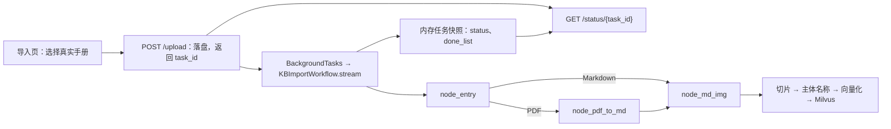
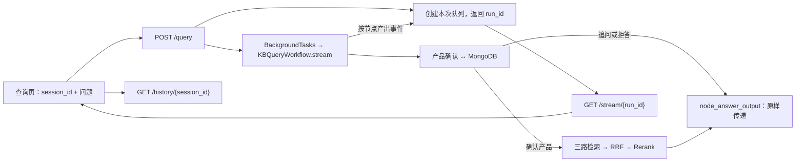

# 第 15 节：API、前端与流式交互

上一节用固定数据练习了同源请求和 SSE。本节把上传、入库、查询进度和会话历史接到同一个 Web 服务，对照 day15 的课堂笔记和代码。生成式答案、答案增量和引用留到第 16 节。[课堂笔记](../../reference/掌教智库/4.视频/day15/课堂笔记/19【掌柜智库】【API接口和前端页面】.md)

## 一、业务流程与设计原因

### 1. 上传完手册，为什么还要等任务完成

在导入页选中一份万用表手册，浏览器用 `multipart/form-data` 把文件交给 `POST /upload`。服务器将文件写到 `workspace` 下的任务目录，登记 `pending`，返回 `task_id`。之后，`BackgroundTasks` 执行同步的导入函数，浏览器用这个 ID 轮询 `GET /status/{task_id}`。切片、向量化和数据库写入耗时不同，所以上传响应只表示服务器收到了文件。等最后一个节点执行完，任务才进入 `completed`。



从上传开始读。文件落盘后，浏览器按任务 ID 看快照，后台图按文件类型决定要不要先调用 PDF 解析。`stream_mode="updates"` 每完成一个节点就给出该节点的更新，后台从更新里取节点名追加到 `done_list`。轮询读取最新快照，可能一次看到好几个短节点一起完成。后台异常时存 `failed`，页面在两个终态都停止轮询。

导入节点以前各自运行，现在要交接状态。入口只给 Markdown 写入 `md_path`。图片节点即使读到了正文，发现没有同级 `images` 目录或没有待处理图片时也会提前返回。如果正文没留在 `md_content`，切片就会拒绝输入。让图片节点在跳过时也把读到的正文交出去，PDF 和 Markdown 就能复用同一条下游链路。

课堂还演示了上传原件到 MinIO。这个闭环使用任务目录保留原件，复用图片节点自己的 MinIO 行为，入库终态以真实 Milvus 记录为准。导入图在单进程内串行处理，避免两份同名文件同时执行入库节点的“按标题清理旧记录 → 插入”操作。

### 2. 一次查询，为什么用两个 ID 和两个请求

发送「RS PRO RS-12 数字万用表怎么测电压？」时，`POST /query` 接收 `query` 和 `session_id`。`session_id` 用于 MongoDB 读写，所以刷新页面后还能取回同一会话。每次提问另有一个新的 `run_id`，只标识这次执行和它的消息队列。这样即使同一个会话连续提问，每次 SSE 也只消费自己的节点进度。



先提交问题，服务器在响应前准备队列，所以节点先跑完也能留下事件。浏览器随后用 `EventSource` 订阅，队列把执行中的更新送给 SSE 生成器。查询服务在正常结束时发 `complete`，异常时发 `task_error`，页面收到终态就关闭连接。三路检索的完成先后可能变化，RRF 和 Rerank 必须在它们之后。确认分支的 `complete` 附带重排文档条数，追问或拒答直接走短分支，已有的提示文字仍从历史接口读取。

第 14 节的生成器自己产生演示进度；本节由图节点执行产生真实更新。同步图在线程中跑，SSE 在事件循环里取 `asyncio.Queue`。线程用 `call_soon_threadsafe` 把入队动作交回事件循环后，等待队列的生成器就能继续。任务与队列都是进程内数据，服务重启会丢失。每个运行只订阅一次，订阅时取走队列入口，未订阅的入口保留到进程重启。MongoDB 历史可跨服务重启读取。

## 二、手敲步骤

### 1. 先让 Markdown 正文能交给切片

打开已有的 `src/shopkeeper_brain/processor/import_processor/nodes/node_md_img.py`，找到 `NodeMdImg.process()` 里的两个提前返回位置。按下面的**增量**补两处赋值，后面的模型、上传和备份代码原样保留。

```python
        if not images_dir.is_dir():
            self.logger.info("图片目录不存在，跳过图片处理：%s", images_dir)
            state["md_content"] = md_content
            return state

        target_images = self._step_2_scan_images(md_content, images_dir)
        if not target_images:
            self.logger.info("没有找到被 Markdown 引用的支持格式图片")
            state["md_content"] = md_content
            return state
```

`_step_1_get_content()` 已经从 `md_path` 读出了正文。两个分支只写回这个正文，原 `md_path` 仍然有效。需要实际改写图片链接时，仍然由原代码在新文件保存成功后更新状态。

### 2. 接好导入主图，给查询图补节点更新入口

导入的 `main_graph.py` 原先只有入口路由。将现有文件替换成以下完整内容，保留路由函数和原有分支名。

**文件**：`src/shopkeeper_brain/processor/import_processor/main_graph.py`

```python
from langgraph.constants import END
from langgraph.graph import StateGraph

from shopkeeper_brain.processor.import_processor.nodes.node_bge_embedding import NodeBGEEmbedding
from shopkeeper_brain.processor.import_processor.nodes.node_document_split import NodeDocumentSplit
from shopkeeper_brain.processor.import_processor.nodes.node_entry import NodeEntry
from shopkeeper_brain.processor.import_processor.nodes.node_import_milvus import NodeImportMilvus
from shopkeeper_brain.processor.import_processor.nodes.node_item_name_recognition import NodeItemNameRecognition
from shopkeeper_brain.processor.import_processor.nodes.node_md_img import NodeMdImg
from shopkeeper_brain.processor.import_processor.nodes.node_pdf_to_md import NodePDFToMD
from shopkeeper_brain.processor.import_processor.state import ImportGraphState


def route_after_entry(state: ImportGraphState) -> str:
    """根据入口节点写入的标记选择下一节点。"""
    if state.get("is_pdf_read_enabled"):
        return "node_pdf_to_md"
    if state.get("is_md_read_enabled"):
        return "node_md_img"
    return END


class KBImportWorkflow:
    def __init__(self) -> None:
        workflow = StateGraph(ImportGraphState)
        for node in (
                NodeEntry(), NodePDFToMD(), NodeMdImg(), NodeDocumentSplit(),
                NodeItemNameRecognition(), NodeBGEEmbedding(), NodeImportMilvus(),
        ):
            workflow.add_node(node.name, node)
        workflow.set_entry_point("node_entry")
        workflow.add_conditional_edges(
            "node_entry", route_after_entry, ["node_pdf_to_md", "node_md_img", END],
        )
        workflow.add_edge("node_pdf_to_md", "node_md_img")
        workflow.add_edge("node_md_img", "node_document_split")
        workflow.add_edge("node_document_split", "node_item_name_recognition")
        workflow.add_edge("node_item_name_recognition", "node_bge_embedding")
        workflow.add_edge("node_bge_embedding", "node_import_milvus")
        workflow.add_edge("node_import_milvus", END)
        self._app = workflow.compile()

    def stream(self, initial_state: ImportGraphState):
        return self._app.stream(initial_state, stream_mode="updates", version="v2")
```

注册节点时用节点实例的 `name`。`add_conditional_edges()` 只负责入口分叉，其他连线固定。`stream()` 返回可迭代对象，服务层要遍历它，才能让图执行并逐步拿到 `update["data"]` 中的节点名和状态更新。

查询图已经有路由和 `run()`。打开 `src/shopkeeper_brain/processor/query_processor/main_graph.py`，在 `KBQueryWorkflow.run()` 后新增这个**方法**，继续保留现有同步调用入口。

```python
    def stream(self, initial_state: QueryGraphState):
        """给后台任务逐节点读取状态更新。"""
        return self.compile().stream(initial_state, stream_mode="updates", version="v2")
```

已有 `run()` 返回最终状态，新方法提供执行过程。两者复用同一张编译后的查询图。

### 3. 把导入状态和查询事件从图里接出来

在 `src/shopkeeper_brain` 下新建 `services` 目录。导入服务用一个字典记录任务，用一个锁让导入图串行运行。上传路由负责保存文件，后台函数从已保存的路径起步。

**文件**：`src/shopkeeper_brain/services/import_service.py`

```python
import logging
from pathlib import Path
from shutil import copyfileobj
from threading import Lock
from typing import BinaryIO
from uuid import UUID, uuid4

from shopkeeper_brain.processor.import_processor.main_graph import KBImportWorkflow
from shopkeeper_brain.processor.import_processor.state import create_default_state

logger = logging.getLogger(__name__)
UPLOAD_DIR = Path(__file__).resolve().parents[3] / "workspace" / "day15-uploads"
_tasks: dict[UUID, dict] = {}
_import_lock = Lock()


def save_upload(filename: str, source: BinaryIO) -> tuple[UUID, Path]:
    task_id = uuid4()
    folder = UPLOAD_DIR / str(task_id)
    folder.mkdir(parents=True)
    path = folder / filename
    with path.open("wb") as target:
        copyfileobj(source, target)
    _tasks[task_id] = {"status": "pending", "done_list": []}
    return task_id, path


def get_import_status(task_id: UUID) -> dict | None:
    return _tasks.get(task_id)


def run_import(task_id: UUID, path: Path) -> None:
    with _import_lock:
        done: list[str] = []
        _tasks[task_id] = {"status": "processing", "done_list": done}
        try:
            state = create_default_state(import_file_path=str(path), file_dir=str(path.parent))
            for update in KBImportWorkflow().stream(state):
                done = [*done, *update["data"]]
                _tasks[task_id] = {"status": "processing", "done_list": done}
            _tasks[task_id] = {"status": "completed", "done_list": done}
        except Exception:
            logger.exception("导入失败，task_id=%s", task_id)
            _tasks[task_id] = {"status": "failed", "done_list": done}
```

同一任务的本地文件和产物共用 UUID 目录。每次更新都替换整个快照，`done` 也用新列表，轮询拿到的状态和节点列表属于同一时点。后台图只拿到 `Path`，客户端上传用的临时文件在响应后可以正常关闭。

查询服务遍历查询图，只把需要展示的节点名和重排条数交给 API 提供的 `publish`。图里的正文、向量和 MongoDB 内部对象继续留在业务状态中。

**文件**：`src/shopkeeper_brain/services/query_service.py`

```python
import logging
from collections.abc import Callable

from shopkeeper_brain.processor.query_processor.main_graph import KBQueryWorkflow

logger = logging.getLogger(__name__)


def run_query(session_id: str, question: str, publish: Callable[[str, dict], None]) -> None:
    state = {"session_id": session_id, "original_query": question}
    reranked_count = None
    try:
        for update in KBQueryWorkflow().stream(state):
            for node, changes in update["data"].items():
                publish("progress", {"node": node})
                if node == "node_rerank":
                    reranked_count = len(changes["reranked_docs"])
        publish("complete", {"reranked_count": reranked_count})
    except Exception:
        logger.exception("查询失败，session_id=%s", session_id)
        publish("task_error", {"message": "查询失败，请查看服务端日志。"})
```

短分支跳过重排，条数用 `None` 表示。重排节点如果实际执行并返回空列表，条数就是 `0`。两个值在页面上对应不同状态。

### 4. 在 FastAPI 上挂业务路由

安装表单解析依赖。在 PyCharm 的项目终端执行下面的准备命令，以更新依赖声明和锁文件。此命令在你的环境执行前标记为**未验证（未运行）**。

```bash
uv add python-multipart --default-index https://pypi.tuna.tsinghua.edu.cn/simple
```

在已有的 `api` 包中新增业务路由。保留课堂的上传、状态、查询、订阅和历史接口形态。`POST /query` 返回这次运行的 ID，`GET /history/{session_id}` 用既有 MongoDB 工具读历史。

**文件**：`src/shopkeeper_brain/api/business.py`

```python
import asyncio
import json
from pathlib import Path, PureWindowsPath
from typing import Annotated
from uuid import UUID, uuid4

from fastapi import APIRouter, BackgroundTasks, File, HTTPException, UploadFile
from fastapi.responses import FileResponse, StreamingResponse
from pydantic import BaseModel, StringConstraints

from shopkeeper_brain.services.import_service import get_import_status, run_import, save_upload
from shopkeeper_brain.services.query_service import run_query
from shopkeeper_brain.utils.mongo_history_utils import get_recent_messages

router = APIRouter()
FRONT = Path(__file__).resolve().parents[1] / "front"
_pending_streams: dict[UUID, asyncio.Queue[tuple[str, dict]]] = {}


class QueryRequest(BaseModel):
    query: Annotated[str, StringConstraints(strip_whitespace=True, min_length=1)]
    session_id: UUID


@router.get("/import.html", response_class=FileResponse)
def import_page() -> FileResponse:
    return FileResponse(FRONT / "import.html", media_type="text/html")


@router.get("/chat.html", response_class=FileResponse)
def chat_page() -> FileResponse:
    return FileResponse(FRONT / "chat.html", media_type="text/html")


@router.post("/upload", status_code=202)
def upload(background_tasks: BackgroundTasks, file: Annotated[UploadFile, File()]) -> dict:
    name = file.filename or ""
    path = PureWindowsPath(name)
    if path.name != name or ":" in name or path.is_reserved() or path.suffix.lower() not in {".md", ".pdf"}:
        raise HTTPException(status_code=400, detail="请选择文件名有效的 PDF 或 Markdown。")
    task_id, saved_path = save_upload(name, file.file)
    background_tasks.add_task(run_import, task_id, saved_path)
    return {"task_id": task_id}


@router.get("/status/{task_id}")
def import_status(task_id: UUID) -> dict:
    status = get_import_status(task_id)
    if status is None:
        raise HTTPException(status_code=404, detail="没有找到该导入任务。")
    return status


@router.post("/query", status_code=202)
async def query(request: QueryRequest, background_tasks: BackgroundTasks) -> dict:
    run_id = uuid4()
    events: asyncio.Queue[tuple[str, dict]] = asyncio.Queue()
    _pending_streams[run_id] = events
    loop = asyncio.get_running_loop()

    def publish(event: str, data: dict) -> None:
        loop.call_soon_threadsafe(events.put_nowait, (event, data))

    background_tasks.add_task(run_query, str(request.session_id), request.query, publish)
    return {"session_id": request.session_id, "run_id": run_id}


@router.get("/stream/{run_id}", response_class=StreamingResponse)
async def stream(run_id: UUID) -> StreamingResponse:
    events = _pending_streams.pop(run_id, None)
    if events is None:
        raise HTTPException(status_code=404, detail="该运行不存在或已订阅。")

    async def generate():
        while True:
            event, data = await events.get()
            yield f"event: {event}\ndata: {json.dumps(data, ensure_ascii=False)}\n\n"
            if event in {"complete", "task_error"}:
                return

    return StreamingResponse(generate(), media_type="text/event-stream", headers={"Cache-Control": "no-cache"})


@router.get("/history/{session_id}")
def history(session_id: UUID) -> dict:
    records = get_recent_messages(str(session_id), limit=50)
    return {"session_id": session_id, "items": [{**record, "_id": str(record["_id"])} for record in records]}
```

上传文件名先过检查，再用于任务目录内的落盘路径。`202 Accepted` 表示接收了任务，最终结果由状态接口或 SSE 给出。上传、历史读取使用同步路由，因为这些操作用的是阻塞文件或数据库接口。查询提交和订阅使用 `async def`，队列的创建、登记和领取都在事件循环里。`pop()` 把队列交给当前订阅者，第二次请求同一个运行 ID 会得到 `404`。`ObjectId` 转成字符串后，历史记录才能作为 JSON 返回给浏览器。

在 `src/shopkeeper_brain/api/main.py` 的现有第三方导入之后补导入，这是第一处**增量**。

```python
from shopkeeper_brain.api.business import router
```

第二处增量是在 `app = FastAPI(title="掌柜智库")` 之后注册路由。服务仍绑定本机地址，页面与 API 使用同一个源。

```python
app.include_router(router)
```

### 5. 让导入页轮询任务，让查询页逐条收流

导入页用 `FormData` 送文件，字段名 `file` 对应上传路由参数。浏览器会自动给 multipart 请求加上边界，页面直接传 `body` 即可。每次状态请求结束后才等下一轮，慢请求不会造成轮询重叠。

**文件**：`src/shopkeeper_brain/front/import.html`
```html
<!doctype html>
<html lang="zh-CN">
<head>
    <meta charset="utf-8">
    <title>掌柜智库 · 导入手册</title>
</head>
<body>
    <nav><a href="/">状态页</a> · <a href="/chat.html">查询手册</a></nav>
    <h1>导入手册</h1>
    <form id="upload-form">
        <label>手册 <input name="file" type="file" accept=".md,.pdf" required></label>
        <button type="submit">上传</button>
    </form>
    <pre id="import-result" aria-live="polite">等待上传</pre>
    <script>
        const form = document.getElementById("upload-form");
        const button = form.querySelector("button");
        const result = document.getElementById("import-result");

        form.addEventListener("submit", async (event) => {
            event.preventDefault();
            button.disabled = true;
            result.textContent = "正在上传…";
            try {
                const upload = await fetch("/upload", { method: "POST", body: new FormData(form) });
                if (!upload.ok) throw new Error(`上传 HTTP ${upload.status}`);
                const { task_id } = await upload.json();
                while (true) {
                    const response = await fetch(`/status/${task_id}`);
                    if (!response.ok) throw new Error(`状态 HTTP ${response.status}`);
                    const { status, done_list } = await response.json();
                    result.textContent = [task_id, status, ...done_list].join("\n");
                    if (status === "completed" || status === "failed") break;
                    await new Promise(resolve => setTimeout(resolve, 500));
                }
            } catch (error) {
                result.textContent = error.message;
            } finally {
                button.disabled = false;
            }
        });
    </script>
</body>
</html>
```

查询页把会话 ID 留在当前标签的 `sessionStorage`。刷新时从服务器读历史。发送后先根据 `run_id` 建立订阅，再按 `progress`、`complete` 和 `task_error` 分别更新页面。服务端的业务错误用 `task_error`，浏览器的连接故障由 `onerror` 处理。

**文件**：`src/shopkeeper_brain/front/chat.html`
```html
<!doctype html>
<html lang="zh-CN">
<head>
    <meta charset="utf-8">
    <title>掌柜智库 · 查询手册</title>
</head>
<body>
    <nav><a href="/">状态页</a> · <a href="/import.html">导入手册</a></nav>
    <h1>查询手册</h1>
    <form id="query-form">
        <label>问题 <input id="question" size="42" required></label>
        <button type="submit">发送</button>
    </form>
    <pre id="query-progress" aria-live="polite">等待提问</pre>
    <h2>会话历史</h2>
    <ol id="history"></ol>
    <p id="history-note" aria-live="polite"></p>
    <script>
        const form = document.getElementById("query-form");
        const button = form.querySelector("button");
        const question = document.getElementById("question");
        const progress = document.getElementById("query-progress");
        const history = document.getElementById("history");
        const historyNote = document.getElementById("history-note");
        const sessionId = sessionStorage.getItem("shopkeeper-session") || crypto.randomUUID();
        sessionStorage.setItem("shopkeeper-session", sessionId);

        async function loadHistory() {
            try {
                const response = await fetch(`/history/${sessionId}`);
                if (!response.ok) throw new Error(`历史 HTTP ${response.status}`);
                const { items } = await response.json();
                history.replaceChildren(...items.map(item => {
                    const line = document.createElement("li");
                    line.textContent = `${item.role === "user" ? "我" : "助手"}：${item.text}`;
                    return line;
                }));
                historyNote.textContent = items.length ? "" : "当前会话暂无记录。";
            } catch (error) {
                historyNote.textContent = `读取历史失败：${error.message}`;
            }
        }

        form.addEventListener("submit", async (event) => {
            event.preventDefault();
            const text = question.value.trim();
            if (!text) return;
            button.disabled = true;
            progress.textContent = "正在提交…\n";
            try {
                const response = await fetch("/query", {
                    method: "POST",
                    headers: { "Content-Type": "application/json" },
                    body: JSON.stringify({ query: text, session_id: sessionId }),
                });
                if (!response.ok) throw new Error(`查询 HTTP ${response.status}`);
                const { run_id } = await response.json();
                const source = new EventSource(`/stream/${run_id}`);
                async function finish(message) {
                    source.close();
                    progress.textContent += message;
                    await loadHistory();
                    button.disabled = false;
                }
                source.addEventListener("progress", (event) => {
                    progress.textContent += `${JSON.parse(event.data).node}\n`;
                });
                source.addEventListener("complete", (event) => {
                    const { reranked_count } = JSON.parse(event.data);
                    const detail = reranked_count === null ? "未进入检索分支" : `重排保留 ${reranked_count} 条资料`;
                    finish(`查询完成，${detail}。`);
                });
                source.addEventListener("task_error", (event) => finish(JSON.parse(event.data).message));
                source.onerror = () => finish("进度连接中断。");
            } catch (error) {
                progress.textContent += error.message;
                button.disabled = false;
            }
        });
        loadHistory();
    </script>
</body>
</html>
```

`textContent` 把问题和历史当纯文本展示。刷新页面会读回本会话已保存的消息，每次提问会重新显示本轮进度。为了从状态页直接进入业务页，在现有 `src/shopkeeper_brain/front/index.html` 的 `<h1>` 后增加这行**导航**。

```html
    <nav><a href="/import.html">导入手册</a> · <a href="/chat.html">查询手册</a></nav>
```

## 三、必做真实验证

以下步骤在你手敲完成并亲自运行之前为**未验证（未运行）**。

### 1. 运行服务，真实上传 Markdown 手册

1. 准备第 4 节用真实手册生成的 `万用表RS-12的使用_new.md`，选已处理图片引用的版本。复制一份到 `workspace` 下的实验目录，保留正文。此次上传的是那份 Markdown，让图片节点走没有同级 `images` 目录的分支。
2. 在 PyCharm 的 `api/main.py` Run 配置中使用项目的 uv 解释器。用运行配置的环境变量覆盖 `SHOPKEEPER_BRAIN_MILVUS_ITEM_NAME_COLLECTION`、`SHOPKEEPER_BRAIN_MILVUS_CHUNK_COLLECTION` 和 `SHOPKEEPER_BRAIN_MONGO_DB_NAME`，分别用本次专用名称，例如 `study_d15_items`、`study_d15_chunks` 和 `study_d15_history`。确认与正式集合和库的名称不同。沿用本地 `.env` 中的连接信息与密钥，BGE-M3 使用第 7 节本地模型。
3. 在 PyCharm 运行 `api/main.py`，访问 `http://127.0.0.1:8000/`，先点一次「检查服务」应看到 `{"ok":true}`。进入「导入手册」，打开浏览器开发者工具的 Network，选择第 1 步的手册并上传。确认 `POST /upload` 返回 `202` 和一个任务 ID，后续 `GET /status/...` 都使用该 ID。若短节点执行很快，页面可能略过 `pending`，最终应看到 `completed`，并有从 `node_entry` 到 `node_import_milvus` 的完成记录。Markdown 分支不经过 `node_pdf_to_md`。
4. 在 PyCharm 展开 `workspace/day15-uploads` 下该 UUID 目录，应能看到上传文件和 `chunks.json`。在 Attu 打开运行配置里的两个实验集合，按 `file_title` 过滤到所上传文件名去掉扩展名后的值。核对一条主体记录、与本次 `chunks.json` 条数一致的 Chunk 记录，并抽查正文对应和 `chunk_id`。看到 `failed` 时，按已完成的最后一个节点和 PyCharm 日志定位。若卡在切片前，观察 `NodeMdImg.process()` 返回时的 `md_content`；若卡在保存，先核对 Milvus 连接与配置的集合名。

### 2. 用真实问题观察查询的事件和历史

1. 保持同一服务和实验配置，确认实验集合已有上一步的真实记录。准备第 9、11、12 节使用的文本模型、Tavily 和百炼配置。进入「查询手册」，打开浏览器 Network 面板，发送「RS PRO RS-12 数字万用表怎么测电压？」。
2. 观察 `POST /query` 返回 `202`、`session_id` 和 `run_id`。`GET /stream/...` 使用返回的 `run_id`。在 EventStream 中观察产品确认、三路检索、RRF、Rerank 的 `progress`；同一轮三路检索的先后可以变化。成功确认后应看到 `complete` 和实际重排条数，SSE 请求结束，发送按钮恢复，且无自动重连。若日志显示重排降级，本次可以核对进度和降级结果，真实打分是否通过要看百炼调用日志。
3. 刷新本标签，「会话历史」应读回刚才的问题。另开一个独立标签，在地址栏直接输入同一查询页地址。新标签应先显示暂无历史。发送「iPhone 15 怎么充电？」以区分两个会话。核对两边 `session_id` 与 `run_id` 不同，第二个会话只消费自己的事件，历史里只出现自己的问题和可能已有的追问或拒答。返回第一个标签刷新，原会话历史仍只属于第一个会话。若看到等待收流但没有事件，先核对订阅用的是 `run_id`，再看后台是否实际遍历了图。若 `complete` 后仍重连，检查页面的 `source.close()` 和服务器的终态分支。
