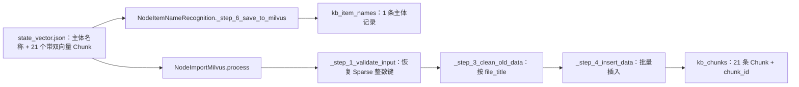

# 第 8 节 Milvus 向量入库实施计划

> **For this repository:** 本项目禁止使用子 agent、多 agent 工作流和自动提交。用户负责按教程手敲学习代码；当前会话负责编写教程、进行 workspace 隔离验证和真实验收。计划中的 Git 提交步骤统一改为只读检查，提交由用户在确认后自行执行。

**目标：** 使用第 7 节生成的真实 `state_vector.json`，把主体名称双向量和 21 个 Chunk 双向量写入现有 Milvus，完成两个集合的 Schema、索引、幂等入库和 Chunk 主键回填。

**架构：** 沿用参考项目的两阶段职责边界。主体识别节点增加第 6 步，负责保存一条主体名称记录；新增 `NodeImportMilvus` 负责创建或复用 Chunk 集合、按 `file_title` 清理旧数据、批量插入 Chunk 并回填 `chunk_id`。学习期入口从第 7 节的真实状态备份读取，按“主体保存 → Chunk 入库”顺序运行，不接正式主图。

**技术栈：** Python 3.11、uv、PyMilvus 3.0.3、Milvus Server 2.5.5、`pymilvus-model` 0.3.4、现有 `BaseNode`/项目异常体系、真实 BGE-M3 向量状态。

---

## 一、文件地图

### 当前会话需要编写或修改的教学/设计文件

- Create: `docs/study/day08-Milvus向量入库.md` — 第 8 节正式教程，只有业务流程与设计原因、手敲步骤、必做真实验证三个一级板块。
- Create: `docs/superpowers/specs/2026-11-16-day08-milvus-ingestion-design.md` — 已完成并经用户选择方案 A；本计划执行时只作为设计依据，不回改前七节。
- Create: `docs/memory/day08-preparation.md` — 教程交付前记录资料范围、版本分歧和输入边界；不记录虚构的真实运行结果。
- Modify: `docs/memory/learning-progress.md` — 教程交付后将第 8 节改为 `编写中`；用户代码未验收前不能改为 `已通过`。

### 用户按教程手敲的学习代码

- Modify: `.env.example` — 增加无密钥的 Milvus URI 和两个集合名称模板。
- Create: `src/shopkeeper_brain/core/milvus_config.py` — 读取 Milvus 连接和集合配置。
- Modify: `src/shopkeeper_brain/processor/import_process/exceptions.py` — 增加 `MilvusError`，让数据库错误保留项目异常边界。
- Create: `src/shopkeeper_brain/utils/milvus_utils.py` — 复用 `MilvusClient`、转义过滤表达式、恢复 JSON Sparse 键。
- Modify: `src/shopkeeper_brain/processor/import_process/nodes/node_item_name_recognition.py` — 在已有主体识别与名称向量步骤后增加主体名称集合保存步骤。
- Create: `src/shopkeeper_brain/processor/import_process/nodes/node_import_milvus.py` — Chunk 输入校验、集合准备、幂等清理、批量插入、`chunk_id` 回填和学习期真实入口。

### 不修改的范围

- `src/shopkeeper_brain/processor/import_process/main_graph.py`：本节不接正式主图。
- `docs/study/day01` 至 `day07`：不回改前七节教程。
- `reference/`：始终只读。
- `workspace/day07-real-run/state_vector.json`：只读输入，不覆盖。
- 虚拟机上的 Milvus、MinIO、etcd、Attu 和 MongoDB：不部署、不删除、不重建、不清空。

---

## 二、执行任务

### Task 1：固定第 8 节输入、环境事实和代码边界

- [x] **本任务执行结果：** 已确认 `workspace/day07-real-run/state_vector.json` 为唯一输入，已确认 Milvus `pkg/v2.5.5`、PyMilvus `3.0.3`、`pymilvus-model 0.3.4`，并保留本节不接主图、不重跑前七节的边界。


**Files:**
- Read: `docs/superpowers/specs/2026-11-16-day08-milvus-ingestion-design.md`
- Read: `docs/memory/day07-acceptance.md`
- Read: `workspace/day07-real-run/state_vector.json`
- Read: `pyproject.toml`
- Read: `.env.example`

- [x] **Step 1：确认输入不是旧的第 5 节 `chunks.json`**

教程开头明确使用：

```text
workspace/day07-real-run/state_vector.json
```

并明确写出以下真实结构：

```text
顶层：item_name
顶层：item_name_dense_vector
顶层：item_name_sparse_vector
chunks：21 个元素
每个 Chunk：item_name、dense_vector、sparse_vector
```

第 5 节的 `chunks.json` 只有切片和元数据，没有主体向量，也不能作为本节入库输入。

- [x] **Step 2：在教程中固定当前环境，不把部署步骤写成用户任务**

教程只说明当前已存在的真实服务：

```text
Milvus：http://192.168.150.120:19530
Milvus Server：pkg/v2.5.5
PyMilvus：3.0.3
pymilvus-model：0.3.4
```

教程不提供 `docker compose up`、删除容器、清空卷或重建 MinIO 的命令。用户只需将已确认的 URI 写入本地 `.env`。

- [x] **Step 3：固定 Sparse 恢复规则**

JSON 对象键在序列化后是字符串；入库前必须恢复为整数。Dense 仍为 1024 维，Sparse 仍保留模型原始权重。教程不能写成“第 7 节已经把 Sparse L2 归一化”，只能说明 Milvus 索引侧的 `normalize=True` 是另一层行为。

**验证：** 后续文档检查必须能找到真实输入路径、服务端版本、整数键恢复、Dense/Sparse 区别和“本节不接主图”边界。

---

### Task 2：编写配置、异常和 Milvus 通用工具的手敲步骤

- [x] **本任务执行结果：** 已将配置、异常、工具和 Sparse 恢复完整代码写入教程；在累积隔离副本中编译、导入并运行 JSON 键恢复检查，未连接或写入 Milvus。


**Files:**
- Modify: `.env.example`
- Create: `src/shopkeeper_brain/core/milvus_config.py`
- Modify: `src/shopkeeper_brain/processor/import_process/exceptions.py`
- Create: `src/shopkeeper_brain/utils/milvus_utils.py`
- Modify: `docs/study/day08-Milvus向量入库.md`

- [ ] **Step 1：在教程中给出 `.env.example` 追加片段**

不能覆盖已有配置，紧邻说明“这是追加配置片段”：

```dotenv
# ====================
# Milvus
# ====================
SHOPKEEPER_BRAIN_MILVUS_URI=http://192.168.150.120:19530
SHOPKEEPER_BRAIN_MILVUS_ITEM_NAME_COLLECTION=kb_item_names
SHOPKEEPER_BRAIN_MILVUS_CHUNK_COLLECTION=kb_chunks
```

同时指导用户把同名、同值配置追加到本地 `.env`。不把 `.env` 的有效密钥或其他本地配置复制进教程。

- [ ] **Step 2：给出完整的 Milvus 配置文件**

教程中使用紧邻 `**文件**：` 标记的完整文件代码块：

```python
import os
from dataclasses import dataclass
from pathlib import Path

from dotenv import load_dotenv


@dataclass(frozen=True)
class MilvusConfig:
    """Milvus 连接地址和本节使用的两个集合。"""

    uri: str
    item_name_collection: str
    chunk_collection: str


def load_milvus_config() -> MilvusConfig:
    """从项目根目录读取 Milvus 配置，系统环境变量优先。"""
    project_root = Path(__file__).resolve().parents[3]
    load_dotenv(project_root / ".env", override=False)

    return MilvusConfig(
        uri=os.getenv("SHOPKEEPER_BRAIN_MILVUS_URI", "").strip(),
        item_name_collection=os.getenv(
            "SHOPKEEPER_BRAIN_MILVUS_ITEM_NAME_COLLECTION", ""
        ).strip(),
        chunk_collection=os.getenv(
            "SHOPKEEPER_BRAIN_MILVUS_CHUNK_COLLECTION", ""
        ).strip(),
    )
```

代码旁说明 `Path(__file__)`、`parents[3]`、`override=False`、`frozen=True` 和空默认值的用途：配置缺失时必须在使用 Milvus 前明确失败，不能静默连接错误地址。

- [ ] **Step 3：在异常文件增加 `MilvusError`**

在 `ConfigurationError` 后增加下面的类，不重贴或改写其他历史异常：

```python


class MilvusError(ImportProcessError):
    """Milvus 连接、集合或写入操作失败。"""
```

说明它继承 `ImportProcessError`，所以 `BaseNode.__call__()` 不会把它再次包装成失去节点边界的普通异常。

- [ ] **Step 4：给出完整的 Milvus 工具文件**

```python
import math
from numbers import Real

from pymilvus import MilvusClient

from shopkeeper_brain.core.milvus_config import load_milvus_config
from shopkeeper_brain.processor.import_process.exceptions import (
    ConfigurationError,
    ValidationError,
)

_milvus_client: MilvusClient | None = None


def get_milvus_client() -> MilvusClient:
    """首次调用连接 Milvus，后续在当前进程复用同一客户端。"""
    global _milvus_client
    if _milvus_client is not None:
        return _milvus_client

    config = load_milvus_config()
    if not config.uri:
        raise ConfigurationError(
            "Milvus URI 未配置，请检查 SHOPKEEPER_BRAIN_MILVUS_URI"
        )

    _milvus_client = MilvusClient(uri=config.uri)
    return _milvus_client


def escape_milvus_string(value: str) -> str:
    """转义 Milvus 过滤表达式中的反斜杠和引号。"""
    return value.replace("\\", "\\\\").replace('"', '\\"').replace("'", "\\'")


def restore_sparse_vector(value: object, field_name: str) -> dict[int, float]:
    """把 JSON 读取后的 Sparse 字典恢复为 Milvus 可接受的整数键字典。"""
    if not isinstance(value, dict) or not value:
        raise ValidationError(
            message=f"{field_name} 必须是非空 Sparse 字典"
        )

    restored: dict[int, float] = {}
    for raw_index, raw_weight in value.items():
        if isinstance(raw_index, bool) or not isinstance(raw_index, (int, str)):
            raise ValidationError(
                message=f"{field_name} 的特征编号必须是整数或整数文本"
            )

        try:
            index = int(raw_index)
        except (TypeError, ValueError) as exc:
            raise ValidationError(
                message=f"{field_name} 的特征编号无法转换为整数：{raw_index!r}"
            ) from exc

        if index < 0:
            raise ValidationError(
                message=f"{field_name} 的特征编号不能为负数：{index}"
            )

        if isinstance(raw_weight, bool) or not isinstance(raw_weight, Real):
            raise ValidationError(
                message=f"{field_name} 的权重必须是数字：{raw_weight!r}"
            )

        weight = float(raw_weight)
        if not math.isfinite(weight):
            raise ValidationError(
                message=f"{field_name} 的权重必须是有限数值：{raw_weight!r}"
            )

        restored[index] = weight

    return restored
```

代码旁说明：

- `MilvusClient` 只在第一次调用时建立，避免同一个学习期进程重复连接；
- `restore_sparse_vector()` 同时适配 JSON 的字符串键和内存中的整数键；
- 不把 Sparse CSR 对象、NumPy 标量或字符串权重直接交给 Milvus；
- 这里只做结构转换和数值检查，不重新计算、不归一化模型权重。

- [ ] **Step 5：在教程中给出本任务的编译观察点**

配置和工具手敲后，用户只需在 IDE 中检查导入；教程不要求用户运行独立替身探针。预期：

- `load_milvus_config()` 能读取三个变量；
- `get_milvus_client()` 在 URI 缺失时抛出配置异常；
- `restore_sparse_vector({"12": 0.5}, "demo")` 的返回对象是 `{12: 0.5}`；
- 空字典、负编号、非数字权重和非有限权重在交给数据库前被拒绝。

**验证：** 在教程累积副本中编译新文件并导入模块；不连接数据库、不写集合。未实际执行的结果写为“未验证（未运行）”。

---

### Task 3：给已有主体识别节点增加主体名称保存步骤

- [x] **本任务执行结果：** 已在教程中给出主体保存增量；累积副本应用增量后，`NodeItemNameRecognition` 可导入且存在 `_step_6_save_to_milvus`。根学习源码未修改。


**Files:**
- Modify: `src/shopkeeper_brain/processor/import_process/nodes/node_item_name_recognition.py`
- Modify: `docs/study/day08-Milvus向量入库.md`

- [ ] **Step 1：在现有导入区增加本节必需依赖**

在原有导入附近增加：

```python
from pymilvus import DataType

from shopkeeper_brain.core.milvus_config import load_milvus_config
from shopkeeper_brain.processor.import_process.exceptions import (
    ConfigurationError,
    ImportProcessError,
    MilvusError,
    StateFieldError,
    ValidationError,
)
from shopkeeper_brain.utils.milvus_utils import (
    escape_milvus_string,
    get_milvus_client,
    restore_sparse_vector,
)
```

保留第 7 节当前仍存在的 `dense_vector_width` 导入和 `get_beg_m3_ef` 拼写，不在第 8 节顺手修复两项非阻塞建议。教程要明确这是范围保护，不是把它们误认为已修复。

- [ ] **Step 2：在 `process()` 中接入第 6 步**

在已有：

```python
dense_vector, sparse_vector = self._step_5_generate_vectors(item_name)
state["item_name_dense_vector"] = dense_vector
state["item_name_sparse_vector"] = sparse_vector
```

之后追加：

```python
self._step_6_save_to_milvus(
    file_title,
    item_name,
    dense_vector,
    sparse_vector,
)
```

说明正式主流程未来接入时，主体名称保存发生在名称向量生成之后；本节学习期入口不会调用整个 `process()`，避免重复远程主体识别和 BGE-M3 编码。

- [ ] **Step 3：在现有 `_step_5_generate_vectors()` 后增加主体保存方法**

新增方法的完整内容如下：

```python
    def _step_6_save_to_milvus(
        self,
        file_title: str,
        item_name: str,
        dense_vector: list[float],
        sparse_vector: dict[int, float],
    ) -> None:
        """按文件标题幂等保存一条主体名称记录。"""
        config = load_milvus_config()
        if not config.item_name_collection:
            raise ConfigurationError(
                "主体名称集合未配置，请检查 "
                "SHOPKEEPER_BRAIN_MILVUS_ITEM_NAME_COLLECTION",
                node_name=self.name,
            )
        if not isinstance(file_title, str) or not file_title.strip():
            raise StateFieldError(
                node_name=self.name,
                field_name="file_title",
                expected_type=str,
            )
        if not isinstance(item_name, str) or not item_name.strip():
            raise StateFieldError(
                node_name=self.name,
                field_name="item_name",
                expected_type=str,
            )
        if not isinstance(dense_vector, list) or len(dense_vector) != 1024:
            raise ValidationError(
                message="主体名称 Dense 向量必须是 1024 维列表",
                node_name=self.name,
            )

        restored_sparse = restore_sparse_vector(
            sparse_vector,
            "item_name_sparse_vector",
        )
        client = get_milvus_client()

        try:
            if not client.has_collection(config.item_name_collection):
                self._create_item_name_collection(
                    client,
                    config.item_name_collection,
                )

            safe_file_title = escape_milvus_string(file_title)
            client.delete(
                collection_name=config.item_name_collection,
                filter=f'file_title == "{safe_file_title}"',
            )
            result = client.insert(
                collection_name=config.item_name_collection,
                data=[
                    {
                        "file_title": file_title,
                        "item_name": item_name,
                        "dense_vector": dense_vector,
                        "sparse_vector": restored_sparse,
                    }
                ],
            )
        except ImportProcessError:
            raise
        except Exception as exc:
            raise MilvusError(
                message="主体名称写入 Milvus 失败",
                node_name=self.name,
                cause=exc,
            ) from exc

        inserted_ids = result.get("ids", [])
        if result.get("insert_count") != 1 or len(inserted_ids) != 1:
            raise MilvusError(
                message="主体名称写入 Milvus 后返回的主键数量不正确",
                node_name=self.name,
            )

    def _create_item_name_collection(
        self,
        client,
        collection_name: str,
    ) -> None:
        """创建主体名称集合及 Dense/Sparse 两类索引。"""
        schema = client.create_schema(
            auto_id=True,
            enable_dynamic_field=False,
        )
        schema.add_field(
            field_name="pk",
            datatype=DataType.INT64,
            is_primary=True,
            auto_id=True,
        )
        schema.add_field(
            field_name="file_title",
            datatype=DataType.VARCHAR,
            max_length=65535,
        )
        schema.add_field(
            field_name="item_name",
            datatype=DataType.VARCHAR,
            max_length=65535,
        )
        schema.add_field(
            field_name="dense_vector",
            datatype=DataType.FLOAT_VECTOR,
            dim=1024,
        )
        schema.add_field(
            field_name="sparse_vector",
            datatype=DataType.SPARSE_FLOAT_VECTOR,
        )

        index_params = client.prepare_index_params()
        index_params.add_index(
            field_name="dense_vector",
            index_name="dense_vector_index",
            index_type="AUTOINDEX",
            metric_type="COSINE",
        )
        index_params.add_index(
            field_name="sparse_vector",
            index_name="sparse_vector_index",
            index_type="SPARSE_INVERTED_INDEX",
            metric_type="IP",
            params={
                "inverted_index_algo": "DAAT_MAXSCORE",
                "normalize": True,
                "quantization": "none",
            },
        )
        client.create_collection(
            collection_name=collection_name,
            schema=schema,
            index_params=index_params,
        )
```

代码旁必须解释：

- 主体集合按 `file_title` 删除旧数据，不按名称删除；这是参考代码的实际行为；
- `pk` 是 Milvus 自增主键，不回填状态，因为本节下游没有主体主键需求；
- `enable_dynamic_field=False` 让插入字段必须与 Schema 显式对应，避免把状态中无关字段误写进集合；
- `AUTOINDEX + COSINE` 和 `SPARSE_INVERTED_INDEX + IP` 是当前 Milvus 2.5.5 的本节设计；
- Sparse 键在插入前经过 `restore_sparse_vector()`，并没有把 JSON 字符串键原样交给 Milvus。

- [ ] **Step 4：说明主体节点入口的边界**

教程明确：

- 正式 `process()` 现在具备“识别 → 回填 → 名称向量 → 主体保存”能力；
- 第 8 节学习期入口从已经完成的 `state_vector.json` 直接调用 `_step_6_save_to_milvus()`；
- 不调用 `_step_3_call_llm()`，不重新请求远程主体识别；
- 不调用 `_step_5_generate_vectors()`，不重新加载或执行 BGE-M3；
- 这次直接调用私有步骤只是为了观察第 7 节状态如何进入第 8 节，不把它伪装成正式主图运行。

**验证：** 教程副本只做编译和导入检查；真实主体集合创建和插入留到 Task 5 的真实 Milvus 运行。没有真实数据库时不能写“主体保存通过”。

---

### Task 4：编写 Chunk 入库节点和真实学习期入口

- [x] **本任务执行结果：** 已在教程中给出完整 `node_import_milvus.py`；累积副本可编译并导入 `NodeImportMilvus`。真实 Milvus 写入留给用户手敲后的正式验收。


**Files:**
- Create: `src/shopkeeper_brain/processor/import_process/nodes/node_import_milvus.py`
- Modify: `docs/study/day08-Milvus向量入库.md`

- [ ] **Step 1：按完整文件方式交付 `node_import_milvus.py`**

教程中必须在代码块前紧邻写出：

```text
**文件**：`src/shopkeeper_brain/processor/import_process/nodes/node_import_milvus.py`
```

完整文件内容如下：

```python
import json
import logging
import math
from pathlib import Path

from pymilvus import DataType

from shopkeeper_brain.core.milvus_config import MilvusConfig, load_milvus_config
from shopkeeper_brain.processor.import_process.BaseNode import BaseNode
from shopkeeper_brain.processor.import_process.exceptions import (
    ConfigurationError,
    ImportProcessError,
    MilvusError,
    StateFieldError,
    ValidationError,
)
from shopkeeper_brain.processor.import_process.nodes.node_item_name_recognition import (
    NodeItemNameRecognition,
)
from shopkeeper_brain.processor.import_process.state import ImportGraphState
from shopkeeper_brain.utils.milvus_utils import (
    escape_milvus_string,
    get_milvus_client,
    restore_sparse_vector,
)

DENSE_VECTOR_DIM = 1024
VARCHAR_MAX_LENGTH = 65535


class NodeImportMilvus(BaseNode):
    """把带双向量的 Chunk 幂等写入 Milvus。"""

    name = "node_import_milvus"

    def process(self, state: ImportGraphState) -> ImportGraphState:
        """校验、清理、批量插入，并在成功后回填 Chunk 主键。"""
        file_title, chunks = self._step_1_validate_input(state)
        config = load_milvus_config()
        client = self._step_2_prepare_collection(config)
        self._step_3_clean_old_data(client, config, file_title)
        updated_chunks = self._step_4_insert_data(client, config, chunks)
        state["chunks"] = updated_chunks
        self.logger.info("Chunk 入库完成：%s 条", len(updated_chunks))
        return state

    def _step_1_validate_input(
        self,
        state: ImportGraphState,
    ) -> tuple[str, list[dict[str, object]]]:
        """校验全部 Chunk，并创建不会污染原状态的待插入副本。"""
        file_title = state.get("file_title")
        if not isinstance(file_title, str) or not file_title.strip():
            raise StateFieldError(
                node_name=self.name,
                field_name="file_title",
                expected_type=str,
            )

        item_name = state.get("item_name")
        if not isinstance(item_name, str) or not item_name.strip():
            raise StateFieldError(
                node_name=self.name,
                field_name="item_name",
                expected_type=str,
            )

        chunks = state.get("chunks")
        if not isinstance(chunks, list) or not chunks:
            raise StateFieldError(
                node_name=self.name,
                field_name="chunks",
                expected_type=list,
            )

        normalized_chunks: list[dict[str, object]] = []
        for index, chunk in enumerate(chunks):
            field_prefix = f"chunks[{index}]"
            if not isinstance(chunk, dict):
                raise ValidationError(
                    message=f"{field_prefix} 必须是字典",
                    node_name=self.name,
                )
            if chunk.get("file_title") != file_title:
                raise ValidationError(
                    message=f"{field_prefix}.file_title 与状态不一致",
                    node_name=self.name,
                )
            if chunk.get("item_name") != item_name:
                raise ValidationError(
                    message=f"{field_prefix}.item_name 与状态不一致",
                    node_name=self.name,
                )

            content = chunk.get("content")
            if not isinstance(content, str) or not content.strip():
                raise ValidationError(
                    message=f"{field_prefix}.content 必须是非空文本",
                    node_name=self.name,
                )

            for field_name in ("title", "parent_title"):
                if not isinstance(chunk.get(field_name, ""), str):
                    raise ValidationError(
                        message=f"{field_prefix}.{field_name} 必须是文本",
                        node_name=self.name,
                    )

            dense_vector = chunk.get("dense_vector")
            if (
                not isinstance(dense_vector, list)
                or len(dense_vector) != DENSE_VECTOR_DIM
                or any(
                    isinstance(value, bool)
                    or not isinstance(value, (int, float))
                    or not math.isfinite(float(value))
                    for value in dense_vector
                )
            ):
                raise ValidationError(
                    message=(
                        f"{field_prefix}.dense_vector 必须是有限数值组成的 "
                        f"{DENSE_VECTOR_DIM} 维列表"
                    ),
                    node_name=self.name,
                )

            sparse_vector = restore_sparse_vector(
                chunk.get("sparse_vector"),
                f"{field_prefix}.sparse_vector",
            )
            normalized_chunk = chunk.copy()
            normalized_chunk["dense_vector"] = [
                float(value) for value in dense_vector
            ]
            normalized_chunk["sparse_vector"] = sparse_vector
            normalized_chunk["part"] = 0
            normalized_chunks.append(normalized_chunk)

        return file_title, normalized_chunks

    def _step_2_prepare_collection(
        self,
        config: MilvusConfig,
    ):
        """连接 Milvus，并在缺少 Chunk 集合时创建它。"""
        if not config.chunk_collection:
            raise ConfigurationError(
                "Chunk 集合未配置，请检查 "
                "SHOPKEEPER_BRAIN_MILVUS_CHUNK_COLLECTION",
                node_name=self.name,
            )

        client = get_milvus_client()
        try:
            if not client.has_collection(config.chunk_collection):
                self._create_chunk_collection(client, config.chunk_collection)
        except ImportProcessError:
            raise
        except Exception as exc:
            raise MilvusError(
                message="Chunk 集合准备失败",
                node_name=self.name,
                cause=exc,
            ) from exc
        return client

    def _create_chunk_collection(self, client, collection_name: str) -> None:
        """创建 Chunk 字段和 Dense/Sparse 索引。"""
        schema = client.create_schema(
            auto_id=True,
            enable_dynamic_field=False,
        )
        schema.add_field(
            field_name="chunk_id",
            datatype=DataType.INT64,
            is_primary=True,
            auto_id=True,
        )
        schema.add_field(
            field_name="content",
            datatype=DataType.VARCHAR,
            max_length=VARCHAR_MAX_LENGTH,
        )
        schema.add_field(
            field_name="title",
            datatype=DataType.VARCHAR,
            max_length=VARCHAR_MAX_LENGTH,
        )
        schema.add_field(
            field_name="parent_title",
            datatype=DataType.VARCHAR,
            max_length=VARCHAR_MAX_LENGTH,
        )
        schema.add_field(
            field_name="part",
            datatype=DataType.INT8,
        )
        schema.add_field(
            field_name="file_title",
            datatype=DataType.VARCHAR,
            max_length=VARCHAR_MAX_LENGTH,
        )
        schema.add_field(
            field_name="item_name",
            datatype=DataType.VARCHAR,
            max_length=VARCHAR_MAX_LENGTH,
        )
        schema.add_field(
            field_name="dense_vector",
            datatype=DataType.FLOAT_VECTOR,
            dim=DENSE_VECTOR_DIM,
        )
        schema.add_field(
            field_name="sparse_vector",
            datatype=DataType.SPARSE_FLOAT_VECTOR,
        )

        index_params = client.prepare_index_params()
        index_params.add_index(
            field_name="dense_vector",
            index_name="dense_vector_index",
            index_type="AUTOINDEX",
            metric_type="COSINE",
        )
        index_params.add_index(
            field_name="sparse_vector",
            index_name="sparse_inverted_index",
            index_type="SPARSE_INVERTED_INDEX",
            metric_type="IP",
            params={
                "inverted_index_algo": "DAAT_MAXSCORE",
                "normalize": True,
                "quantization": "none",
            },
        )
        client.create_collection(
            collection_name=collection_name,
            schema=schema,
            index_params=index_params,
        )

    def _step_3_clean_old_data(
        self,
        client,
        config: MilvusConfig,
        file_title: str,
    ) -> None:
        """只删除当前文档的旧 Chunk，保留其他文档。"""
        safe_file_title = escape_milvus_string(file_title)
        try:
            client.delete(
                collection_name=config.chunk_collection,
                filter=f'file_title == "{safe_file_title}"',
            )
        except Exception as exc:
            raise MilvusError(
                message="Chunk 旧数据清理失败",
                node_name=self.name,
                cause=exc,
            ) from exc

    def _step_4_insert_data(
        self,
        client,
        config: MilvusConfig,
        chunks: list[dict[str, object]],
    ) -> list[dict[str, object]]:
        """映射 Schema、批量插入，并按返回顺序回填自增主键。"""
        data_to_insert = [
            {
                "content": chunk["content"],
                "title": chunk.get("title", ""),
                "parent_title": chunk.get("parent_title", ""),
                "part": chunk["part"],
                "file_title": chunk["file_title"],
                "item_name": chunk["item_name"],
                "dense_vector": chunk["dense_vector"],
                "sparse_vector": chunk["sparse_vector"],
            }
            for chunk in chunks
        ]

        try:
            result = client.insert(
                collection_name=config.chunk_collection,
                data=data_to_insert,
            )
        except Exception as exc:
            raise MilvusError(
                message="Chunk 批量写入 Milvus 失败",
                node_name=self.name,
                cause=exc,
            ) from exc

        inserted_ids = result.get("ids", [])
        if (
            result.get("insert_count") != len(chunks)
            or len(inserted_ids) != len(chunks)
        ):
            raise MilvusError(
                message=(
                    "Chunk 写入成功响应中的数量不正确："
                    f"期望 {len(chunks)}，实际 {len(inserted_ids)}"
                ),
                node_name=self.name,
            )

        updated_chunks: list[dict[str, object]] = []
        for chunk, inserted_id in zip(chunks, inserted_ids, strict=True):
            updated_chunk = chunk.copy()
            updated_chunk["chunk_id"] = int(inserted_id)
            updated_chunks.append(updated_chunk)
        return updated_chunks


if __name__ == "__main__":
    logging.basicConfig(
        level=logging.INFO,
        format="%(levelname)s %(name)s %(message)s",
    )

    project_root = Path(__file__).resolve().parents[5]
    state_path = project_root / "workspace/day07-real-run/state_vector.json"
    if not state_path.is_file():
        raise SystemExit(f"找不到第 7 节真实状态备份：{state_path}")

    state = json.loads(state_path.read_text(encoding="utf-8"))
    if not isinstance(state, dict) or not state.get("chunks"):
        raise SystemExit("state_vector.json 必须是带非空 chunks 的状态对象")

    item_node = NodeItemNameRecognition()
    item_node._step_6_save_to_milvus(
        state["file_title"],
        state["item_name"],
        state["item_name_dense_vector"],
        state["item_name_sparse_vector"],
    )
    result = NodeImportMilvus()(state)

    config = load_milvus_config()
    client = get_milvus_client()
    client.flush(collection_name=config.item_name_collection)
    client.flush(collection_name=config.chunk_collection)
    safe_file_title = escape_milvus_string(result["file_title"])
    item_rows = client.query(
        collection_name=config.item_name_collection,
        filter=f'file_title == "{safe_file_title}"',
        output_fields=["pk", "file_title", "item_name"],
    )
    chunk_rows = client.query(
        collection_name=config.chunk_collection,
        filter=f'file_title == "{safe_file_title}"',
        output_fields=["chunk_id", "file_title", "item_name", "part"],
    )

    assert len(item_rows) == 1
    assert len(chunk_rows) == len(result["chunks"]) == 21
    assert all(chunk.get("chunk_id") for chunk in result["chunks"])
    assert all(
        isinstance(key, int)
        for key in result["chunks"][0]["sparse_vector"]
    )

    print("主体集合当前文档记录数：", len(item_rows))
    print("Chunk 集合当前文档记录数：", len(chunk_rows))
    print("Chunk 主键回填数：", len(result["chunks"]))
    print("主体与 Chunk 真实入库：通过")
```

- [ ] **Step 2：按方法顺序讲清 Chunk 节点**

教程在完整文件之后按以下顺序短讲：

1. `_step_1_validate_input()` 读取顶层 `file_title`、`item_name` 和 `chunks`；逐块校验主体、正文、Dense 维度、Sparse 结构；用浅复制构造待插入副本；不提前修改 `state["chunks"]`。
2. `_step_2_prepare_collection()` 读取集合配置，连接真实 Milvus；集合不存在才创建，已有集合直接复用。
3. `_step_3_clean_old_data()` 使用当前 `file_title` 过滤删除，解释重复运行为什么不会不断累积。
4. `_step_4_insert_data()` 显式把 Chunk 映射到 Schema，不把输入字典中的其他状态字段传给关闭动态字段的集合；插入返回 ID 数量正确后才按原顺序回填。
5. `process()` 最后才替换 `state["chunks"]`，所以数据库插入失败时不会把半成品主键写回内存状态。

- [ ] **Step 3：说明删除与插入的失败边界**

教程必须明确：清理旧数据和插入新数据不是一个数据库事务。如果删除成功、插入失败，旧数据可能已经被删除；本节不增加事务模拟或假回滚功能。异常必须保留 `node_import_milvus` 上下文，用户正常验证不执行破坏性实验。

- [ ] **Step 4：说明学习期入口为什么按两个节点调用**

入口读取第 7 节备份后：

```text
NodeItemNameRecognition._step_6_save_to_milvus()
        ↓
NodeImportMilvus()(state)
```

第一步只保存顶层主体名称，第二步只保存 21 个 Chunk。它不调用旧的 LLM 识别和 BGE-M3 生成，避免重复前七节工作；它也不代表正式主图已经接通。

**验证：** 教程副本编译 `node_import_milvus.py`，检查模块导入；没有真实 Milvus 写入时不运行学习入口，不用内存假客户端替代。

---

### Task 5：编写教程的真实 Milvus 验证操作链

- [x] **本任务执行结果：** 已写入真实 Milvus 准备、第一次运行、第二次幂等运行、失败定位和通过判据；当前未代替用户执行真实写入。


**Files:**
- Modify: `docs/study/day08-Milvus向量入库.md`
- Read: `.env.example`
- Read: `workspace/day07-real-run/state_vector.json`

- [ ] **Step 1：保持教程只有三个一级板块**

文档结构固定为：

```markdown
## 一、业务流程与设计原因
## 二、手敲步骤
## 三、必做真实验证
```

开头用两句话承接第 7 节：第 7 节留下主体和 21 个 Chunk 的双向量状态；本节把它们保存到两个真实 Milvus 集合。不要新增独立目标章、术语章、阶段列账、选做、汇报记录或下一节预告。

- [ ] **Step 2：在业务板块放入两个集合的数据流图**

使用真实类名和字段名：



图后立即用白话说明：起点是第 7 节备份；上支只读顶层字段；下支逐块处理；两个集合都保存 Dense/Sparse，但主体集合一条、Chunk 集合二十一条；删除和插入发生在两个独立节点中。

- [ ] **Step 3：写出第一次真实运行的 IDE 操作链**

教程按以下顺序交付，不用多条终端探针替代：

1. 打开本地 `.env`，确认三个 Milvus 变量指向 `192.168.150.120:19530`、`kb_item_names` 和 `kb_chunks`；不在控制台打印密钥，因为本节没有密钥字段。
2. 确认虚拟机在线，Milvus 容器健康，Windows 能访问 `192.168.150.120:19530`。
3. 打开 `node_import_milvus.py`，确认 `state_path` 指向第 7 节真实状态备份。
4. 在 `_step_6_save_to_milvus()`、`_step_1_validate_input()`、`_step_4_insert_data()` 和两个 `query()` 处设置断点。
5. 使用项目 uv 解释器直接 Run/Debug 文件，不运行正式主图。
6. 在第一个断点观察顶层主体、1024 维名称 Dense 和名称 Sparse；名称内部空格必须保留。
7. 在 Chunk 校验处观察 21 个 Chunk，JSON 字符串键经过工具后成为整数键；原始 `content` 不被拼接文本覆盖。
8. 在插入返回处观察主体返回 1 个 ID、Chunk 返回 21 个 ID；`chunk_id` 按输入顺序回填。
9. 继续到查询断言，观察当前文档主体记录数为 1、Chunk 记录数为 21。

- [ ] **Step 4：写出第二次真实运行的幂等验证**

用户不需要删除集合或执行破坏性命令，只需在相同实现和相同输入上再次 Run：

1. 观察两个集合被复用，不重复创建；
2. 观察当前 `file_title` 旧主体和旧 Chunk 被清理；
3. 观察新的主体仍为 1 条，Chunk 仍为 21 条；
4. 观察不是 2 条主体和 42 条 Chunk；
5. 通过 Attu 或代码查询确认其他文档数据（若存在）不在本次过滤范围内。

当前 Milvus 初始只读核对为空，因此第一次运行预期会创建两个集合；如果用户在运行前已由其他程序写入同名集合，教程应以“复用并核对 Schema”为准，不能删除后重建。

- [ ] **Step 5：写出失败定位表**

至少覆盖：

| 现象 | 先看哪里 | 判定 |
| --- | --- | --- |
| URI 无法连接 | 虚拟机、19530 端口、`.env` | 外部服务未连接，不能记入库通过 |
| 集合创建失败 | 服务端版本、字段名、索引参数 | 记录服务端原始异常，不盲改成 IVF 参数 |
| `SPARSE_FLOAT_VECTOR` 插入失败 | JSON 键、权重类型、非有限值 | 先确认恢复为 `dict[int, float]` |
| 只有主体没有 Chunk | 两个节点调用顺序 | 主体保存成功不等于 Chunk 入库成功 |
| Chunk 数量不是 21 | 输入路径和过滤条件 | 不能拿旧 `chunks.json` 或其他文档替代 |
| 重复后变成 42 条 | 删除 filter 和 `file_title` | 幂等清理没有作用，记录失败 |
| 原状态文件发生变化 | `state_path` 和写文件代码 | 本节不应覆盖第 7 节备份 |
| MinIO 时间偏差 | MinIO API | 不属于本节 Milvus 判据，不拿来替代 Milvus 结果 |

- [ ] **Step 6：写出通过判据**

只有以下观察全部发生，才能记录“主体与 Chunk 真实入库：通过”：

- 两个真实集合存在；
- 主体集合当前文档 1 条；
- Chunk 集合当前文档 21 条；
- Dense 字段为 1024 维，Sparse 字段真实插入成功；
- 两个集合的索引由服务端接受并存在；
- JSON Sparse 字符串键在入库适配后变成整数；
- 21 个 `chunk_id` 全部返回并按顺序回填；
- 第二次运行仍为 1 条主体和 21 条 Chunk；
- 原始 `state_vector.json` 未覆盖。

编译、导入、集合 API 调用或依赖同步都不能单独替代上述真实结果。

---

### Task 6：教程代码与文档的 workspace 隔离检查

- [x] **本任务执行结果：** 已完成文档围栏、完整文件标记、相对链接、累积副本编译/导入和真实状态只读输入校验；一次副本锁文件同步受 Windows 深路径影响，根项目依赖下的等价输入校验已通过。


**Files:**
- Read: `docs/study/day08-Milvus向量入库.md`
- Create: `workspace/verification/day08/tutorial-20261116/project/`
- Create: `workspace/verification/day08/tutorial-20261116/document-check.json`

- [ ] **Step 1：建立累积副本**

复制当前真实工程到 `workspace/verification/day08/tutorial-20261116/project/`，不在仓库根目录和 `reference/` 产生临时文件；不复制用户 `.env` 的密钥到文档或日志。

- [ ] **Step 2：抽取完整文件代码块并应用增量**

检查：

- `milvus_config.py` 是完整文件代码块；
- `milvus_utils.py` 是完整文件代码块；
- `node_import_milvus.py` 是完整文件代码块；
- `state.py`、`exceptions.py`、`node_item_name_recognition.py` 的增量都标明了插入位置；
- `.env.example` 是追加片段，不会覆盖前七节配置；
- 所有路径相对仓库根目录，代码块没有假冒成其他文件的完整内容。

- [ ] **Step 3：执行静态检查**

在副本目录运行：

```bash
python -I -m compileall -q src
```

预期：退出码 0、没有编译错误。

再运行：

```bash
uv run --project <副本绝对路径> python -I -c "from shopkeeper_brain.core.milvus_config import load_milvus_config; from shopkeeper_brain.utils.milvus_utils import restore_sparse_vector; from shopkeeper_brain.processor.import_process.nodes.node_import_milvus import NodeImportMilvus; print(type(restore_sparse_vector({'12': 0.5}, 'demo')).__name__); print(NodeImportMilvus.name)"
```

预期输出包含：

```text
dict
node_import_milvus
```

该命令只检查副本模块和纯内存键转换，不连接真实 Milvus，不作为真实入库通过。

- [ ] **Step 4：执行文档结构检查**

确认文档只有三个一级业务板块，Mermaid 图后紧邻白话说明，代码块前有正确文件标记，验证部分包含准备、入口、观察点、预期判据和失败定位。

**验证：** 只把静态和教程副本结果写入 workspace 证据；不更新学习进度为 `已通过`，因为用户真实代码还没有手敲和验收。

---

### Task 7：交付教程并等待用户手敲

- [x] **本任务执行结果：** 教程和备课记录已写入，唯一进度源第 8 节已改为 `编写中`；未修改学习源码，未记录章节通过。


**Files:**
- Modify: `docs/study/day08-Milvus向量入库.md`
- Modify: `docs/memory/day08-preparation.md`
- Modify: `docs/memory/learning-progress.md`

- [ ] **Step 1：完成教程交付前检查**

逐项确认：

- 正文只保留三块一级结构；
- 图后有白话说明；
- 新文件有紧邻 `**文件**：` 标记和完整内容；
- 已有文件的改动都有明确定位；
- 不重复前七节的主体识别、向量生成和模型验收；
- 不写假 Milvus、假模型或内存替身；
- 未运行的命令标记为“未验证（未运行）”；
- 不把 MinIO 的时间偏差写成 Milvus 失败；
- 不输出有效密钥；
- 不写阶段列账、选做、测试条数基线或下一节预告。

- [ ] **Step 2：更新备课记录**

`docs/memory/day08-preparation.md` 记录：

- day08 视频目录实际覆盖主体保存、Chunk 组织和 Milvus 入库；
- 主体集合和 Chunk 集合的字段、索引、幂等依据；
- 参考代码的主体 `file_title` 删除行为与 Chunk `file_title` 删除行为；
- 当前 PyMilvus 3.0.3、服务端 2.5.5 的版本边界；
- 第 7 节真实状态输入和 Sparse 键恢复；
- Milvus 已部署且当前只读集合为空；
- 本节未进行真实写入的部分不能记录为通过。

- [ ] **Step 3：更新唯一进度源**

将第 8 节状态从 `未开始` 改为 `编写中`，备注只写教程已交付、等待用户手敲和真实 Milvus 验收；不提前填写验收日期和测试条数。

- [ ] **Step 4：交付用户手敲入口**

对话中提供本节教程路径、需要用户手敲的文件列表和真实运行入口：

```text
src/shopkeeper_brain/processor/import_process/nodes/node_import_milvus.py
```

用户完成手敲、自测并反馈后，才进入正式验收；当前会话不代写 `src/` 学习代码。

---

### Task 8：用户手敲后的真实 Milvus 验收

**Files:**
- Read: 用户真实修改后的 `.env.example`
- Read: `src/shopkeeper_brain/core/milvus_config.py`
- Read: `src/shopkeeper_brain/utils/milvus_utils.py`
- Read: `src/shopkeeper_brain/processor/import_process/exceptions.py`
- Read: `src/shopkeeper_brain/processor/import_process/nodes/node_item_name_recognition.py`
- Read: `src/shopkeeper_brain/processor/import_process/nodes/node_import_milvus.py`
- Read: `workspace/day07-real-run/state_vector.json`
- Create: `workspace/verification/day08/formal-acceptance-<日期>/`
- Create: `docs/memory/day08-acceptance.md`

- [ ] **Step 1：重新读取真实源码，不能拿教程代码代替**

将用户真实源码复制到 `workspace/verification/day08/formal-acceptance-<日期>/project/`，并记录保护文件哈希。保护范围至少包括：

- 用户本节源码；
- `.env.example`；
- `pyproject.toml`、`uv.lock`；
- 第 7 节真实输入和状态备份；
- 前七节教程；
- Git index。

- [ ] **Step 2：在副本中运行编译和导入检查**

运行：

```bash
python -I -m compileall -q src
```

预期：退出码 0。

编译通过只记录“源码编译：通过”，不替代 Milvus 真实写入。

- [ ] **Step 3：在真实 Milvus 上执行第一次正常入口**

使用用户真实实现和 `192.168.150.120:19530`：

- 记录两个集合创建/复用结果；
- 记录 Schema 字段和 Dense/Sparse 索引；
- 记录主体插入数量；
- 记录 Chunk 插入数量和返回 ID 数量；
- 记录状态中 `chunk_id` 的顺序和数量；
- 查询当前 `file_title` 得到 1 条主体和 21 条 Chunk；
- 确认第 7 节原始状态备份字节未改变。

不打印 `.env` 全文或任何密钥。

- [ ] **Step 4：执行第二次正常入口验证幂等**

不删除集合、不清空数据库、不做破坏性实验；使用相同输入再次执行：

- 集合应被复用；
- 当前文档旧记录应被过滤清理；
- 查询结果应仍是主体 1 条、Chunk 21 条；
- 不应出现主体 2 条或 Chunk 42 条。

- [ ] **Step 5：在隔离副本执行必要的边界检查**

若需要检查输入失败、Sparse 键错误、ID 数量错误或中途异常，只在 `workspace/verification/day08/` 副本中完成，不要求用户执行，也不写入教程。正常用户验证不改坏源码、不停止服务、不删除集合。

- [ ] **Step 6：记录验收结论**

`docs/memory/day08-acceptance.md` 每项明确标记：`通过`、`失败`、`跳过` 或 `未运行`。真实服务不可达时如实记录，不用假 Milvus 结果补齐。

只有真实第一次运行、重复运行、字段映射、索引、Sparse 类型恢复和主键回填全部满足退出条件，才能把 `learning-progress.md` 的第 8 节改为 `已通过`。

- [ ] **Step 7：完成后只读检查并提供用户提交信息**

执行允许的只读 Git 检查：

```bash
git status --short
git diff --check
git diff --stat
```

不执行 `git add`、`git commit`、`git push`、`git reset`、`git clean` 或删除命令。验收通过后在对话中提供代码提交信息和文档收尾提交信息，由用户自行提交。

---

## 三、计划自检

### 1. 设计覆盖

| 设计要求 | 计划任务 |
| --- | --- |
| 现有 Milvus URI 与版本 | Task 1、Task 5、Task 8 |
| 主体名称集合与字段映射 | Task 3 |
| Chunk 集合与字段映射 | Task 4 |
| Dense/Sparse 索引和相似度 | Task 3、Task 4 |
| JSON Sparse 键恢复 | Task 2、Task 4 |
| 主体和 Chunk 幂等依据 | Task 3、Task 4、Task 5 |
| Chunk 自增主键回填 | Task 4、Task 5、Task 8 |
| 第 7 节真实状态衔接 | Task 1、Task 4 |
| 正式主图与检索边界 | Task 1、Task 3、Task 5 |
| 不修改前七节和 reference | 文件地图、Task 7、Task 8 |
| 真实服务失败如实记录 | Task 5、Task 8 |

### 2. 占位和范围检查

- 计划没有使用待补代码标记或未决占位内容。
- 没有安排自动化 pytest 文件；本项目按规则使用 IDE 学习入口、真实状态和隔离验收。
- 没有安排子 agent、多 agent 工作流或 Git 写操作。
- 没有安排 Docker/MinIO 重建、数据库清空或破坏性用户操作。
- 没有把教程副本验证当成用户真实代码验收。

### 3. 类型和接口一致性

- `load_milvus_config()` 返回 `MilvusConfig`，主体和 Chunk 节点都使用其三个字段。
- `get_milvus_client()` 返回 `MilvusClient`，两个节点都通过它连接服务。
- `restore_sparse_vector()` 返回 `dict[int, float]`，主体和 Chunk 两条写入路径都调用它。
- 主体保存方法接收 `(file_title, item_name, dense_vector, sparse_vector)`，学习入口和正式 `process()` 调用保持一致。
- Chunk 节点的四个步骤依次为输入校验、集合准备、旧数据清理、批量插入，`process()` 最后才更新状态。
- `state_vector.json` 作为读取输入，程序不向该路径写回。

### 4. 执行门槛

当前计划只完成施工拆解和教程交付准备。用户手敲前不修改 `src/`，用户真实验收前不修改章节状态为 `已通过`。每个未实际运行的验证项都必须保留“未验证（未运行）”或“跳过”状态。
