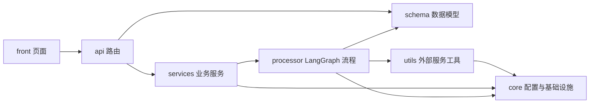

# shopkeeper-brain 带练式重建设计

## 1. 目标与边界

本项目用于重建并学习 `reference/掌教智库` 中的“掌柜智库”知识库问答项目。目标是理解业务、原理、流程和关键 Python 代码，而不是先交付一个脱离原项目的扩展版本。

原项目的主链路为：

范围内包含原项目已有的导入链路、检索链路、Web 服务、流式输出和答案节点。项目完成前不主动加入原项目没有的业务功能。若摸底或验证发现原项目缺陷，单独记录缺陷表现和修正理由，再决定是否修正。

## 2. 参考项目与技术栈

`reference/掌教智库/` 是只读参考区，包含笔记、资料、代码压缩包、视频目录截图和 16 天课堂笔记。参考区不得被修改、格式化、解压覆盖或提交。

根据现有笔记确认的主要技术栈如下，具体版本和实际调用方式以对应章节摸底结果为准：

- Python 3.11 与 uv
- FastAPI、Uvicorn、Pydantic
- LangChain、LangGraph
- DashScope 兼容 OpenAI API 的大语言模型
- OpenAI `text-embedding-v4` 与 BGE-M3 向量模型
- BGE-Reranker-Large 重排序模型
- Milvus 向量数据库
- MongoDB 对话历史
- MinIO 文件和图片存储
- MinerU PDF 转 Markdown
- HTML5 + JavaScript 前端
- SSE 流式输出与 MCP Web 搜索

新项目命名约定：

- 仓库名：`shopkeeper-brain`
- Python 包名：`shopkeeper_brain`
- 配置前缀：`SHOPKEEPER_BRAIN_`
- 当前阶段：尚未开始编写学习代码

## 3. 教学组织

视频目录包含 `day01` 至 `day16`，学习文档按天一一对应，共 16 节。每节独立对应一个会话；上一节未验收通过时，不开始下一节。

每节学习文档固定包含以下内容：

1. 本节能力目标和前置条件
2. 术语小灶
3. 最小探针
4. 从探针暴露问题并逐步改造
5. 用户手敲的完整代码和中文短注释
6. 运行步骤、预期效果和破坏性验证
7. 与参考项目的对照
8. 本节小结、欠账和下一节入口

学习文档只保留三类有效内容：

- 业务、原理、流程
- 手敲代码
- 真实验证

视频目录截图、汇报记录和重复性的过程记录不单独写入学习文档。

## 4. 代码分层与依赖方向

代码目录以参考项目课堂笔记给出的结构为主，初步分层如下：

目录职责：

- `api/`：HTTP 路由和请求入口
- `core/`：配置、路径、依赖和基础设施初始化
- `processor/`：导入流程和查询流程的 LangGraph 状态、节点与主图
- `schema/`：请求、响应和任务状态模型
- `services/`：文件导入和任务管理等业务服务
- `utils/`：Milvus、MongoDB、MinIO、LLM、Embedding、Rerank、SSE 等外部能力封装
- `front/`：HTML 与 JavaScript 页面
- `test/`：测试代码
- `docs/`：教学文档和项目记忆
- `temp_data/`：运行产生的临时数据，具体位置和忽略规则在环境章节确认

这是基于参考笔记的初步地图。进入具体章节后，如果实际代码结构与笔记不一致，以实际代码为准，并在记忆中更新地图。

## 5. 文档与记忆

- `docs/study/`：16 节学习文档
- `docs/study/images/`：教程专用图片；Mermaid 能清楚表达时优先使用 Mermaid
- `docs/memory/`：跨会话项目记忆，包括项目全景、技术事实、验收记录、当前进度和未解决问题
- `docs/superpowers/specs/`：已确认的协作设计文档

进度文件是跨会话的唯一权威状态源。每节状态只能是：`未开始`、`编写中`、`待验收`、`已通过`。测试条数必须来自实际运行输出，不能凭教程预测。

## 6. 验收方式

用户手敲代码后，验收流程如下：

1. 读取用户真实文件，不以教程代码或记忆代替。
2. 将当前学习工程复制到仓库内被忽略的 `workspace/` 实验区，隔离运行产物。
3. 按当前章节的依赖状态运行 uv 同步、构建或测试命令。
4. 至少执行一次破坏性实验，确认关键测试会因预期原因失败，再还原并核对文件差异。
5. 检查测试是否验证行为、输入、过程和结果，而不是只断言数量。
6. 按“必须改 / 建议改 / 可选”给出批改意见。
7. 只有验收通过后，才更新进度和记忆，并生成下一节开始提示词。

需要外部服务的 Milvus、MongoDB、MinIO、模型 API、MinerU 和 MCP 行为，按环境条件分别标记为已验证、失败、跳过或未运行；无法在当前环境复现的行为记录为欠账，不编造通过结果。

## 7. 工作边界

- 用户负责手敲学习代码。
- AI 负责读取参考项目、编写施工图纸、解释原理、验收真实代码和整理文档记忆。
- 用户未明确要求代写时，AI 不直接修改学习代码。
- AI 可以创建和更新教学文档、记忆、规则文件以及验证所需的临时副本。
- `workspace/` 是仓库内被忽略的实验区，临时脚本、复制工程、测试输出和其他实验产物统一放在这里；根目录 `.gitignore` 只为它增加忽略规则。
- Git 只执行只读操作；提交、推送和分支整理由用户执行。
- 敏感配置放环境变量和本地 `.env`，提交 `.env.example`；密钥不得写入文档中的可用值。
