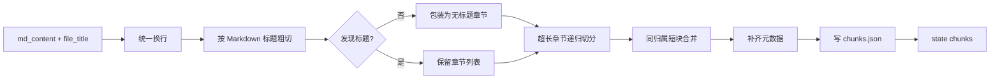

# 第 5 节文档切片设计

## 目标

从第 4 节已经生成的真实 Markdown 出发，新增一个独立的 `NodeDocumentSplit` 学习节点，把长文档整理成可供后续主体识别、向量化和检索使用的 `chunks` 列表。

本节只交付教学文档和施工图纸。学习代码由用户手敲，正式导入主图暂不扩展。

## 输入与输出

节点读取：

- `state["md_content"]`：已经完成图片处理的 Markdown 正文；
- `state["file_title"]`：文档标题；
- `state["md_path"]`：用于在 Markdown 同目录写出 `chunks.json`。

节点写回：

- `state["chunks"]`：切片字典列表；
- 同目录 `chunks.json`：便于人工检查和后续调试。

每个切片至少保留 `title`、`content`、`file_title`；长章节细分时补充 `parent_title`、`part`。

## 处理流程



标题粗切只识别标准 ATX 标题（`#` 到 `######` 后跟空白），并维护代码围栏状态，避免代码示例中的伪标题改变章节边界。超长章节使用 `langchain_text_splitters.RecursiveCharacterTextSplitter`，分隔符优先级为段落、换行、中文标点、英文标点和空格，最大正文长度为 2000 字符，重叠为 0。短块阈值为 500 字符。

## 已确认的实现选择

1. **修正短块归属字段**：参考笔记在初切章节尚未超长时没有提前写入 `parent_title`，会让相邻不同标题的短章节都拥有 `None` 归属并发生错误合并。本节在初切阶段就写入归属标题，保留原流程但修正这一处数据契约缺口。
2. **修正带语言标记的代码围栏识别**：参考正则只匹配单独的 ```，而课堂 Markdown 使用 ```python 等形式。本节让围栏状态机识别开闭围栏及其语言标记，避免代码注释被当成标题。
3. **保持学习期独立入口**：当前项目的 `main_graph.py` 仍是入口路由函数，上一节也保留了节点末尾的真实 `__main__` 入口。本节只新增状态、依赖和切片节点，不提前构建正式主图。
4. **不重复图片链路**：真实验证直接读取第 4 节留下的 `_new.md`，不重新调用 VL 模型、MinIO 或图片替换逻辑。
5. **不新增模拟服务和自动化测试文件**：正常验证使用真实 Markdown、真实课堂 Markdown 和本地 JSON 产物；破坏性实验由 AI 在 `workspace/verification/` 隔离副本完成。

## 文件边界

- 教程新增：`docs/study/day05-文档切片.md`；
- 用户手敲时修改：`pyproject.toml`、`src/shopkeeper_brain/processor/import_processor/state.py`，新增 `src/shopkeeper_brain/processor/import_processor/nodes/node_document_split.py`；
- 后续验收记忆：用户代码验收通过后才新增 `docs/memory/day05-acceptance.md`，并更新 `docs/memory/learning-progress.md`；
- 临时副本和输出：统一放在 `workspace/verification/day05/`；
- `reference/` 始终只读。

## 成功标准

- 教程按“业务流程与设计原因 → 手敲步骤 → 必做真实验证”组织；
- 每个可落盘代码块都有紧邻的 `**文件**：`标记和完整可运行内容；
- 真实 `_new.md` 能生成非空 `chunks`，每个切片保留可追溯元数据；
- `state["chunks"]` 与 `chunks.json` 内容一致；
- 代码围栏中的伪标题不会被当作章节标题；
- 不同标题的短章节不会因 `parent_title` 缺失而跨章节合并；
- 本节教程交付后，进度仍为“编写中”或“待验收”，只有用户代码实机验收通过后才能更新为“已通过”。
