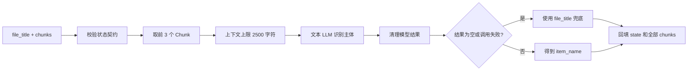

# 第 6 节主体识别设计

## 资料口径

本节按业务编号“day06”组织资料。参考区的物理目录存在一天错位：

- `4.视频/day06/` 的视频目录图片和课堂笔记仍是文档切片；其中的主体识别节点代码还是占位实现。
- `4.视频/day07/` 出现“day06总结”和“主体识别节点的作用”，并包含主体识别的输入校验、上下文构建和向量基础概念。
- `4.视频/day08/` 出现“day07总结”以及商品名识别的 LLM 识别、数据回填、向量生成和 Milvus 相关视频。
- `1.笔记/08【掌柜智库】【导入】【节点5】主体识别.md` 是对应主题的补充长笔记，包含完整节点和后续向量、Milvus 设计。

事实优先级仍为：视频目录图片 → 当天课堂笔记和代码 → `1.笔记/` 补充资料。物理目录错位只记录，不修改参考区。

## 目标

第 5 节已经把真实 Markdown 变成带 `title`、`content`、`file_title`、`parent_title` 的 `chunks` 列表，但每个 Chunk 还没有文档主体名称。第 6 节新增主体识别节点，从文件标题和前几个 Chunk 中识别产品或文档主体，并把一个稳定的 `item_name` 回填到状态和所有 Chunk。

本节只交付教学文档和施工图纸。学习代码由用户手敲，正式主图暂不扩展。

## 教学写法（2026-11-15 修订）

- 方法以只读团购项目 `docs/study/AGENTS.md`、教学风格记忆及第 31、32 节为参照，本项目第 3 节为直接样例；团购工程任何文件均不修改。
- 正文仅保留“业务流程与设计原因 → 手敲步骤 → 必做真实验证”；不再加目标、术语、阶段探针、列账和末尾汇总板块。
- 每块代码就近解释缺口、设计原因和数据走向，图后接白话说明；Python 和模型 API 贴着节点短讲。
- 真实验证以 IDE 直接运行 `__main__` 为主，路径在代码中修改，无需命令行运行参数；说明输入、断点、模型返回、全量回填及失败定位。
- 资料物理分布、验收证据和临时实验结果留在设计、进度或验收记忆，不在教程重复列报。
- 本项目不使用子 agent。当前会话直接完成重构与隔离验证，不修改前五节教程和学习代码。

## 输入与输出

节点读取：

- `state["file_title"]`：入口节点提取的文件标题；
- `state["chunks"]`：第 5 节生成的真实 Chunk 列表。

节点写回：

- `state["item_name"]`：识别出的文档主体名称；
- 每个 `state["chunks"]` 元素的 `item_name`：供后续向量化和入库使用。

本节不写 `chunks.json`，只读取第 5 节已经生成的真实文件作为学习期入口输入。

## 处理流程

## 已确认的实现选择

1. **本节只做到识别和回填**：步骤 1 至步骤 4属于本节；BGE-M3 稠密/稀疏向量留给第 7 节，Milvus 集合和入库留给第 8 节。
2. **采用当天代码的上下文参数**：参考 day07/day08 代码使用 `item_name_chunk_k=3` 和 `item_name_chunk_size=2500`；补充笔记中出现过 K=5 的版本，本节不采用。
3. **使用当前项目的配置风格**：新增文本模型配置读取模块，变量使用 `SHOPKEEPER_BRAIN_` 前缀；不复用视觉模型配置名，也不把密钥写入文档。
4. **保留失败兜底**：上下文为空、文本模型配置不完整、模型返回空内容或调用异常时，使用 `file_title`，并在日志中说明走了兜底路径。
5. **保持学习期独立入口**：不修改当前 `main_graph.py`，在节点文件末尾用 `__main__` 读取真实 `chunks.json`；不重新实现第 5 节的切片和备份。
6. **不新增模拟服务和自动化测试文件**：正常验证使用真实 `chunks.json`；文本模型有真实配置时才调用真实接口，缺少配置就明确跳过远程调用并验证文件标题兜底。
7. **名称保留内部空格**：品牌和型号中的空格有语义，例如 `RS PRO RS-12 数字万用表`。使用当前 LangChain 的 `response.text.strip()` 提取纯文本并仅裁剪首尾空白，兼容字符串和内容块列表，不把列表 `str()` 化，也不固定取第一个块。若配置使用 `SecretStr`，缺失密钥应默认空字符串后再包装，保证走缺少配置的兜底分支。

## 文件边界

- 教程新增：`docs/study/day06-主体识别.md`；
- 用户手敲时修改：`src/shopkeeper_brain/processor/import_processor/state.py`、`.env.example`；
- 用户手敲时新增：`src/shopkeeper_brain/core/llm_config.py`、`src/shopkeeper_brain/processor/import_processor/nodes/node_item_name_recognition.py`；
- 本节不修改：`pyproject.toml`、`main_graph.py`、第 5 节切片节点；当前项目已经有 `langchain-openai`；
- 后续验收记忆：用户代码验收通过后才新增 `docs/memory/day06-acceptance.md`，并更新 `docs/memory/learning-progress.md`；
- 临时副本和输出：统一放在 `workspace/verification/day06/`；
- `reference/` 始终只读。

## 成功标准

- 教程按“业务流程与设计原因 → 手敲步骤 → 必做真实验证”组织；
- 每个可落盘代码块都有紧邻的 `**文件**：`标记和完整可运行内容；
- 真实 `chunks.json` 能构建受限上下文，长度不超过 2500 字符且最多取前 3 个 Chunk；
- 文本模型真实调用成功时得到非空 `item_name`；配置或外部服务不可用时明确走文件标题兜底；
- `state["item_name"]` 和每个 Chunk 的 `item_name`值一致；
- 不调用 BGE-M3、Milvus，不重复第 5 节的代码围栏、切片和 `chunks.json`备份逻辑；
- 本节教程交付后，进度保持“编写中”或“待验收”，只有用户代码实机验收通过后才能更新为“已通过”。
